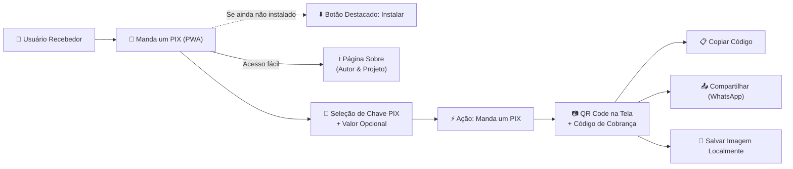

# 📖 Documentação do Sistema — Manda um PIX (`mandaumpix.app`)

> Visão executiva e central de navegação técnica e de negócio da aplicação **Manda um PIX**.

O **Manda um PIX** (`mandaumpix.app`) é um Progressive Web App (PWA) gratuito que facilita a geração rápida de cobranças via PIX sem a necessidade de abrir aplicativos bancários. Para usuários que ainda não instalaram o aplicativo no dispositivo, um botão **"Instalar"** é apresentado de forma destacada, além de contar com fácil acesso a uma página **"Sobre"** que apresenta o aplicativo com informações sobre o **autor** (**Luiz Henrique Canet Filho** — `<me@luizca.net>`) e o **projeto**. O usuário pode cadastrar múltiplas chaves PIX de recebimento, selecionar uma chave, informar opcionalmente um valor (ou mantê-lo aberto/dinâmico) e acionar **"Manda um PIX"** para gerar o **QR Code** e o código **PIX Copia e Cola** para cópia, compartilhamento (ex.: WhatsApp) ou download local da imagem.

---

## 📌 Sumário de Documentação

| Seção               | Descrição                                                                   | Documentos                                                                                                                                                                                                                                    |
| :------------------ | :-------------------------------------------------------------------------- | :-------------------------------------------------------------------------------------------------------------------------------------------------------------------------------------------------------------------------------------------- |
| 💼 **Negócio**      | Proposta de valor, personas, linguagem ubíqua e fluxos de cobrança          | [Visão Geral](./business/overview.md) · [Modelo de Domínio](./business/domain_model.md) · [Fluxos de Trabalho](./business/workflows.md)                                                                                                       |
| 🏛️ **Arquitetura**  | Estilo arquitetural PWA Client-Side, modelo C4, integrações Web APIs e ADRs | [Visão Geral](./architecture/overview.md) · [Modelos C4](./architecture/c4_models.md) · [Integrações](./architecture/integrations.md) · [ADRs](./architecture/decisions/0001-record-architecture-decisions.md)                                |
| 🎨 **Design**       | Organização de módulos, modelo de dados, contratos e proposta de UI         | [Módulos](./design/modules.md) · [Modelo de Dados](./design/data_models.md) · [Especificações e Contratos](./design/api_specs.md) · [Proposta de Interface (UI)](./design/ui_proposal.md) · [Protótipo Navegável](./design/ui_prototype.html) |
| 🚀 **Implantação**  | Pipeline de verificação, build e topologia de hospedagem estática/PWA       | [Pipeline CI/CD](./deployment/pipeline.md) · [Infraestrutura](./deployment/infrastructure.md)                                                                                                                                                 |
| ⚙️ **Configuração** | Variáveis de ambiente, arquivos de configuração e setup local               | [Ambiente](./configuration/environment.md) · [Setup Local](./configuration/local_setup.md)                                                                                                                                                    |
| 🛡️ **Segurança**    | Modelo de acesso local, privacidade de chaves PIX e conformidade            | [Autenticação e Acesso](./security/auth_and_access.md) · [Conformidade e Proteção](./security/compliance.md)                                                                                                                                  |
| 🧰 **Tecnologia**   | Stack tecnológica, runtime, ESM e dependências do projeto                   | [Stack Tecnológica](./technology/stack.md)                                                                                                                                                                                                    |
| 🧪 **Qualidade**    | Estratégia de testes, linting multi-linguagem (ESLint v10) e formatação     | [Estratégia de Testes](./quality/testing_strategy.md) · [Análise Estática](./quality/static_analysis.md)                                                                                                                                      |

---

## 🧭 Mapa Rápido do Sistema

---

## 📊 Status Atual do Repositório

| Dimensão                          | Estado Atual no Código                                          | Referência no Repositório                                                            |
| :-------------------------------- | :-------------------------------------------------------------- | :----------------------------------------------------------------------------------- |
| **Metadados e Manifesto**         | ✅ Configurado (`v1.0.0`, ES Modules `"type": "module"`)        | [`package.json`](../package.json)                                                    |
| **Análise Estática e Formatação** | ✅ ESLint v10 (JS, JSON, CSS, Markdown) + Prettier v3           | [`eslint.config.js`](../eslint.config.js), [`.prettierrc`](../.prettierrc)           |
| **Módulos da Aplicação (PWA)**    | ✅ Entrypoint e funções base em [`src/main.js`](../src/main.js) | [`package.json`](../package.json), [`src/main.js`](../src/main.js)                   |
| **Suíte de Testes Automatizados** | ✅ Configurado (Vitest v5 + JSDOM + Coverage V8)                | [`vitest.config.js`](../vitest.config.js), [`src/main.test.js`](../src/main.test.js) |
| **Hospedagem e Domínio**          | ✅ Definido (Firebase Hosting `dev`/`stg`/`prd` + Name.com TLS) | [`docs/deployment/infrastructure.md`](./deployment/infrastructure.md)                |

---

## 📝 Histórico de Atualizações

Para acompanhar as evoluções desta documentação, consulte o [CHANGELOG de Documentação](./CHANGELOG.md).
