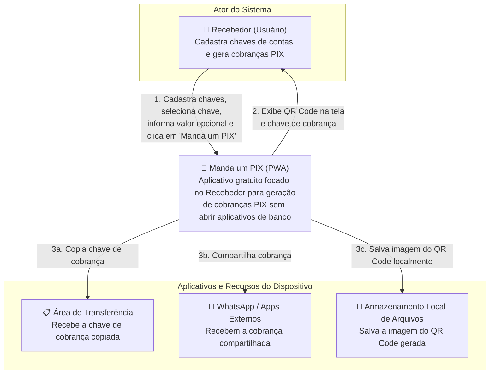
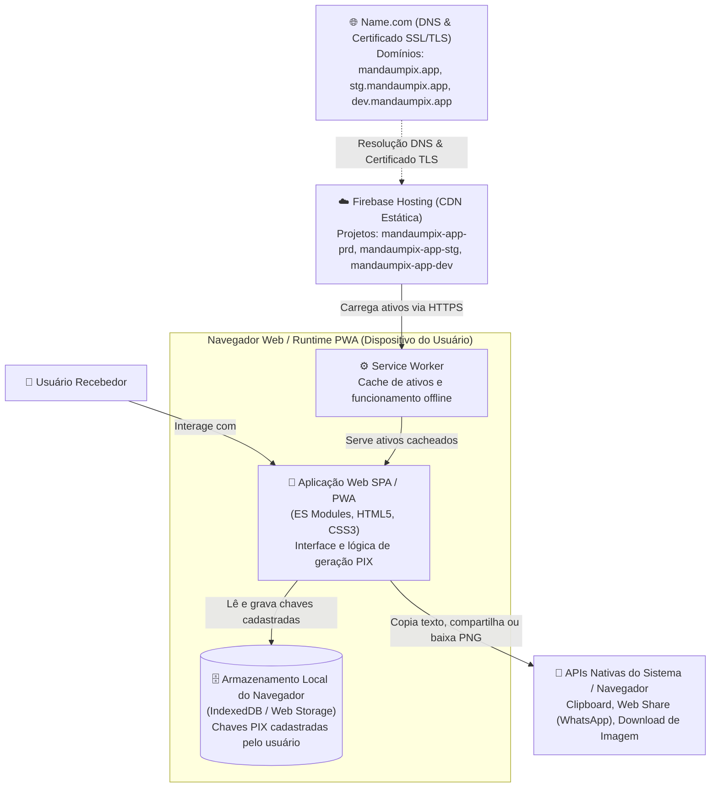
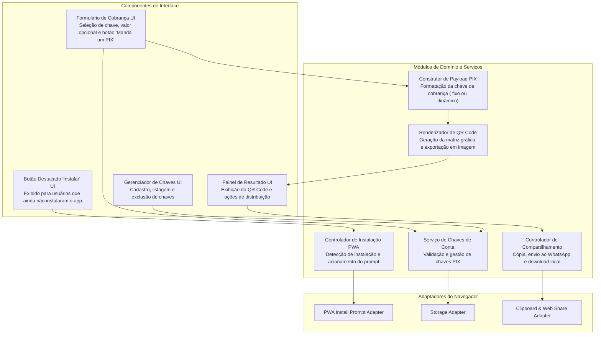

[Início](../README.md) > [Arquitetura](./overview.md) > **Modelos C4**

# 🗺️ Modelos C4 da Arquitetura

Esta página apresenta a arquitetura do **Manda um PIX** segundo o modelo **C4** (Contexto, Contêineres e Componentes).

---

## 1. Nível 1 — Diagrama de Contexto do Sistema

Demonstra como o **Manda um PIX** atende exclusivamente ao **Recebedor** e interage com os recursos e aplicativos do dispositivo.

---

## 2. Nível 2 — Diagrama de Contêineres

Por se tratar de um **PWA Client-Side**, os contêineres de execução residem no navegador do dispositivo do usuário, apoiados pelo **Firebase Hosting** (`mandaumpix-app-dev`, `mandaumpix-app-stg` e `mandaumpix-app-prd`) para distribuição dos artefatos web e pelo **Name.com** para registro do domínio `mandaumpix.app` e fornecimento do certificado SSL/TLS.

---

## 3. Nível 3 — Diagrama de Componentes (Aplicação PWA)

Decomposição lógica dos módulos internos planejados para a aplicação no cliente.

---

⬅️ **Anterior**: [Visão Geral de Arquitetura](./overview.md) | ➡️ **Próximo**: [Integrações Externas](./integrations.md)
