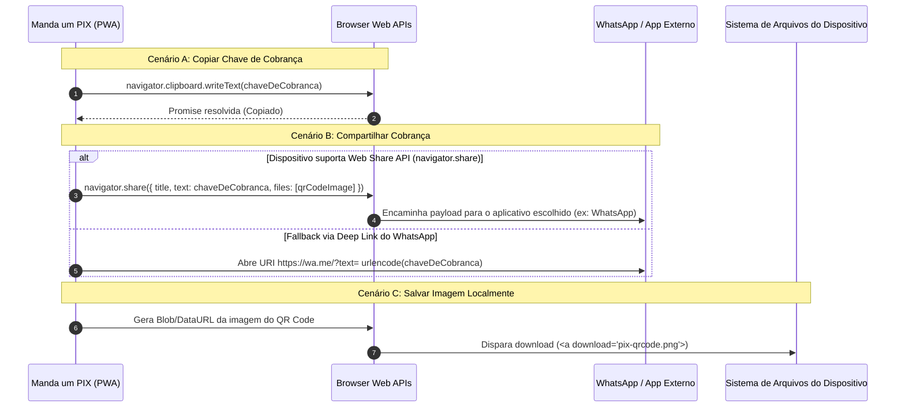

[Início](../README.md) > [Arquitetura](./overview.md) > **Integrações**

# 🔌 Integrações Externas e Interfaces de Plataforma

O **Manda um PIX** opera sem acoplamento direto a APIs proprietárias de instituições bancárias (não exige login bancário nem chaves de API de bancos), integrando-se ao ecossistema de pagamentos e compartilhamento por meio de padrões abertos e APIs nativas do navegador.

---

## 📋 Matriz de Integrações

| Integração / Padrão                                                            | Tipo                                        |      Direção      | Finalidade no Manda um PIX                                                                                                                             |
| :----------------------------------------------------------------------------- | :------------------------------------------ | :---------------: | :----------------------------------------------------------------------------------------------------------------------------------------------------- |
| **Padrão PIX BR Code (EMV® QRCPS-MPM)**                                        | Protocolo / Formato de Dados Aberto (BACEN) |   Geração Local   | Estruturar a chave de cobrança (PIX Copia e Cola) e o conteúdo do QR Code de forma universalmente reconhecida por qualquer banco brasileiro.           |
| **Clipboard API (`navigator.clipboard`)**                                      | Web API Nativa                              |  Escrita (Saída)  | Permitir ao usuário copiar a chave de cobrança gerada com um toque.                                                                                    |
| **Web Share API (`navigator.share`) / Deep Link WhatsApp (`https://wa.me/`)**  | Web API Nativa / URI Scheme                 |       Saída       | Compartilhar a chave de cobrança e/ou a imagem do QR Code diretamente com o **WhatsApp** e outros aplicativos instalados no dispositivo.               |
| **HTML5 Canvas / Blob Download (`a[download]`)**                               | Web API Nativa                              |  Saída (Arquivo)  | Converter o QR Code exibido na tela em um arquivo de imagem e salvá-lo no armazenamento local do dispositivo.                                          |
| **IndexedDB API (`window.indexedDB`)**                                         | Web API Nativa (Banco NoSQL Transacional)   | Leitura / Escrita | Persistir localmente de forma assíncrona e transacional os dados do usuário (chaves de contas cadastradas e preferências/seleção ativa) no navegador.  |
| **PWA Install Prompt (`beforeinstallprompt` / `appinstalled` / `matchMedia`)** | Web API Nativa / Manifesto PWA              | Eventos / Entrada | Detectar quando o aplicativo ainda não está instalado no dispositivo, exibir de forma destacada o botão **"Instalar"** e disparar a instalação nativa. |

---

## 🔄 Fluxo de Integração com Aplicativos Externos (WhatsApp e Download)

---

⬅️ **Anterior**: [Modelos C4](./c4_models.md) | ➡️ **Próximo**: [ADR 0001: Registro de Decisões Arquiteturais](./decisions/0001-record-architecture-decisions.md)
