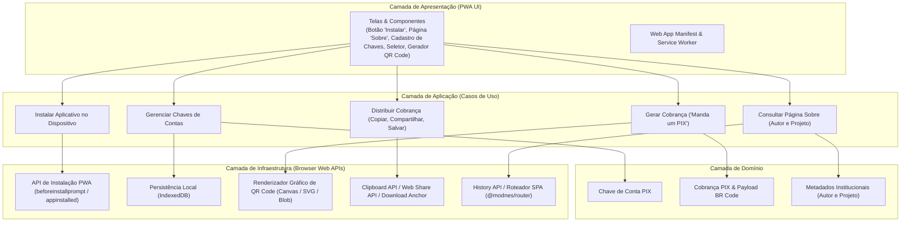

[Início](../README.md) > **Arquitetura: Visão Geral**

# 🏛️ Visão Geral de Arquitetura

## 🏗️ Estilo Arquitetural

O **Manda um PIX** (`mandaumpix.app`) é concebido como uma aplicação **Progressive Web App (PWA) Client-Side (Local-First)** baseada em **ES Modules nativos** (`"type": "module"` em [`package.json`](../../package.json)) e executada diretamente no navegador (`globals.browser` em [`eslint.config.js`](../../eslint.config.js)).

### Princípios Arquiteturais

1. **Execução Client-Side e Autossuficiência (Zero-Backend para Operações Core)**:
   - O cadastro de chaves de contas, a montagem da chave de cobrança PIX (padrão EMV® BR Code) e a renderização da imagem do QR Code acontecem integralmente no dispositivo do usuário.
   - Não há necessidade de intermediar credenciais bancárias nem reter chaves PIX em servidores remotos para gerar cobranças estáticas/dinâmicas no padrão PIX Copia e Cola.
2. **Capacidades de PWA (Progressive Web App)**:
   - Instalável em dispositivos móveis e desktops, apresentando de forma destacada um botão **"Instalar"** para usuários que ainda não instalaram o aplicativo no dispositivo.
   - Operação rápida e resiliente mesmo em conexões instáveis, uma vez que a geração do QR Code e da chave de cobrança é matemática e determinística no cliente.
3. **Integração Nativa com a Plataforma Web**:
   - Uso de APIs padronizadas do navegador (Instalação PWA via `BeforeInstallPromptEvent` e `matchMedia('(display-mode: standalone)')`, Persistência Local Assíncrona de Dados do Usuário via **IndexedDB**, Clipboard API, Web Share API / Deep Links para WhatsApp, Canvas/Blob Download).
4. **Padronização e Qualidade Multi-Linguagem**:
   - Código-fonte JavaScript, folhas de estilo CSS, arquivos de configuração JSON e documentação Markdown são verificados estaticamente por uma configuração unificada no [`eslint.config.js`](../../eslint.config.js) combinada ao [`prettier`](../../package.json).

---

## 🧭 Visão Arquitetural em Camadas (Alvo do PWA)

---

## 📑 Navegação da Seção de Arquitetura

- [Modelos C4 (Contexto, Contêineres e Componentes)](./c4_models.md)
- [Integrações Externas e APIs do Navegador](./integrations.md)
- [Registros de Decisão Arquitetural (ADRs)](./decisions/0001-record-architecture-decisions.md)
  - [ADR 0001: Registro de Decisões Arquiteturais](./decisions/0001-record-architecture-decisions.md)
  - [ADR 0002: Arquitetura PWA Client-Side com ES Modules e Linting Multi-Linguagem](./decisions/0002-arquitetura-pwa-client-side-es-modules.md)
  - [ADR 0003: Hospedagem em Firebase Hosting Multi-Ambiente e Domínio no Name.com](./decisions/0003-hospedagem-firebase-hosting-e-dominio-name-com.md)
  - [ADR 0004: Persistência Local de Dados do Usuário com IndexedDB](./decisions/0004-persistencia-local-indexeddb.md)

---

⬅️ **Anterior**: [Backlog do Produto](../business/backlog.md) | ➡️ **Próximo**: [Modelos C4](./c4_models.md)
