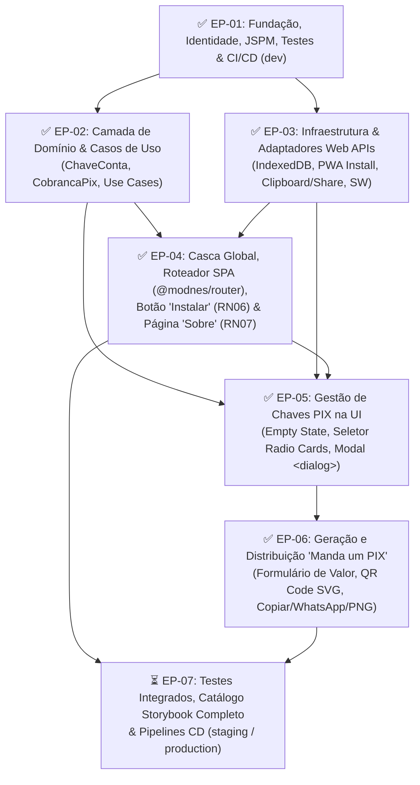
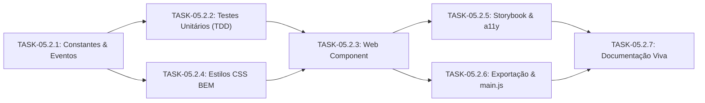
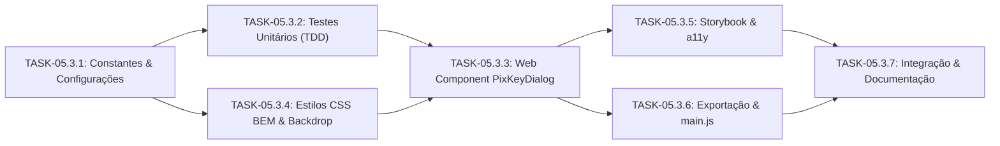
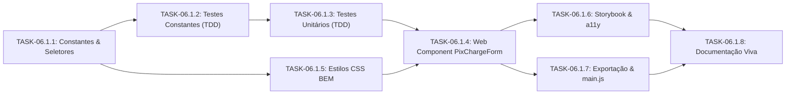
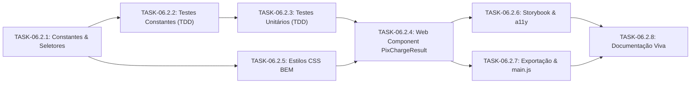
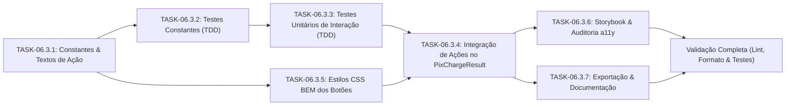
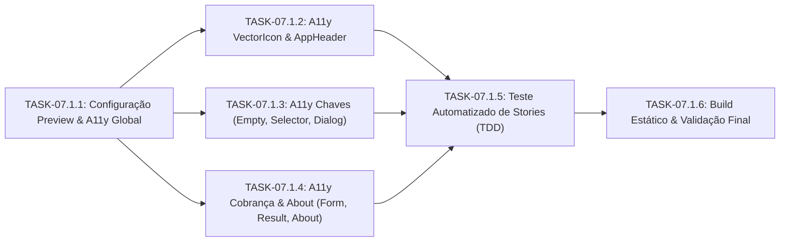

[Início](../README.md) > [Negócio](./overview.md) > **Backlog do Produto**

# 📋 Backlog Completo de Desenvolvimento (`mandaumpix.app`)

Este documento consolida o **Backlog do Produto e de Engenharia** do **Manda um PIX** (`mandaumpix.app`), estruturado em **Épicos**, **Histórias de Usuário / Tarefas Técnicas** e **Critérios de Aceite** rastreáveis às regras de negócio (`RN01` a `RN07`), à [Arquitetura em Camadas](../architecture/overview.md), ao [Design de Módulos](../design/modules.md) e à [Proposta de Interface (UI)](../design/ui_proposal.md).

---

## 📊 Visão Executiva e Progresso por Épico

| ID        | Épico                                                                      | Regras / Escopo                                     | Progresso Atual | Status       |
| :-------- | :------------------------------------------------------------------------- | :-------------------------------------------------- | :-------------: | :----------- |
| **EP-01** | Fundação, Ferramental, Identidade Visual e CI/CD (`dev`)                   | Infraestrutura base, ESM/JSPM, Qualidade, Storybook |     `6 / 6`     | ✅ Concluído |
| **EP-02** | Camada de Domínio e Casos de Uso (Clean Architecture)                      | `RN01`, `RN02`, `RN03`, `RN04`, `RN05`, `RN06`      |     `5 / 5`     | ✅ Concluído |
| **EP-03** | Camada de Infraestrutura e Adaptadores Web APIs (Local-First)              | `RN01`, `RN05`, `RN06`, Offline/Service Worker      |     `4 / 4`     | ✅ Concluído |
| **EP-04** | Casca da Aplicação, Roteamento SPA, Botão "Instalar" e Página "Sobre"      | `RN06`, `RN07`, `@modnes/router`, Layout Split-View |     `4 / 4`     | ✅ Concluído |
| **EP-05** | Gestão de Chaves PIX na Interface (`<pix-key-*>`)                          | `RN01`, `RN02`, `<dialog class="key-dialog">`       |     `3 / 3`     | ✅ Concluído |
| **EP-06** | Geração, Exibição e Distribuição de Cobrança ("Manda um PIX")              | `RN02`, `RN03`, `RN04`, `RN05`, QR Code & Saídas    |     `3 / 3`     | ✅ Concluído |
| **EP-07** | Qualidade Ponta a Ponta, Acessibilidade (WCAG 2.2 AA) e Deploy `stg`/`prd` | Testes de Integração, Storybook a11y, Releases      |     `0 / 3`     | ⏳ Pendente  |

---

## 🗺️ Roadmap e Grafo de Dependências de Desenvolvimento

---

## 🧱 Detalhamento dos Épicos e Histórias de Usuário

### 📦 Épico 01 — Fundação, Ferramental, Identidade Visual e CI/CD (`dev`)

> **Objetivo**: Estabelecer a base arquitetural Zero-Build com ES Modules nativos e JSPM, licenciamento livre `AGPL-3.0-only`, linters multi-linguagem, testes unitários, ícones oficiais, Design Tokens, componente `<vector-icon>` e esteira de CI/CD para o ambiente `development`.

| ID          | Item de Backlog                                                                  | Status       | Artefatos no Repositório                                                                                                                                                               |
| :---------- | :------------------------------------------------------------------------------- | :----------- | :------------------------------------------------------------------------------------------------------------------------------------------------------------------------------------- |
| **US-01.1** | Configuração de ES Modules nativos, JSPM, Import Map W3C, `modulepreload` e SRI  | ✅ Concluído | [`package.json`](../../package.json), [`importmap.js`](../../importmap.js), [`index.html`](../../index.html)                                                                           |
| **US-01.2** | Licenciamento GNU AGPL v3.0 (`AGPL-3.0-only`), ESLint v10 Flat Config e Prettier | ✅ Concluído | [`LICENSE`](../../LICENSE), [`eslint.config.js`](../../eslint.config.js), [`.prettierrc`](../../.prettierrc)                                                                           |
| **US-01.3** | Configuração do Vitest + JSDOM + Cobertura V8                                    | ✅ Concluído | [`vitest.config.js`](../../vitest.config.js), [`src/main.test.js`](../../src/main.test.js)                                                                                             |
| **US-01.4** | Criação do logotipo vetorial, ícones de instalação e `manifest.json`             | ✅ Concluído | [`src/assets/icons/`](../../src/assets/icons/icon.svg), [`manifest.json`](../../manifest.json)                                                                                         |
| **US-01.5** | Design Tokens CSS, Reset, Storybook v10 e Web Component `<vector-icon>`          | ✅ Concluído | [`src/presentation/styles/tokens.css`](../../src/presentation/styles/tokens.css), [`vector-icon.component.js`](../../src/presentation/components/vector-icon/vector-icon.component.js) |
| **US-01.6** | Workflows GitHub Actions de CI e CD automático para `dev.mandaumpix.app`         | ✅ Concluído | [`.github/workflows/ci.yml`](../../.github/workflows/ci.yml), [`.github/workflows/deploy-dev.yml`](../../.github/workflows/deploy-dev.yml)                                             |

---

### 🧠 Épico 02 — Camada de Domínio e Casos de Uso (Clean Architecture)

> **Objetivo**: Implementar as entidades puras de domínio, validações de regras de negócio (`RN01`–`RN07`) e casos de uso desacoplados de frameworks e do DOM, guiados por TDD.

#### `US-02.1` — Funções Base de Geração e Parsing de Cobrança PIX (`✅ Concluído`)

- **Descrição**: Implementar as funções puras de geração de payload BR Code (`generatePixCharge`), validação/parsing (`parsePixCharge`) e exportação gráfica (`exportQrCodePng`) integrando `pix-utils` e `qr`.
- **Artefatos**: [`src/main.js`](../../src/main.js), [`src/main.test.js`](../../src/main.test.js).

#### `US-02.2` — Entidade `ChaveConta` e Validador de Chaves PIX (`✅ Concluído` · `3 Story Points`)

- **História (Narrativa Canônica)**:
  > **Como** **Recebedor** que cadastra contas no Manda um PIX,
  > **Quero** que minhas chaves PIX (`CPF`, `CNPJ`, `EMAIL`, `TELEFONE`, `EVP`) e os dados do titular (`nome_recebedor`, `cidade_recebedor`, `rotulo`) sejam validados e normalizados segundo o padrão EMV® / BR Code do Banco Central no momento do cadastro,
  > **Para que** apenas chaves íntegras sejam salvas no dispositivo e eu evite a geração de códigos BR Code inválidos ou rejeitados pelos aplicativos bancários.
- **Regras de Negócio e Invariantes**: `RN01` ([Modelo de Domínio](./domain_model.md), [Modelo de Dados](../design/data_models.md) e [Especificações EMV](../design/api_specs.md)).
  - **INV-01 (`CPF`)**: Sanitização de máscara (`[^\d]`), 11 dígitos numéricos, rejeição de dígitos repetidos (`000...` a `999...`) e validação dos 2 dígitos verificadores (Módulo 11).
  - **INV-02 (`CNPJ`)**: Sanitização de máscara (`[^\d]`), 14 dígitos numéricos, rejeição de dígitos repetidos e validação dos 2 dígitos verificadores (Módulo 11).
  - **INV-03 (`EMAIL`)**: Normalização `trim()` + `toLowerCase()`, formato de e-mail válido e comprimento máximo `<= 77` caracteres (limite DICT/BACEN).
  - **INV-04 (`TELEFONE`)**: Normalização para padrão internacional E.164 (`+55DDD9XXXXXXXX`, 14 caracteres totais com DDD válido `11..99` e nono dígito `9`).
  - **INV-05 (`EVP`)**: Normalização `trim()` + `toLowerCase()` e validação estrita de UUID v4 (`36` caracteres hifenizados).
  - **INV-06 (`nome_recebedor` — Tag EMV `59`)**: Obrigatório; remoção de acentos (`NFD`) e caracteres não-ASCII, conversão para `UPPERCASE`, colapso de espaços e truncamento seguro em até `25` caracteres.
  - **INV-07 (`cidade_recebedor` — Tag EMV `60`)**: Obrigatório; remoção de acentos (`NFD`) e caracteres não-ASCII, conversão para `UPPERCASE`, colapso de espaços e truncamento seguro em até `15` caracteres.
  - **INV-08 (Identidade & Imutabilidade)**: Geração automática de `id` (`crypto.randomUUID()`), `criado_em` (ISO-8601), normalização de `rotulo` (com fallback amigável por tipo) e congelamento da instância (`Object.freeze`).
- **Critérios de Aceite (BDD / Gherkin)**:
  - **Cenário 01 (CPF e CNPJ com máscara)**: Dado um CPF (`123.456.789-09`) ou CNPJ (`11.222.333/0001-81`) válido com pontuação, quando `ChaveConta.create()` for invocado, então `valor_chave` deve ser normalizado apenas com dígitos (`12345678909` / `11222333000181`) e a instância imutável criada com sucesso.
  - **Cenário 02 (E-mail, Telefone e EVP válidos)**: Dado um e-mail (`<= 77` chars), telefone celular brasileiro ou chave EVP UUID v4 válidos, quando `ChaveConta.create()` for invocado, então `valor_chave` deve ser normalizado (`lowercase` para e-mail/EVP e `+55DDD9XXXXXXXX` para telefone).
  - **Cenário 03 (Normalização EMV de Titular e Cidade)**: Dado `nome_recebedor` `"João da Silva Júnior & Cia Ltda"` (`31` chars com acentos/símbolos) e `cidade_recebedor` `"São José dos Campos"` (`19` chars), quando a entidade for criada, então `nome_recebedor` deve resultar em `"JOAO DA SILVA JUNIOR CIA"` (`<= 25` chars) e `cidade_recebedor` em `"SAO JOSE DOS CA"` (`<= 15` chars).
  - **Cenário 04 (Rejeição de Chaves Inválidas)**: Dado um `tipo_chave` desconhecido ou um `valor_chave` inválido (CPF/CNPJ com DV incorreto ou dígitos repetidos, e-mail `> 77` chars, telefone fora do padrão móvel nacional ou UUID malformado), quando a criação for acionada, então deve lançar `PixKeyValidationError` indicando o motivo da falha.
- **Tarefas de Desenvolvimento (Dev Tasks)**:
  - [x] **TASK-02.2.1 (Domínio / Erros & Constantes)**: Definir constantes `PIX_KEY_TYPES`, `DEFAULT_PIX_KEY_LABELS`, `PIX_KEY_ERROR_CODES` e a classe de erro `PixKeyValidationError` em [`src/domain/entities/pix-key.entity.js`](../../src/domain/entities/pix-key.entity.js) com testes unitários em [`src/domain/entities/pix-key.entity.test.js`](../../src/domain/entities/pix-key.entity.test.js).
  - [x] **TASK-02.2.2 (TDD / Validadores de Chave PIX)**: Criar testes unitários e implementar funções puras de validação e sanitização para `CPF`, `CNPJ`, `EMAIL`, `TELEFONE` e `EVP` (`validateAndNormalizePixKey`) em [`src/domain/entities/pix-key.entity.js`](../../src/domain/entities/pix-key.entity.js).
  - [x] **TASK-02.2.3 (TDD / Normalizadores EMV)**: Criar testes unitários e implementar normalizadores `normalizeMerchantName` (`<= 25` chars) e `normalizeMerchantCity` (`<= 15` chars) compatíveis com EMV® QRCPS-MPM e `pix-utils` em [`src/domain/entities/pix-key.entity.js`](../../src/domain/entities/pix-key.entity.js).
  - [x] **TASK-02.2.4 (TDD / Entidade `ChaveConta`)**: Implementar a classe/fábrica imutável `ChaveConta` (`PixKeyEntity`) em [`src/domain/entities/pix-key.entity.js`](../../src/domain/entities/pix-key.entity.js) (`id`, `rotulo`, `tipo_chave`, `valor_chave`, `nome_recebedor`, `cidade_recebedor`, `criado_em`, `toJSON()`) com suíte completa em [`src/domain/entities/pix-key.entity.test.js`](../../src/domain/entities/pix-key.entity.test.js) (`100%` de cobertura nas regras).
  - [x] **TASK-02.2.5 (Integração & Exportação)**: Reexportar `ChaveConta` / `PixKeyValidationError` em [`src/main.js`](../../src/main.js) e validar pipeline de qualidade (`npm run lint`, `npm run format:check`, `npm run test:coverage`).

#### `US-02.3` — Entidade `CobrancaPix` e Caso de Uso `GeneratePixChargeUseCase` (`✅ Concluído` · `3 Story Points`)

- **História (Narrativa Canônica)**:
  > **Como** **Recebedor** que utiliza o Manda um PIX,
  > **Quero** gerar uma cobrança PIX a partir de uma `ChaveConta` selecionada, informando opcionalmente um valor monetário fixo ou mantendo o valor dinâmico (em aberto),
  > **Para que** eu obtenha simultaneamente o código **PIX Copia e Cola** (`chave_cobranca` no padrão EMV® BR Code com CRC16 válido) e a representação gráfica do **QR Code** (`imagem_qrcode`) prontos para leitura óptica ou compartilhamento imediato.
- **Regras de Negócio e Invariantes**: `RN02`, `RN03`, `RN04` ([Modelo de Domínio](./domain_model.md), [Modelo de Dados](../design/data_models.md) e [Especificações EMV](../design/api_specs.md)).
  - **INV-01 (`RN02` — Seleção Obrigatória de `ChaveConta`)**: A emissão exige uma `ChaveConta` válida (instância de `ChaveConta` ou objeto hidratável via `ChaveConta.fromJSON()`). Quando ausente ou nula, lança `PixChargeValidationError` com código `MISSING_PIX_KEY`; quando malformada, propaga/lança erro de validação (`INVALID_PIX_KEY`).
  - **INV-02 (`RN03` — Modalidade de Valor Dinâmico / Aberto)**: Quando `valor_opcional` for omitido (`undefined`), `null`, string vazia (`""`) ou zero (`0`, `"0"`, `"0,00"`, `"0.00"`), define `valor_opcional = null` e `valor_dinamico = true`, omitindo a tag EMV `54` (_Transaction Amount_) do payload BR Code.
  - **INV-03 (`RN03` — Modalidade de Valor Fixo e Sanitização Monetária BRL)**: Quando `valor_opcional` for positivo (numérico como `42.5` ou string monetária como `"42,50"` / `"R$ 1.234,56"`), normaliza para `Number` com duas casas decimais (`42.5`), define `valor_dinamico = false` e inclui a tag EMV `54` formatada (`"42.50"`). Rejeita valores negativos (`< 0`), `NaN`, `Infinity` ou acima de `999999999.99` com `PixChargeValidationError` (`INVALID_AMOUNT`).
  - **INV-04 (Identificador de Transação `txid` — Tag EMV `62` / Subtag `05`)**: Assume `"***"` por padrão quando omitido ou vazio; se informado, deve conter apenas caracteres alfanuméricos ASCII (`1` a `25` caracteres) ou `"***"`, lançando `PixChargeValidationError` (`INVALID_TXID`) caso contrário.
  - **INV-05 (`RN04` — Geração Simultânea de BR Code e QR Code)**: Produz deterministicamente `chave_cobranca` (`brCode` EMV® iniciado por `000201` e finalizado pelo `CRC16` na tag `63`) e `imagem_qrcode` (objeto imutável contendo `svg`, `dataUrl` e `gifBytes`).
  - **INV-06 (Imutabilidade e Rastreabilidade)**: Registra `id_chave_conta` (`chaveConta.id`), `chave_conta` (instância `ChaveConta`), `valor_opcional`, `valor_dinamico`, `txid`, `info_adicional`, `chave_cobranca`, `imagem_qrcode` e `gerado_em` (ISO-8601), expondo `toJSON()` e congelando a instância com `Object.freeze()`.
  - **INV-07 (Orquestração no Caso de Uso `GeneratePixChargeUseCase`)**: Aceita uma `chaveConta` direta no input ou resolve a chave ativa via porta opcional `pixKeyRepository`, executa a geração da `CobrancaPix` e retorna o resultado pronto para a camada de apresentação.
- **Critérios de Aceite (BDD / Gherkin)**:
  - **Cenário 01 (Cobrança com Valor Fixo — `RN02`, `RN03`, `RN04`)**: Dada uma `ChaveConta` válida selecionada e um `valor_opcional` de `42.5` (ou `"42,50"`), quando `GeneratePixChargeUseCase.execute()` for invocado, então deve retornar uma `CobrancaPix` imutável com `valor_opcional = 42.5`, `valor_dinamico = false`, `chave_cobranca` contendo a tag EMV `54` (`"540542.50"`) e `imagem_qrcode` preenchida (`svg`, `dataUrl`, `gifBytes`).
  - **Cenário 02 (Cobrança com Valor Dinâmico/Aberto — `RN03`, `RN04`)**: Dada uma `ChaveConta` válida selecionada e `valor_opcional` omitido, nulo, vazio ou `0`, quando `GeneratePixChargeUseCase.execute()` for invocado, então deve retornar uma `CobrancaPix` com `valor_opcional = null`, `valor_dinamico = true`, `chave_cobranca` sem a tag EMV `54` (`transactionAmount = 0` no parser) e `imagem_qrcode` válida.
  - **Cenário 03 (Bloqueio sem Chave Selecionada — `RN02`)**: Dado que nenhuma `ChaveConta` foi informada (ou o repositório não possui chave ativa selecionada), quando a geração for acionada, então deve lançar `PixChargeValidationError` com código `MISSING_PIX_KEY`.
  - **Cenário 04 (Rejeição de Valor Monetário ou `txid` Inválido)**: Dada uma `ChaveConta` válida, quando `valor_opcional` for negativo (`-10`), malformado (`"abc"`), acima do limite EMV ou `txid` contiver símbolos inválidos/exceder `25` caracteres, então deve lançar `PixChargeValidationError` (`INVALID_AMOUNT` ou `INVALID_TXID`).
- **Tarefas de Desenvolvimento (Dev Tasks)**:
  - [x] **TASK-02.3.1 (Domínio / Erros, Constantes & Sanitizadores de Cobrança)**: Definir `PIX_CHARGE_ERROR_CODES`, `PixChargeValidationError`, `normalizeTransactionAmount` (suporte a `number`, strings BRL `"1.234,56"`, `null`/`0` como valor aberto) e `normalizeTxid` em [`src/domain/entities/pix-charge.entity.js`](../../src/domain/entities/pix-charge.entity.js) com testes unitários em [`src/domain/entities/pix-charge.entity.test.js`](../../src/domain/entities/pix-charge.entity.test.js).
  - [x] **TASK-02.3.2 (TDD / Entidade Imutável `CobrancaPix`)**: Implementar a classe/fábrica `CobrancaPix` (`PixChargeEntity`) em [`src/domain/entities/pix-charge.entity.js`](../../src/domain/entities/pix-charge.entity.js) validando a associação obrigatória com `ChaveConta` (`RN02`), `valor_opcional` e `valor_dinamico` (`RN03`), `chave_cobranca` e `imagem_qrcode` (`RN04`), `gerado_em` e `toJSON()`, com cobertura unitária de `100%`.
  - [x] **TASK-02.3.3 (TDD / Caso de Uso `GeneratePixChargeUseCase`)**: Implementar `GeneratePixChargeUseCase` (e helper funcional `executeGeneratePixCharge`) em [`src/application/use-cases/generate-pix-charge.use-case.js`](../../src/application/use-cases/generate-pix-charge.use-case.js) com testes unitários em [`src/application/use-cases/generate-pix-charge.use-case.test.js`](../../src/application/use-cases/generate-pix-charge.use-case.test.js) cobrindo execução síncrona/assíncrona, resolução via `pixKeyRepository` mockado, valor fixo, valor aberto e tratamento de falhas.
  - [x] **TASK-02.3.4 (Integração, Reexportação & Qualidade)**: Integrar `CobrancaPix` e `GeneratePixChargeUseCase` em [`src/main.js`](../../src/main.js) (mantendo retrocompatibilidade com `generatePixCharge`), atualizar [`src/main.test.js`](../../src/main.test.js) e validar `npm run lint`, `npm run format:check` e `npm run test:coverage`.

#### `US-02.4` — Casos de Uso de Gestão de Chaves de Contas (`✅ Concluído` · `3 Story Points`)

- **História (Narrativa Canônica)**:
  > **Como** **Recebedor** que utiliza o Manda um PIX para receber em diferentes contas bancárias,
  > **Quero** cadastrar novas chaves PIX, listar minhas chaves salvas, selecionar a chave ativa para emissão de cobrança e remover chaves que não utilizo mais, mantendo automaticamente uma chave válida selecionada sempre que houver ao menos uma conta cadastrada,
  > **Para que** eu possa gerenciar minhas contas de recebimento sem duplicidades e emitir cobranças PIX em poucos toques sem redigitar dados.
- **Regras de Negócio e Invariantes**: `RN01`, `RN02` ([Modelo de Domínio](./domain_model.md), [Modelo de Dados](../design/data_models.md) e [Especificações e Contratos](../design/api_specs.md)).
  - **INV-01 (Contrato da Porta `pixKeyRepository`)**: Todos os casos de uso exigem um repositório válido (`findAll`, `save`, `deleteById`, `getSelectedKeyId`, `setSelectedKeyId`). Quando ausente ou inválido, lançam `PixKeyManagementError` com código `MISSING_PIX_KEY_REPOSITORY`.
  - **INV-02 (`RN01` — Validação, Hidratação e Prevenção de Duplicidade no Cadastro — `SavePixKeyUseCase`)**: Os dados de entrada são validados/hidratados via `ChaveConta.create()` (propagando `PixKeyValidationError` quando inválidos). Rejeita o cadastro de outra chave com o mesmo par normalizado `(tipo_chave, valor_chave)` e `id` distinto com `PixKeyManagementError` (`DUPLICATE_PIX_KEY`).
  - **INV-03 (`RN01`, `RN02` — Auto-Seleção no Cadastro — `SavePixKeyUseCase`)**: Ao persistir uma chave, define-a automaticamente como selecionada (`setSelectedKeyId(chaveConta.id)`) quando for a primeira chave cadastrada, quando não houver chave ativa válida ou quando `selectAsActive = true`.
  - **INV-04 (`RN01`, `RN02` — Listagem Hidratada e Auto-Recuperação de Seleção — `ListPixKeysUseCase`)**: Retorna a lista imutável de instâncias `ChaveConta` (`items`), `selectedKeyId` e `selectedKey`. Caso existam chaves salvas e `selectedKeyId` seja nulo ou órfão, reatribui automaticamente a primeira chave disponível (`items[0].id`); caso não existam chaves, garante `selectedKeyId = null` e `selectedKey = null`.
  - **INV-05 (`RN02` — Seleção Explícita de Chave Ativa — `SelectPixKeyUseCase`)**: Exige um `id` não vazio (`MISSING_PIX_KEY_ID`) pertencente a uma `ChaveConta` existente no repositório (`PIX_KEY_NOT_FOUND`), persiste `setSelectedKeyId(id)` e retorna `{ selectedKeyId, selectedKey }`.
  - **INV-06 (`RN01`, `RN02` — Exclusão e Reatribuição Automática da Chave Ativa — `DeletePixKeyUseCase`)**: Exige um `id` válido e existente (`MISSING_PIX_KEY_ID` / `PIX_KEY_NOT_FOUND`), remove a chave via `deleteById(id)` e, caso a chave excluída fosse a ativa (ou a seleção estivesse órfã), seleciona automaticamente a primeira chave remanescente (`remaining[0].id`) ou define `selectedKeyId = null` se a coleção ficar vazia.
- **Critérios de Aceite (BDD / Gherkin)**:
  - **Cenário 01 (Cadastro da Primeira Chave com Auto-Seleção — `RN01`, `RN02`)**: Dado que o repositório está vazio, quando `SavePixKeyUseCase.execute()` for invocado com dados válidos de `ChaveConta`, então a chave deve ser persistida e definida automaticamente como a chave ativa (`selectedKeyId = chave.id`).
  - **Cenário 02 (Cadastro de Múltiplas Chaves e Bloqueio de Duplicidade — `RN01`)**: Dado que já existe uma chave ativa cadastrada, quando uma nova chave distinta for salva, ela deve ser adicionada à coleção mantendo a seleção vigente (ou assumindo a seleção se `selectAsActive = true`); se possuir o mesmo `(tipo_chave, valor_chave)` de outra chave existente, deve lançar `PixKeyManagementError` (`DUPLICATE_PIX_KEY`).
  - **Cenário 03 (Listagem e Troca de Chave Selecionada — `RN01`, `RN02`)**: Dadas múltiplas chaves salvas, quando `SelectPixKeyUseCase.execute({ id })` e `ListPixKeysUseCase.execute()` forem invocados, então `selectedKeyId` e `selectedKey` devem refletir a chave escolhida; se o `id` informado não existir, deve lançar `PixKeyManagementError` (`PIX_KEY_NOT_FOUND`).
  - **Cenário 04 (Remoção da Chave Ativa e Reatribuição / Limpeza — `RN01`, `RN02`)**: Dada uma chave ativa selecionada, quando `DeletePixKeyUseCase.execute({ id })` removê-la, então a seleção deve ser reatribuída automaticamente para a primeira chave remanescente (ou `null` quando a última chave for excluída).
- **Tarefas de Desenvolvimento (Dev Tasks)**:
  - [x] **TASK-02.4.1 (TDD / Erros de Gestão & Caso de Uso `SavePixKeyUseCase`)**: Definir `PIX_KEY_MANAGEMENT_ERROR_CODES`, `PixKeyManagementError` e implementar `SavePixKeyUseCase` (`executeSavePixKey`) em [`src/application/use-cases/save-pix-key.use-case.js`](../../src/application/use-cases/save-pix-key.use-case.js) com testes unitários em [`src/application/use-cases/save-pix-key.use-case.test.js`](../../src/application/use-cases/save-pix-key.use-case.test.js).
  - [x] **TASK-02.4.2 (TDD / Caso de Uso `ListPixKeysUseCase`)**: Implementar `ListPixKeysUseCase` (`executeListPixKeys`) em [`src/application/use-cases/list-pix-keys.use-case.js`](../../src/application/use-cases/list-pix-keys.use-case.js) com testes unitários em [`src/application/use-cases/list-pix-keys.use-case.test.js`](../../src/application/use-cases/list-pix-keys.use-case.test.js) cobrindo hidratação, estado vazio e auto-recuperação de `selectedKeyId` órfão.
  - [x] **TASK-02.4.3 (TDD / Caso de Uso `SelectPixKeyUseCase`)**: Implementar `SelectPixKeyUseCase` (`executeSelectPixKey`) em [`src/application/use-cases/select-pix-key.use-case.js`](../../src/application/use-cases/select-pix-key.use-case.js) com testes unitários em [`src/application/use-cases/select-pix-key.use-case.test.js`](../../src/application/use-cases/select-pix-key.use-case.test.js) cobrindo seleção válida e erros `MISSING_PIX_KEY_ID` / `PIX_KEY_NOT_FOUND`.
  - [x] **TASK-02.4.4 (TDD / Caso de Uso `DeletePixKeyUseCase`)**: Implementar `DeletePixKeyUseCase` (`executeDeletePixKey`) em [`src/application/use-cases/delete-pix-key.use-case.js`](../../src/application/use-cases/delete-pix-key.use-case.js) com testes unitários em [`src/application/use-cases/delete-pix-key.use-case.test.js`](../../src/application/use-cases/delete-pix-key.use-case.test.js) cobrindo remoção de chave inativa, reatribuição ao excluir chave ativa e limpeza ao excluir a última chave.
  - [x] **TASK-02.4.5 (Integração, Reexportação & Qualidade)**: Reexportar os casos de uso e erros de gestão de chaves em [`src/main.js`](../../src/main.js), atualizar [`src/main.test.js`](../../src/main.test.js) e validar `npm run lint`, `npm run format:check` e `npm run test:coverage`.

#### `US-02.5` — Casos de Uso de Distribuição da Cobrança e Instalação do PWA (`✅ Concluído` · `3 Story Points`)

- **História (Narrativa Canônica)**:
  > **Como** **Recebedor** que gerou uma cobrança no Manda um PIX,
  > **Quero** copiar o código PIX Copia e Cola, compartilhá-lo diretamente (via menu nativo ou WhatsApp), baixar o QR Code como imagem PNG no meu dispositivo e instalar o aplicativo (PWA) quando ele ainda não estiver instalado,
  > **Para que** eu envie a cobrança rapidamente ao pagador pelo canal mais conveniente e tenha acesso instantâneo ao aplicativo na tela inicial do meu aparelho.
- **Regras de Negócio e Invariantes**: `RN05`, `RN06` ([Modelo de Domínio](./domain_model.md), [Especificações e Contratos](../design/api_specs.md) e [Integrações](../architecture/integrations.md)).
  - **INV-01 (Contrato da Porta `chargeDistributionGateway` — `DistributePixChargeUseCase`)**: O caso de uso exige uma porta de distribuição válida para a operação solicitada (`copyText`, `share` / `shareViaWhatsApp`, `downloadQrCodePng`). Quando ausente ou inválida, lança `PixChargeDistributionError` com código `MISSING_DISTRIBUTION_GATEWAY`.
  - **INV-02 (Validação da Cobrança na Distribuição — `RN05`)**: Aceita uma instância de `CobrancaPix`, um objeto hidratável ou `{ chave_cobranca / brCode, imagem_qrcode }`. Exige um `chave_cobranca` válido no envelope EMV® (`000201...6304XXXX`), lançando `PixChargeDistributionError` (`MISSING_CHARGE_PAYLOAD` ou `INVALID_CHARGE_PAYLOAD`) quando ausente ou malformado.
  - **INV-03 (`RN05` — Cópia do Código PIX Copia e Cola — `copyChargeCode`)**: Invoca `copyText(chave_cobranca)` na porta de distribuição e retorna `{ action: "COPY", copied: true, chave_cobranca }` congelado (`Object.freeze`); falhas de escrita na área de transferência lançam `PixChargeDistributionError` (`COPY_FAILED`).
  - **INV-04 (`RN05` — Compartilhamento com Fallback para WhatsApp — `shareCharge`)**: Prioriza o compartilhamento nativo (`share({ title, text, files })`) quando suportado pela porta (`canShare !== false`); caso não seja suportado ou quando `channel === "WHATSAPP"`, utiliza o fallback `shareViaWhatsApp` com URI codificada `https://wa.me/?text=${encodeURIComponent(text)}`, retornando `{ action: "SHARE", shared: true, channel: "WEB_SHARE" | "WHATSAPP", chave_cobranca, whatsappUrl }`.
  - **INV-05 (`RN05` — Download Local do QR Code em PNG — `downloadQrImage`)**: Normaliza o nome do arquivo (padrão `"mandaumpix-qrcode.png"`, garantindo sufixo `.png`) e as dimensões (`512x512` por padrão), aciona `downloadQrCodePng` na porta e retorna `{ action: "DOWNLOAD_QR", downloaded: true, fileName, width, height, chave_cobranca }`.
  - **INV-06 (`RN06` — Estado de Instalação e Visibilidade do Botão "Instalar" — `InstallPwaUseCase`)**: Exige uma porta `pwaInstallGateway` válida (`MISSING_PWA_INSTALL_GATEWAY`). Calcula o estado imutável `{ isInstalled, canInstall, shouldShowInstallButton }` garantindo a invariante `RN06`: se `isInstalled === true`, então `canInstall = false` e `shouldShowInstallButton = false`; o botão destacado **"Instalar"** só deve ser exibido quando `isInstalled === false && canInstall === true`.
  - **INV-07 (`RN06` — Disparo do Prompt Nativo de Instalação — `triggerInstall`)**: Rejeita o acionamento quando o PWA já está instalado (`PWA_ALREADY_INSTALLED`) ou quando o prompt nativo não está disponível (`PWA_INSTALL_NOT_AVAILABLE`). Ao executar `promptInstall()`, normaliza `outcome` (`"accepted"` ou `"dismissed"`) e, caso `"accepted"`, atualiza o estado retornando `isInstalled = true`, `canInstall = false` e `shouldShowInstallButton = false`.
- **Critérios de Aceite (BDD / Gherkin)**:
  - **Cenário 01 (Cópia do Código PIX Copia e Cola — `RN05`)**: Dada uma `CobrancaPix` válida, quando `DistributePixChargeUseCase.copyChargeCode()` (ou `execute({ action: "COPY", cobranca })`) for invocado, então a porta de área de transferência deve receber `cobranca.chave_cobranca` e retornar `{ action: "COPY", copied: true, chave_cobranca }`.
  - **Cenário 02 (Compartilhamento Nativo e Fallback para WhatsApp — `RN05`)**: Dada uma `CobrancaPix` válida, quando `shareCharge()` for invocado em um ambiente com suporte a Web Share API, deve utilizar `share()` retornando `channel: "WEB_SHARE"`; quando a Web Share API não estiver disponível (ou `channel: "WHATSAPP"`), deve acionar o fallback com `https://wa.me/?text=...` codificado e retornar `channel: "WHATSAPP"`.
  - **Cenário 03 (Salvamento Local do QR Code como PNG — `RN05`)**: Dada uma `CobrancaPix` válida, quando `downloadQrImage()` for invocado, então deve acionar a porta de download com `fileName = "mandaumpix-qrcode.png"` e dimensões `512x512`, retornando `{ action: "DOWNLOAD_QR", downloaded: true, fileName: "mandaumpix-qrcode.png" }`.
  - **Cenário 04 (Exibição e Disparo do Botão "Instalar" do PWA — `RN06`)**: Dado que o PWA ainda não está instalado (`isInstalled = false`) e o evento de instalação está disponível (`canInstall = true`), quando `InstallPwaUseCase.getInstallState()` for consultado, `shouldShowInstallButton` deve ser `true`; quando `triggerInstall()` for executado e aceito pelo usuário (`outcome = "accepted"`), `shouldShowInstallButton` deve tornar-se `false` imediatamente.
- **Tarefas de Desenvolvimento (Dev Tasks)**:
  - [x] **TASK-02.5.1 (TDD / Erros, Constantes & Caso de Uso `DistributePixChargeUseCase`)**: Definir `PIX_CHARGE_DISTRIBUTION_ACTIONS`, `PIX_CHARGE_DISTRIBUTION_ERROR_CODES`, `PixChargeDistributionError`, `buildWhatsAppShareUrl` e implementar `DistributePixChargeUseCase` (`executeDistributePixCharge`) em [`src/application/use-cases/distribute-pix-charge.use-case.js`](../../src/application/use-cases/distribute-pix-charge.use-case.js) com testes unitários em [`src/application/use-cases/distribute-pix-charge.use-case.test.js`](../../src/application/use-cases/distribute-pix-charge.use-case.test.js) (`100%` de cobertura para cópia, compartilhamento nativo, fallback WhatsApp, download PNG e validações de erro).
  - [x] **TASK-02.5.2 (TDD / Erros, Constantes & Caso de Uso `InstallPwaUseCase`)**: Definir `PWA_INSTALL_ERROR_CODES`, `PwaInstallError` e implementar `InstallPwaUseCase` (`executeInstallPwa`) em [`src/application/use-cases/install-pwa.use-case.js`](../../src/application/use-cases/install-pwa.use-case.js) com testes unitários em [`src/application/use-cases/install-pwa.use-case.test.js`](../../src/application/use-cases/install-pwa.use-case.test.js) (`100%` de cobertura para `getInstallState`, `triggerInstall`, `subscribe`, aceitação/recusa do prompt e invariante `RN06`).
  - [x] **TASK-02.5.3 (Integração, Reexportação & Qualidade)**: Reexportar `DistributePixChargeUseCase`, `InstallPwaUseCase`, helpers e classes de erro em [`src/main.js`](../../src/main.js), adicionar testes de integração da API pública em [`src/main.test.js`](../../src/main.test.js), atualizar [`docs/design/modules.md`](../design/modules.md) e validar `npm run lint`, `npm run format:check` e `npm run test:coverage`.

---

### 🔌 Épico 03 — Camada de Infraestrutura e Adaptadores Web APIs (Local-First)

> **Objetivo**: Implementar os adaptadores concretos de infraestrutura do navegador (IndexedDB, Clipboard, Web Share / WhatsApp, Download PNG, Instalação PWA e Service Worker), mantendo 100% dos dados do usuário locais no dispositivo.

#### `US-03.1` — Repositório Local de Dados do Usuário no IndexedDB (`IndexedDbPixKeyRepository`) (`✅ Concluído` · `3 Story Points`)

- **História (Narrativa Canônica)**:
  > **Como** **Recebedor** que utiliza o Manda um PIX no meu dispositivo,
  > **Quero** que minhas chaves PIX cadastradas (`ChaveConta`) e a preferência da chave ativa (`selectedKeyId`) sejam persistidas e recuperadas de forma assíncrona, transacional e reativa no banco **IndexedDB** (`mandaumpix_db`) do meu próprio navegador,
  > **Para que** eu não precise redigitar meus dados a cada cobrança e mantenha 100% de privacidade local (Zero-Backend / LGPD) sem envio de informações para servidores externos.
- **Regras de Negócio e Invariantes**: `RN01`, `RN02` ([ADR 0004](../architecture/decisions/0004-persistencia-local-indexeddb.md), [Modelo de Dados](../design/data_models.md), [Especificações e Contratos](../design/api_specs.md) e [Conformidade e Privacidade](../security/compliance.md)).
  - **INV-01 (Esquema Físico e Migração `onupgradeneeded` — `ADR 0004`)**: Ao abrir o banco `mandaumpix_db` (versão `1`), garante de forma idempotente no evento `onupgradeneeded` a criação da _object store_ `pix_keys` (`{ keyPath: "id" }`) com os índices `by_tipo_chave` (`tipo_chave`, `{ unique: false }`) e `by_criado_em` (`criado_em`, `{ unique: false }`), e da _object store_ `user_settings` (`{ keyPath: "key" }`).
  - **INV-02 (Conformidade Estrita com a Porta `pixKeyRepository` — `RN01`, `RN02`)**: Implementa integralmente o contrato esperado por `assertPixKeyRepository` e pelos casos de uso (`SavePixKeyUseCase`, `ListPixKeysUseCase`, `SelectPixKeyUseCase`, `DeletePixKeyUseCase` e `GeneratePixChargeUseCase`): `findAll()`, `findById(id)`, `save(pixKey)`, `deleteById(id)`, `getSelectedKeyId()`, `setSelectedKeyId(id)` e `getSelectedKey()`, retornando `Promises` com instâncias imutáveis de `ChaveConta`.
  - **INV-03 (Persistência Estruturada e Hidratação de `ChaveConta` — `RN01`)**: `save(pixKey)` aceita uma instância de `ChaveConta` ou objeto compatível (`ChaveConta.fromJSON()`), persiste o registro plano (`toJSON()`) em transação `readwrite` na store `pix_keys` e retorna a instância imutável `ChaveConta`. `findAll()` lê todos os registros em transação `readonly`, hidrata-os via `ChaveConta.fromJSON()` e retorna um array imutável ordenado de forma determinística por `criado_em` ascendente.
  - **INV-04 (Persistência da Preferência `selectedKeyId` em `user_settings` — `RN02`)**: `getSelectedKeyId()` realiza leitura `readonly` da chave `"selectedKeyId"` na store `user_settings`, retornando o `id` (`string`) ou `null`. `setSelectedKeyId(id)` grava `{ key: "selectedKeyId", value: normalizedId, updatedAt: new Date().toISOString() }` (normalizando `null` ou string vazia para `null`) em transação `readwrite` na store `user_settings`.
  - **INV-05 (Sincronização Reativa com `@modnes/data-controller`)**: Mantém um controlador de estado reativo (`DataController` com proxies `DataHandler` / `ArrayHandler`) sobre `{ items, selectedKeyId, selectedKey }`, atualizando o estado e emitindo notificações (`dataUpdated` / `subscribe`) após mutações (`save`, `deleteById`, `setSelectedKeyId`) e sincronizações (`findAll`).
  - **INV-06 (Resiliência e Tratamento Estruturado de Erros do `indexedDB`)**: Define `PIX_KEY_STORAGE_ERROR_CODES` (`INDEXED_DB_UNSUPPORTED`, `DATABASE_OPEN_FAILED`, `DATABASE_BLOCKED`, `TRANSACTION_FAILED`, `QUOTA_EXCEEDED`) e a classe `PixKeyStorageError`, traduzindo indisponibilidade da API `indexedDB`, bloqueios de versão (`onblocked`) e falhas de transação/requisição (`QuotaExceededError`, `AbortError`) em erros semânticos rastreáveis.
- **Critérios de Aceite (BDD / Gherkin)**:
  - **Cenário 01 (Inicialização do Banco `mandaumpix_db` e Migração `onupgradeneeded` — `ADR 0004`)**: Dado um navegador com suporte a `indexedDB` sem banco prévio, quando `IndexedDbPixKeyRepository` abrir a conexão pela primeira vez, então deve criar o banco `mandaumpix_db` na versão `1` com as _object stores_ `pix_keys` (`keyPath: "id"`, índices `by_tipo_chave` e `by_criado_em`) e `user_settings` (`keyPath: "key"`).
  - **Cenário 02 (Ciclo CRUD Transacional de `ChaveConta` e Integração com Casos de Uso — `RN01`)**: Dada uma instância de `IndexedDbPixKeyRepository`, quando `save()`, `findById()`, `findAll()` e `deleteById()` forem executados diretamente ou via `SavePixKeyUseCase` / `ListPixKeysUseCase` / `DeletePixKeyUseCase`, então os registros devem ser gravados, hidratados como instâncias imutáveis `ChaveConta` e removidos atomicamente em `pix_keys`.
  - **Cenário 03 (Persistência de `selectedKeyId` e Reatividade `@modnes/data-controller` — `RN02`)**: Dada uma chave cadastrada no repositório, quando `setSelectedKeyId(id)` ou `save()` alterar o estado persistido, então `getSelectedKeyId()` e `getSelectedKey()` devem refletir a chave ativa em `user_settings` e o estado reativo do `DataController` (`state.items`, `state.selectedKeyId`, `state.selectedKey`) deve notificar os observadores inscritos.
  - **Cenário 04 (Tratamento de Indisponibilidade e Falhas de Armazenamento)**: Dado um ambiente onde `indexedDB` não está disponível ou uma transação falha por limite de armazenamento (`QuotaExceededError`) / aborto (`AbortError`) / bloqueio (`onblocked`), quando qualquer operação do repositório for invocada, então a `Promise` deve rejeitar com `PixKeyStorageError` contendo o código correspondente (`INDEXED_DB_UNSUPPORTED`, `QUOTA_EXCEEDED`, `DATABASE_BLOCKED` ou `TRANSACTION_FAILED`).
- **Tarefas de Desenvolvimento (Dev Tasks)**:
  - [x] **TASK-03.1.1 (TDD / Erros, Constantes & Gerenciador de Conexão IndexedDB)**: Definir `DEFAULT_DB_NAME` (`"mandaumpix_db"`), `DEFAULT_DB_VERSION` (`1`), `OBJECT_STORES` (`pix_keys`, `user_settings`), `PIX_KEY_INDEXES` (`by_tipo_chave`, `by_criado_em`), `SELECTED_KEY_SETTING_KEY` (`"selectedKeyId"`), `PIX_KEY_STORAGE_ERROR_CODES`, `PixKeyStorageError` e o helper de abertura/migração `openPixKeyDatabase` (`onupgradeneeded`, `onblocked`, `onerror`) em [`src/infrastructure/storage/indexed-db-pix-key.repository.js`](../../src/infrastructure/storage/indexed-db-pix-key.repository.js) com testes unitários em [`src/infrastructure/storage/indexed-db-pix-key.repository.test.js`](../../src/infrastructure/storage/indexed-db-pix-key.repository.test.js).
  - [x] **TASK-03.1.2 (TDD / Operações Transacionais da Porta `IndexedDbPixKeyRepository`)**: Implementar a classe `IndexedDbPixKeyRepository` (e fábrica `createIndexedDbPixKeyRepository`) em [`src/infrastructure/storage/indexed-db-pix-key.repository.js`](../../src/infrastructure/storage/indexed-db-pix-key.repository.js) com os métodos assíncronos `findAll()`, `findById(id)`, `save(pixKey)`, `deleteById(id)`, `getSelectedKeyId()`, `setSelectedKeyId(id)`, `getSelectedKey()`, `clear()` e `close()`, garantindo hidratação via `ChaveConta` e transações `readonly`/`readwrite`.
  - [x] **TASK-03.1.3 (TDD / Estado Reativo com `@modnes/data-controller` & Suíte de Testes)**: Integrar `DataController` (`DataHandler` / `ArrayHandler`) e método `subscribe(listener)` ao `IndexedDbPixKeyRepository`, e criar a suíte completa de testes unitários e de integração em [`src/infrastructure/storage/indexed-db-pix-key.repository.test.js`](../../src/infrastructure/storage/indexed-db-pix-key.repository.test.js) (`100%` de cobertura nas operações do banco, casos de uso integrados e cenários de erro `QuotaExceededError`, `AbortError`, `onblocked` e ausência de `indexedDB`).
  - [x] **TASK-03.1.4 (Integração, Reexportação & Qualidade)**: Reexportar `IndexedDbPixKeyRepository`, `createIndexedDbPixKeyRepository`, constantes e `PixKeyStorageError` em [`src/main.js`](../../src/main.js), adicionar testes de integração com os casos de uso em [`src/main.test.js`](../../src/main.test.js), atualizar [`docs/design/modules.md`](../design/modules.md) e validar `npm run lint`, `npm run format:check` e `npm run test:coverage`.

#### `US-03.2` — Adaptador de Instalação do PWA (`PwaInstallAdapter`) (`✅ Concluído` · `2 Story Points`)

- **História (Narrativa Canônica)**:
  > **Como** **Recebedor** que acessa o Manda um PIX pelo navegador sem ter o aplicativo instalado no dispositivo,
  > **Quero** que o sistema detecte automaticamente se o PWA já está em modo instalado (`standalone`) ou se está elegível para instalação (`beforeinstallprompt`), expondo esse estado reativamente e disparando o diálogo nativo de instalação quando eu acionar o botão **"Instalar"**,
  > **Para que** eu possa instalar o aplicativo na tela inicial com um único clique e o botão **"Instalar"** seja ocultado imediatamente assim que a instalação for concluída (`RN06`).
- **Regras de Negócio e Invariantes**: `RN06` ([Modelo de Domínio](./domain_model.md), [Especificações e Contratos](../design/api_specs.md) e [Integrações](../architecture/integrations.md)).
  - **INV-01 (Conformidade Estrita com a Porta `pwaInstallGateway` — `RN06`)**: Implementa integralmente o contrato validado por `assertPwaInstallGateway` e consumido por `InstallPwaUseCase`: `isInstalled()`, `canInstall()`, `promptInstall()` (e alias `triggerInstall()`), `getState()`, `subscribe(listener)` e `destroy()`.
  - **INV-02 (Detecção Multi-Plataforma de Modo Instalado — `isInstalled`)**: Detecta se o PWA já está rodando instalado verificando `window.matchMedia('(display-mode: standalone)').matches === true`, `navigator.standalone === true` (iOS/Safari) ou se o evento `appinstalled` já foi disparado na sessão atual (`installedFlag === true`).
  - **INV-03 (Captura e Ciclo de Vida de `beforeinstallprompt` — `canInstall` / `RN06`)**: Escuta o evento `beforeinstallprompt` no `window`, executa `event.preventDefault()` para assumir o controle do gatilho de instalação, armazena a referência em `deferredPrompt` e recalcula o estado garantindo `shouldShowInstallButton = !isInstalled && Boolean(deferredPrompt)`.
  - **INV-04 (Acionamento Único do Prompt Nativo — `promptInstall` / `RN06`)**: Quando `promptInstall()` é invocado com um `deferredPrompt` válido e `isInstalled === false`, invoca `deferredPrompt.prompt()`, aguarda a resolução de `deferredPrompt.userChoice` (ou o retorno direto de `prompt()`), normaliza o `outcome` (`"accepted"` ou `"dismissed"`), limpa a referência `deferredPrompt = null` (pois o evento só pode ser consumido uma vez) e, se `"accepted"`, marca `isInstalled = true`, ocultando o botão **"Instalar"** imediatamente. Se invocado sem `deferredPrompt` disponível ou com o app já instalado, lança `PwaInstallAdapterError` (`INSTALL_PROMPT_UNAVAILABLE` ou `PWA_ALREADY_INSTALLED`).
  - **INV-05 (Ocultação Imediata via `appinstalled` e Mudança de `display-mode` — `RN06`)**: Escuta o evento `appinstalled` no `window` e mudanças na media query `(display-mode: standalone)`; quando acionados, limpa `deferredPrompt = null`, define `isInstalled = true`, `canInstall = false` e `shouldShowInstallButton = false`, notificando todos os observadores imediatamente.
  - **INV-06 (Estado Reativo com `@modnes/data-controller` e Limpeza de Listeners)**: Mantém o estado `{ isInstalled, canInstall, shouldShowInstallButton }` sincronizado via `DataController` (`dataUpdated` / `subscribe(listener)`) e fornece o método `destroy()` para remover os listeners de `window` e `MediaQueryList`, prevenindo vazamentos de memória.
- **Critérios de Aceite (BDD / Gherkin)**:
  - **Cenário 01 (Captura de `beforeinstallprompt` e Exibição do Botão "Instalar" — `RN06`)**: Dado que o aplicativo roda no navegador (`standalone = false`), quando o navegador disparar o evento `beforeinstallprompt`, então o adaptador deve chamar `preventDefault()`, armazenar o prompt e notificar o estado `{ isInstalled: false, canInstall: true, shouldShowInstallButton: true }`.
  - **Cenário 02 (Disparo do Prompt Nativo com Aceitação ou Recusa — `RN06`)**: Dado que `beforeinstallprompt` foi capturado (`canInstall = true`), quando `promptInstall()` for executado (diretamente ou via `InstallPwaUseCase.triggerInstall()`), então `deferredPrompt.prompt()` deve ser chamado, `deferredPrompt` deve ser limpo e o resultado deve refletir `outcome: "accepted"` (atualizando `isInstalled: true, shouldShowInstallButton: false`) ou `outcome: "dismissed"` (`isInstalled: false, canInstall: false, shouldShowInstallButton: false`).
  - **Cenário 03 (Detecção de Aplicativo Já Instalado ou Evento `appinstalled` — `RN06`)**: Dado que `matchMedia('(display-mode: standalone)').matches` ou `navigator.standalone` é `true` — ou quando o evento `appinstalled` for disparado —, então `isInstalled()` deve retornar `true`, `canInstall()` deve retornar `false` e `shouldShowInstallButton` deve ser `false`.
  - **Cenário 04 (Resiliência em Ambientes Sem Suporte, Erros de Prompt e `destroy()`)**: Dado que não há `deferredPrompt` disponível ou `prompt()` rejeita com erro, quando `promptInstall()` for chamado, deve lançar `PwaInstallAdapterError` (traduzido por `InstallPwaUseCase` em `PwaInstallError`); e quando `destroy()` for invocado, novos eventos `beforeinstallprompt` ou `appinstalled` no `window` devem ser ignorados.
- **Tarefas de Desenvolvimento (Dev Tasks)**:
  - [x] **TASK-03.2.1 (TDD / Erros, Constantes & Detectores Standalone)**: Definir `STANDALONE_MEDIA_QUERY` (`"(display-mode: standalone)"`), `PWA_INSTALL_ADAPTER_ERROR_CODES`, `PwaInstallAdapterError` e o helper puro `detectStandaloneMode({ windowTarget, navigatorTarget })` em [`src/infrastructure/pwa/pwa-install.adapter.js`](../../src/infrastructure/pwa/pwa-install.adapter.js) com testes unitários em [`src/infrastructure/pwa/pwa-install.adapter.test.js`](../../src/infrastructure/pwa/pwa-install.adapter.test.js).
  - [x] **TASK-03.2.2 (TDD / Classe `PwaInstallAdapter` & Ciclo de Eventos do Navegador)**: Implementar `PwaInstallAdapter` (e fábrica `createPwaInstallAdapter`) em [`src/infrastructure/pwa/pwa-install.adapter.js`](../../src/infrastructure/pwa/pwa-install.adapter.js) gerenciando os listeners `beforeinstallprompt`, `appinstalled` e `matchMedia('(display-mode: standalone)')`, além dos métodos da porta `isInstalled()`, `canInstall()`, `promptInstall()`, `triggerInstall()`, `getState()` e `destroy()`.
  - [x] **TASK-03.2.3 (TDD / Reatividade `@modnes/data-controller` & Suíte de Testes Completa)**: Integrar `DataController` e `subscribe(listener)` ao `PwaInstallAdapter` e criar a suíte completa de testes unitários e de integração com `InstallPwaUseCase` em [`src/infrastructure/pwa/pwa-install.adapter.test.js`](../../src/infrastructure/pwa/pwa-install.adapter.test.js) (`100%` de cobertura em todos os fluxos e casos de borda).
  - [x] **TASK-03.2.4 (Integração, Reexportação & Qualidade)**: Reexportar `PwaInstallAdapter`, `createPwaInstallAdapter`, constantes e `PwaInstallAdapterError` em [`src/main.js`](../../src/main.js), adicionar testes de integração em [`src/main.test.js`](../../src/main.test.js), atualizar [`docs/design/modules.md`](../design/modules.md) e validar `npm run lint`, `npm run format:check` e `npm run test:coverage`.

#### `US-03.3` — Adaptador de Saída do Navegador: Clipboard, Web Share (WhatsApp) e Download PNG (`BrowserShareAdapter`) (`✅ Concluído` · `3 Story Points`)

- **História (Narrativa Canônica)**:
  > **Como** **Recebedor** que gerou uma cobrança no Manda um PIX,
  > **Quero** que as ações de **Copiar**, **Compartilhar** e **Salvar PNG** utilizem os recursos nativos do meu navegador e sistema operacional (Clipboard API, Web Share API com fallback para WhatsApp e download local via Blob/Canvas),
  > **Para que** eu possa enviar a cobrança instantaneamente ao pagador pelo canal mais conveniente e salvar a imagem do QR Code em qualquer smartphone ou computador com máxima segurança e privacidade local.
- **Regras de Negócio e Invariantes**: `RN05` ([Modelo de Domínio](./domain_model.md), [Especificações e Contratos](../design/api_specs.md), [Integrações](../architecture/integrations.md) e [Módulos](../design/modules.md)).
  - **INV-01 (Conformidade com a Porta `chargeDistributionGateway` — `RN05`)**: Implementa integralmente o contrato de gateway consumido por `DistributePixChargeUseCase`: `copyText(text)`, `share(payload)`, `canShare(payload)`, `shareViaWhatsApp({ text, url })`, `openExternalUrl(url, target, features)` e `downloadQrCodePng({ chave_cobranca, svg, dataUrl, fileName, width, height })`, aceitando injeção de dependências configuráveis (`windowTarget`, `navigatorTarget`, `documentTarget`, `exportQrCodePngFn`).
  - **INV-02 (`RN05` — Cópia via Clipboard API e Tratamento de Contextos Inseguros)**: `copyText(text)` valida a entrada não vazia e invoca `navigator.clipboard.writeText(text)`. Se `navigator.clipboard` for inacessível (ex.: contexto sem HTTPS/localhost) ou a operação for rejeitada por falta de permissão/foco, lança `BrowserShareAdapterError` com código `CLIPBOARD_WRITE_FAILED` ou `CLIPBOARD_UNAVAILABLE`.
  - **INV-03 (`RN05` — Compartilhamento Nativo via Web Share API e Cancelamento Seguro)**: `share(payload)` e `canShare(payload)` verificam `navigator.canShare` e acionam `navigator.share({ title, text, files })`. Quando o usuário cancela intencionalmente o diálogo de compartilhamento do sistema operacional (rejeição com `AbortError`), o adaptador reconhece como operação abortada pelo usuário, retornando `{ shared: false, aborted: true }` ou lançando `BrowserShareAdapterError` (`SHARE_ABORTED`), evitando que cancelamentos sejam interpretados como falhas técnicas críticas.
  - **INV-04 (`RN05` — Fallback para WhatsApp com Abertura Segura em Nova Aba)**: Quando a Web Share API não estiver disponível ou para envios diretos ao WhatsApp, `shareViaWhatsApp({ text, url })` ou `openExternalUrl(url)` constrói/utiliza a URI codificada `https://wa.me/?text=${encodeURIComponent(text)}` e dispara `window.open(url, "_blank", "noopener,noreferrer")`. Caso o navegador bloqueie o pop-up (retornando `null`), lança `BrowserShareAdapterError` (`POPUP_BLOCKED`).
  - **INV-05 (`RN05` — Exportação e Download Local do QR Code PNG com Liberação de Memória)**: `downloadQrCodePng(payload)` obtém a imagem PNG do QR Code via `exportQrCodePngFn` (ou gera a partir do SVG/Canvas), converte em Blob binário `image/png`, cria uma URL temporária via `URL.createObjectURL(blob)`, anexa um elemento âncora invisível `<a download="[fileName].png">`, dispara `anchor.click()`, remove o elemento e agenda a revogação imediata da URL do objeto com `URL.revokeObjectURL(url)` para prevenir vazamentos de memória no navegador.
  - **INV-06 (Erros Estruturados & Códigos Semânticos)**: Define `BROWSER_SHARE_ADAPTER_ERROR_CODES` (`CLIPBOARD_UNAVAILABLE`, `CLIPBOARD_WRITE_FAILED`, `SHARE_UNAVAILABLE`, `SHARE_FAILED`, `SHARE_ABORTED`, `POPUP_BLOCKED`, `DOWNLOAD_FAILED`, `INVALID_PAYLOAD`) e a classe `BrowserShareAdapterError`, permitindo mapeamento direto de falhas pelo caso de uso `DistributePixChargeUseCase` (`PixChargeDistributionError`).
- **Critérios de Aceite (BDD / Gherkin)**:
  - **Cenário 01 (Cópia da Chave PIX Copia e Cola via Clipboard API — `RN05`)**: Dado que o navegador suporta `navigator.clipboard`, quando `copyText(brCode)` for chamado com um código BR Code válido, então deve invocar `navigator.clipboard.writeText(brCode)` e retornar sucesso `{ copied: true }`.
  - **Cenário 02 (Compartilhamento Nativo via Web Share API — `RN05`)**: Dado que o navegador suporta Web Share (`navigator.share` e `navigator.canShare`), quando `share({ title, text })` for invocado, então deve repassar o payload para `navigator.share()` e retornar `{ shared: true, channel: "WEB_SHARE" }`. Se o usuário fechar o menu nativo (`AbortError`), deve normalizar sem lançar erro inesperado.
  - **Cenário 03 (Fallback para WhatsApp via Deep Link Seguro — `RN05`)**: Dado que a Web Share API não é suportada ou o canal WhatsApp foi explicitado, quando `shareViaWhatsApp()` for invocado, então deve abrir `https://wa.me/?text=...` em nova aba via `window.open` com `noopener,noreferrer`. Se o pop-up for bloqueado, deve lançar `BrowserShareAdapterError` com código `POPUP_BLOCKED`.
  - **Cenário 04 (Conversão do QR Code e Download do Arquivo PNG — `RN05`)**: Dado um QR Code válido (`svg` ou `chave_cobranca`), quando `downloadQrCodePng({ fileName, width, height })` for executado, então deve converter o gráfico para PNG (`512x512`), gerar `URL.createObjectURL(blob)`, simular o clique do link `<a download="mandaumpix-qrcode.png">` e revogar a URL (`URL.revokeObjectURL`) após o download.
  - **Cenário 05 (Resiliência e Tratamento de Falhas)**: Dado um ambiente restrito sem suporte à Clipboard API ou onde a escrita na área de transferência for negada por permissão, quando `copyText()` falhar, então deve lançar `BrowserShareAdapterError` sem quebrar a aplicação principal.
- **Tarefas de Desenvolvimento (Dev Tasks)**:
  - [x] **TASK-03.3.1 (TDD / Constantes, Erros & Adaptador de Clipboard)**: Definir `BROWSER_SHARE_ADAPTER_ERROR_CODES`, `BrowserShareAdapterError`, helpers de validação e implementar o método `copyText(text)` com injeção de `navigatorTarget` em [`src/infrastructure/share/browser-share.adapter.js`](../../src/infrastructure/share/browser-share.adapter.js) e testes unitários em [`src/infrastructure/share/browser-share.adapter.test.js`](../../src/infrastructure/share/browser-share.adapter.test.js).
  - [x] **TASK-03.3.2 (TDD / Web Share API, Fallback WhatsApp & Abertura Segura de Janelas)**: Implementar os métodos `canShare(payload)`, `share(payload)`, `shareViaWhatsApp({ text, url })` e `openExternalUrl(url, target, features)` em [`src/infrastructure/share/browser-share.adapter.js`](../../src/infrastructure/share/browser-share.adapter.js) cobrindo suporte nativo, tratamento de `AbortError`, abertura com `noopener,noreferrer` e detecção de bloqueio de pop-up com testes unitários em [`src/infrastructure/share/browser-share.adapter.test.js`](../../src/infrastructure/share/browser-share.adapter.test.js).
  - [x] **TASK-03.3.3 (TDD / Download PNG do QR Code, Blob & Liberação de Recursos)**: Implementar `downloadQrCodePng({ chave_cobranca, svg, dataUrl, fileName, width, height })` integrando com `exportQrCodePng`, criação de Blob, âncora `<a download>`, `URL.createObjectURL` e `URL.revokeObjectURL` em [`src/infrastructure/share/browser-share.adapter.js`](../../src/infrastructure/share/browser-share.adapter.js) com testes unitários em [`src/infrastructure/share/browser-share.adapter.test.js`](../../src/infrastructure/share/browser-share.adapter.test.js).
  - [x] **TASK-03.3.4 (TDD / Fábrica `createBrowserShareAdapter`, Integração com `DistributePixChargeUseCase`, Reexportação & Qualidade)**: Criar a classe e fábrica `BrowserShareAdapter`, integrar à suíte de testes de `DistributePixChargeUseCase`, reexportar em [`src/main.js`](../../src/main.js), adicionar testes em [`src/main.test.js`](../../src/main.test.js), atualizar [`docs/design/modules.md`](../design/modules.md) e validar `npm run lint`, `npm run format:check` e `npm run test:coverage`.

#### `US-03.4` — Service Worker (`sw.js`) e Funcionamento Offline (`✅ Concluído` · `3 Story Points`)

- **História (Narrativa Canônica)**:
  > **Como** **Recebedor** que utiliza o Manda um PIX no dia a dia,
  > **Quero** que o aplicativo registre um Service Worker com estratégia de cache offline para a casca PWA (HTML, manifest, ícones, estilos e módulos JavaScript),
  > **Para que** eu consiga abrir a aplicação e gerar cobranças PIX mesmo quando estiver em locais sem conexão de internet ou com sinal instável (`RN01`, `RN04`, `RN05`).
- **Regras de Negócio e Invariantes**:
  - **INV-01 (Autonomia Offline Total — `RN01`, `RN04`, `RN05`)**: Como o Manda um PIX é um PWA 100% client-side, toda a lógica de negócio (geração do payload BR Code, renderização de QR Code, persistência em IndexedDB, cópia para clipboard e download PNG) deve funcionar perfeitamente sem qualquer requisição de rede ativa após a primeira carga.
  - **INV-02 (Estratégia de Cache da App Shell e Ativos Estáticos)**: O Service Worker (`sw.js`) deve realizar o pré-carregamento (_pre-caching_) no evento `install` dos recursos essenciais da aplicação (`/`, `/index.html`, `/manifest.json`, `/src/main.js`, ícones SVG/PNG e módulos essenciais do runtime) em um cache versionado (`mandaumpix-v1.0.0-precache`), ativando-se imediatamente com `self.skipWaiting()`.
  - **INV-03 (Interceptação de Requisições & Estratégia de Runtime Caching)**:
    - Para navegações de página (`navigate` / HTML): adotar estratégia **Network-First** com fallback transparente para o cache da App Shell (`index.html`) em caso de falha de rede/offline.
    - Para ativos estáticos da aplicação e dependências do CDN JSPM (`ga.jspm.io`): adotar estratégia **Stale-While-Revalidate** ou **Cache-First**, persistindo recursos resolvidos em `mandaumpix-v1.0.0-runtime` para garantir disponibilidade offline imediata.
  - **INV-04 (Ciclo de Vida e Limpeza de Versões Obsoletas)**: No evento `activate`, o Service Worker deve identificar e expurgar todos os caches legados que não pertençam à versão ativa e assumir imediatamente o controle das abas abertas chamando `self.clients.claim()`.
  - **INV-05 (Isolamento do Próprio Script `sw.js`)**: O arquivo `sw.js` nunca deve ser armazenado em cache pelo próprio Service Worker e deve ser servido pelo servidor estático ([`firebase.json`](../../firebase.json)) com cabeçalho `Cache-Control: no-cache, no-store, must-revalidate` para viabilizar atualizações transparentes.
  - **INV-06 (Adaptador de Registro e Resiliência em Ambientes sem Suporte)**: O registro do Service Worker deve ser gerenciado por um adaptador desacoplado ([`src/infrastructure/pwa/service-worker.adapter.js`](../../src/infrastructure/pwa/service-worker.adapter.js)), injetando `navigator.serviceWorker` de forma testável, registrando `./sw.js` com escopo `./` após o evento `window.load` e monitorando reativamente o status de conectividade (`navigator.onLine`, eventos `online`/`offline`) via `@modnes/data-controller`. Se o ambiente não suportar Service Worker (ex.: navegadores antigos ou `iframe` restrito), o sistema deve operar normalmente em modo fallback online sem lançar exceções não tratadas.
- **Critérios de Aceite (BDD / Gherkin)**:
  - **Cenário 01 (Pré-cache da App Shell na Instalação do Service Worker)**:
    - Dado que o navegador suporta Service Worker e o usuário acessa o aplicativo pela primeira vez,
    - Quando o evento `install` de `sw.js` for disparado,
    - Então o Service Worker deve abrir o cache versionado `mandaumpix-v1.0.0-precache`, realizar o pré-carregamento dos ativos fundamentais da App Shell e invocar `self.skipWaiting()`.
  - **Cenário 02 (Funcionamento Offline Transparente via Interceptação de Rede)**:
    - Dado que o Service Worker está ativado e a conexão com a internet é perdida (`offline`),
    - Quando o usuário carregar ou recarregar a URL raiz `/` ou qualquer rota SPA,
    - Então o Service Worker deve interceptar a requisição e responder imediatamente com a casca `index.html` e os módulos/ativos cacheados, permitindo gerar cobranças normalmente.
  - **Cenário 03 (Expurgo de Caches Obsoletos na Ativação de Nova Versão)**:
    - Dado que existe um cache legado de versão anterior (`mandaumpix-v0.9.0-precache`),
    - Quando uma nova versão do Service Worker disparar o evento `activate`,
    - Então o Service Worker deve remover todos os caches não correspondentes à versão ativa, chamar `self.clients.claim()` e assumir o controle dos clientes abertos.
  - **Cenário 04 (Registro Seguro e Monitoramento de Conectividade pelo Adaptador)**:
    - Dado que o aplicativo foi iniciado no navegador (`bootstrapApp`),
    - Quando a janela emitir o evento `load`,
    - Então `ServiceWorkerAdapter` deve invocar `navigator.serviceWorker.register('./sw.js', { scope: './' })`, expor o estado `{ isRegistered: true, isOnline: navigator.onLine }` e notificar observadores reativos caso ocorram eventos `online` ou `offline`.
  - **Cenário 05 (Resiliência em Ambientes sem Suporte a Service Worker)**:
    - Dado um navegador ou ambiente de testes onde `navigator.serviceWorker` é indefinido,
    - Quando `ServiceWorkerAdapter.register()` for executado,
    - Então deve retornar status `{ isSupported: false, isRegistered: false }` de forma segura sem lançar exceções e permitindo que a aplicação funcione em modo online padrão.
- **Tarefas de Desenvolvimento (Dev Tasks)**:
  - [x] **TASK-03.4.1 (TDD / Constantes, Erros & Adaptador de Service Worker e Conectividade)**: Definir constantes de cache e eventos, classes de erro estruturadas e implementar a classe `ServiceWorkerAdapter` (e fábrica `createServiceWorkerAdapter`) em [`src/infrastructure/pwa/service-worker.adapter.js`](../../src/infrastructure/pwa/service-worker.adapter.js) gerenciando `register({ scriptUrl, scope })`, detecção de suporte, listeners `online`/`offline` e reatividade com `@modnes/data-controller`, com testes unitários em [`src/infrastructure/pwa/service-worker.adapter.test.js`](../../src/infrastructure/pwa/service-worker.adapter.test.js).
  - [x] **TASK-03.4.2 (TDD / Script do Service Worker `sw.js` & Estratégias de Cache Offline)**: Implementar o script [`sw.js`](../../sw.js) na raiz do projeto contendo a lista de ativos de pré-cache (`PRECACHE_ASSETS`), estratégias de interceptação `fetch` (Network-First para HTML e Stale-While-Revalidate/Cache-First para ativos estáticos e dependências CDN `ga.jspm.io`), e ciclo de vida com expurgo de caches legados em `activate`, com testes unitários/mocking em [`src/infrastructure/pwa/sw.test.js`](../../src/infrastructure/pwa/sw.test.js).
  - [x] **TASK-03.4.3 (Configuração de Servidor & Headers HTTP no `firebase.json`)**: Configurar em [`firebase.json`](../../firebase.json) os cabeçalhos de resposta estáticos para `sw.js` com `Cache-Control: no-cache, no-store, must-revalidate` e `Service-Worker-Allowed: /`, garantindo que atualizações do Service Worker não fiquem presas em cache HTTP de CDN.
  - [x] **TASK-03.4.4 (Integração no Bootstrap, Reexportação em `src/main.js` & Qualidade)**: Integrar a inicialização do `ServiceWorkerAdapter` no `bootstrapApp` em [`src/main.js`](../../src/main.js), reexportar símbolos públicos, adicionar testes de integração em [`src/main.test.js`](../../src/main.test.js), atualizar [`docs/design/modules.md`](../design/modules.md) e validar conformidade com `npm run lint`, `npm run format:check` e `npm run test:coverage`.

---

### 🏛️ Épico 04 — Casca da Aplicação, Roteamento SPA, Botão "Instalar" e Página "Sobre"

> **Objetivo**: Construir a estrutura global da interface (`.app-root`, `<app-header>`, `.app-footer`), configurar as rotas `/` e `/sobre` com `@modnes/router` e entregar os requisitos completos do botão destacado **"Instalar"** (`RN06`) e da página **"Sobre"** (`RN07`).

#### `US-04.1` — Casca Semântica Global e Layout Responsivo (Mobile-First & Desktop Split-View) (`✅ Concluído` · `3 Story Points`)

- **História (Narrativa Canônica)**:
  > **Como** **Recebedor** que acessa o Manda um PIX pelo smartphone ou computador,
  > **Quero** uma casca semântica global (`index.html`) com arquitetura CSS modular e responsiva (Mobile-First em coluna única para alcance do polegar e Desktop Split-View em 2 colunas lado a lado) e um rodapé informativo com status local e licença AGPLv3,
  > **Para que** eu tenha uma experiência visual rápida, fluida, acessível e confortável em qualquer dispositivo, preparando a casca da aplicação para acomodar o cabeçalho dinâmico e o roteamento de telas.
- **Referência Visual & Protótipo**:
  - [Proposta de Interface (UI)](../design/ui_proposal.md) e protótipo interativo [`docs/design/ui_prototype.html`](../design/ui_prototype.html).
- **Regras de Negócio e Invariantes**:
  - **INV-01 (Semântica W3C & Landmarks de Acessibilidade)**: A casca global no [`index.html`](../../index.html) deve estruturar a página utilizando marcos semânticos W3C (`<main id="app" class="app-root">`, `<header class="app-header">`, `
` e `<footer class="app-footer">`), garantindo navegação lógica por teclado e leitores de tela sem elementos anônimos desnecessários.
  - **INV-02 (Arquitetura CSS Modular & Padrão BEM)**: Os estilos devem ser desacoplados em folhas de estilo em [`src/presentation/styles/`](../../src/presentation/styles/) (`layout.css` e `app-shell.css`), consumindo exclusivamente os tokens oficiais de cor, tipografia e espaçamento de [`tokens.css`](../../src/presentation/styles/tokens.css) e respeitando o reset de [`reset.css`](../../src/presentation/styles/reset.css). Todas as classes devem seguir estritamente o padrão BEM (`.app-root`, `.app-header`, `.app-main`, `.app-footer`, `.charge-page`).
  - **INV-03 (Ergonomia Mobile-First & Alcance do Polegar)**: Em visualizações com largura inferior a `768px` (`< 768px`), o layout deve operar em coluna única com área de conteúdo centrada e fluida, priorizando zonas de toque confortáveis (mínimo de 36px a 44px de altura) e posicionando ações em posições ergonômicas.
  - **INV-04 (Desktop Split-View em 2 Colunas via CSS Grid)**: Em resoluções iguais ou superiores a `768px` (`@media (min-width: 768px)`), o container da página de cobrança (`.charge-page`) deve transicionar para **CSS Grid de 2 colunas lado a lado** (`.charge-page--split`), reservando a coluna esquerda para o formulário gerador/chaves e a coluna direita para o cartão de visualização do QR Code/PIX Copia e Cola, com largura total contida de até `960px`.
  - **INV-05 (Rodapé Institucional, Privacidade & Licença AGPL-3.0-only)**: O rodapé (`.app-footer`) deve exibir um indicador visual de status local (`.app-footer__dot` com cor `--color-brand-accent: #00d37f`) acompanhado do texto _"100% Local & Offline-Ready"_, atalho textual ou link para `/sobre` (`.app-footer__link`) e referência explícita à licença livre `AGPL-3.0-only`.
  - **INV-06 (Acessibilidade & Aprimoramento Progressivo)**: A casca deve respeitar preferências do sistema (`prefers-reduced-motion: reduce`), garantir contraste mínimo WCAG AA em todas as superfícies e manter estilos de foco visíveis (`:focus-visible`).
- **Critérios de Aceite (BDD / Gherkin)**:
  - **Cenário 01 (Estrutura Semântica da Casca Global no `index.html`)**:
    - Dado que o usuário carrega o aplicativo no navegador,
    - Quando o documento HTML for parseado,
    - Então deve existir um elemento container `<main id="app" class="app-root">` contendo o cabeçalho `.app-header`, o container de conteúdo principal `.app-main` e o rodapé `.app-footer`.
  - **Cenário 02 (Comportamento Responsivo Mobile-First em Coluna Única)**:
    - Dado um viewport de tela estreita com largura inferior a `768px`,
    - Quando a página for renderizada,
    - Então a classe `.charge-page` deve dispor seus blocos filhos em coluna única vertical fluida, com espaçamentos otimizados para toque.
  - **Cenário 03 (Comportamento Desktop Split-View em 2 Colunas com CSS Grid)**:
    - Dado um viewport amplo com largura igual ou superior a `768px`,
    - Quando a classe modificadora `.charge-page--split` estiver ativa,
    - Então a área principal deve exibir as seções de formulário e visualização organizadas em duas colunas paralelas via CSS Grid com largura máxima de container de até `960px`.
  - **Cenário 04 (Exibição do Rodapé Minimalista com Selo Offline e Licença AGPL-3.0)**:
    - Dado que a casca da aplicação foi montada,
    - Quando o rodapé `.app-footer` for exibido,
    - Então deve conter o elemento `.app-footer__status` com o ponto verde `.app-footer__dot` e texto _"100% Local & Offline-Ready"_, link acessível `.app-footer__link` apontando para `/sobre` e menção à licença `AGPL-3.0-only`.
  - **Cenário 05 (Acessibilidade Semântica e Estados de Foco)**:
    - Dado que o usuário navega na casca via teclado utilizando a tecla `Tab`,
    - Quando os elementos interativos do rodapé ou links receberem foco,
    - Então deve ser aplicado o indicador de foco `:focus-visible` com contraste adequado conforme definido nos tokens.
- **Tarefas de Desenvolvimento (Dev Tasks)**:
  - [x] **TASK-04.1.1 (Arquitetura CSS / Grid Responsivo & Split-View)**: Criar o arquivo [`src/presentation/styles/layout.css`](../../src/presentation/styles/layout.css) contendo o sistema de grid, container responsivo, regras de quebra para `< 768px` (coluna única) e `>= 768px` (`.charge-page--split` em 2 colunas CSS Grid de até 960px).
  - [x] **TASK-04.1.2 (Arquitetura CSS / Estilos BEM da Casca Global)**: Criar o arquivo [`src/presentation/styles/app-shell.css`](../../src/presentation/styles/app-shell.css) definindo os estilos BEM para `.app-root`, `.app-header`, `.app-main`, `.app-footer`, `.app-footer__status`, `.app-footer__dot` e `.app-footer__link`, consumindo [`tokens.css`](../../src/presentation/styles/tokens.css).
  - [x] **TASK-04.1.3 (Marcação Semântica no `index.html` & Vinculação de Folhas de Estilo)**: Atualizar [`index.html`](../../index.html) importando `layout.css` e `app-shell.css`, e estruturando os landmarks `<main id="app" class="app-root">`, casca inicial com `<header class="app-header">`, `
` e `<footer class="app-footer">` alinhado ao protótipo visual.
  - [x] **TASK-04.1.4 (TDD / Testes Automatizados de DOM e Acessibilidade da Casca)**: Criar testes automatizados em [`src/presentation/styles/app-shell.test.js`](../../src/presentation/styles/app-shell.test.js) (ou equivalente DOM em Vitest) validando a estrutura semântica dos elementos, classes BEM esperadas e landmarks de acessibilidade da casca.
  - [x] **TASK-04.1.5 (Qualidade, Linters & Documentação)**: Validar conformidade de formatação e tipagem com `npm run lint`, `npm run format:check` e `npm test`, e atualizar a documentação de arquitetura de apresentação em [`docs/design/modules.md`](../design/modules.md).

#### `US-04.2` — Componente `<app-header>` com Botão Destacado "Instalar" (`RN06`) e Atalho "Sobre" (`RN07`) (`✅ Concluído` · `3 Story Points`)

- **História (Narrativa Canônica)**:
  > **Como** **Recebedor** que acessa o Manda um PIX pelo smartphone ou computador,
  > **Quero** um componente de cabeçalho global reativo (`<app-header>`) que exiba a marca da aplicação, um botão destacado "Instalar" exclusivamente quando o PWA estiver disponível para instalação no meu dispositivo (`RN06`), e um atalho acessível para a página institucional "Sobre" (`RN07`),
  > **Para que** eu possa instalar o aplicativo com um único toque na tela inicial quando elegível e navegar para as informações institucionais e de apoio a qualquer momento com navegação rápida e acessível.
- **Referência Visual & Protótipo**:
  - [Proposta de Interface (UI)](../design/ui_proposal.md), protótipo [`docs/design/ui_prototype.html`](../design/ui_prototype.html) e folha de estilos da casca [`src/presentation/styles/app-shell.css`](../../src/presentation/styles/app-shell.css).
- **Regras de Negócio e Invariantes**:
  - **INV-01 (Web Component Nativo `@modnes/custom-element`)**: Definir a classe `AppHeaderComponent` estendendo `CustomElement` (`@modnes/custom-element`) e registrando o custom element `<app-header>` no DOM global.
  - **INV-02 (Arquitetura BEM e Estilização Consistente)**: O componente deve renderizar como bloco semântico `<header class="app-header">` (ou encapsular internamente o bloco `.app-header`), integrando `.app-header__brand`, `.app-header__logo`, `.app-header__title`, `.app-header__subtitle`, `.app-header__actions`, `.app-header__install-btn` e `.app-header__about-link`, consumindo as regras já definidas em `app-shell.css` e tokens em `tokens.css`.
  - **INV-03 (Visibilidade Condicional e Reativa do Botão "Instalar" — `RN06`)**: O botão `.app-header__install-btn` deve ser exibido exclusivamente quando `shouldShowInstallButton === true` (isto é, `!isInstalled && canInstall`), obtido a partir de `InstallPwaUseCase` ou `PwaInstallAdapter`. Caso o aplicativo já esteja em modo `standalone` ou o prompt não esteja disponível, o botão deve permanecer oculto (`display: none` ou classe `.hidden`).
  - **INV-04 (Acionamento do Prompt Nativo de Instalação — `RN06`)**: Ao clicar no botão `.app-header__install-btn`, o componente deve invocar `installPwaUseCase.triggerInstall()`. Quando o usuário aceita (`outcome: "accepted"`) ou o evento `appinstalled` é disparado, o botão deve ser ocultado imediatamente sem necessidade de recarregar a página.
  - **INV-05 (Atalho Institucional para "Sobre" — `RN07`)**: O link `.app-header__about-link` deve possuir `href="/sobre"`, rótulo acessível e ícone `<vector-icon name="circle-info">`, permitindo transição fluida para a tela institucional. A área da marca (`.app-header__brand`) deve apontar para `/` para permitir retorno à tela principal de cobrança.
  - **INV-06 (Acessibilidade Semântica, Teclado & WCAG AA)**: Garantir `role="banner"` no cabeçalho, `aria-label="Instalar aplicativo"` no botão, `aria-label="Sobre o aplicativo"` no link, áreas de toque mínimas confortáveis (mínimo de 36px de altura) e foco visualmente destacado via `:focus-visible`.
  - **INV-07 (Injeção Desacoplada e Tolerância a Falhas)**: O componente deve aceitar injeção explícita de `installPwaUseCase` ou instanciá-lo a partir do `PwaInstallAdapter` padrão, comportando-se de forma segura e resiliente caso a API de instalação não seja suportada pelo navegador do usuário.
- **Critérios de Aceite (BDD / Gherkin)**:
  - **Cenário 01 (Renderização Inicial e Elementos Estruturais da Marca)**:
    - Dado que o componente `<app-header>` é adicionado ao DOM,
    - Quando o ciclo de vida inicial for executado,
    - Então deve renderizar o logotipo vetorial (`./src/assets/icons/icon.svg`), o título principal _"Manda um PIX"_, o subtítulo _"Cobrança rápida via PIX"_ e o link institucional para `/sobre` com `<vector-icon name="circle-info">`.
  - **Cenário 02 (Exibição do Botão "Instalar" Quando Elegível — `RN06`)**:
    - Dado que o aplicativo roda no navegador e o prompt de instalação está disponível (`canInstall: true` e `isInstalled: false`),
    - Quando o componente `<app-header>` sincronizar o estado de instalação,
    - Então o botão destacado `.app-header__install-btn` deve estar visível com o ícone `<vector-icon name="download">` e o texto _"Instalar"_.
  - **Cenário 03 (Ocultação do Botão "Instalar" Quando Já Instalado ou Indisponível — `RN06`)**:
    - Dado que o aplicativo está rodando em modo standalone (`isInstalled: true`) ou o prompt de instalação ainda não foi capturado (`canInstall: false`),
    - Quando o componente renderizar ou receber atualização de estado,
    - Então o botão `.app-header__install-btn` não deve ser exibido (oculto com `.hidden` ou ausente do fluxo).
  - **Cenário 04 (Disparo do Prompt de Instalação ao Clicar no Botão — `RN06`)**:
    - Dado que o botão `.app-header__install-btn` está visível,
    - Quando o usuário clicar no botão ou acioná-lo via teclado (`Enter` / `Espaço`),
    - Então deve ser chamado o método `triggerInstall()` do caso de uso de instalação, disparando o diálogo nativo do navegador.
  - **Cenário 05 (Ocultação Imediata do Botão Pós-Instalação Bem-Sucedida — `RN06`)**:
    - Dado que o prompt de instalação foi acionado pelo usuário e aceito (`outcome: "accepted"`),
    - Quando o estado de instalação transicionar para `isInstalled: true`,
    - Então o botão `.app-header__install-btn` deve ser imediatamente ocultado da interface.
  - **Cenário 06 (Acessibilidade por Teclado e Navegação — `RN07`)**:
    - Dado que o usuário navega pelo cabeçalho utilizando a tecla `Tab`,
    - Quando os elementos interativos (marca, botão instalar e link sobre) receberem foco sequencial,
    - Então devem exibir contorno visível de foco (`:focus-visible`) e possuir descrições acessíveis correspondentes.
- **Tarefas de Desenvolvimento (Dev Tasks)**:
  - [x] **TASK-04.2.1 (TDD / Web Component `<app-header>` & Ciclo de Vida)**: Criar o Web Component `AppHeaderComponent` em [`src/presentation/components/app-header/app-header.component.js`](../../src/presentation/components/app-header/app-header.component.js) estendendo `CustomElement` (`@modnes/custom-element`), com template BEM para marca, ações e atalho `/sobre` com `<vector-icon name="circle-info">`, com testes unitários em [`src/presentation/components/app-header/app-header.test.js`](../../src/presentation/components/app-header/app-header.test.js).
  - [x] **TASK-04.2.2 (TDD / Integração Reativa com PWA Install & Disparo do Prompt — `RN06`)**: Conectar `<app-header>` a `InstallPwaUseCase` e/ou `PwaInstallAdapter`, escutando mudanças de estado para alternar a exibição de `.app-header__install-btn` (`<vector-icon name="download">`) e disparando `triggerInstall()` no clique com testes unitários de interação.
  - [x] **TASK-04.2.3 (Storybook / Stories do Componente nos Estados de Instalação)**: Criar arquivo de stories em [`src/presentation/components/app-header/app-header.stories.js`](../../src/presentation/components/app-header/app-header.stories.js) cobrindo os estados _Disponível para Instalação (com botão verde destacado)_, _Já Instalado / Standalone (sem botão de instalação)_ e _Sem Suporte PWA_.
  - [x] **TASK-04.2.4 (Integração na Casca Global `index.html`, Exportação em `src/main.js` & Bootstrap)**: Atualizar [`index.html`](../../index.html) substituindo o cabeçalho estático pelo Web Component `<app-header></app-header>`, reexportar o componente em [`src/main.js`](../../src/main.js) e inicializá-lo com injeção segura de dependências no `bootstrapApp`.
  - [x] **TASK-04.2.5 (Qualidade, Linters, Testes de Regressão & Documentação)**: Executar validações com `npm test`, `npm run lint` e `npm run format:check`, e atualizar a documentação de arquitetura de apresentação em [`docs/design/modules.md`](../design/modules.md).

#### `US-04.3` — Roteamento SPA (`@modnes/router`) e Injeção de Dependências (`SetInjectable`) (`✅ Concluído` · `3 Story Points`)

- **História (Narrativa Canônica)**:
  > **Como** **Recebedor** ou usuário do Manda um PIX,
  > **Quero** alternar de forma instantânea entre a tela principal de cobrança (`/`) e a página institucional (`/sobre`) sem recarregamento da página,
  > **Para que** eu tenha uma navegação ágil, fluida e com transições instantâneas típicas de um PWA moderno, enquanto os componentes da interface obtêm seus casos de uso e gateways de forma desacoplada e segura através de injeção de dependências (`SetInjectable`).
- **Estimativa de Complexidade**: **`3 Story Points`** (Complexidade Técnica: Média · Esforço: Médio · Incerteza: Baixa).
- **Regras de Negócio e Invariantes**:
  - **INV-01 (Inicialização do Roteador SPA `@modnes/router`)**: O `bootstrapApp` deve instanciar `new Router(outletElement, routes)` associando o contêiner `#router-outlet` da casca da aplicação às rotas declarativas do sistema.
  - **INV-02 (Tabela de Rotas Canônica)**:
    - Rota `/`: Apresenta a visualização da tela principal de cobrança (`.charge-page.charge-page--split`).
    - Rota `/sobre`: Monta a página institucional através do elemento customizado `<about-page class="about-page">`.
    - Rota `/*` (Fallback / Wildcard): Redireciona ou reconcilia qualquer caminho desconhecido para a rota raiz `/`.
  - **INV-03 (Interceptação de Navegação SPA)**: Os links internos da interface (como o botão "Sobre" no `<app-header>` e o link no `.app-footer`, bem como links de retorno para `/`) não devem disparar requisição HTTP / recarregamento total da página, navegando via `Router.goTo(path)` ou custom anchor `is="router-anchor"`.
  - **INV-04 (Injeção Centralizada de Dependências via `SetInjectable`)**: O bootstrap da aplicação deve registrar no `ownerDocument` todas as instâncias de casos de uso e adaptadores da aplicação para que qualquer componente filho estendendo `CustomElement` possa consumi-los via `this.addInjectable(serviceName, propertyName)` sem acoplamento direto:
    - `install-pwa-use-case`: `InstallPwaUseCase`
    - `pwa-install-gateway`: `PwaInstallAdapter`
    - `service-worker-gateway`: `ServiceWorkerAdapter`
    - `browser-share-gateway`: `BrowserShareAdapter`
    - `pix-key-repository`: `IndexedDbPixKeyRepository`
    - `generate-pix-charge-use-case`: `GeneratePixChargeUseCase`
    - `distribute-pix-charge-use-case`: `DistributePixChargeUseCase`
    - `save-pix-key-use-case`: `SavePixKeyUseCase`
    - `list-pix-keys-use-case`: `ListPixKeysUseCase`
    - `select-pix-key-use-case`: `SelectPixKeyUseCase`
    - `delete-pix-key-use-case`: `DeletePixKeyUseCase`
    - `app-router`: Instância ativa do `Router`
  - **INV-05 (Acessibilidade na Navegação SPA — Focus Management & Document Title)**:
    - Ao transicionar de rota (`pathChanged`), o título da janela (`document.title`) deve ser atualizado contextualmente (ex.: `"Manda um PIX — Cobrança rápida"` para `/` e `"Sobre o aplicativo — Manda um PIX"` para `/sobre`).
    - O contêiner de rota `#router-outlet` deve receber foco programático acessível (`tabindex="-1"`) para permitir que leitores de tela anunciem a nova página.
  - **INV-06 (Compatibilidade com Deep Linking e Rewrites de Hosting)**: O roteador deve reconhecer o `location.pathname` inicial no carregamento da página (inclusive em recarregamentos diretos em `/sobre`), suportado pelos rewrites já ativos em `firebase.json`.
- **Critérios de Aceite (BDD / Gherkin)**:
  - **Cenário 01 (Inicialização do Router e Navegação para a Rota Raiz — Happy Path)**:
    - Dado que a aplicação é inicializada através da função `bootstrapApp()`,
    - E o elemento `#router-outlet` está presente no DOM,
    - Quando a URL atual for `"/"`,
    - Então a instância do `Router` deve estar associada ao contêiner `#router-outlet`,
    - E a visualização da tela principal de cobrança deve ser mantida/exibida,
    - E o `document.title` deve conter `"Manda um PIX"`.
  - **Cenário 02 (Transição de Rota para "/sobre" sem Recarregamento de Página)**:
    - Dado que o usuário está na tela inicial `"/"`,
    - Quando o link ou botão para `"/sobre"` for acionado,
    - Ou for executado `Router.goTo("/sobre")`,
    - Então a URL do navegador deve transicionar para `"/sobre"` via History API (`pushState`),
    - E o contêiner `#router-outlet` deve exibir o elemento `<about-page>`,
    - E nenhum recarregamento completo de página deve ocorrer,
    - E o `document.title` deve ser atualizado para `"Sobre o aplicativo — Manda um PIX"`.
  - **Cenário 03 (Retorno para a Rota Raiz a partir da Página Institucional)**:
    - Dado que a visualização ativa no roteador é `"/sobre"`,
    - Quando o usuário acionar o botão de retorno para `"/"` (no cabeçalho ou na página sobre),
    - Ou acionar o botão "Voltar" do navegador (evento `popstate`),
    - Então o elemento `<about-page>` deve ser desmontado,
    - E a tela principal de cobrança deve ser reexibida no `#router-outlet`,
    - E a URL deve retornar para `"/"`.
  - **Cenário 04 (Tratamento de Rotas Desconhecidas — Fallback / Wildcard)**:
    - Dado que o usuário tenta navegar para uma rota não mapeada como `"/rota-inexistente"`,
    - Quando o roteador processar a rota correspondente,
    - Então deve redirecionar para a rota raiz `"/"` de forma transparente,
    - E exibir a interface padrão de cobrança sem quebrar a aplicação.
  - **Cenário 05 (Injeção Desacoplada de Casos de Uso e Gateways via `SetInjectable`)**:
    - Dado que a aplicação concluiu a execução do `bootstrapApp()`,
    - E registrou os casos de uso e gateways no documento através de `SetInjectable`,
    - Quando um componente `CustomElement` filho disparar o evento `"request-provider"` para `"pix-key-repository"`,
    - Ou para `"generate-pix-charge-use-case"`,
    - Então o contêiner de injeção deve fornecer a instância correspondente,
    - E atribuir a dependência diretamente à propriedade declarada no componente.
  - **Cenário 06 (Acessibilidade e Gestão de Foco na Navegação SPA)**:
    - Dado que uma transição de rota foi concluída com sucesso,
    - Quando o evento `pathChanged` for finalizado,
    - Então o contêiner `#router-outlet` deve possuir `tabindex="-1"` e receber foco acessível,
    - E leitores de tela devem ser capazes de navegar pelo novo conteúdo renderizado.
- **Tarefas de Desenvolvimento (Dev Tasks)**:
  - [x] **TASK-04.3.1 (TDD / Testes Unitários de Rotas & Router SPA)**: Criar testes unitários em [`src/main.test.js`](../../src/main.test.js) cobrindo a inicialização do roteador no `#router-outlet`, registro das rotas `/`, `/sobre` e wildcard `/*`, e navegação programática com `Router.goTo()`.
  - [x] **TASK-04.3.2 (Implementação / Roteador SPA e Mapeamento de Rotas no `bootstrapApp`)**: Implementar em [`src/main.js`](../../src/main.js) a exportação das constantes de rotas (`APP_ROUTES`), criação e retorno da instância do `Router` dentro de `bootstrapApp()`, vinculando-a à propriedade `rootElement.__appRouter`.
  - [x] **TASK-04.3.3 (TDD / Testes Unitários do Contêiner `SetInjectable`)**: Criar testes unitários validando o registro de todos os casos de uso (`generate`, `distribute`, `install`, `keys`) e adaptadores via `SetInjectable` no `ownerDocument`, confirmando a resolução de dependências através do evento `request-provider`.
  - [x] **TASK-04.3.4 (Implementação / Registro de Casos de Uso e Gateways no DI)**: Expandir a inicialização do `bootstrapApp()` em [`src/main.js`](../../src/main.js) para instanciar (com fallbacks resilientes) os gateways e use cases da aplicação e registrá-los no contêiner DI via `SetInjectable`.
  - [x] **TASK-04.3.5 (Navegação SPA Fluida nos Links & Interceptação de Cliques)**: Integrar interceptação de cliques em links internos de navegação SPA (`app-header__about-link`, links de marca e links de rodapé) utilizando `Router.goTo()` ou custom anchor `is="router-anchor"`.
  - [x] **TASK-04.3.6 (Acessibilidade na Troca de Rota — Gestão de Foco & `document.title`)**: Implementar listener do evento `pathChanged` no `bootstrapApp` para atualizar dinamicamente o `document.title` e direcionar o foco acessível para `#router-outlet` (`tabindex="-1"`).
  - [x] **TASK-04.3.7 (Qualidade, Linters, Testes de Regressão & Integração)**: Executar suíte completa de testes (`npm test`), verificação de estilos e linting (`npm run lint`, `npm run format:check`).
  - [x] **TASK-04.3.8 (Documentação Viva & Diagramas de Arquitetura)**: Atualizar a documentação viva em [`docs/design/modules.md`](../design/modules.md) e [`docs/business/backlog.md`](./backlog.md) refletindo o roteamento e a tabela de injeções concluídos.

#### `US-04.4` — Página Institucional `<about-page>` (`/sobre` — Autor, Projeto, Apoio e Divulgação) (`✅ Concluído` · `3 Story Points`)

- **História (Narrativa Canônica)**:
  > **Como** **Recebedor** que utiliza o Manda um PIX,
  > **Quero** acessar facilmente uma página institucional **"Sobre"** (`/sobre`) que evidencie a natureza gratuita, livre e de código aberto do software, identifique o **autor** e o **projeto**, permita contribuir voluntariamente via **"Manda um PIX"** para `eu@luizca.net` (com QR Code de valor dinâmico e chave copia e cola) e ofereça ação rápida para **divulgar o aplicativo**,
  > **Para que** eu compreenda a transparência e privacidade da solução, possa apoiar a continuidade do projeto com qualquer quantia e compartilhe a ferramenta com mais pessoas.
- **Regras de Negócio e Invariantes**: `RN07` ([Modelo de Domínio](./domain_model.md), [Especificações e Contratos](../design/api_specs.md) e [Proposta de Interface](../design/ui_proposal.md)).
  - **INV-01 (Componente Canônico e Rota SPA — `RN07`)**: Implementado como Web Component `<about-page>` estendendo `CustomElement` (`@modnes/custom-element`) sob o bloco BEM `.about-page`, associado à rota canônica `/sobre` e renderizado dentro do contêiner `#router-outlet`.
  - **INV-02 (Seção Institucional "Sobre o Aplicativo" e Retorno à Rota Raiz)**: Apresenta cabeçalho com o logotipo oficial do Manda um PIX, título `"Sobre o Manda um PIX"`, versão `"mandaumpix.app • v1.0.0"`, botão de ação **"Início"** (`<vector-icon name="home">`) para retornar à rota `/` via `Router.goTo("/")`, e texto explicativo enfatizando que o aplicativo é **gratuito, livre e de código aberto** com execução e armazenamento 100% locais no dispositivo.
  - **INV-03 (Card "Sobre o Autor")**: Exibe bloco estruturado identificando **Luiz Henrique Canet Filho**, e-mail de contato funcional com link `mailto:me@luizca.net` e link externo para o perfil no GitHub ([`github.com/luizcanet`](https://github.com/luizcanet)) com `target="_blank"` e `rel="noopener noreferrer"`.
  - **INV-04 (Card "Sobre o Projeto & Licença Livre")**: Exibe bloco estruturado informando o domínio oficial `mandaumpix.app`, termos de licenciamento sob a **GNU Affero General Public License v3.0 (`AGPL-3.0-only`)** e link oficial do repositório/issues ([`github.com/luizcanet/mandaumpix.app`](https://github.com/luizcanet/mandaumpix.app)).
  - **INV-05 (Card de Contribuição Voluntária — "Manda um PIX" para `eu@luizca.net`)**:
    - Mensagem descontraída com emojis (`"☕🚀 Apoie o Projeto — Manda um PIX! 💚"`) explicando que o aplicativo é 100% gratuito e aberto, mas convidando a contribuir com **qualquer valor** para a manutenção do projeto.
    - Exibe palco do QR Code em fundo de alto contraste (`#ffffff`), gerado deterministicamente para a chave **`eu@luizca.net`** na modalidade de **valor dinâmico (aberto)** com tag EMV `54` ausente (`role="img"`, `aria-label="QR Code PIX com valor dinâmico para eu@luizca.net"`).
    - Exibe a identificação da chave (`eu@luizca.net`) e a caixa de texto com o payload BR Code canônico: `00020126350014br.gov.bcb.pix0113eu@luizca.net5204000053039865802BR5925LUIZ HENRIQUE CANET FILHO6008BRASILIA62070503***63043C63`.
    - Disponibiliza botão **"Copiar Chave Copia e Cola"** (`<vector-icon name="copy">`), acionando a cópia via `navigator.clipboard.writeText` (ou `distributePixChargeUseCase.copyChargeCode`), com feedback visual imediato (ícone `<vector-icon name="check">` e rótulo `"Chave copiada!"`) e anúncio acessível em região `aria-live="polite"`.
  - **INV-06 (Card de Incentivo à Divulgação)**:
    - Convite caloroso com emojis (`"📣 Espalhe a Palavra e Divulgue! 🤝"`) para compartilhar o aplicativo com amigos, colegas, clientes e comerciantes.
    - Botão **"Compartilhar e Divulgar o Aplicativo"** (`<vector-icon name="share">`), acionando a Web Share API (`navigator.share`) com título `"Manda um PIX"`, texto descritivo e URL `https://mandaumpix.app`, com fallback seguro para WhatsApp (`https://wa.me/?text=...`) ou cópia da URL caso a API nativa não esteja disponível.
  - **INV-07 (Injeção de Dependências Desacoplada via `addInjectable`)**: Consome opcionalmente `app-router` e `distribute-pix-charge-use-case` registrados no `ownerDocument` via `SetInjectable`, mantendo fallbacks robustos para execução autônoma (Storybook / testes isolados).
  - **INV-08 (Acessibilidade WCAG 2.2 AA & Semântica)**:
    - Utiliza container semântico `<section class="card about-page" aria-label="Sobre o aplicativo">`.
    - Alvos de toque com dimensão mínima de `44x44px` para todos os botões e links (`Início`, `Copiar`, `Compartilhar`, links de e-mail e GitHub).
    - Feedback de cópia anunciado por `aria-live="polite"`.
    - Suporte integral a navegação por teclado (`Tab`, `Enter`, `Space`).
- **Critérios de Aceite (BDD / Gherkin)**:
  - **Cenário 01 (Renderização Completa da Página Institucional — Happy Path)**:
    - Dado que o usuário navega para a rota `"/sobre"`,
    - Quando o componente `<about-page>` for montado no `#router-outlet`,
    - Então deve renderizar o cabeçalho institucional com versão `"mandaumpix.app • v1.0.0"` e o botão `"Início"`,
    - E deve exibir os cards de Autor (**Luiz Henrique Canet Filho**), Projeto/Licença (**AGPL-3.0-only**), Contribuição Voluntária (**"Manda um PIX"** para `eu@luizca.net`) e Divulgação,
    - E o `document.title` deve ser atualizado para `"Sobre o aplicativo — Manda um PIX"`.
  - **Cenário 02 (Retorno para a Tela Inicial via Botão "Início")**:
    - Dado que o usuário está visualizando a página `<about-page>`,
    - Quando o usuário acionar o botão de ação rápida `"Início"`,
    - Então deve invocar `Router.goTo("/")` ou método de navegação correspondente,
    - E a URL deve transicionar para `"/"` sem recarregamento da página.
  - **Cenário 03 (Cópia da Chave Copia e Cola de Apoio Voluntário com Feedback Visual e Acessível)**:
    - Dado que a seção de contribuição voluntária está visível com a chave `eu@luizca.net`,
    - Quando o usuário acionar o botão `"Copiar Chave Copia e Cola"`,
    - Então o payload BR Code `"00020126350014br.gov.bcb.pix0113eu@luizca.net5204000053039865802BR5925LUIZ HENRIQUE CANET FILHO6008BRASILIA62070503***63043C63"` deve ser gravado na área de transferência,
    - E o botão deve exibir feedback temporário com ícone `<vector-icon name="check">` e texto `"Chave copiada!"`,
    - E a mensagem de confirmação deve ser anunciada na região `aria-live="polite"`.
  - **Cenário 04 (Compartilhamento e Divulgação do Aplicativo com Fallback)**:
    - Dado que a seção de divulgação está visível,
    - Quando o usuário clicar em `"Compartilhar e Divulgar o Aplicativo"`,
    - Então deve invocar a API de compartilhamento nativo (`navigator.share`) com URL `https://mandaumpix.app`;
    - E se o compartilhamento nativo não estiver disponível ou for rejeitado, deve fornecer fallback imediato para envio via WhatsApp ou cópia do link.
  - **Cenário 05 (Acessibilidade, Alvos de Toque e Navegação por Teclado — WCAG AA)**:
    - Dado que um usuário navega na página institucional exclusivamente por teclado,
    - Quando pressionar a tecla `Tab`,
    - Então o foco deve percorrer sequencialmente o botão `"Início"`, links de e-mail e GitHub, link do repositório, botão de cópia do QR Code e botão de divulgação,
    - E todos os elementos interativos devem possuir área clicável `>= 44x44px`, anéis de foco visíveis e contraste adequado.
  - **Cenário 06 (Resiliência e Execução Autônoma no Storybook / Sem Dependências Injetadas)**:
    - Dado que o elemento `<about-page>` é instanciado em ambiente isolado (Storybook ou teste unitário sem bootstrap global),
    - Quando for anexado ao DOM sem provedores DI registrados,
    - Então deve renderizar perfeitamente utilizando fallbacks locais para o roteador, área de transferência e compartilhamento, sem lançar exceções não tratadas.
- **Tarefas de Desenvolvimento (Dev Tasks)**:
  - [x] **TASK-04.4.1 (Constantes, Payloads & Contratos Institucionais)**: Criar [`src/presentation/pages/about-page/about-page.constants.js`](../../src/presentation/pages/about-page/about-page.constants.js) contendo as constantes canônicas da página (`ABOUT_AUTHOR`, `ABOUT_PROJECT`, `ABOUT_SUPPORT_PIX`, payload BR Code gerado para `eu@luizca.net`, links e textos amigáveis de apoio e divulgação).
  - [x] **TASK-04.4.2 (TDD / Testes Unitários de Renderização e Interação de `<about-page>`)**: Criar testes unitários em [`src/presentation/pages/about-page/about-page.test.js`](../../src/presentation/pages/about-page/about-page.test.js) cobrindo montagem no DOM, estrutura semântica BEM, renderização de cards, clique no botão "Início" (`Router.goTo`), cópia da chave copia e cola com feedback `aria-live`, compartilhamento/fallback e resolução de DI.
  - [x] **TASK-04.4.3 (Implementação / Web Component `AboutPageComponent`)**: Implementar a classe `AboutPageComponent` em [`src/presentation/pages/about-page/about-page.component.js`](../../src/presentation/pages/about-page/about-page.component.js) estendendo `CustomElement` (`@modnes/custom-element`), com template BEM declarativo, consumo dos ícones (`home`, `circle-info`, `qrcode`, `copy`, `share`, `check`), e handlers de eventos acessíveis.
  - [x] **TASK-04.4.4 (Estilização BEM e Responsividade)**: Implementar os estilos CSS correspondentes ao bloco `.about-page` (e modificadores `.about-page__box--support`, `.about-page__box--share`, etc.) em [`src/presentation/pages/about-page/about-page.css`](../../src/presentation/pages/about-page/about-page.css) ou integrados a [`src/presentation/styles/app-shell.css`](../../src/presentation/styles/app-shell.css), respeitando os tokens CSS de cor, tipografia e alvos de toque `>= 44x44px`.
  - [x] **TASK-04.4.5 (Integração no Roteador, Bootstrap & Exportação)**: Registrar e exportar `AboutPageComponent` e registrar o elemento customizado `customElements.define("about-page", AboutPageComponent)` em [`src/main.js`](../../src/main.js), garantindo a resolução automática na rota `/sobre` do `@modnes/router`.
  - [x] **TASK-04.4.6 (Catálogo Interativo no Storybook)**: Criar arquivo de stories [`src/presentation/pages/about-page/about-page.stories.js`](../../src/presentation/pages/about-page/about-page.stories.js) com documentação de props/slots e auditoria de acessibilidade `@storybook/addon-a11y`.
  - [x] **TASK-04.4.7 (Testes Integrados de Rota & Regressão)**: Atualizar testes de integração em [`src/main.test.js`](../../src/main.test.js) validando o ciclo completo de navegação `/` -> `/sobre` -> retorno via botão "Início" e verificação do `document.title`.
  - [x] **TASK-04.4.8 (Documentação Viva & Atualização do Backlog)**: Atualizar [`docs/design/modules.md`](../design/modules.md), [`docs/business/backlog.md`](./backlog.md) e [`docs/CHANGELOG.md`](../CHANGELOG.md) marcando a conclusão do refinamento e detalhamento de `US-04.4`.

---

### 🔑 Épico 05 — Gestão de Chaves PIX na Interface (`RN01`, `RN02`)

> **Objetivo**: Implementar a experiência completa de cadastro, listagem, seleção e remoção de múltiplas chaves PIX diretamente na tela principal sem mudança de contexto.

#### `US-05.1` — Componente `<pix-key-empty>` (Estado Inicial Sem Chaves) (`✅ Concluído` · `2 Story Points`)

- **História (Narrativa Canônica)**:
  > **Como** **Recebedor** abrindo o aplicativo pela primeira vez (ou que não possui nenhuma chave PIX cadastrada),
  > **Quero** visualizar uma interface de estado vazio acolhedora e informativa que explique com clareza que meus dados bancários e chaves ficam armazenados exclusivamente no meu próprio dispositivo e disponha de um botão de ação destacado para cadastrar minha primeira chave,
  > **Para que** eu me sinta seguro em relação à minha privacidade e possa iniciar a configuração da minha conta em apenas um toque sem fricção.
- **Regras de Negócio e Invariantes**: `RN01`, `RN02` ([Modelo de Domínio](./domain_model.md), [Especificações e Contratos](../design/api_specs.md) e [Proposta de Interface](../design/ui_proposal.md)).
  - **INV-01 (Semântica e Bloco BEM Canônico)**: Implementado como Web Component autônomo `<pix-key-empty>` estendendo `CustomElement` (`@modnes/custom-element`) sob o bloco BEM `.key-empty-state`, encapsulado semanticamente em `<section class="card key-empty-state" aria-label="Primeiro acesso sem chaves">`.
  - **INV-02 (Identidade Visual e Ícone de Destaque)**: Exibe ícone temático de chave (`<vector-icon name="key">`) dentro de um contêiner estilizado `.key-empty-state__icon`, com fundo nas cores de marca (`--color-brand-primary`) e contraste adequado.
  - **INV-03 (Mensagem Institucional de Privacidade 100% Local)**: Exibe título hierárquico `<h2>` (`"Cadastre sua primeira chave PIX"`) e mensagem descritiva enfatizando que os dados são salvos **100% localmente no aparelho**, sem envio para servidores externos ou nuvem.
  - **INV-04 (Ação Primária / Botão CTA com Disparo de Evento Desacoplado)**: Botão de ação primária destacado (`.charge-cta` / `.key-empty-state__cta`) contendo o ícone `<vector-icon name="plus">` e rótulo `"Adicionar Minha Primeira Chave"`, que dispara o evento customizado borbulhante `CustomEvent("open-key-dialog", { bubbles: true, composed: true })` ao ser acionado, permitindo que a tela ou o contêiner orquestrador abra o modal `<pix-key-dialog>` sem acoplamento direto.
  - **INV-05 (Reatividade e Customização via Atributos Observados)**: Suporta os atributos `title-text`, `description-text` e `cta-text` com valores padrão amigáveis, atualizando a visualização de forma reativa caso modificados programaticamente.
  - **INV-06 (Acessibilidade WCAG 2.2 AA & Gestão de Teclado)**: Alvo de toque mínimo de `44x44px`, contraste de cores em conformidade com WCAG AA, suporte integral ao acionamento via teclado (`Enter` e `Space`) e compatibilidade total com leitores de tela.
- **Critérios de Aceite (BDD / Gherkin)**:
  - **Cenário 01 (Renderização Padrão do Estado Vazio — Happy Path)**:
    - Dado que o componente `<pix-key-empty>` é montado no DOM sem atributos customizados,
    - Quando a renderização for concluída,
    - Então deve conter a seção semântica com classes `.card.key-empty-state` e atributo `aria-label="Primeiro acesso sem chaves"`,
    - E deve renderizar o ícone `<vector-icon name="key">` dentro do bloco `.key-empty-state__icon`,
    - E deve exibir o título padrão `"Cadastre sua primeira chave PIX"` e o texto informativo de armazenamento 100% local,
    - E deve renderizar o botão CTA contendo o ícone `<vector-icon name="plus">` e o texto `"Adicionar Minha Primeira Chave"`.
  - **Cenário 02 (Disparo do Evento `open-key-dialog` ao Clicar no Botão CTA)**:
    - Dado que o componente `<pix-key-empty>` está visível na tela,
    - E um listener para o evento `"open-key-dialog"` está anexado a um elemento ancestral no DOM,
    - Quando o usuário clicar no botão CTA `"Adicionar Minha Primeira Chave"`,
    - Então o evento `"open-key-dialog"` deve ser despachado com as propriedades `bubbles: true` e `composed: true`.
  - **Cenário 03 (Navegação e Acionamento Exclusivo via Teclado)**:
    - Dado que o foco de navegação está posicionado no botão CTA do `<pix-key-empty>`,
    - Quando o usuário pressionar a tecla `Enter` ou a tecla `Space`,
    - Então o evento `"open-key-dialog"` deve ser despachado da mesma forma que no clique com o mouse.
  - **Cenário 04 (Reatividade e Parametrização via Atributos Observados)**:
    - Dado que o componente `<pix-key-empty>` já está instanciado no DOM,
    - Quando os atributos `title-text`, `description-text` ou `cta-text` forem alterados,
    - Então o template interno do componente deve refletir imediatamente os novos textos parametrizados sem necessidade de reinicialização.
  - **Cenário 05 (Acessibilidade, Alvos de Toque e Conformidade WCAG AA)**:
    - Dado que o componente é inspecionado para conformidade de acessibilidade,
    - Quando avaliadas as dimensões do botão CTA e a árvore de acessibilidade,
    - Então o botão interativo deve possuir altura mínima `>= 44px` e área de toque confortável,
    - E o elemento deve apresentar anel de foco visível durante navegação por teclado (`:focus-visible`),
    - E não deve apresentar violações de acessibilidade no teste automatizado `@storybook/addon-a11y`.
- **Tarefas de Desenvolvimento (Dev Tasks)**:
  - [x] **TASK-05.1.1 (Constantes & Textos Padronizados do Empty State)**: Criar [`src/presentation/components/pix-key-empty/pix-key-empty.constants.js`](../../src/presentation/components/pix-key-empty/pix-key-empty.constants.js) contendo as constantes canônicas (`DEFAULT_EMPTY_STATE_TITLE`, `DEFAULT_EMPTY_STATE_DESCRIPTION`, `DEFAULT_EMPTY_STATE_CTA`, `KEY_EMPTY_EVENT_NAMES`).
  - [x] **TASK-05.1.2 (TDD / Testes Unitários de Renderização e Eventos)**: Criar testes unitários em [`src/presentation/components/pix-key-empty/pix-key-empty.test.js`](../../src/presentation/components/pix-key-empty/pix-key-empty.test.js) cobrindo renderização padrão, verificação semântica BEM, reação a atributos observados, clique no CTA e emissão do evento `open-key-dialog`.
  - [x] **TASK-05.1.3 (Implementação / Web Component `PixKeyEmptyComponent`)**: Implementar a classe `PixKeyEmptyComponent` em [`src/presentation/components/pix-key-empty/pix-key-empty.component.js`](../../src/presentation/components/pix-key-empty/pix-key-empty.component.js) estendendo `CustomElement` (`@modnes/custom-element`), com template declarativo BEM, binding reativo de propriedades e disparo seguro de evento.
  - [x] **TASK-05.1.4 (Estilização BEM, Tokens de Cor e Responsividade)**: Implementar os estilos do bloco `.key-empty-state` em [`src/presentation/components/pix-key-empty/pix-key-empty.css`](../../src/presentation/components/pix-key-empty/pix-key-empty.css) consumindo os tokens de design (`--color-brand-primary`, `--color-brand-accent`, `--space-xl`, `--radius-lg`), com alvos de toque mínimos de `44px` e animação suave de foco.
  - [x] **TASK-05.1.5 (Catálogo Interativo no Storybook & Auditoria a11y)**: Criar arquivo de stories [`src/presentation/components/pix-key-empty/pix-key-empty.stories.js`](../../src/presentation/components/pix-key-empty/pix-key-empty.stories.js) com stories cobrindo o estado padrão, textos customizados e validação de acessibilidade com `@storybook/addon-a11y`.
  - [x] **TASK-05.1.6 (Exportação Pública no Módulo Principal e Registro de Tag)**: Exportar `PixKeyEmptyComponent` e constantes em [`src/main.js`](../../src/main.js) e registrar a tag `customElements.define("pix-key-empty", PixKeyEmptyComponent)` para disponibilização global.
  - [x] **TASK-05.1.7 (Documentação Viva & Atualização do Backlog)**: Atualizar a tabela de módulos em [`docs/design/modules.md`](../design/modules.md) e registrar a conclusão do ciclo de refinamento da história.

#### `US-05.2` — Componente `<pix-key-selector>` (Lista de Radio Cards de Chaves) (`✅ Concluído` · `3 Story Points`)

- **História (Narrativa Canônica)**:
  > **Como** **Recebedor** que possui múltiplas contas bancárias cadastradas no Manda um PIX,
  > **Quero** visualizar minhas chaves em uma lista de cartões interativos (Radio Cards), selecionar a conta ativa para recebimento com um único toque ou teclado, excluir chaves que não utilizo mais e dispor de um botão direto para adicionar novas chaves,
  > **Para que** eu possa alternar instantaneamente para onde o pagamento será creditado sem redigitar dados e manter minha lista de contas organizada com autonomia e total privacidade local.
- **Estimativa de Complexidade**: **`3 Story Points`** (Complexidade Técnica: Média · Esforço: Médio · Incerteza: Baixa).
- **Regras de Negócio e Invariantes**: `RN01`, `RN02` ([Modelo de Domínio](./domain_model.md), [Especificações e Contratos](../design/api_specs.md) e [Proposta de Interface](../design/ui_proposal.md)).
  - **INV-01 (Semântica e Bloco BEM Canônico)**: Implementado como Web Component autônomo `<pix-key-selector>` estendendo `CustomElement` (`@modnes/custom-element`) sob o bloco BEM `.key-selector`, encapsulado semanticamente em `<section class="card key-selector" aria-labelledby="key-selector-title">`.
  - **INV-02 (Cabeçalho da Seção com Identificador de Passo e Botão "+ Nova chave")**: O cabeçalho da seção (`.section-header`) deve exibir o identificador numérico de passo `1`, o título da seção com ID semântico `<h2 id="key-selector-title" class="section-header__title">Chave para recebimento</h2>` e o botão de ação secundária **"+ Nova chave"** (`.key-selector__add-btn`), contendo o ícone `<vector-icon name="plus">` e disparando o evento customizado borbulhante `CustomEvent("open-key-dialog", { bubbles: true, composed: true })`.
  - **INV-03 (Semântica de Acessibilidade W3C ARIA — Radiogroup & Radio Cards)**: O contêiner de lista `.key-selector__list` deve possuir `role="radiogroup"` e `aria-labelledby="key-selector-title"` (ou `aria-label="Chaves PIX cadastradas"`). Cada cartão filho `.key-selector__card` deve implementar `role="radio"`, `aria-checked="true|false"`, `tabindex="0"` (para o cartão ativo/selecionado) e `tabindex="-1"` (para os demais cartões não selecionados, seguindo a técnica de roving tabindex ou foco acessível).
  - **INV-04 (Composição e Dados do Cartão de Chave)**: Cada cartão deve renderizar:
    - Indicador óptico de rádio `.key-selector__radio` contendo o ponto interno `.key-selector__radio-dot` quando ativo.
    - Metadados da conta `.key-selector__meta`:
      - Linha de cabeçalho `.key-selector__title-row` com o apelido/rótulo amigável `.key-selector__label` (ex.: `"Nubank Pessoal"`) e o badge monoespaçado do tipo de chave `.key-selector__type-badge` (`CPF`, `CNPJ`, `EMAIL`, `TELEFONE`, `EVP`).
      - Valor da chave `.key-selector__value` em fonte monoespaçada (`--font-mono`), exibindo a chave normalizada.
    - Botão de exclusão dedicado `.key-selector__delete-btn` (`<vector-icon name="trash">`), com `type="button"`, `aria-label="Remover chave ${rotulo}"`, `title="Remover chave"` e área de toque mínima de `44x44px`.
  - **INV-05 (Seleção Ativa e Modificador Visual)**: O cartão correspondente à chave ativa (`selectedKeyId === item.id`) deve aplicar a classe modificadora `.key-selector__card--selected` com borda `--color-brand-accent` (`#00d37f`), fundo sutilmente destacado e sombra suave de foco. O clique no cartão (ou acionamento via teclado `Space` / `Enter`) deve invocar `SelectPixKeyUseCase` (ou emitir o evento `"select-key"` com o `id` da chave selecionada).
  - **INV-06 (Exclusão Segura com Prevenção de Seleção Indesejada — `stopPropagation`)**: O clique no botão `.key-selector__delete-btn` deve executar `event.stopPropagation()` para não disparar o evento de seleção do cartão, invocando `DeletePixKeyUseCase` (ou despachando o evento `"delete-key"` com o `id` correspondente). A exclusão aciona a auto-reatribuição automática da chave ativa conforme definido em `DeletePixKeyUseCase` (`RN01`, `RN02`).
  - **INV-07 (Injeção de Dependências Desacoplada e Reatividade)**: O componente deve ser capaz de receber dependências via `addInjectable` (`select-pix-key-use-case`, `delete-pix-key-use-case`, `list-pix-keys-use-case`, `pix-key-repository`), permitindo também sincronização reativa via propriedade direta `keys` e `selectedKeyId` ou inscrição em `pixKeyRepository.subscribe()`.
  - **INV-08 (Navegação Acessível por Teclado — WCAG 2.2 AA)**: Suporte completo à navegação por setas (`ArrowDown`, `ArrowUp`), `Tab`, `Space` e `Enter` para alternar a seleção entre os cartões sem uso do mouse, e `:focus-visible` destacado com anel de foco de alto contraste.
- **Critérios de Aceite (BDD / Gherkin)**:
  - **Cenário 01 (Renderização dos Cartões de Chaves com Seleção Ativa — Happy Path)**:
    - Dado que o usuário possui duas chaves cadastradas (`id: "k1"`, rótulo `"Nubank"`, tipo `"CPF"` e `id: "k2"`, rótulo `"Inter PJ"`, tipo `"CNPJ"`),
    - E a chave `"k1"` está selecionada (`selectedKeyId = "k1"`),
    - Quando o componente `<pix-key-selector>` renderizar no DOM,
    - Então deve renderizar o container `role="radiogroup"` contendo 2 cartões `role="radio"`,
    - E o cartão `"k1"` deve possuir a classe `.key-selector__card--selected`, `aria-checked="true"`, `tabindex="0"` e o ponto `.key-selector__radio-dot`,
    - E o cartão `"k2"` deve possuir `aria-checked="false"`, `tabindex="-1"` e não conter a classe modificadora selecionada,
    - E o botão "+ Nova chave" deve estar visível com ícone `<vector-icon name="plus">`.
  - **Cenário 02 (Seleção de Nova Chave via Clique ou Teclado — `RN02`)**:
    - Dado que o cartão `"k2"` não está selecionado,
    - Quando o usuário clicar sobre o cartão `"k2"` ou pressionar `Enter` / `Space` sobre ele,
    - Então o caso de uso `SelectPixKeyUseCase` deve ser invocado com `{ id: "k2" }` (ou despachado o evento `"select-key"`),
    - E a classe `.key-selector__card--selected` e `aria-checked="true"` devem ser transferidos para `"k2"`.
  - **Cenário 03 (Exclusão de Chave sem Disparar Seleção Indesejada — `RN01`, `RN02`)**:
    - Dado que a lista exibe o cartão `"k2"` com seu botão de exclusão `.key-selector__delete-btn`,
    - Quando o usuário clicar no botão de exclusão do cartão `"k2"`,
    - Então o evento não deve propagar para o cartão (impedindo seleção indevida),
    - E deve invocar `DeletePixKeyUseCase` com `{ id: "k2" }` (ou despachar o evento `"delete-key"`),
    - E o cartão `"k2"` deve ser removido da visualização.
  - **Cenário 04 (Disparo do Modal de Cadastro pelo Botão "+ Nova chave")**:
    - Dado que o botão `.key-selector__add-btn` está visível no cabeçalho do seletor,
    - Quando o usuário clicar no botão "+ Nova chave" ou acioná-lo via teclado,
    - Então o evento `"open-key-dialog"` deve ser despachado com `bubbles: true` e `composed: true`.
  - **Cenário 05 (Navegação Acessível entre Radios via Setas do Teclado — WCAG AA)**:
    - Dado que o foco está no cartão selecionado `"k1"`,
    - Quando o usuário pressionar a tecla `ArrowDown` (ou `ArrowRight`),
    - Então o foco e a seleção devem navegar para o próximo cartão disponível (`"k2"`),
    - E quando pressionar `ArrowUp` (ou `ArrowLeft`), deve retornar ao cartão anterior com foco gerenciado.
  - **Cenário 06 (Resiliência e Execução Autônoma no Storybook / Estado de Atualização)**:
    - Dado que o componente `<pix-key-selector>` é instanciado em modo isolado (Storybook ou testes sem DI global),
    - Quando a propriedade `keys` for atualizada diretamente com um novo array de dados,
    - Então o componente deve re-renderizar imediatamente a lista sem lançar exceções.
- **Tarefas de Desenvolvimento (Dev Tasks)**:
  - [x] **TASK-05.2.1 (Constantes & Eventos do Seletor de Chaves)**: Criar [`src/presentation/components/pix-key-selector/pix-key-selector.constants.js`](../../src/presentation/components/pix-key-selector/pix-key-selector.constants.js) contendo as constantes canônicas (`KEY_SELECTOR_EVENT_NAMES`, `KEY_SELECTOR_ICONS`, classes BEM, textos padrão do cabeçalho e atributos acessíveis).
  - [x] **TASK-05.2.2 (TDD / Testes Unitários de Renderização e Interação)**: Criar testes unitários em [`src/presentation/components/pix-key-selector/pix-key-selector.test.js`](../../src/presentation/components/pix-key-selector/pix-key-selector.test.js) cobrindo estrutura BEM, `role="radiogroup"`, `role="radio"`, `aria-checked`, clique de seleção, teclado (`Enter`, `Space`, setas), acionamento de exclusão com `stopPropagation`, emissão de `"open-key-dialog"` e injeção de dependências.
  - [x] **TASK-05.2.3 (Implementação / Web Component `PixKeySelectorComponent`)**: Implementar a classe `PixKeySelectorComponent` em [`src/presentation/components/pix-key-selector/pix-key-selector.component.js`](../../src/presentation/components/pix-key-selector/pix-key-selector.component.js) estendendo `CustomElement` (`@modnes/custom-element`), com template declarativo BEM, roving tabindex, consumo dos ícones (`plus`, `trash`), integração com `SelectPixKeyUseCase` e `DeletePixKeyUseCase`, e métodos de sincronização de estado.
  - [x] **TASK-05.2.4 (Estilização BEM, Tokens de Cor e Responsividade)**: Implementar os estilos do bloco `.key-selector` em [`src/presentation/components/pix-key-selector/pix-key-selector.css`](../../src/presentation/components/pix-key-selector/pix-key-selector.css) consumindo os tokens de design (`--color-brand-primary`, `--color-brand-accent`, `--color-surface`, `--color-surface-muted`, `--color-danger`, `--font-mono`, `--radius-lg`), garantindo alvos de toque mínimos de `44x44px` para exclusão e anéis de foco acessíveis (`:focus-visible`).
  - [x] **TASK-05.2.5 (Catálogo Interativo no Storybook & Auditoria a11y)**: Criar arquivo de stories [`src/presentation/components/pix-key-selector/pix-key-selector.stories.js`](../../src/presentation/components/pix-key-selector/pix-key-selector.stories.js) cobrindo os estados: _Chave Única Selecionada_, _Múltiplas Chaves Cadastradas_, _Alternância Interativa de Seleção_ e validação automatizada de acessibilidade com `@storybook/addon-a11y`.
  - [x] **TASK-05.2.6 (Exportação Pública no Módulo Principal e Registro de Tag)**: Exportar `PixKeySelectorComponent` e constantes em [`src/main.js`](../../src/main.js) e registrar o custom element `customElements.define("pix-key-selector", PixKeySelectorComponent)`.
  - [x] **TASK-05.2.7 (Documentação Viva & Atualização do Backlog)**: Atualizar a tabela de módulos em [`docs/design/modules.md`](../design/modules.md) e [`docs/business/backlog.md`](./backlog.md) refletindo o status da história refinada.

#### `US-05.3` — Componente `<pix-key-dialog>` (Modal `<dialog>` de Cadastro de Chave) (`✅ Concluído` · `5 Story Points`)

- **História (Narrativa Canônica)**:
  > **Como** **Recebedor** que deseja receber pagamentos via PIX ou cadastrar uma nova conta bancária no Manda um PIX,
  > **Quero** abrir um modal rápido (`<dialog>`) sem sair da tela principal de cobrança, selecionar visualmente o tipo de chave (`CPF`, `CNPJ`, `E-mail`, `Celular`, `Aleatória EVP`), preencher os dados com validação imediata e salvar a nova conta com persistência 100% local,
  > **Para que** a nova chave seja instantaneamente cadastrada e selecionada como a conta ativa de recebimento, permitindo emitir cobranças em poucos segundos sem fricção ou perda de contexto.
- **Estimativa de Complexidade**: **`5 Story Points`** (Complexidade Técnica: Alta · Esforço: Alto · Incerteza: Baixa).
- **Regras de Negócio e Invariantes**: `RN01`, `RN02` ([Modelo de Domínio](./domain_model.md), [Especificações e Contratos](../design/api_specs.md) e [Proposta de Interface](../design/ui_proposal.md)).
  - **INV-01 (Semântica Nativa `<dialog>` e Bloco BEM Canônico)**: Implementado como Web Component autônomo `<pix-key-dialog>` estendendo `CustomElement` (`@modnes/custom-element`) sob o bloco BEM `.key-dialog`. O contêiner de diálogo utiliza o elemento semântico nativo `<dialog class="key-dialog">` operado via métodos padrão do navegador (`.showModal()` e `.close()`), garantindo isolamento de modal e aprisionamento acessível de foco.
  - **INV-02 (Seletor de Tipo de Chave com Pílulas Reativas)**: O cabeçalho do formulário deve disponibilizar uma barra de botões/pílulas (`.key-dialog__types`) com os 5 tipos de chave canônicos definidos em `PIX_KEY_TYPES` (`CPF`, `CNPJ`, `EMAIL`, `TELEFONE`, `EVP`), identificados por `data-type` e `aria-pressed="true|false"`. A seleção da pílula ativa (`.key-dialog__type-btn--active`) ajusta dinamicamente o `placeholder`, o tipo de teclado virtual (`inputmode="numeric" | "email" | "text"`), o comprimento máximo (`maxlength`) e a validação específica do input `valor_chave`.
  - **INV-03 (Composição do Formulário e Campos Obrigatórios)**: O formulário interno `<form method="dialog" class="key-dialog__form">` deve conter os seguintes campos:
    - **Tipo de Chave** (`tipo_chave`): Definido pelas pílulas seletoras (padrão inicial: `CPF`).
    - **Chave PIX** (`valor_chave`): Campo obrigatório com rótulo descritivo e placeholder dinâmico por tipo.
    - **Apelido da Conta** (`rotulo`): Campo opcional (`maxlength="40"`), com fallback automático para `DEFAULT_PIX_KEY_LABELS[tipo_chave]` (ex.: `"Conta CPF"`) se deixado em branco.
    - **Nome do Recebedor / Titular** (`nome_recebedor`): Campo obrigatório (`maxlength="25"`), sanitizado e restrito aos padrões do Banco Central (EMV).
    - **Cidade do Recebedor** (`cidade_recebedor`): Campo obrigatório (`maxlength="15"`), sanitizado e restrito aos padrões do Banco Central (EMV).
  - **INV-04 (Feedback Visual de Erros e Região de Alerta Acessível — `role="alert"`)**: Em caso de validação inválida local ou lançada pelo domínio (`PixKeyValidationError` ou conflito de chave duplicada `DUPLICATE_PIX_KEY`), o componente deve exibir um bloco de alerta visual `.key-dialog__alert` contendo o ícone `<vector-icon name="circle-exclamation">`, semântica `role="alert"` e `aria-live="assertive"`, adicionando a classe `.key-dialog__input--error` ao campo causador do erro para orientação imediata do usuário.
  - **INV-05 (Submissão, Persistência Local e Seleção Automática — `SavePixKeyUseCase`)**: Ao submeter o formulário (clique no botão primário `.key-dialog__btn-save` com ícone `<vector-icon name="check">` ou acionamento de `Enter` nos campos de texto), o componente deve validar os dados e invocar `SavePixKeyUseCase.execute({ chave_conta: { tipo_chave, valor_chave, rotulo, nome_recebedor, cidade_recebedor }, selectAsActive: true })`. Ao salvar com sucesso:
    - O modal é fechado automaticamente via `.close()`.
    - Os campos do formulário e estados de erro são resetados para os valores padrão.
    - É despachado o evento borbulhante `CustomEvent("key-saved", { bubbles: true, composed: true, detail: { chaveConta, selectedKeyId } })`.
  - **INV-06 (Fechamento Seguro e Prevenção de Perda Acidental)**: O modal pode ser fechado sem salvar via botão de cancelamento (`.key-dialog__btn-cancel`), botão de fechar no cabeçalho (`.key-dialog__close-btn` com ícone `<vector-icon name="xmark">`), acionamento da tecla `Escape` (evento nativo `cancel` de `<dialog>`), ou clique na área externa/backdrop (`::backdrop`). O fechamento despacha o evento customizado `CustomEvent("close-key-dialog", { bubbles: true, composed: true })`.
  - **INV-07 (Injeção de Dependências Desacoplada e Execução Autônoma)**: Registra injeção de dependências via `this.addInjectable()` (`save-pix-key-use-case`, `pix-key-repository`), mantendo total resiliência caso instanciado isoladamente no Storybook ou em testes unitários.
  - **INV-08 (Acessibilidade WCAG 2.2 AA & Gestão de Teclado)**: Conformidade com critérios WCAG AA: armadilha de foco nativa proporcionada pelo `<dialog>.showModal()`, foco automático no primeiro campo interativo ao abrir, restauração de foco ao elemento chamador após fechamento, alvos de toque $\ge 44\times 44\text{px}$ para todos os botões e pílulas, e contraste rigoroso de cores.
- **Critérios de Aceite (BDD / Gherkin)**:
  - **Cenário 01 (Abertura do Modal de Cadastro com Estado Padrão — Happy Path)**:
    - Dado que o componente `<pix-key-dialog>` está inserido no DOM,
    - Quando o método `.openModal()` for invocado (ou o componente receber a notificação do evento `"open-key-dialog"`),
    - Então o elemento nativo `<dialog>` deve ser aberto no modo modal via `.showModal()`,
    - E o tipo de chave `CPF` deve estar selecionado por padrão com a classe `.key-dialog__type-btn--active` e `aria-pressed="true"`,
    - E o campo de valor da chave deve exibir o placeholder `"000.000.000-00"`,
    - E o foco inicial deve ser direcionado para o campo de entrada da chave.
  - **Cenário 02 (Alternância Dinâmica entre Tipos de Chave PIX)**:
    - Dado que o modal de cadastro está aberto,
    - Quando o usuário clicar na pílula correspondente ao tipo `"E-mail"`,
    - Então a pílula `"E-mail"` deve receber a classe `.key-dialog__type-btn--active`,
    - E as demais pílulas devem ter `aria-pressed="false"`,
    - E o input de chave deve atualizar seu `placeholder` para `"seu.email@exemplo.com"` e `inputmode="email"`,
    - E quando o usuário alternar para `"Celular"`, deve atualizar para `"+55 11 99999-9999"` e `inputmode="tel"`.
  - **Cenário 03 (Validação de Dados e Exibição de Alerta de Erro — `role="alert"`)**:
    - Dado que o modal está aberto com o tipo `"CPF"` selecionado,
    - Quando o usuário informar um CPF com dígitos verificadores inválidos (`"123.456.789-00"`) e acionar o botão `"Salvar Chave"`,
    - Então o modal não deve ser fechado,
    - E deve renderizar o container `.key-dialog__alert` com `role="alert"` e `<vector-icon name="circle-exclamation">`,
    - E deve exibir a mensagem explicativa `"Chave CPF com dígitos verificadores inválidos."`,
    - E o campo de chave deve receber a classe modificadora `.key-dialog__input--error`.
  - **Cenário 04 (Cadastro com Sucesso, Persistência Local e Seleção Automática — `RN01`, `RN02`)**:
    - Dado que o usuário preencheu corretamente todos os campos obrigatórios (tipo `"EMAIL"`, chave `"pagamentos@minhaempresa.com.br"`, titular `"Minha Empresa"`, cidade `"Curitiba"` e rótulo `"Conta Principal"`),
    - Quando o usuário clicar no botão primário `"Salvar Chave"` (ou pressionar `Enter` no formulário),
    - Então o caso de uso `SavePixKeyUseCase` deve ser executado com os dados informados e `selectAsActive: true`,
    - E a nova chave deve ser persistida localmente no repositório,
    - E o modal deve ser fechado via `.close()`,
    - E o evento `"key-saved"` deve ser despachado contendo a entidade criada e a confirmação de que foi ativada como a chave selecionada.
  - **Cenário 05 (Tratamento de Chave Já Existente — Erro de Duplicidade)**:
    - Dado que a chave `"chave@pix.com.br"` já se encontra cadastrada no banco de dados local,
    - Quando o usuário tentar cadastrar exatamente a mesma chave para outra conta,
    - Então o caso de uso deve acusar erro `DUPLICATE_PIX_KEY`,
    - E o modal deve exibir o alerta com a mensagem `"Esta chave PIX já está cadastrada em outra conta."`,
    - E o modal deve permanecer aberto para correção.
  - **Cenário 06 (Fechamento sem Salvar via Teclado, Backdrop ou Botão Cancelar)**:
    - Dado que o modal de cadastro está aberto com campos parcialmente preenchidos,
    - Quando o usuário pressionar a tecla `Escape` (ou clicar no botão `"Cancelar"`, ou clicar no botão de fechar `xmark`),
    - Então o modal nativo deve ser fechado via `.close()`,
    - E nenhuma alteração deve ser persistida no repositório de chaves,
    - E o evento `"close-key-dialog"` deve ser despachado.
  - **Cenário 07 (Acessibilidade WCAG 2.2 AA e Alvos de Toque)**:
    - Dado que o modal `<pix-key-dialog>` é inspecionado para requisitos de acessibilidade,
    - Quando avaliados os botões de ação, pílulas de tipo e campos de formulário,
    - Então todos os botões e controles interativos devem possuir área de toque mínima $\ge 44\times 44\text{px}$,
    - E a navegação por tecla `Tab` deve ficar restrita aos elementos internos do diálogo enquanto aberto (Focus Trap nativo),
    - E não deve apresentar violações no teste automatizado `@storybook/addon-a11y`.
- **Tarefas de Desenvolvimento (Dev Tasks)**:
  - [x] **TASK-05.3.1 (Constantes, Tipos, Seletores BEM e Textos Canônicos do Dialog)**: Criar [`src/presentation/components/pix-key-dialog/pix-key-dialog.constants.js`](../../src/presentation/components/pix-key-dialog/pix-key-dialog.constants.js) contendo as constantes canônicas (`KEY_DIALOG_EVENT_NAMES`, `KEY_DIALOG_ICONS`, `KEY_DIALOG_CLASSES`, `KEY_DIALOG_TYPES_CONFIG`, placeholders por tipo, limites de tamanho e mensagens padrão).
  - [x] **TASK-05.3.2 (TDD / Testes Unitários de Renderização, Validação e Interação)**: Criar testes unitários em [`src/presentation/components/pix-key-dialog/pix-key-dialog.test.js`](../../src/presentation/components/pix-key-dialog/pix-key-dialog.test.js) cobrindo abertura/fechamento modal, alternância de pílulas de tipo, validação de inputs, exibição do alerta `role="alert"`, submissão com sucesso chamando `SavePixKeyUseCase`, tecla `Escape` e disparo do evento `key-saved`.
  - [x] **TASK-05.3.3 (Implementação / Web Component `PixKeyDialogComponent`)**: Implementar a classe `PixKeyDialogComponent` em [`src/presentation/components/pix-key-dialog/pix-key-dialog.component.js`](../../src/presentation/components/pix-key-dialog/pix-key-dialog.component.js) estendendo `CustomElement` (`@modnes/custom-element`), com template declarativo `<dialog class="key-dialog">`, pílulas seletoras, formulário BEM, consumo de `<vector-icon>` (`xmark`, `check`, `circle-exclamation`), injeção de dependências e manipulação de erros de domínio.
  - [x] **TASK-05.3.4 (Estilização CSS BEM, Modal Backdrop, Tokens e Responsividade)**: Implementar os estilos do bloco `.key-dialog` e pseudo-elemento `::backdrop` em [`src/presentation/components/pix-key-dialog/pix-key-dialog.css`](../../src/presentation/components/pix-key-dialog/pix-key-dialog.css) consumindo os tokens de design (`--color-surface`, `--color-brand-primary`, `--color-brand-accent`, `--color-danger`, `--color-border-strong`), garantindo alvos de toque $\ge 44\text{px}$, suporte a tema escuro/claro e visual limpo em telas móveis e desktop.
  - [x] **TASK-05.3.5 (Catálogo Interativo no Storybook & Auditoria a11y)**: Criar arquivo de stories [`src/presentation/components/pix-key-dialog/pix-key-dialog.stories.js`](../../src/presentation/components/pix-key-dialog/pix-key-dialog.stories.js) cobrindo os estados: _Modal Aberto Padrão (CPF)_, _Seleção de E-mail / Celular_, _Estado com Alerta de Validação_, _Formulário Preenchido_ e auditoria de acessibilidade automatizada com `@storybook/addon-a11y`.
  - [x] **TASK-05.3.6 (Exportação Pública no Módulo Principal e Registro de Tag)**: Exportar `PixKeyDialogComponent` e constantes em [`src/main.js`](../../src/main.js) e registrar o custom element `customElements.define("pix-key-dialog", PixKeyDialogComponent)`.
  - [x] **TASK-05.3.7 (Integração com Telas/Eventos, Documentação Viva & Atualização do Backlog)**: Atualizar a tabela de módulos em [`docs/design/modules.md`](../design/modules.md) e [`docs/business/backlog.md`](./backlog.md), documentando o contrato do componente e a orquestração dos eventos `"open-key-dialog"` e `"key-saved"`.

---

### ⚡ Épico 06 — Geração, Exibição e Distribuição de Cobrança ("Manda um PIX")

> **Objetivo**: Entregar o fluxo central em 3 toques (**Selecionar chave → Informar valor opcional → Clicar em "Manda um PIX"**) e o cartão de resultado com QR Code de alto contraste e ações de saída (`Copiar`, `WhatsApp`, `Salvar PNG`).

#### `US-06.1` — Componente `<pix-charge-form>` (Valor Opcional + Botão "Manda um PIX") (`✅ Concluído` · `3 Story Points`)

- **História (Narrativa Canônica)**:
  > **Como** **Recebedor** que já possui uma conta ou chave selecionada para recebimento,
  > **Quero** informar opcionalmente o valor monetário da cobrança (utilizando digitação direta ou atalhos rápidos) ou mantê-lo dinâmico em aberto, e acionar o botão destacado **"Manda um PIX"**,
  > **Para que** a cobrança PIX (payload EMV Copia e Cola e QR Code) seja gerada instantaneamente de forma segura e sem atrito para visualização e compartilhamento.
- **Estimativa de Complexidade**: **`3 Story Points`** (Complexidade Técnica: Média · Esforço: Médio · Incerteza: Baixa).
- **Regras de Negócio e Invariantes**: `RN02`, `RN03`, `RN04` ([Modelo de Domínio](./domain_model.md), [Especificações e Contratos](../design/api_specs.md) e [Proposta de Interface](../design/ui_proposal.md)).
  - **INV-01 (Semântica e Blocos BEM Canônicos)**: Implementado como Web Component autônomo `<pix-charge-form>` estendendo `CustomElement` (`@modnes/custom-element`) sob o bloco BEM `.charge-form`, encapsulado semanticamente em `<form class="charge-form" aria-label="Gerador de cobrança PIX" novalidate>` contendo os blocos internos `.amount-field` (Passo 2) e `.charge-cta` (Passo 3).
  - **INV-02 (Cabeçalho de Passo e Rótulo Semântico)**: O cabeçalho do campo de valor exibe o identificador numérico de passo `2`, o rótulo semântico associado `<label for="charge-amount" class="section-header__title">Valor da cobrança</label>` e a tag informativa de valor opcional `Opcional`.
  - **INV-03 (Caixa de Entrada Monetária e Sanitização)**: A caixa de entrada `.amount-field__box` agrupa:
    - O prefixo monetário fixo `.amount-field__currency` (`R$`).
    - O campo de texto amplo `.amount-field__input` (`id="charge-amount"`, `inputmode="decimal"`, `placeholder="0,00 (Valor aberto)"`), suportando formatação brasileira (`1.234,56` ou `1234.56`) e normalização compatível com `normalizeTransactionAmount` de `pix-charge.entity.js`.
    - O botão de limpeza rápida `.amount-field__clear-btn` (`<vector-icon name="xmark">`, `aria-label="Limpar valor e manter aberto"`), visível ou ativo quando há conteúdo no campo, permitindo resetar o valor para em aberto com 1 toque.
  - **INV-04 (Pílula de Status Reativa de Modalidade de Valor — `RN03`)**: O rodapé `.amount-field__footer` renderiza uma pílula de status reativa `.amount-field__status`:
    - **Modo Valor Aberto**: Quando o campo estiver vazio, nulo ou com valor numérico igual a `0`, exibe a classe `.amount-field__status--open` e o texto `"Valor aberto (pagador define)"`.
    - **Modo Valor Fixo**: Quando o campo contiver um valor monetário positivo válido (`> 0`), exibe a classe `.amount-field__status--fixed` e o texto `"Valor fixo: R$ XX,XX"`.
    - A pílula deve possuir o atributo `aria-live="polite"` para que alterações de modalidade sejam anunciadas por tecnologias assistivas.
  - **INV-05 (Atalhos Rápidos de Valor Predefinido)**: O grupo `.amount-field__shortcuts` disponibiliza botões compactos (`.amount-field__preset`):
    - **"Aberto"**: Limpa o campo e redefine para valor dinâmico.
    - **"R$ 25"**: Preenche com `"25,00"` e atualiza o status para fixo.
    - **"R$ 50"**: Preenche com `"50,00"` e atualiza o status para fixo.
  - **INV-06 (Botão de Ação Primária CTA "Manda um PIX" — `RN02`, `RN04`)**: O botão de submissão `.charge-cta` (Passo 3) exibe o ícone `<vector-icon name="qrcode">` e o rótulo `"Manda um PIX"`.
    - Deve permanecer desabilitado (`disabled`, `aria-disabled="true"`) com estilo visual esmaecido quando não houver nenhuma chave PIX cadastrada ou selecionada no repositório/propriedade (`RN02`), acompanhado de dica acessível (`title="Selecione ou cadastre uma chave PIX para gerar a cobrança"`).
    - Quando houver chave selecionada válida, torna-se habilitado e interativo com gradiente verde da marca (`--color-brand-accent`).
  - **INV-07 (Submissão, Execução do Caso de Uso e Eventos Desacoplados)**: Ao submeter o formulário (clique no botão CTA ou acionamento de `Enter` no input):
    - Se houver chave ativa, invoca o caso de uso injetado `GeneratePixChargeUseCase.execute({ chave_conta, valor_opcional })`.
    - Despacha o evento customizado borbulhante `CustomEvent("charge-generated", { bubbles: true, composed: true, detail: { cobrancaPix, rawAmount, chaveConta } })`.
    - Se a geração falhar ou o valor for inválido (`PixChargeValidationError`), exibe alerta acessível `role="alert"` com a mensagem de erro.
  - **INV-08 (Injeção de Dependências e Reatividade)**: Registra injeção de dependências via `this.addInjectable()` (`generate-pix-charge-use-case`, `pix-key-repository`), permitindo também vinculação reativa de propriedades (`selectedKey`, `amount`) e inscrição automática em mudanças do repositório de chaves.
  - **INV-09 (Acessibilidade WCAG 2.2 AA & Gestão de Teclado)**: Alvos de toque $\ge 44\times 44\text{px}$ para todos os botões (limpar, presets e CTA principal), indicação visual de foco `:focus-visible` de alto contraste, associação correta entre `<label>` e `<input>`, e suporte a `prefers-reduced-motion`.
- **Critérios de Aceite (BDD / Gherkin)**:
  - **Cenário 01 (Renderização Padrão com Valor Aberto e Chave Ativa — Happy Path)**:
    - Dado que o componente `<pix-charge-form>` está inserido no DOM,
    - E existe uma chave PIX ativa selecionada no contexto da aplicação,
    - Quando o formulário for renderizado,
    - Então o campo de valor monetário deve estar vazio com placeholder `"0,00 (Valor aberto)"`,
    - E a pílula de status deve exibir `"Valor aberto (pagador define)"` com a classe `.amount-field__status--open` e `aria-live="polite"`,
    - E o botão CTA `"Manda um PIX"` deve estar habilitado (`disabled` falso) e pronto para acionamento.
  - **Cenário 02 (Botão "Manda um PIX" Desabilitado sem Chave Selecionada — `RN02`)**:
    - Dado que nenhuma chave PIX está cadastrada ou selecionada no repositório,
    - Quando o componente `<pix-charge-form>` renderizar ou receber `selectedKey = null`,
    - Então o botão CTA `.charge-cta` deve possuir o atributo `disabled` e `aria-disabled="true"`,
    - E deve aplicar a classe visual de desativação correspondente,
    - E o acionamento via clique ou tecla `Enter` não deve submeter nem disparar geração de cobrança.
  - **Cenário 03 (Preenchimento Manual de Valor Monetário e Atualização da Pílula — `RN03`)**:
    - Dado que o formulário está visível com valor aberto,
    - Quando o usuário digitar `"45,90"` no campo de valor monetário,
    - Então a pílula de status deve atualizar reativamente seu texto para `"Valor fixo: R$ 45,90"`,
    - E deve aplicar a classe modificadora `.amount-field__status--fixed`.
  - **Cenário 04 (Uso dos Atalhos Rápidos de Valor Predefinido)**:
    - Dado que o usuário deseja definir um valor comum sem digitar,
    - Quando o usuário clicar no botão de preset `"R$ 25"`,
    - Então o valor do input deve ser atualizado para `"25,00"`,
    - E a pílula de status deve exibir `"Valor fixo: R$ 25,00"`,
    - E quando o usuário clicar em `"Aberto"`, o campo deve ser esvaziado e o status retornar para `"Valor aberto (pagador define)"`.
  - **Cenário 05 (Limpeza Rápida do Valor via Botão Limpar)**:
    - Dado que o campo de valor contém `"150,00"`,
    - Quando o usuário acionar o botão de limpeza rápida `.amount-field__clear-btn` (`xmark`),
    - Então o valor do input deve ser limpo imediatamente,
    - E o foco deve retornar para o campo de entrada,
    - E a pílula de status deve alternar para `"Valor aberto (pagador define)"`.
  - **Cenário 06 (Submissão e Geração da Cobrança com Sucesso — `RN04`)**:
    - Dado que há uma chave PIX válida selecionada (`chaveConta`) e o valor `"75,00"` informado,
    - Quando o usuário clicar no botão destacado `"Manda um PIX"` (ou pressionar `Enter` no input),
    - Então o caso de uso `GeneratePixChargeUseCase` deve ser executado com a chave selecionada e o valor `75.00`,
    - E deve ser despachado o evento borbulhante `"charge-generated"` contendo a entidade `CobrancaPix` resultante em `detail`,
    - E o formulário não deve recarregar a página (comportamento SPA `event.preventDefault()`).
  - **Cenário 07 (Tratamento de Valor Acima do Limite Máximo ou Inválido)**:
    - Dado que o usuário digitou um valor superior ao limite suportado (`> 999.999.999,99`) ou caracteres corrompidos,
    - Quando o usuário tentar gerar a cobrança,
    - Então o caso de uso deve lançar erro `INVALID_AMOUNT`,
    - E o componente deve exibir alerta com `role="alert"` indicando o erro de validação,
    - E o evento `"charge-generated"` não deve ser emitido.
  - **Cenário 08 (Acessibilidade WCAG 2.2 AA e Navegação por Teclado)**:
    - Dado que um usuário navega pelo formulário exclusivamente por teclado,
    - Quando navegar por tecla `Tab`,
    - Então a ordem de foco deve percorrer sequencialmente: campo de valor → botão limpar (se ativo) → atalhos rápidos ("Aberto", "R$ 25", "R$ 50") → botão principal "Manda um PIX",
    - E todos os botões devem possuir altura mínima $\ge 44\text{px}$ e anel de foco `:focus-visible` visível.
- **Tarefas de Desenvolvimento (Dev Tasks)**:
  - [x] **TASK-06.1.1 (Constantes, Seletores BEM, Mensagens e Atalhos do Form)**: Criar [`src/presentation/components/pix-charge-form/pix-charge-form.constants.js`](../../src/presentation/components/pix-charge-form/pix-charge-form.constants.js) contendo seletores BEM (`.charge-form`, `.amount-field`, `.charge-cta`), presets de valor (`"Aberto"`, `"25,00"`, `"50,00"`), nomes de eventos (`"charge-generated"`, `"charge-amount-changed"`), identificadores de injeção e textos acessíveis.
  - [x] **TASK-06.1.2 (TDD / Testes Unitários de Constantes e Helpers)**: Criar testes unitários em [`src/presentation/components/pix-charge-form/pix-charge-form.constants.test.js`](../../src/presentation/components/pix-charge-form/pix-charge-form.constants.test.js) cobrindo estrutura de constantes, formatação de moeda e validações básicas.
  - [x] **TASK-06.1.3 (TDD / Testes Unitários de Renderização e Interação do Form)**: Criar suíte completa em [`src/presentation/components/pix-charge-form/pix-charge-form.test.js`](../../src/presentation/components/pix-charge-form/pix-charge-form.test.js) cobrindo montagem BEM, sincronização da pílula de status, presets de valor, botão de limpeza, bloqueio do CTA sem chave ativa, submissão com `GeneratePixChargeUseCase` e disparo de `charge-generated`.
  - [x] **TASK-06.1.4 (Implementação / Web Component `PixChargeFormComponent`)**: Implementar a classe `PixChargeFormComponent` em [`src/presentation/components/pix-charge-form/pix-charge-form.component.js`](../../src/presentation/components/pix-charge-form/pix-charge-form.component.js) estendendo `CustomElement` (`@modnes/custom-element`), com template declarativo BEM, injeção de dependências (`generate-pix-charge-use-case`, `pix-key-repository`), consumo de ícones `<vector-icon name="qrcode">` e `<vector-icon name="xmark">`, e métodos reativos.
  - [x] **TASK-06.1.5 (Estilização CSS BEM, Tokens de Cor e Responsividade)**: Implementar os estilos em [`src/presentation/components/pix-charge-form/pix-charge-form.css`](../../src/presentation/components/pix-charge-form/pix-charge-form.css) e testes de estilo em [`src/presentation/components/pix-charge-form/pix-charge-form.css.test.js`](../../src/presentation/components/pix-charge-form/pix-charge-form.css.test.js), consumindo os tokens de design (`--color-brand-accent`, `--color-surface-muted`, `--radius-lg`), garantindo alvos de toque $\ge 44\text{px}$ e estados `:focus-visible`.
  - [x] **TASK-06.1.6 (Catálogo Interativo no Storybook & Auditoria a11y)**: Criar arquivo de stories [`src/presentation/components/pix-charge-form/pix-charge-form.stories.js`](../../src/presentation/components/pix-charge-form/pix-charge-form.stories.js) com cenários: _Formulário com Valor Aberto_, _Valor Fixo Preenchido_, _Botão CTA Desabilitado (Sem Chave)_, e auditoria `@storybook/addon-a11y`.
  - [x] **TASK-06.1.7 (Exportação Pública no Módulo Principal e Registro de Tag)**: Exportar `PixChargeFormComponent` e constantes em [`src/main.js`](../../src/main.js) e registrar `customElements.define("pix-charge-form", PixChargeFormComponent)`.
  - [x] **TASK-06.1.8 (Documentação Viva & Atualização do Backlog)**: Atualizar a matriz de módulos em [`docs/design/modules.md`](../design/modules.md) e [`docs/business/backlog.md`](./backlog.md) documentando o contrato do componente gerador.

#### `US-06.2` — Componente `<pix-charge-result>` (Palco QR Code e PIX Copia e Cola) (`✅ Concluído` · `3 Story Points`)

- **História (Narrativa Canônica)**:
  > **Como** **Recebedor** que gerou uma cobrança no Manda um PIX (ou que aguarda sua emissão),
  > **Quero** visualizar na tela o palco de exibição com o QR Code vetorial nítido de alto contraste, o resumo completo da transação (conta, recebedor, cidade e valor formatado ou aberto) e o código PIX Copia e Cola selecionável,
  > **Para que** eu possa apresentar o QR Code diretamente para leitura óptica da câmera do pagador ou conferir os dados da cobrança com clareza e segurança antes de distribuí-la.
- **Estimativa de Complexidade**: **`3 Story Points`** (Complexidade Técnica: Média · Esforço: Médio · Incerteza: Baixa).
- **Regras de Negócio e Invariantes**: `RN03`, `RN04` ([Modelo de Domínio](./domain_model.md), [Especificações e Contratos](../design/api_specs.md) e [Proposta de Interface](../design/ui_proposal.md)).
  - **INV-01 (Semântica e Bloco BEM Canônico)**: Implementado como Web Component autônomo `<pix-charge-result>` estendendo `CustomElement` (`@modnes/custom-element`) sob o bloco BEM `.charge-result`, encapsulado semanticamente em `<section class="card charge-result" aria-label="Cobrança PIX gerada">`.
  - **INV-02 (Estado Inicial / Aguardando Cobrança — Empty State)**: Quando nenhuma cobrança estiver atribuída (`charge = null` ou ausente):
    - Renderiza o estado aguardando `.charge-result--empty` / `.charge-result__waiting` com ícone temático `<vector-icon name="qrcode">`, título de instrução `"Aguardando geração"` e texto de orientação amigável incentivando o preenchimento do formulário ao lado/acima.
    - Oculta ou não renderiza o palco do QR Code e a caixa de código Copia e Cola até que uma cobrança válida seja fornecida.
  - **INV-03 (Resumo da Cobrança no Cabeçalho — `.charge-result__header`)**:
    - Exibe o selo de sucesso `.charge-result__badge-ready` contendo o ícone `<vector-icon name="check">` e o texto `"Cobrança pronta"`.
    - Exibe o identificador da conta / recebedor `.charge-result__account` formatado (ex.: `"Nubank • JOAO DA SILVA"` ou rótulo da chave ativa acompanhado do titular).
    - Exibe a pílula de modalidade de valor `.charge-result__amount-pill`:
      - **Valor Fixo**: `.charge-result__amount-pill` exibindo o valor monetário formatado no padrão brasileiro (`"R$ 45,90"`).
      - **Valor Aberto**: `.charge-result__amount-pill--open` exibindo o texto `"Valor Aberto"`.
  - **INV-04 (Palco do QR Code de Alto Contraste Óptico — `.charge-result__qr-stage`)**:
    - O contêiner `.charge-result__qr-stage` centraliza a moldura `.charge-result__qr-frame`.
    - A moldura possui fundo branco puro (`#ffffff`), borda de alto contraste `#0b1834` (ou `--color-brand-primary`) e sombra suave, assegurando que o código bidimensional seja perfeitamente legível por qualquer câmera de aplicativo bancário, mesmo quando o dispositivo estiver utilizando modo escuro (Dark Mode).
    - O SVG vetorial da imagem (`cobranca.imagem_qrcode.svg`) é renderizado de forma segura dentro de `.charge-result__qr-svg` (dimensões responsivas `168x168px`, preservando aspect ratio).
    - Exibe a legenda de metadados `.charge-result__meta` contendo o tipo de chave, valor mascarado/resumido e cidade do recebedor (ex.: `"Chave CPF: ***.456.789-** (Curitiba)"`).
  - **INV-05 (Bloco PIX Copia e Cola — `.charge-result__brcode`)**:
    - O cabeçalho `.charge-result__brcode-label` identifica `"PIX Copia e Cola"` e o selo de modo (`"Valor Fixo"` ou `"Valor Dinâmico"`).
    - O contêiner de código `.charge-result__brcode` exibe o payload EMV integral (`cobranca.chave_cobranca` / `brCode`) em fonte monoespaçada (`--font-mono`), quebra de palavras segura (`word-break: break-all`), com `user-select: all` para seleção instantânea em um clique ou toque, `tabindex="0"`, `role="region"` e `aria-label="Código PIX Copia e Cola"`.
  - **INV-06 (Área de Ações de Distribuição — Slot / Contêiner `.charge-result__actions`)**:
    - Disponibiliza a grade estrutural `.charge-result__actions` pronta para acomodar as 3 ações de saída da história complementar `US-06.3` (`Copiar`, `WhatsApp`, `Salvar PNG`), permitindo projeção via slot ou composição direta sem quebra de layout.
  - **INV-07 (Reatividade, Propriedades e Métodos Públicos)**:
    - Expõe a propriedade reativa `charge` (e método `setCharge(cobrancaPix)`), aceitando instâncias de `CobrancaPix` ou objetos serializados compatíveis.
    - Suporta método `clearCharge()` para retornar ao estado de espera.
    - Escuta automaticamente ou permite vinculação com o evento `charge-generated` disparado por `<pix-charge-form>`.
  - **INV-08 (Acessibilidade WCAG 2.2 AA & Leitor de Tela)**:
    - Anúncio acessível de transição de estado via região `aria-live="polite"` quando a cobrança for gerada e renderizada.
    - Contraste visual de texto e palco do QR Code em conformidade estrita com o padrão WCAG 2.2 AA (relação $\ge 4.5:1$).
    - Total navegabilidade por teclado com indicadores `:focus-visible` visíveis para caixas e botões.
- **Critérios de Aceite (BDD / Gherkin)**:
  - **Cenário 01 (Estado Inicial Aguardando Geração — Empty State)**:
    - Dado que o componente `<pix-charge-result>` é montado no DOM sem cobrança atribuída (`charge = null`),
    - Quando a renderização for concluída,
    - Então deve renderizar o container `.charge-result--empty` / `.charge-result__waiting`,
    - E deve exibir o ícone `<vector-icon name="qrcode">` e mensagem de instrução `"Aguardando geração"`,
    - E não deve renderizar o palco do QR Code nem a caixa de código Copia e Cola.
  - **Cenário 02 (Renderização de Cobrança com Valor Fixo — Happy Path)**:
    - Dado que uma cobrança PIX com valor fixo (`valor_opcional = 45.9`, `valor_dinamico = false`, chave Nubank CPF, titular `"JOAO DA SILVA"`, cidade `"CURITIBA"`) é fornecida ao componente via propriedade `charge`,
    - Quando o componente renderizar o resultado,
    - Então deve exibir o selo `"Cobrança pronta"` com o ícone `<vector-icon name="check">`,
    - E deve exibir o rótulo da conta e titular em `.charge-result__account`,
    - E deve renderizar a pílula de valor `.charge-result__amount-pill` com o texto `"R$ 45,90"`,
    - E deve renderizar a moldura de alto contraste `.charge-result__qr-frame` contendo o SVG vetorial do QR Code,
    - E a caixa `.charge-result__brcode` deve conter o código EMV BR Code com `user-select: all`.
  - **Cenário 03 (Renderização de Cobrança com Valor Aberto/Dinâmico — `RN03`)**:
    - Dado que uma cobrança PIX com valor aberto (`valor_opcional = null`, `valor_dinamico = true`) é atribuída ao componente,
    - Quando o componente renderizar,
    - Então a pílula de valor deve possuir a classe modificadora `.charge-result__amount-pill--open` e o texto `"Valor Aberto"`,
    - E o metadado no cabeçalho do código deve indicar `"Valor Dinâmico"`.
  - **Cenário 04 (Atualização Reativa ao Receber Nova Cobrança ou Limpeza)**:
    - Dado que o componente já está exibindo uma cobrança anterior,
    - Quando o método `setCharge()` for invocado com uma nova cobrança de outra conta,
    - Então a interface deve atualizar reativamente o QR Code, valor e código Copia e Cola anunciando a atualização em `aria-live="polite"`,
    - E quando `clearCharge()` for invocado, deve retornar imediatamente ao estado aguardando.
  - **Cenário 05 (Acessibilidade, Contraste e Navegação por Teclado — WCAG AA)**:
    - Dado que o componente renderizou uma cobrança,
    - Quando um usuário navegar via tecla `Tab`,
    - Então o foco deve alcançar a caixa de código Copia e Cola `.charge-result__brcode`,
    - E o elemento deve possuir indicação de foco `:focus-visible` de alto contraste,
    - E o contraste entre o QR Code, a moldura branca e os elementos de texto deve atender ao índice mínimo de 4.5:1 da WCAG AA.
  - **Cenário 06 (Resiliência e Execução Autônoma no Storybook / Sem Dependências Externas)**:
    - Dado que o componente `<pix-charge-result>` é instanciado em modo isolado (Storybook ou teste unitário puro),
    - Quando for alimentado com mocks de `CobrancaPix` ou strings puras de SVG e BR Code,
    - Então deve renderizar perfeitamente todos os estados sem erros no console ou dependência de contexto global.
- **Tarefas de Desenvolvimento (Dev Tasks)**:
  - [x] **TASK-06.2.1 (Constantes, Seletores BEM, Textos e Estrutura do Resultado)**: Criar [`src/presentation/components/pix-charge-result/pix-charge-result.constants.js`](../../src/presentation/components/pix-charge-result/pix-charge-result.constants.js) contendo seletores BEM (`.charge-result`, `.charge-result__header`, `.charge-result__qr-stage`, `.charge-result__brcode`, etc.), nomes de eventos, identificadores acessíveis e textos padrão.
  - [x] **TASK-06.2.2 (TDD / Testes Unitários de Constantes e Formatadores)**: Criar testes unitários em [`src/presentation/components/pix-charge-result/pix-charge-result.constants.test.js`](../../src/presentation/components/pix-charge-result/pix-charge-result.constants.test.js) cobrindo formatação de moeda BRL, fallbacks de título, metadados de chave e constantes.
  - [x] **TASK-06.2.3 (TDD / Testes Unitários de Renderização e Ciclo de Vida)**: Criar suíte de testes em [`src/presentation/components/pix-charge-result/pix-charge-result.test.js`](../../src/presentation/components/pix-charge-result/pix-charge-result.test.js) cobrindo montagem inicial no estado de espera, renderização com valor fixo, renderização com valor aberto, inserção do SVG, acessibilidade ARIA e métodos `setCharge` / `clearCharge`.
  - [x] **TASK-06.2.4 (Implementação / Web Component `PixChargeResultComponent`)**: Implementar a classe `PixChargeResultComponent` em [`src/presentation/components/pix-charge-result/pix-charge-result.component.js`](../../src/presentation/components/pix-charge-result/pix-charge-result.component.js) estendendo `CustomElement` (`@modnes/custom-element`), com template BEM declarativo, renderização de SVG, ícones `<vector-icon name="check">` e `<vector-icon name="qrcode">`, getters/setters reativos e slot de ações.
  - [x] **TASK-06.2.5 (Estilização CSS BEM, Moldura Óptica e Responsividade)**: Implementar os estilos em [`src/presentation/components/pix-charge-result/pix-charge-result.css`](../../src/presentation/components/pix-charge-result/pix-charge-result.css) e testes de folha de estilos em [`src/presentation/components/pix-charge-result/pix-charge-result.css.test.js`](../../src/presentation/components/pix-charge-result/pix-charge-result.css.test.js), garantindo moldura `#ffffff` com borda `#0b1834`, `--font-mono` para BR Code, badges e compatibilidade Dark/Light.
  - [x] **TASK-06.2.6 (Catálogo Interativo no Storybook & Auditoria a11y)**: Criar [`src/presentation/components/pix-charge-result/pix-charge-result.stories.js`](../../src/presentation/components/pix-charge-result/pix-charge-result.stories.js) documentando os estados: _Aguardando Geração (Empty State)_, _Cobrança com Valor Fixo (R$ 45,90)_, _Cobrança com Valor Aberto_ e auditoria de acessibilidade `@storybook/addon-a11y`.
  - [x] **TASK-06.2.7 (Exportação Pública no Módulo Principal e Registro de Tag)**: Exportar `PixChargeResultComponent` e constantes em [`src/main.js`](../../src/main.js) e registrar o elemento customizado `customElements.define("pix-charge-result", PixChargeResultComponent)`.
  - [x] **TASK-06.2.8 (Documentação Viva & Atualização do Backlog e Módulos)**: Atualizar a tabela de módulos em [`docs/design/modules.md`](../design/modules.md) e registrar a conclusão do ciclo de refinamento da história.

#### `US-06.3` — Ações de Distribuição da Cobrança: Copiar, Compartilhar (WhatsApp) e Salvar PNG (`✅ Concluído` · `3 Story Points`)

- **História (Narrativa Canônica)**:
  > **Como** **Recebedor** que gerou uma cobrança no Manda um PIX,
  > **Quero** acionar com um toque as opções de saída (copiar o código PIX Copia e Cola com feedback visual imediato, compartilhar via Web Share API ou WhatsApp, e baixar a imagem PNG em alta resolução do QR Code),
  > **Para que** eu envie a cobrança instantaneamente ao pagador pelo canal mais conveniente ou arquive a imagem para impressão e exibição física, sem atrito e com confirmação acessível.
- **Estimativa de Complexidade**: **`3 Story Points`** (Complexidade Técnica: Média · Esforço: Médio · Incerteza: Baixa).
- **Regras de Negócio e Invariantes**: `RN05` ([Modelo de Domínio](./domain_model.md), [Especificações e Contratos](../design/api_specs.md) e [Proposta de Interface](../design/ui_proposal.md)).
  - **INV-01 (Semântica e Composição BEM Canônica na Grade de Ações)**: A grade estrutural `.charge-result__actions` de `<pix-charge-result>` incorpora três botões de ação interativos:
    - `.charge-result__btn.charge-result__btn--copy` (Copiar)
    - `.charge-result__btn.charge-result__btn--share` (WhatsApp / Compartilhar)
    - `.charge-result__btn.charge-result__btn--download` (Salvar PNG)
      Cada botão deve possuir `type="button"`, ícone vetorial temático via `<vector-icon>` e rótulo textual semântico legível.
  - **INV-02 (Ação Copiar e Feedback Visual Temporário — `RN05`)**:
    - O botão `.charge-result__btn--copy` inicia com o ícone `<vector-icon name="copy">` e o texto `"Copiar"`.
    - Ao ser acionado (clique ou teclado), executa o caso de uso `DistributePixChargeUseCase` com a ação `COPY` e a cobrança ativa (`cobranca.chave_cobranca`).
    - Em caso de sucesso, transita imediatamente para o estado copiado:
      - Aplica a classe modificadora `.charge-result__btn--copied`.
      - Alterna o ícone para `<vector-icon name="check">` e o texto para `"Copiado!"`.
      - Anuncia a mensagem `"Código PIX Copia e Cola copiado para a área de transferência!"` na região `aria-live="polite"`.
      - Dispara o evento customizado borbulhante `CustomEvent("charge-copied", { bubbles: true, composed: true, detail: { cobranca, chave_cobranca } })`.
    - Após um intervalo de `2500ms` (configurável via constante), o botão reverte automaticamente para o estado inicial (`"Copiar"` e ícone `"copy"`). Caso um novo clique ocorra antes da expiração, o timer anterior deve ser cancelado e reiniciado de forma idempotente.
  - **INV-03 (Tratamento Resiliente de Falha na Área de Transferência)**:
    - Caso a API de área de transferência falhe ou seja bloqueada pelo navegador (`COPY_FAILED` / `CLIPBOARD_UNAVAILABLE`), o componente seleciona automaticamente todo o texto do container `.charge-result__brcode` (`window.getSelection()`) e anuncia em `aria-live="polite"` a mensagem `"Não foi possível copiar automaticamente. O código foi selecionado para cópia manual."`.
  - **INV-04 (Ação Compartilhar / WhatsApp — `RN05`)**:
    - O botão `.charge-result__btn--share` exibe o ícone `<vector-icon name="share">` e o rótulo `"WhatsApp"`.
    - Ao ser acionado, executa `DistributePixChargeUseCase` com a ação `SHARE` (priorizando Web Share API quando disponível ou fallback determinístico para `https://wa.me/?text=${encodeURIComponent(cobranca.chave_cobranca)}`).
    - Despacha o evento `CustomEvent("charge-shared", { bubbles: true, composed: true, detail: { cobranca, channel, result } })` e anuncia a conclusão em `aria-live="polite"`.
  - **INV-05 (Ação Salvar Imagem PNG — `RN05`)**:
    - O botão `.charge-result__btn--download` exibe o ícone `<vector-icon name="download">` e o rótulo `"Salvar PNG"`.
    - Ao ser acionado, executa `DistributePixChargeUseCase` com a ação `DOWNLOAD_QR` (gerando/baixando localmente o arquivo `"mandaumpix-qrcode.png"` em dimensões `512x512px`).
    - Despacha o evento `CustomEvent("charge-downloaded", { bubbles: true, composed: true, detail: { cobranca, fileName: "mandaumpix-qrcode.png" } })` e anuncia em `aria-live="polite"`.
  - **INV-06 (Injeção de Dependências e Desacoplamento)**:
    - O componente resolve `DistributePixChargeUseCase` via `this.useInjectable("distribute-pix-charge-use-case")` ou via propriedade `distributePixChargeUseCase`.
    - Caso nenhuma dependência seja injetada (ex.: Storybook isolado ou testes unitários sem DI), implementa fallback seguro que utiliza instâncias padrão ou emite os eventos de saída normalmente.
  - **INV-07 (Acessibilidade WCAG 2.2 AA & Alvos de Toque)**:
    - Cada um dos três botões possui altura mínima $\ge 48\text{px}$ e largura mínima $\ge 44\text{px}$, satisfazendo os critérios de alvo de toque para dispositivos móveis.
    - Contraste cromático estrito ($\ge 4.5:1$) com tokens de cores do tema:
      - Copiar: fundo `--color-brand-primary` (`#0b1834`), texto branco e acento verde.
      - WhatsApp: fundo `--color-success` (`#059669`), texto branco.
      - Salvar PNG: fundo `--color-surface-elevated` (`#ffffff`), borda `--color-border-strong` e texto `--color-text-primary`.
    - Anéis de foco `:focus-visible` de alto contraste e suporte a navegação integral por teclado (`Tab`, `Enter`, `Space`).
- **Critérios de Aceite (BDD / Gherkin)**:
  - **Cenário 01 (Cópia do Código Copia e Cola com Feedback Visual e Acessível — Happy Path)**:
    - Dado que uma cobrança PIX válida está sendo exibida no componente `<pix-charge-result>`,
    - Quando o usuário clicar no botão `.charge-result__btn--copy` (ou acioná-lo via tecla `Enter`/`Space`),
    - Então o caso de uso `DistributePixChargeUseCase` deve ser executado com `{ action: "COPY", cobranca }`,
    - E o payload `cobranca.chave_cobranca` deve ser enviado para a área de transferência do dispositivo,
    - E o botão deve receber a classe `.charge-result__btn--copied`,
    - E o ícone deve alternar para `<vector-icon name="check">` e o texto para `"Copiado!"`,
    - E a região `aria-live="polite"` deve anunciar `"Código PIX Copia e Cola copiado para a área de transferência!"`,
    - E o evento borbulhante `"charge-copied"` deve ser despachado.
  - **Cenário 02 (Reversão Automática do Estado do Botão Copiar após Timeout)**:
    - Dado que o botão Copiar está no estado transitório `"Copiado!"` (`.charge-result__btn--copied`),
    - Quando transcorrer o tempo limite de `2500ms`,
    - Então a classe `.charge-result__btn--copied` deve ser removida,
    - E o rótulo do botão deve retornar para `"Copiar"`,
    - E o ícone deve retornar para `<vector-icon name="copy">`.
  - **Cenário 03 (Fallback de Cópia Manual em caso de Falha de Permissão ou Indisponibilidade do Clipboard)**:
    - Dado que o navegador bloqueia o acesso à API Clipboard (`writeText` rejeita ou indisponível),
    - Quando o usuário tentar copiar a cobrança,
    - Então o erro deve ser capturado de forma resiliente sem quebrar a UI,
    - E o texto dentro de `.charge-result__brcode` deve ser selecionado programaticamente,
    - E a região `aria-live="polite"` deve anunciar `"Não foi possível copiar automaticamente. O código foi selecionado para cópia manual."`.
  - **Cenário 04 (Compartilhamento via Web Share API e Fallback WhatsApp)**:
    - Dado que uma cobrança PIX está ativa na interface,
    - Quando o usuário clicar no botão `.charge-result__btn--share`,
    - Então o caso de uso de distribuição deve acionar o gateway de compartilhamento,
    - E se a Web Share API for suportada, deve invocar `navigator.share({ title, text: cobranca.chave_cobranca })`,
    - E se a Web Share API não for suportada, deve abrir a URL `https://wa.me/?text=...` em nova aba,
    - E deve despachar o evento customizado `"charge-shared"`,
    - E a região `aria-live="polite"` deve anunciar `"Cobrança PIX aberta para compartilhamento."`.
  - **Cenário 05 (Download Local do QR Code em Imagem PNG)**:
    - Dado que uma cobrança PIX com QR Code está sendo exibida,
    - Quando o usuário clicar no botão `.charge-result__btn--download`,
    - Então o caso de uso deve solicitar o download do arquivo `"mandaumpix-qrcode.png"` em resolução `512x512px`,
    - E o arquivo PNG deve ser baixado no sistema de arquivos local do dispositivo,
    - E deve despachar o evento customizado `"charge-downloaded"`,
    - E a região `aria-live="polite"` deve anunciar `"Download da imagem do QR Code em PNG iniciado."`.
  - **Cenário 06 (Comportamento dos Botões no Estado Vazio / Aguardando Geração)**:
    - Dado que o componente `<pix-charge-result>` está no estado aguardando (`charge = null`),
    - Quando a interface for renderizada,
    - Então a grade de ações não deve renderizar botões interativos (ou deve mantê-los desabilitados e inacessíveis por teclado),
    - E tentativas de acionamento não devem disparar casos de uso nem eventos de distribuição.
  - **Cenário 07 (Navegação por Teclado, Alvos de Toque e Acessibilidade — WCAG 2.2 AA)**:
    - Dado que o usuário navega pelo resultado da cobrança utilizando navegação por teclado (`Tab`),
    - Quando o foco atingir a grade de ações,
    - Então os botões Copiar, WhatsApp e Salvar PNG devem ser focáveis sequencialmente,
    - E cada botão deve apresentar anel de foco `:focus-visible` de alto contraste,
    - E todos os botões devem ter altura mínima $\ge 48\text{px}$ e alvos de toque adequados para dispositivos móveis,
    - E não deve haver violações de acessibilidade no `@storybook/addon-a11y`.
- **Tarefas de Desenvolvimento (Dev Tasks)**:
  - [x] **TASK-06.3.1 (Constantes, Seletores BEM, Textos e Mensagens de Ação)**: Atualizar [`src/presentation/components/pix-charge-result/pix-charge-result.constants.js`](../../src/presentation/components/pix-charge-result/pix-charge-result.constants.js) adicionando seletores BEM (`.charge-result__btn`, `.charge-result__btn--copy`, `.charge-result__btn--copied`, `.charge-result__btn--share`, `.charge-result__btn--download`), novos eventos (`charge-copied`, `charge-shared`, `charge-downloaded`), timeout de cópia (`COPY_FEEDBACK_DURATION_MS = 2500`), textos de feedback e mensagens `aria-live`.
  - [x] **TASK-06.3.2 (TDD / Testes Unitários de Constantes e Mensagens de Distribuição)**: Criar testes unitários em [`src/presentation/components/pix-charge-result/pix-charge-result.constants.test.js`](../../src/presentation/components/pix-charge-result/pix-charge-result.constants.test.js) cobrindo as novas constantes, eventos, mensagens acessíveis e seletores.
  - [x] **TASK-06.3.3 (TDD / Testes Unitários de Renderização e Interação das Ações de Saída)**: Expandir [`src/presentation/components/pix-charge-result/pix-charge-result.test.js`](../../src/presentation/components/pix-charge-result/pix-charge-result.test.js) cobrindo a renderização dos botões, injeção de dependência do caso de uso `DistributePixChargeUseCase`, clique em Copiar (feedback "Copiado!" e temporizador), fallback de seleção manual em falhas, acionamento de WhatsApp/Web Share, acionamento de Salvar PNG e emissão dos eventos customizados.
  - [x] **TASK-06.3.4 (Implementação / Integração das Ações no Web Component `PixChargeResultComponent`)**: Implementar a lógica de distribuição em [`src/presentation/components/pix-charge-result/pix-charge-result.component.js`](../../src/presentation/components/pix-charge-result/pix-charge-result.component.js), integrando `this.useInjectable("distribute-pix-charge-use-case")`, renderização declarativa dos botões no container `.charge-result__actions`, gerenciamento do timer de feedback visual de cópia e anúncios em `aria-live="polite"`.
  - [x] **TASK-06.3.5 (Estilização CSS BEM, Cores dos Botões, Alvos de Toque e Estados Visuais)**: Atualizar [`src/presentation/components/pix-charge-result/pix-charge-result.css`](../../src/presentation/components/pix-charge-result/pix-charge-result.css) e [`src/presentation/components/pix-charge-result/pix-charge-result.css.test.js`](../../src/presentation/components/pix-charge-result/pix-charge-result.css.test.js) estilizando `.charge-result__btn`, variações `--copy`, `--copied`, `--share`, `--download`, altura mínima $\ge 48\text{px}$, alinhamento flex vertical, estados `:hover` e `:focus-visible`.
  - [x] **TASK-06.3.6 (Catálogo Storybook & Auditoria a11y das Ações de Distribuição)**: Atualizar [`src/presentation/components/pix-charge-result/pix-charge-result.stories.js`](../../src/presentation/components/pix-charge-result/pix-charge-result.stories.js) com stories interativas simulando as ações: _Cobrança com Ações Ativas_, _Estado Copiado Ativo ("Copiado!")_ e validação automatizada de acessibilidade `@storybook/addon-a11y`.
  - [x] **TASK-06.3.7 (Exportação Pública no Módulo Principal, Documentação Viva & Validação Geral)**: Reexportar novos identificadores e constantes em [`src/main.js`](../../src/main.js), atualizar [`docs/design/modules.md`](../design/modules.md) e [`docs/business/backlog.md`](./backlog.md), e validar suíte completa (`npm run lint`, `npm run format:check` e `npm test`).

---

### 🧪 Épico 07 — Qualidade Ponta a Ponta, Acessibilidade (WCAG 2.2 AA) e Deploy `stg` / `prd`

> **Objetivo**: Garantir cobertura de testes de integração de ponta a ponta, conformidade de acessibilidade WCAG 2.2 AA no Storybook e automação completa de deploy para os ambientes `staging` e `production`.

#### `US-07.1` — Catálogo Completo no Storybook e Auditoria `@storybook/addon-a11y` (`⏳ Pendente` · `3 Story Points`)

- **História (Narrativa Canônica)**:
  > **Como** **Mantenedor e Desenvolvedor Front-end** do Manda um PIX,
  > **Quero** um catálogo de componentes completo e interativo no Storybook com documentação automática (`autodocs`) e auditoria automatizada de acessibilidade via `@storybook/addon-a11y`,
  > **Para que** todas as variações visuais dos Web Components nativos do aplicativo possam ser inspecionadas isoladamente e validadas contra as diretrizes WCAG 2.2 AA (contraste de cores, alvos de toque $\ge 44\times 44\text{px}$, navegação por teclado e semântica ARIA) prevenindo regressões de design e barreiras de acessibilidade.
- **Estimativa de Complexidade**: **`3 Story Points`** (Complexidade Técnica: Média · Esforço: Médio · Incerteza: Baixa).
- **Regras de Negócio e Invariantes**:
  - **INV-01 (Cobertura Canônica Integral de Componentes)**: Todos os 8 blocos de interface do projeto devem possuir stories dedicadas com categorização padronizada no Storybook (`Shared Components/`, `Components/`, `Pages/`), metadados `tags: ["autodocs"]`, documentação descritiva (`parameters.docs.description.component`), controles dinâmicos (`argTypes`) e renderização consistente:
    1. `<vector-icon>` em [`src/presentation/components/vector-icon/vector-icon.stories.js`](../../src/presentation/components/vector-icon/vector-icon.stories.js) (`Shared Components/VectorIcon`)
    2. `<app-header>` em [`src/presentation/components/app-header/app-header.stories.js`](../../src/presentation/components/app-header/app-header.stories.js) (`Components/AppHeader`)
    3. `<pix-key-empty>` em [`src/presentation/components/pix-key-empty/pix-key-empty.stories.js`](../../src/presentation/components/pix-key-empty/pix-key-empty.stories.js) (`Components/PixKeyEmpty`)
    4. `<pix-key-selector>` em [`src/presentation/components/pix-key-selector/pix-key-selector.stories.js`](../../src/presentation/components/pix-key-selector/pix-key-selector.stories.js) (`Components/PixKeySelector`)
    5. `<pix-key-dialog>` em [`src/presentation/components/pix-key-dialog/pix-key-dialog.stories.js`](../../src/presentation/components/pix-key-dialog/pix-key-dialog.stories.js) (`Components/PixKeyDialog`)
    6. `<pix-charge-form>` em [`src/presentation/components/pix-charge-form/pix-charge-form.stories.js`](../../src/presentation/components/pix-charge-form/pix-charge-form.stories.js) (`Components/PixChargeForm`)
    7. `<pix-charge-result>` em [`src/presentation/components/pix-charge-result/pix-charge-result.stories.js`](../../src/presentation/components/pix-charge-result/pix-charge-result.stories.js) (`Components/PixChargeResult`)
    8. `<about-page>` em [`src/presentation/pages/about-page/about-page.stories.js`](../../src/presentation/pages/about-page/about-page.stories.js) (`Pages/AboutPage`)
  - **INV-02 (Conformidade WCAG 2.2 Nível AA via `@storybook/addon-a11y` e Axe Core)**:
    - O arquivo [`.storybook/preview.js`](../../.storybook/preview.js) deve configurar globalmente o `@storybook/addon-a11y` ativando regras estritas do Axe Core para WCAG 2.2 AA (`color-contrast`, `target-size`, `button-name`, `aria-required-children`, `aria-allowed-attr`, `duplicate-id`).
    - Nenhuma story padrão ou de variação deve apresentar violações de acessibilidade críticas ou sérias.
  - **INV-03 (Alvos de Toque $\ge 44\times 44\text{px}$ — WCAG 2.2 SC 2.5.8)**:
    - Todos os elementos interativos (botões de ação, pílulas de tipo de chave, cards de seleção de chave, atalhos de valor e links de navegação) devem manter dimensões mínimas de toque $\ge 44\times 44\text{px}$ (ou $\ge 48\times 48\text{px}$ em CTAs primários) em layouts mobile e desktop.
  - **INV-04 (Contraste Cromático Estrito $\ge 4.5:1$ e $\ge 3:1$)**:
    - Garantir contraste $\ge 4.5:1$ para texto regular e $\ge 3:1$ para textos em destaque/gráficos de interface em todos os fundos configurados no Storybook (Superfície Clara `#f8fafc`, Branco Puro `#ffffff`, Azul Marca `#0b1834` e Azul Noturno `#060d1e`).
  - **INV-05 (Navegação por Teclado e Estados de Foco Visível)**:
    - Suporte a navegação por teclado sequencial (`Tab` / `Shift+Tab`), acionamento por `Enter` e `Space`, escape por `Esc` em modais e roving tabindex por setas em listas.
    - Todos os controles devem exibir anel de foco `:focus-visible` de alto contraste (`--color-brand-primary` / `--color-brand-accent`) sem obstrução.
  - **INV-06 (Compilação Estática Determinística)**:
    - O script `npm run build-storybook` deve executar e compilar todos os módulos para `storybook-static/` com código de retorno `0` e sem erros de resolução de dependências.
- **Critérios de Aceite (BDD / Gherkin)**:
  - **Cenário 01 (Compilação e Build Estático do Storybook — Happy Path)**:
    - Dado que o projeto possui todas as dependências instaladas,
    - Quando o mantenedor executar o comando `npm run build-storybook`,
    - Então o Storybook v10 deve compilar com sucesso todos os módulos e stories para o diretório `storybook-static/`,
    - E o processo deve encerrar com código de saída 0 sem erros de importação ou sintaxe.
  - **Cenário 02 (Documentação Interativa com Autodocs para Todos os 8 Componentes)**:
    - Dado que o Storybook está em execução ou compilado estaticamente,
    - Quando a documentação de qualquer um dos 8 componentes for acessada no menu lateral,
    - Então a página deve conter a aba `Docs` gerada automaticamente via `tags: ["autodocs"]`,
    - E deve exibir a tabela de propriedades/atributos (`argTypes`) com controles interativos reativos,
    - E deve descrever as regras de negócio (`RN01` a `RN07`) e comportamentos associados.
  - **Cenário 03 (Auditoria de Contraste e Acessibilidade com Axe Core)**:
    - Dado que as stories são renderizadas no painel do Storybook,
    - Quando o add-on `@storybook/addon-a11y` auditar cada story,
    - Então a verificação de contraste de cores (`color-contrast`) deve passar com índice $\ge 4.5:1$,
    - E não devem ser reportadas violações com impacto crítico ou sério nas regras do Axe Core.
  - **Cenário 04 (Navegação por Teclado e Foco Visível)**:
    - Dado que o avaliador interage com as stories de componentes acionáveis (`<app-header>`, `<pix-key-empty>`, `<pix-key-selector>`, `<pix-key-dialog>`, `<pix-charge-form>`, `<pix-charge-result>`, `<about-page>`),
    - Quando a navegação ocorrer exclusivamente por teclado (`Tab`, `Shift+Tab`, setas, `Enter`, `Space`, `Esc`),
    - Então o foco deve transitar na ordem lógica do DOM,
    - E cada controle interativo deve exibir anel de foco `:focus-visible` nítido,
    - E nenhum componente deve prender o foco indefinidamente (_focus trap_ indevido fora do modal).
  - **Cenário 05 (Validação de Alvos de Toque Mínimos $\ge 44\times 44\text{px}$)**:
    - Dado que um componente de ação ou formulário é inspecionado,
    - Quando as dimensões da caixa delimitadora (_bounding box_) dos elementos clicáveis forem avaliadas,
    - Então nenhum botão interativo deve possuir altura ou largura inferior a $44\text{px}$.
- **Tarefas de Desenvolvimento (Dev Tasks)**:
  - [ ] **TASK-07.1.1 (Configuração Centralizada de A11y e Estilos Globais em `.storybook/preview.js`)**: Atualizar [`.storybook/preview.js`](../../.storybook/preview.js) adicionando a configuração centralizada do `@storybook/addon-a11y` com regras do Axe Core para WCAG 2.2 AA (`color-contrast`, `target-size`, `button-name`) e importação das folhas de estilo restantes (`pix-key-selector.css`, `pix-key-dialog.css`, `pix-charge-form.css`, `pix-charge-result.css`) para garantir renderização idêntica ao app em todas as stories.
  - [ ] **TASK-07.1.2 (Auditoria e Parametrização A11y em `VectorIcon` e `AppHeader`)**: Atualizar [`src/presentation/components/vector-icon/vector-icon.stories.js`](../../src/presentation/components/vector-icon/vector-icon.stories.js) e [`src/presentation/components/app-header/app-header.stories.js`](../../src/presentation/components/app-header/app-header.stories.js) configurando parâmetros explícitos `a11y`, validação de `aria-hidden` vs `role="img"` e garantindo conformidade com o botão "Instalar" (`RN06`) e atalho "Sobre" (`RN07`).
  - [ ] **TASK-07.1.3 (Auditoria e Parametrização A11y nos Componentes de Gestão de Chaves PIX)**: Auditar e validar [`pix-key-empty.stories.js`](../../src/presentation/components/pix-key-empty/pix-key-empty.stories.js), [`pix-key-selector.stories.js`](../../src/presentation/components/pix-key-selector/pix-key-selector.stories.js) e [`pix-key-dialog.stories.js`](../../src/presentation/components/pix-key-dialog/pix-key-dialog.stories.js) assegurando roving tabindex, foco no modal `<dialog>`, tratamento de `Esc`, alvos de toque $\ge 44\text{px}$ e feedback em `role="alert"`.
  - [ ] **TASK-07.1.4 (Auditoria e Parametrização A11y nos Componentes de Cobrança e Página Sobre)**: Auditar e validar [`pix-charge-form.stories.js`](../../src/presentation/components/pix-charge-form/pix-charge-form.stories.js), [`pix-charge-result.stories.js`](../../src/presentation/components/pix-charge-result/pix-charge-result.stories.js) e [`about-page.stories.js`](../../src/presentation/pages/about-page/about-page.stories.js) assegurando contraste nos botões de distribuição (Copiar, WhatsApp, Salvar PNG), status em `aria-live="polite"` e links institucionais acessíveis.
  - [ ] **TASK-07.1.5 (TDD / Teste Automatizado de Metadados e Integridade do Catálogo de Stories)**: Criar testes unitários em [`src/presentation/storybook.test.js`](../../src/presentation/storybook.test.js) para verificar se todas as 8 stories de componentes exportam metadados válidos com `tags: ["autodocs"]`, componentes associados, controles (`argTypes`) e parâmetros de acessibilidade definidos.
  - [ ] **TASK-07.1.6 (Validação do Build Estático, Verificação de Acessibilidade e Sincronização da Documentação)**: Executar `npm run build-storybook`, validar conformidade estática em `storybook-static/`, sincronizar a matriz de rastreabilidade em [`docs/business/backlog.md`](./backlog.md) e executar suíte geral (`npm run lint`, `npm run format:check` e `npm test`).

#### `US-07.2` — Suíte de Testes de Integração das Jornadas Completas (Vitest + JSDOM) (`⏳ Pendente`)

- **História**: Como **Mantenedor**, quero testes automatizados que exercitem as jornadas completas do usuário de ponta a ponta para prevenir regressões.
- **Critérios de Aceite**:
  - [ ] Teste de integração da **Jornada Principal**: primeiro acesso (Empty State) → cadastro de chave no `<dialog>` → seleção de chave → geração de cobrança com valor fixo e com valor aberto → cópia, compartilhamento e download.
  - [ ] Teste de integração da **Jornada de Instalação (`RN06`)**: exibição do botão **"Instalar"** quando não instalado → disparo do prompt → ocultação após `appinstalled`.
  - [ ] Teste de integração da **Jornada Institucional (`RN07`)**: clique no atalho **"Sobre"** → renderização da rota `/sobre` com informação de software gratuito, livre e de código aberto, dados do autor (**Luiz Henrique Canet Filho** — `<me@luizca.net>`), do projeto (`AGPL-3.0-only`), seção descontraída com emojis (**"Manda um PIX"**) com QR Code de valor dinâmico e Chave copia e cola para **`eu@luizca.net`**, e incentivo à divulgação → retorno à tela inicial (`/`).
  - [ ] Sincronizar `npm run importmap`, `npm run lint`, `npm run format:check`, `npm run test:coverage` e `npm run build`.

#### `US-07.3` — Workflows de Entrega Contínua (CD) para `staging` e `production` (`⏳ Pendente`)

- **História**: Como **Mantenedor**, quero pipelines automatizados no GitHub Actions alinhados ao modelo **Git Flow** para promover releases em homologação (`release/*` e `hotfix/*`) para `stg.mandaumpix.app` (`mandaumpix-app-stg`) e versões estáveis (`main` / tags `v*`) para `mandaumpix.app` (`mandaumpix-app-prd`).
- **Referência**: [Pipeline de Implantação](../deployment/pipeline.md), [ADR 0003](../architecture/decisions/0003-hospedagem-firebase-hosting-e-dominio-name-com.md) e [ADR 0005](../architecture/decisions/0005-modelo-de-branching-git-flow.md).
- **Critérios de Aceite**:
  - [ ] Criar workflow `.github/workflows/deploy-stg.yml` (disparado em `push` nas branches `release/*` e `hotfix/*` do Git Flow) para deploy no projeto Firebase `mandaumpix-app-stg` (`https://stg.mandaumpix.app`).
  - [ ] Criar workflow `.github/workflows/deploy-prd.yml` (disparado em `push` na branch `main` / tags de release `v*` do Git Flow) para deploy no projeto Firebase `mandaumpix-app-prd` (`https://mandaumpix.app`).
  - [ ] Atualizar a matriz de status em [`docs/deployment/pipeline.md`](../deployment/pipeline.md).

---

## 🔗 Matriz de Rastreabilidade (Regras de Negócio × Backlog)

| Regra de Negócio | Descrição Resumida                                                                                                                                                                          | Histórias Vinculadas no Backlog                                  |
| :--------------: | :------------------------------------------------------------------------------------------------------------------------------------------------------------------------------------------ | :--------------------------------------------------------------- |
|     **RN01**     | Cadastro e persistência local de múltiplas chaves PIX de recebimento                                                                                                                        | `US-02.2`, `US-02.4`, `US-03.1`, `US-05.1`, `US-05.2`, `US-05.3` |
|     **RN02**     | Seleção obrigatória de uma chave cadastrada para emitir cobrança                                                                                                                            | `US-02.3`, `US-02.4`, `US-05.2`, `US-06.1`                       |
|     **RN03**     | Valor monetário opcional (valor fixo quando informado; dinâmico/aberto se omitido)                                                                                                          | `US-02.1`, `US-02.3`, `US-06.1`, `US-06.2`                       |
|     **RN04**     | Geração simultânea de QR Code e chave de cobrança (PIX Copia e Cola) ao clicar                                                                                                              | `US-02.1`, `US-02.3`, `US-06.1`, `US-06.2`                       |
|     **RN05**     | Opções de saída: Copiar, Compartilhar (WhatsApp) e Salvar Imagem PNG localmente                                                                                                             | `US-02.1`, `US-02.5`, `US-03.3`, `US-06.3`                       |
|     **RN06**     | Exibição destacada do botão **"Instalar"** quando o PWA ainda não está instalado                                                                                                            | `US-02.5`, `US-03.2`, `US-04.2`, `US-07.2`                       |
|     **RN07**     | Acesso fácil à página **"Sobre"** (app gratuito/livre/open-source, autor, projeto, apoio "Manda um PIX" com QR Code dinâmico e Copia e Cola para `eu@luizca.net`, e incentivo à divulgação) | `US-04.2`, `US-04.3`, `US-04.4`, `US-07.2`                       |

---

⬅️ **Anterior**: [Fluxos de Trabalho e Jornadas](./workflows.md) | ➡️ **Próximo**: [Arquitetura do Sistema](../architecture/overview.md)
