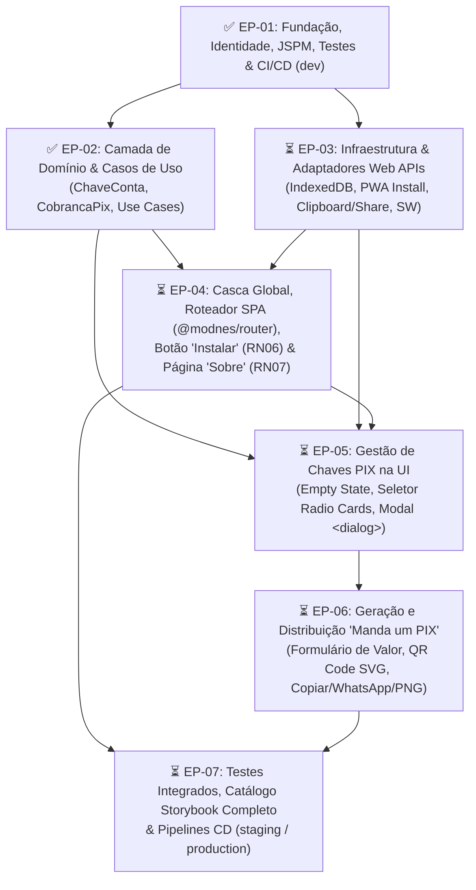

[Início](../README.md) > [Negócio](./overview.md) > **Backlog do Produto**

# 📋 Backlog Completo de Desenvolvimento (`mandaumpix.app`)

Este documento consolida o **Backlog do Produto e de Engenharia** do **Manda um PIX** (`mandaumpix.app`), estruturado em **Épicos**, **Histórias de Usuário / Tarefas Técnicas** e **Critérios de Aceite** rastreáveis às regras de negócio (`RN01` a `RN07`), à [Arquitetura em Camadas](../architecture/overview.md), ao [Design de Módulos](../design/modules.md) e à [Proposta de Interface (UI)](../design/ui_proposal.md).

---

## 📊 Visão Executiva e Progresso por Épico

| ID        | Épico                                                                      | Regras / Escopo                                     | Progresso Atual | Status          |
| :-------- | :------------------------------------------------------------------------- | :-------------------------------------------------- | :-------------: | :-------------- |
| **EP-01** | Fundação, Ferramental, Identidade Visual e CI/CD (`dev`)                   | Infraestrutura base, ESM/JSPM, Qualidade, Storybook |     `6 / 6`     | ✅ Concluído    |
| **EP-02** | Camada de Domínio e Casos de Uso (Clean Architecture)                      | `RN01`, `RN02`, `RN03`, `RN04`, `RN05`, `RN06`      |     `5 / 5`     | ✅ Concluído    |
| **EP-03** | Camada de Infraestrutura e Adaptadores Web APIs (Local-First)              | `RN01`, `RN05`, `RN06`, Offline/Service Worker      |     `2 / 4`     | 🔄 Em Progresso |
| **EP-04** | Casca da Aplicação, Roteamento SPA, Botão "Instalar" e Página "Sobre"      | `RN06`, `RN07`, `@modnes/router`, Layout Split-View |     `0 / 4`     | ⏳ Pendente     |
| **EP-05** | Gestão de Chaves PIX na Interface (`<pix-key-*>`)                          | `RN01`, `RN02`, `<dialog class="key-dialog">`       |     `0 / 3`     | ⏳ Pendente     |
| **EP-06** | Geração, Exibição e Distribuição de Cobrança ("Manda um PIX")              | `RN02`, `RN03`, `RN04`, `RN05`, QR Code & Saídas    |     `0 / 3`     | ⏳ Pendente     |
| **EP-07** | Qualidade Ponta a Ponta, Acessibilidade (WCAG 2.2 AA) e Deploy `stg`/`prd` | Testes de Integração, Storybook a11y, Releases      |     `0 / 3`     | ⏳ Pendente     |

---

## 🗺️ Roadmap e Grafo de Dependências de Desenvolvimento

---

## 🧱 Detalhamento dos Épicos e Histórias de Usuário

### 📦 Épico 01 — Fundação, Ferramental, Identidade Visual e CI/CD (`dev`)

> **Objetivo**: Estabelecer a base arquitetural Zero-Build com ES Modules nativos e JSPM, licenciamento livre `AGPL-3.0-only`, linters multi-linguagem, testes unitários, ícones oficiais, Design Tokens, componente `<vector-icon>` e esteira de CI/CD para o ambiente `development`.

| ID          | Item de Backlog                                                                  | Status       | Artefatos no Repositório                                                                                                                                                               |
| :---------- | :------------------------------------------------------------------------------- | :----------- | :------------------------------------------------------------------------------------------------------------------------------------------------------------------------------------- |
| **US-01.1** | Configuração de ES Modules nativos, JSPM, Import Map W3C, `modulepreload` e SRI  | ✅ Concluído | [`package.json`](../../package.json), [`importmap.js`](../../importmap.js), [`index.html`](../../index.html)                                                                           |
| **US-01.2** | Licenciamento GNU AGPL v3.0 (`AGPL-3.0-only`), ESLint v10 Flat Config e Prettier | ✅ Concluído | [`LICENSE`](../../LICENSE), [`eslint.config.js`](../../eslint.config.js), [`.prettierrc`](../../.prettierrc)                                                                           |
| **US-01.3** | Configuração do Vitest + JSDOM + Cobertura V8                                    | ✅ Concluído | [`vitest.config.js`](../../vitest.config.js), [`src/main.test.js`](../../src/main.test.js)                                                                                             |
| **US-01.4** | Criação do logotipo vetorial, ícones de instalação e `manifest.json`             | ✅ Concluído | [`src/assets/icons/`](../../src/assets/icons/icon.svg), [`manifest.json`](../../manifest.json)                                                                                         |
| **US-01.5** | Design Tokens CSS, Reset, Storybook v10 e Web Component `<vector-icon>`          | ✅ Concluído | [`src/presentation/styles/tokens.css`](../../src/presentation/styles/tokens.css), [`vector-icon.component.js`](../../src/presentation/components/vector-icon/vector-icon.component.js) |
| **US-01.6** | Workflows GitHub Actions de CI e CD automático para `dev.mandaumpix.app`         | ✅ Concluído | [`.github/workflows/ci.yml`](../../.github/workflows/ci.yml), [`.github/workflows/deploy-dev.yml`](../../.github/workflows/deploy-dev.yml)                                             |

---

### 🧠 Épico 02 — Camada de Domínio e Casos de Uso (Clean Architecture)

> **Objetivo**: Implementar as entidades puras de domínio, validações de regras de negócio (`RN01`–`RN07`) e casos de uso desacoplados de frameworks e do DOM, guiados por TDD.

#### `US-02.1` — Funções Base de Geração e Parsing de Cobrança PIX (`✅ Concluído`)

- **Descrição**: Implementar as funções puras de geração de payload BR Code (`generatePixCharge`), validação/parsing (`parsePixCharge`) e exportação gráfica (`exportQrCodePng`) integrando `pix-utils` e `qr`.
- **Artefatos**: [`src/main.js`](../../src/main.js), [`src/main.test.js`](../../src/main.test.js).

#### `US-02.2` — Entidade `ChaveConta` e Validador de Chaves PIX (`✅ Concluído` · `3 Story Points`)

- **História (Narrativa Canônica)**:
  > **Como** **Recebedor** que cadastra contas no Manda um PIX,
  > **Quero** que minhas chaves PIX (`CPF`, `CNPJ`, `EMAIL`, `TELEFONE`, `EVP`) e os dados do titular (`nome_recebedor`, `cidade_recebedor`, `rotulo`) sejam validados e normalizados segundo o padrão EMV® / BR Code do Banco Central no momento do cadastro,
  > **Para que** apenas chaves íntegras sejam salvas no dispositivo e eu evite a geração de códigos BR Code inválidos ou rejeitados pelos aplicativos bancários.
- **Regras de Negócio e Invariantes**: `RN01` ([Modelo de Domínio](./domain_model.md), [Modelo de Dados](../design/data_models.md) e [Especificações EMV](../design/api_specs.md)).
  - **INV-01 (`CPF`)**: Sanitização de máscara (`[^\d]`), 11 dígitos numéricos, rejeição de dígitos repetidos (`000...` a `999...`) e validação dos 2 dígitos verificadores (Módulo 11).
  - **INV-02 (`CNPJ`)**: Sanitização de máscara (`[^\d]`), 14 dígitos numéricos, rejeição de dígitos repetidos e validação dos 2 dígitos verificadores (Módulo 11).
  - **INV-03 (`EMAIL`)**: Normalização `trim()` + `toLowerCase()`, formato de e-mail válido e comprimento máximo `<= 77` caracteres (limite DICT/BACEN).
  - **INV-04 (`TELEFONE`)**: Normalização para padrão internacional E.164 (`+55DDD9XXXXXXXX`, 14 caracteres totais com DDD válido `11..99` e nono dígito `9`).
  - **INV-05 (`EVP`)**: Normalização `trim()` + `toLowerCase()` e validação estrita de UUID v4 (`36` caracteres hifenizados).
  - **INV-06 (`nome_recebedor` — Tag EMV `59`)**: Obrigatório; remoção de acentos (`NFD`) e caracteres não-ASCII, conversão para `UPPERCASE`, colapso de espaços e truncamento seguro em até `25` caracteres.
  - **INV-07 (`cidade_recebedor` — Tag EMV `60`)**: Obrigatório; remoção de acentos (`NFD`) e caracteres não-ASCII, conversão para `UPPERCASE`, colapso de espaços e truncamento seguro em até `15` caracteres.
  - **INV-08 (Identidade & Imutabilidade)**: Geração automática de `id` (`crypto.randomUUID()`), `criado_em` (ISO-8601), normalização de `rotulo` (com fallback amigável por tipo) e congelamento da instância (`Object.freeze`).
- **Critérios de Aceite (BDD / Gherkin)**:
  - **Cenário 01 (CPF e CNPJ com máscara)**: Dado um CPF (`123.456.789-09`) ou CNPJ (`11.222.333/0001-81`) válido com pontuação, quando `ChaveConta.create()` for invocado, então `valor_chave` deve ser normalizado apenas com dígitos (`12345678909` / `11222333000181`) e a instância imutável criada com sucesso.
  - **Cenário 02 (E-mail, Telefone e EVP válidos)**: Dado um e-mail (`<= 77` chars), telefone celular brasileiro ou chave EVP UUID v4 válidos, quando `ChaveConta.create()` for invocado, então `valor_chave` deve ser normalizado (`lowercase` para e-mail/EVP e `+55DDD9XXXXXXXX` para telefone).
  - **Cenário 03 (Normalização EMV de Titular e Cidade)**: Dado `nome_recebedor` `"João da Silva Júnior & Cia Ltda"` (`31` chars com acentos/símbolos) e `cidade_recebedor` `"São José dos Campos"` (`19` chars), quando a entidade for criada, então `nome_recebedor` deve resultar em `"JOAO DA SILVA JUNIOR CIA"` (`<= 25` chars) e `cidade_recebedor` em `"SAO JOSE DOS CA"` (`<= 15` chars).
  - **Cenário 04 (Rejeição de Chaves Inválidas)**: Dado um `tipo_chave` desconhecido ou um `valor_chave` inválido (CPF/CNPJ com DV incorreto ou dígitos repetidos, e-mail `> 77` chars, telefone fora do padrão móvel nacional ou UUID malformado), quando a criação for acionada, então deve lançar `PixKeyValidationError` indicando o motivo da falha.
- **Tarefas de Desenvolvimento (Dev Tasks)**:
  - [x] **TASK-02.2.1 (Domínio / Erros & Constantes)**: Definir constantes `PIX_KEY_TYPES`, `DEFAULT_PIX_KEY_LABELS`, `PIX_KEY_ERROR_CODES` e a classe de erro `PixKeyValidationError` em [`src/domain/entities/pix-key.entity.js`](../../src/domain/entities/pix-key.entity.js) com testes unitários em [`src/domain/entities/pix-key.entity.test.js`](../../src/domain/entities/pix-key.entity.test.js).
  - [x] **TASK-02.2.2 (TDD / Validadores de Chave PIX)**: Criar testes unitários e implementar funções puras de validação e sanitização para `CPF`, `CNPJ`, `EMAIL`, `TELEFONE` e `EVP` (`validateAndNormalizePixKey`) em [`src/domain/entities/pix-key.entity.js`](../../src/domain/entities/pix-key.entity.js).
  - [x] **TASK-02.2.3 (TDD / Normalizadores EMV)**: Criar testes unitários e implementar normalizadores `normalizeMerchantName` (`<= 25` chars) e `normalizeMerchantCity` (`<= 15` chars) compatíveis com EMV® QRCPS-MPM e `pix-utils` em [`src/domain/entities/pix-key.entity.js`](../../src/domain/entities/pix-key.entity.js).
  - [x] **TASK-02.2.4 (TDD / Entidade `ChaveConta`)**: Implementar a classe/fábrica imutável `ChaveConta` (`PixKeyEntity`) em [`src/domain/entities/pix-key.entity.js`](../../src/domain/entities/pix-key.entity.js) (`id`, `rotulo`, `tipo_chave`, `valor_chave`, `nome_recebedor`, `cidade_recebedor`, `criado_em`, `toJSON()`) com suíte completa em [`src/domain/entities/pix-key.entity.test.js`](../../src/domain/entities/pix-key.entity.test.js) (`100%` de cobertura nas regras).
  - [x] **TASK-02.2.5 (Integração & Exportação)**: Reexportar `ChaveConta` / `PixKeyValidationError` em [`src/main.js`](../../src/main.js) e validar pipeline de qualidade (`npm run lint`, `npm run format:check`, `npm run test:coverage`).

#### `US-02.3` — Entidade `CobrancaPix` e Caso de Uso `GeneratePixChargeUseCase` (`✅ Concluído` · `3 Story Points`)

- **História (Narrativa Canônica)**:
  > **Como** **Recebedor** que utiliza o Manda um PIX,
  > **Quero** gerar uma cobrança PIX a partir de uma `ChaveConta` selecionada, informando opcionalmente um valor monetário fixo ou mantendo o valor dinâmico (em aberto),
  > **Para que** eu obtenha simultaneamente o código **PIX Copia e Cola** (`chave_cobranca` no padrão EMV® BR Code com CRC16 válido) e a representação gráfica do **QR Code** (`imagem_qrcode`) prontos para leitura óptica ou compartilhamento imediato.
- **Regras de Negócio e Invariantes**: `RN02`, `RN03`, `RN04` ([Modelo de Domínio](./domain_model.md), [Modelo de Dados](../design/data_models.md) e [Especificações EMV](../design/api_specs.md)).
  - **INV-01 (`RN02` — Seleção Obrigatória de `ChaveConta`)**: A emissão exige uma `ChaveConta` válida (instância de `ChaveConta` ou objeto hidratável via `ChaveConta.fromJSON()`). Quando ausente ou nula, lança `PixChargeValidationError` com código `MISSING_PIX_KEY`; quando malformada, propaga/lança erro de validação (`INVALID_PIX_KEY`).
  - **INV-02 (`RN03` — Modalidade de Valor Dinâmico / Aberto)**: Quando `valor_opcional` for omitido (`undefined`), `null`, string vazia (`""`) ou zero (`0`, `"0"`, `"0,00"`, `"0.00"`), define `valor_opcional = null` e `valor_dinamico = true`, omitindo a tag EMV `54` (_Transaction Amount_) do payload BR Code.
  - **INV-03 (`RN03` — Modalidade de Valor Fixo e Sanitização Monetária BRL)**: Quando `valor_opcional` for positivo (numérico como `42.5` ou string monetária como `"42,50"` / `"R$ 1.234,56"`), normaliza para `Number` com duas casas decimais (`42.5`), define `valor_dinamico = false` e inclui a tag EMV `54` formatada (`"42.50"`). Rejeita valores negativos (`< 0`), `NaN`, `Infinity` ou acima de `999999999.99` com `PixChargeValidationError` (`INVALID_AMOUNT`).
  - **INV-04 (Identificador de Transação `txid` — Tag EMV `62` / Subtag `05`)**: Assume `"***"` por padrão quando omitido ou vazio; se informado, deve conter apenas caracteres alfanuméricos ASCII (`1` a `25` caracteres) ou `"***"`, lançando `PixChargeValidationError` (`INVALID_TXID`) caso contrário.
  - **INV-05 (`RN04` — Geração Simultânea de BR Code e QR Code)**: Produz deterministicamente `chave_cobranca` (`brCode` EMV® iniciado por `000201` e finalizado pelo `CRC16` na tag `63`) e `imagem_qrcode` (objeto imutável contendo `svg`, `dataUrl` e `gifBytes`).
  - **INV-06 (Imutabilidade e Rastreabilidade)**: Registra `id_chave_conta` (`chaveConta.id`), `chave_conta` (instância `ChaveConta`), `valor_opcional`, `valor_dinamico`, `txid`, `info_adicional`, `chave_cobranca`, `imagem_qrcode` e `gerado_em` (ISO-8601), expondo `toJSON()` e congelando a instância com `Object.freeze()`.
  - **INV-07 (Orquestração no Caso de Uso `GeneratePixChargeUseCase`)**: Aceita uma `chaveConta` direta no input ou resolve a chave ativa via porta opcional `pixKeyRepository`, executa a geração da `CobrancaPix` e retorna o resultado pronto para a camada de apresentação.
- **Critérios de Aceite (BDD / Gherkin)**:
  - **Cenário 01 (Cobrança com Valor Fixo — `RN02`, `RN03`, `RN04`)**: Dada uma `ChaveConta` válida selecionada e um `valor_opcional` de `42.5` (ou `"42,50"`), quando `GeneratePixChargeUseCase.execute()` for invocado, então deve retornar uma `CobrancaPix` imutável com `valor_opcional = 42.5`, `valor_dinamico = false`, `chave_cobranca` contendo a tag EMV `54` (`"540542.50"`) e `imagem_qrcode` preenchida (`svg`, `dataUrl`, `gifBytes`).
  - **Cenário 02 (Cobrança com Valor Dinâmico/Aberto — `RN03`, `RN04`)**: Dada uma `ChaveConta` válida selecionada e `valor_opcional` omitido, nulo, vazio ou `0`, quando `GeneratePixChargeUseCase.execute()` for invocado, então deve retornar uma `CobrancaPix` com `valor_opcional = null`, `valor_dinamico = true`, `chave_cobranca` sem a tag EMV `54` (`transactionAmount = 0` no parser) e `imagem_qrcode` válida.
  - **Cenário 03 (Bloqueio sem Chave Selecionada — `RN02`)**: Dado que nenhuma `ChaveConta` foi informada (ou o repositório não possui chave ativa selecionada), quando a geração for acionada, então deve lançar `PixChargeValidationError` com código `MISSING_PIX_KEY`.
  - **Cenário 04 (Rejeição de Valor Monetário ou `txid` Inválido)**: Dada uma `ChaveConta` válida, quando `valor_opcional` for negativo (`-10`), malformado (`"abc"`), acima do limite EMV ou `txid` contiver símbolos inválidos/exceder `25` caracteres, então deve lançar `PixChargeValidationError` (`INVALID_AMOUNT` ou `INVALID_TXID`).
- **Tarefas de Desenvolvimento (Dev Tasks)**:
  - [x] **TASK-02.3.1 (Domínio / Erros, Constantes & Sanitizadores de Cobrança)**: Definir `PIX_CHARGE_ERROR_CODES`, `PixChargeValidationError`, `normalizeTransactionAmount` (suporte a `number`, strings BRL `"1.234,56"`, `null`/`0` como valor aberto) e `normalizeTxid` em [`src/domain/entities/pix-charge.entity.js`](../../src/domain/entities/pix-charge.entity.js) com testes unitários em [`src/domain/entities/pix-charge.entity.test.js`](../../src/domain/entities/pix-charge.entity.test.js).
  - [x] **TASK-02.3.2 (TDD / Entidade Imutável `CobrancaPix`)**: Implementar a classe/fábrica `CobrancaPix` (`PixChargeEntity`) em [`src/domain/entities/pix-charge.entity.js`](../../src/domain/entities/pix-charge.entity.js) validando a associação obrigatória com `ChaveConta` (`RN02`), `valor_opcional` e `valor_dinamico` (`RN03`), `chave_cobranca` e `imagem_qrcode` (`RN04`), `gerado_em` e `toJSON()`, com cobertura unitária de `100%`.
  - [x] **TASK-02.3.3 (TDD / Caso de Uso `GeneratePixChargeUseCase`)**: Implementar `GeneratePixChargeUseCase` (e helper funcional `executeGeneratePixCharge`) em [`src/application/use-cases/generate-pix-charge.use-case.js`](../../src/application/use-cases/generate-pix-charge.use-case.js) com testes unitários em [`src/application/use-cases/generate-pix-charge.use-case.test.js`](../../src/application/use-cases/generate-pix-charge.use-case.test.js) cobrindo execução síncrona/assíncrona, resolução via `pixKeyRepository` mockado, valor fixo, valor aberto e tratamento de falhas.
  - [x] **TASK-02.3.4 (Integração, Reexportação & Qualidade)**: Integrar `CobrancaPix` e `GeneratePixChargeUseCase` em [`src/main.js`](../../src/main.js) (mantendo retrocompatibilidade com `generatePixCharge`), atualizar [`src/main.test.js`](../../src/main.test.js) e validar `npm run lint`, `npm run format:check` e `npm run test:coverage`.

#### `US-02.4` — Casos de Uso de Gestão de Chaves de Contas (`✅ Concluído` · `3 Story Points`)

- **História (Narrativa Canônica)**:
  > **Como** **Recebedor** que utiliza o Manda um PIX para receber em diferentes contas bancárias,
  > **Quero** cadastrar novas chaves PIX, listar minhas chaves salvas, selecionar a chave ativa para emissão de cobrança e remover chaves que não utilizo mais, mantendo automaticamente uma chave válida selecionada sempre que houver ao menos uma conta cadastrada,
  > **Para que** eu possa gerenciar minhas contas de recebimento sem duplicidades e emitir cobranças PIX em poucos toques sem redigitar dados.
- **Regras de Negócio e Invariantes**: `RN01`, `RN02` ([Modelo de Domínio](./domain_model.md), [Modelo de Dados](../design/data_models.md) e [Especificações e Contratos](../design/api_specs.md)).
  - **INV-01 (Contrato da Porta `pixKeyRepository`)**: Todos os casos de uso exigem um repositório válido (`findAll`, `save`, `deleteById`, `getSelectedKeyId`, `setSelectedKeyId`). Quando ausente ou inválido, lançam `PixKeyManagementError` com código `MISSING_PIX_KEY_REPOSITORY`.
  - **INV-02 (`RN01` — Validação, Hidratação e Prevenção de Duplicidade no Cadastro — `SavePixKeyUseCase`)**: Os dados de entrada são validados/hidratados via `ChaveConta.create()` (propagando `PixKeyValidationError` quando inválidos). Rejeita o cadastro de outra chave com o mesmo par normalizado `(tipo_chave, valor_chave)` e `id` distinto com `PixKeyManagementError` (`DUPLICATE_PIX_KEY`).
  - **INV-03 (`RN01`, `RN02` — Auto-Seleção no Cadastro — `SavePixKeyUseCase`)**: Ao persistir uma chave, define-a automaticamente como selecionada (`setSelectedKeyId(chaveConta.id)`) quando for a primeira chave cadastrada, quando não houver chave ativa válida ou quando `selectAsActive = true`.
  - **INV-04 (`RN01`, `RN02` — Listagem Hidratada e Auto-Recuperação de Seleção — `ListPixKeysUseCase`)**: Retorna a lista imutável de instâncias `ChaveConta` (`items`), `selectedKeyId` e `selectedKey`. Caso existam chaves salvas e `selectedKeyId` seja nulo ou órfão, reatribui automaticamente a primeira chave disponível (`items[0].id`); caso não existam chaves, garante `selectedKeyId = null` e `selectedKey = null`.
  - **INV-05 (`RN02` — Seleção Explícita de Chave Ativa — `SelectPixKeyUseCase`)**: Exige um `id` não vazio (`MISSING_PIX_KEY_ID`) pertencente a uma `ChaveConta` existente no repositório (`PIX_KEY_NOT_FOUND`), persiste `setSelectedKeyId(id)` e retorna `{ selectedKeyId, selectedKey }`.
  - **INV-06 (`RN01`, `RN02` — Exclusão e Reatribuição Automática da Chave Ativa — `DeletePixKeyUseCase`)**: Exige um `id` válido e existente (`MISSING_PIX_KEY_ID` / `PIX_KEY_NOT_FOUND`), remove a chave via `deleteById(id)` e, caso a chave excluída fosse a ativa (ou a seleção estivesse órfã), seleciona automaticamente a primeira chave remanescente (`remaining[0].id`) ou define `selectedKeyId = null` se a coleção ficar vazia.
- **Critérios de Aceite (BDD / Gherkin)**:
  - **Cenário 01 (Cadastro da Primeira Chave com Auto-Seleção — `RN01`, `RN02`)**: Dado que o repositório está vazio, quando `SavePixKeyUseCase.execute()` for invocado com dados válidos de `ChaveConta`, então a chave deve ser persistida e definida automaticamente como a chave ativa (`selectedKeyId = chave.id`).
  - **Cenário 02 (Cadastro de Múltiplas Chaves e Bloqueio de Duplicidade — `RN01`)**: Dado que já existe uma chave ativa cadastrada, quando uma nova chave distinta for salva, ela deve ser adicionada à coleção mantendo a seleção vigente (ou assumindo a seleção se `selectAsActive = true`); se possuir o mesmo `(tipo_chave, valor_chave)` de outra chave existente, deve lançar `PixKeyManagementError` (`DUPLICATE_PIX_KEY`).
  - **Cenário 03 (Listagem e Troca de Chave Selecionada — `RN01`, `RN02`)**: Dadas múltiplas chaves salvas, quando `SelectPixKeyUseCase.execute({ id })` e `ListPixKeysUseCase.execute()` forem invocados, então `selectedKeyId` e `selectedKey` devem refletir a chave escolhida; se o `id` informado não existir, deve lançar `PixKeyManagementError` (`PIX_KEY_NOT_FOUND`).
  - **Cenário 04 (Remoção da Chave Ativa e Reatribuição / Limpeza — `RN01`, `RN02`)**: Dada uma chave ativa selecionada, quando `DeletePixKeyUseCase.execute({ id })` removê-la, então a seleção deve ser reatribuída automaticamente para a primeira chave remanescente (ou `null` quando a última chave for excluída).
- **Tarefas de Desenvolvimento (Dev Tasks)**:
  - [x] **TASK-02.4.1 (TDD / Erros de Gestão & Caso de Uso `SavePixKeyUseCase`)**: Definir `PIX_KEY_MANAGEMENT_ERROR_CODES`, `PixKeyManagementError` e implementar `SavePixKeyUseCase` (`executeSavePixKey`) em [`src/application/use-cases/save-pix-key.use-case.js`](../../src/application/use-cases/save-pix-key.use-case.js) com testes unitários em [`src/application/use-cases/save-pix-key.use-case.test.js`](../../src/application/use-cases/save-pix-key.use-case.test.js).
  - [x] **TASK-02.4.2 (TDD / Caso de Uso `ListPixKeysUseCase`)**: Implementar `ListPixKeysUseCase` (`executeListPixKeys`) em [`src/application/use-cases/list-pix-keys.use-case.js`](../../src/application/use-cases/list-pix-keys.use-case.js) com testes unitários em [`src/application/use-cases/list-pix-keys.use-case.test.js`](../../src/application/use-cases/list-pix-keys.use-case.test.js) cobrindo hidratação, estado vazio e auto-recuperação de `selectedKeyId` órfão.
  - [x] **TASK-02.4.3 (TDD / Caso de Uso `SelectPixKeyUseCase`)**: Implementar `SelectPixKeyUseCase` (`executeSelectPixKey`) em [`src/application/use-cases/select-pix-key.use-case.js`](../../src/application/use-cases/select-pix-key.use-case.js) com testes unitários em [`src/application/use-cases/select-pix-key.use-case.test.js`](../../src/application/use-cases/select-pix-key.use-case.test.js) cobrindo seleção válida e erros `MISSING_PIX_KEY_ID` / `PIX_KEY_NOT_FOUND`.
  - [x] **TASK-02.4.4 (TDD / Caso de Uso `DeletePixKeyUseCase`)**: Implementar `DeletePixKeyUseCase` (`executeDeletePixKey`) em [`src/application/use-cases/delete-pix-key.use-case.js`](../../src/application/use-cases/delete-pix-key.use-case.js) com testes unitários em [`src/application/use-cases/delete-pix-key.use-case.test.js`](../../src/application/use-cases/delete-pix-key.use-case.test.js) cobrindo remoção de chave inativa, reatribuição ao excluir chave ativa e limpeza ao excluir a última chave.
  - [x] **TASK-02.4.5 (Integração, Reexportação & Qualidade)**: Reexportar os casos de uso e erros de gestão de chaves em [`src/main.js`](../../src/main.js), atualizar [`src/main.test.js`](../../src/main.test.js) e validar `npm run lint`, `npm run format:check` e `npm run test:coverage`.

#### `US-02.5` — Casos de Uso de Distribuição da Cobrança e Instalação do PWA (`✅ Concluído` · `3 Story Points`)

- **História (Narrativa Canônica)**:
  > **Como** **Recebedor** que gerou uma cobrança no Manda um PIX,
  > **Quero** copiar o código PIX Copia e Cola, compartilhá-lo diretamente (via menu nativo ou WhatsApp), baixar o QR Code como imagem PNG no meu dispositivo e instalar o aplicativo (PWA) quando ele ainda não estiver instalado,
  > **Para que** eu envie a cobrança rapidamente ao pagador pelo canal mais conveniente e tenha acesso instantâneo ao aplicativo na tela inicial do meu aparelho.
- **Regras de Negócio e Invariantes**: `RN05`, `RN06` ([Modelo de Domínio](./domain_model.md), [Especificações e Contratos](../design/api_specs.md) e [Integrações](../architecture/integrations.md)).
  - **INV-01 (Contrato da Porta `chargeDistributionGateway` — `DistributePixChargeUseCase`)**: O caso de uso exige uma porta de distribuição válida para a operação solicitada (`copyText`, `share` / `shareViaWhatsApp`, `downloadQrCodePng`). Quando ausente ou inválida, lança `PixChargeDistributionError` com código `MISSING_DISTRIBUTION_GATEWAY`.
  - **INV-02 (Validação da Cobrança na Distribuição — `RN05`)**: Aceita uma instância de `CobrancaPix`, um objeto hidratável ou `{ chave_cobranca / brCode, imagem_qrcode }`. Exige um `chave_cobranca` válido no envelope EMV® (`000201...6304XXXX`), lançando `PixChargeDistributionError` (`MISSING_CHARGE_PAYLOAD` ou `INVALID_CHARGE_PAYLOAD`) quando ausente ou malformado.
  - **INV-03 (`RN05` — Cópia do Código PIX Copia e Cola — `copyChargeCode`)**: Invoca `copyText(chave_cobranca)` na porta de distribuição e retorna `{ action: "COPY", copied: true, chave_cobranca }` congelado (`Object.freeze`); falhas de escrita na área de transferência lançam `PixChargeDistributionError` (`COPY_FAILED`).
  - **INV-04 (`RN05` — Compartilhamento com Fallback para WhatsApp — `shareCharge`)**: Prioriza o compartilhamento nativo (`share({ title, text, files })`) quando suportado pela porta (`canShare !== false`); caso não seja suportado ou quando `channel === "WHATSAPP"`, utiliza o fallback `shareViaWhatsApp` com URI codificada `https://wa.me/?text=${encodeURIComponent(text)}`, retornando `{ action: "SHARE", shared: true, channel: "WEB_SHARE" | "WHATSAPP", chave_cobranca, whatsappUrl }`.
  - **INV-05 (`RN05` — Download Local do QR Code em PNG — `downloadQrImage`)**: Normaliza o nome do arquivo (padrão `"mandaumpix-qrcode.png"`, garantindo sufixo `.png`) e as dimensões (`512x512` por padrão), aciona `downloadQrCodePng` na porta e retorna `{ action: "DOWNLOAD_QR", downloaded: true, fileName, width, height, chave_cobranca }`.
  - **INV-06 (`RN06` — Estado de Instalação e Visibilidade do Botão "Instalar" — `InstallPwaUseCase`)**: Exige uma porta `pwaInstallGateway` válida (`MISSING_PWA_INSTALL_GATEWAY`). Calcula o estado imutável `{ isInstalled, canInstall, shouldShowInstallButton }` garantindo a invariante `RN06`: se `isInstalled === true`, então `canInstall = false` e `shouldShowInstallButton = false`; o botão destacado **"Instalar"** só deve ser exibido quando `isInstalled === false && canInstall === true`.
  - **INV-07 (`RN06` — Disparo do Prompt Nativo de Instalação — `triggerInstall`)**: Rejeita o acionamento quando o PWA já está instalado (`PWA_ALREADY_INSTALLED`) ou quando o prompt nativo não está disponível (`PWA_INSTALL_NOT_AVAILABLE`). Ao executar `promptInstall()`, normaliza `outcome` (`"accepted"` ou `"dismissed"`) e, caso `"accepted"`, atualiza o estado retornando `isInstalled = true`, `canInstall = false` e `shouldShowInstallButton = false`.
- **Critérios de Aceite (BDD / Gherkin)**:
  - **Cenário 01 (Cópia do Código PIX Copia e Cola — `RN05`)**: Dada uma `CobrancaPix` válida, quando `DistributePixChargeUseCase.copyChargeCode()` (ou `execute({ action: "COPY", cobranca })`) for invocado, então a porta de área de transferência deve receber `cobranca.chave_cobranca` e retornar `{ action: "COPY", copied: true, chave_cobranca }`.
  - **Cenário 02 (Compartilhamento Nativo e Fallback para WhatsApp — `RN05`)**: Dada uma `CobrancaPix` válida, quando `shareCharge()` for invocado em um ambiente com suporte a Web Share API, deve utilizar `share()` retornando `channel: "WEB_SHARE"`; quando a Web Share API não estiver disponível (ou `channel: "WHATSAPP"`), deve acionar o fallback com `https://wa.me/?text=...` codificado e retornar `channel: "WHATSAPP"`.
  - **Cenário 03 (Salvamento Local do QR Code como PNG — `RN05`)**: Dada uma `CobrancaPix` válida, quando `downloadQrImage()` for invocado, então deve acionar a porta de download com `fileName = "mandaumpix-qrcode.png"` e dimensões `512x512`, retornando `{ action: "DOWNLOAD_QR", downloaded: true, fileName: "mandaumpix-qrcode.png" }`.
  - **Cenário 04 (Exibição e Disparo do Botão "Instalar" do PWA — `RN06`)**: Dado que o PWA ainda não está instalado (`isInstalled = false`) e o evento de instalação está disponível (`canInstall = true`), quando `InstallPwaUseCase.getInstallState()` for consultado, `shouldShowInstallButton` deve ser `true`; quando `triggerInstall()` for executado e aceito pelo usuário (`outcome = "accepted"`), `shouldShowInstallButton` deve tornar-se `false` imediatamente.
- **Tarefas de Desenvolvimento (Dev Tasks)**:
  - [x] **TASK-02.5.1 (TDD / Erros, Constantes & Caso de Uso `DistributePixChargeUseCase`)**: Definir `PIX_CHARGE_DISTRIBUTION_ACTIONS`, `PIX_CHARGE_DISTRIBUTION_ERROR_CODES`, `PixChargeDistributionError`, `buildWhatsAppShareUrl` e implementar `DistributePixChargeUseCase` (`executeDistributePixCharge`) em [`src/application/use-cases/distribute-pix-charge.use-case.js`](../../src/application/use-cases/distribute-pix-charge.use-case.js) com testes unitários em [`src/application/use-cases/distribute-pix-charge.use-case.test.js`](../../src/application/use-cases/distribute-pix-charge.use-case.test.js) (`100%` de cobertura para cópia, compartilhamento nativo, fallback WhatsApp, download PNG e validações de erro).
  - [x] **TASK-02.5.2 (TDD / Erros, Constantes & Caso de Uso `InstallPwaUseCase`)**: Definir `PWA_INSTALL_ERROR_CODES`, `PwaInstallError` e implementar `InstallPwaUseCase` (`executeInstallPwa`) em [`src/application/use-cases/install-pwa.use-case.js`](../../src/application/use-cases/install-pwa.use-case.js) com testes unitários em [`src/application/use-cases/install-pwa.use-case.test.js`](../../src/application/use-cases/install-pwa.use-case.test.js) (`100%` de cobertura para `getInstallState`, `triggerInstall`, `subscribe`, aceitação/recusa do prompt e invariante `RN06`).
  - [x] **TASK-02.5.3 (Integração, Reexportação & Qualidade)**: Reexportar `DistributePixChargeUseCase`, `InstallPwaUseCase`, helpers e classes de erro em [`src/main.js`](../../src/main.js), adicionar testes de integração da API pública em [`src/main.test.js`](../../src/main.test.js), atualizar [`docs/design/modules.md`](../design/modules.md) e validar `npm run lint`, `npm run format:check` e `npm run test:coverage`.

---

### 🔌 Épico 03 — Camada de Infraestrutura e Adaptadores Web APIs (Local-First)

> **Objetivo**: Implementar os adaptadores concretos de infraestrutura do navegador (IndexedDB, Clipboard, Web Share / WhatsApp, Download PNG, Instalação PWA e Service Worker), mantendo 100% dos dados do usuário locais no dispositivo.

#### `US-03.1` — Repositório Local de Dados do Usuário no IndexedDB (`IndexedDbPixKeyRepository`) (`✅ Concluído` · `3 Story Points`)

- **História (Narrativa Canônica)**:
  > **Como** **Recebedor** que utiliza o Manda um PIX no meu dispositivo,
  > **Quero** que minhas chaves PIX cadastradas (`ChaveConta`) e a preferência da chave ativa (`selectedKeyId`) sejam persistidas e recuperadas de forma assíncrona, transacional e reativa no banco **IndexedDB** (`mandaumpix_db`) do meu próprio navegador,
  > **Para que** eu não precise redigitar meus dados a cada cobrança e mantenha 100% de privacidade local (Zero-Backend / LGPD) sem envio de informações para servidores externos.
- **Regras de Negócio e Invariantes**: `RN01`, `RN02` ([ADR 0004](../architecture/decisions/0004-persistencia-local-indexeddb.md), [Modelo de Dados](../design/data_models.md), [Especificações e Contratos](../design/api_specs.md) e [Conformidade e Privacidade](../security/compliance.md)).
  - **INV-01 (Esquema Físico e Migração `onupgradeneeded` — `ADR 0004`)**: Ao abrir o banco `mandaumpix_db` (versão `1`), garante de forma idempotente no evento `onupgradeneeded` a criação da _object store_ `pix_keys` (`{ keyPath: "id" }`) com os índices `by_tipo_chave` (`tipo_chave`, `{ unique: false }`) e `by_criado_em` (`criado_em`, `{ unique: false }`), e da _object store_ `user_settings` (`{ keyPath: "key" }`).
  - **INV-02 (Conformidade Estrita com a Porta `pixKeyRepository` — `RN01`, `RN02`)**: Implementa integralmente o contrato esperado por `assertPixKeyRepository` e pelos casos de uso (`SavePixKeyUseCase`, `ListPixKeysUseCase`, `SelectPixKeyUseCase`, `DeletePixKeyUseCase` e `GeneratePixChargeUseCase`): `findAll()`, `findById(id)`, `save(pixKey)`, `deleteById(id)`, `getSelectedKeyId()`, `setSelectedKeyId(id)` e `getSelectedKey()`, retornando `Promises` com instâncias imutáveis de `ChaveConta`.
  - **INV-03 (Persistência Estruturada e Hidratação de `ChaveConta` — `RN01`)**: `save(pixKey)` aceita uma instância de `ChaveConta` ou objeto compatível (`ChaveConta.fromJSON()`), persiste o registro plano (`toJSON()`) em transação `readwrite` na store `pix_keys` e retorna a instância imutável `ChaveConta`. `findAll()` lê todos os registros em transação `readonly`, hidrata-os via `ChaveConta.fromJSON()` e retorna um array imutável ordenado de forma determinística por `criado_em` ascendente.
  - **INV-04 (Persistência da Preferência `selectedKeyId` em `user_settings` — `RN02`)**: `getSelectedKeyId()` realiza leitura `readonly` da chave `"selectedKeyId"` na store `user_settings`, retornando o `id` (`string`) ou `null`. `setSelectedKeyId(id)` grava `{ key: "selectedKeyId", value: normalizedId, updatedAt: new Date().toISOString() }` (normalizando `null` ou string vazia para `null`) em transação `readwrite` na store `user_settings`.
  - **INV-05 (Sincronização Reativa com `@modnes/data-controller`)**: Mantém um controlador de estado reativo (`DataController` com proxies `DataHandler` / `ArrayHandler`) sobre `{ items, selectedKeyId, selectedKey }`, atualizando o estado e emitindo notificações (`dataUpdated` / `subscribe`) após mutações (`save`, `deleteById`, `setSelectedKeyId`) e sincronizações (`findAll`).
  - **INV-06 (Resiliência e Tratamento Estruturado de Erros do `indexedDB`)**: Define `PIX_KEY_STORAGE_ERROR_CODES` (`INDEXED_DB_UNSUPPORTED`, `DATABASE_OPEN_FAILED`, `DATABASE_BLOCKED`, `TRANSACTION_FAILED`, `QUOTA_EXCEEDED`) e a classe `PixKeyStorageError`, traduzindo indisponibilidade da API `indexedDB`, bloqueios de versão (`onblocked`) e falhas de transação/requisição (`QuotaExceededError`, `AbortError`) em erros semânticos rastreáveis.
- **Critérios de Aceite (BDD / Gherkin)**:
  - **Cenário 01 (Inicialização do Banco `mandaumpix_db` e Migração `onupgradeneeded` — `ADR 0004`)**: Dado um navegador com suporte a `indexedDB` sem banco prévio, quando `IndexedDbPixKeyRepository` abrir a conexão pela primeira vez, então deve criar o banco `mandaumpix_db` na versão `1` com as _object stores_ `pix_keys` (`keyPath: "id"`, índices `by_tipo_chave` e `by_criado_em`) e `user_settings` (`keyPath: "key"`).
  - **Cenário 02 (Ciclo CRUD Transacional de `ChaveConta` e Integração com Casos de Uso — `RN01`)**: Dada uma instância de `IndexedDbPixKeyRepository`, quando `save()`, `findById()`, `findAll()` e `deleteById()` forem executados diretamente ou via `SavePixKeyUseCase` / `ListPixKeysUseCase` / `DeletePixKeyUseCase`, então os registros devem ser gravados, hidratados como instâncias imutáveis `ChaveConta` e removidos atomicamente em `pix_keys`.
  - **Cenário 03 (Persistência de `selectedKeyId` e Reatividade `@modnes/data-controller` — `RN02`)**: Dada uma chave cadastrada no repositório, quando `setSelectedKeyId(id)` ou `save()` alterar o estado persistido, então `getSelectedKeyId()` e `getSelectedKey()` devem refletir a chave ativa em `user_settings` e o estado reativo do `DataController` (`state.items`, `state.selectedKeyId`, `state.selectedKey`) deve notificar os observadores inscritos.
  - **Cenário 04 (Tratamento de Indisponibilidade e Falhas de Armazenamento)**: Dado um ambiente onde `indexedDB` não está disponível ou uma transação falha por limite de armazenamento (`QuotaExceededError`) / aborto (`AbortError`) / bloqueio (`onblocked`), quando qualquer operação do repositório for invocada, então a `Promise` deve rejeitar com `PixKeyStorageError` contendo o código correspondente (`INDEXED_DB_UNSUPPORTED`, `QUOTA_EXCEEDED`, `DATABASE_BLOCKED` ou `TRANSACTION_FAILED`).
- **Tarefas de Desenvolvimento (Dev Tasks)**:
  - [x] **TASK-03.1.1 (TDD / Erros, Constantes & Gerenciador de Conexão IndexedDB)**: Definir `DEFAULT_DB_NAME` (`"mandaumpix_db"`), `DEFAULT_DB_VERSION` (`1`), `OBJECT_STORES` (`pix_keys`, `user_settings`), `PIX_KEY_INDEXES` (`by_tipo_chave`, `by_criado_em`), `SELECTED_KEY_SETTING_KEY` (`"selectedKeyId"`), `PIX_KEY_STORAGE_ERROR_CODES`, `PixKeyStorageError` e o helper de abertura/migração `openPixKeyDatabase` (`onupgradeneeded`, `onblocked`, `onerror`) em [`src/infrastructure/storage/indexed-db-pix-key.repository.js`](../../src/infrastructure/storage/indexed-db-pix-key.repository.js) com testes unitários em [`src/infrastructure/storage/indexed-db-pix-key.repository.test.js`](../../src/infrastructure/storage/indexed-db-pix-key.repository.test.js).
  - [x] **TASK-03.1.2 (TDD / Operações Transacionais da Porta `IndexedDbPixKeyRepository`)**: Implementar a classe `IndexedDbPixKeyRepository` (e fábrica `createIndexedDbPixKeyRepository`) em [`src/infrastructure/storage/indexed-db-pix-key.repository.js`](../../src/infrastructure/storage/indexed-db-pix-key.repository.js) com os métodos assíncronos `findAll()`, `findById(id)`, `save(pixKey)`, `deleteById(id)`, `getSelectedKeyId()`, `setSelectedKeyId(id)`, `getSelectedKey()`, `clear()` e `close()`, garantindo hidratação via `ChaveConta` e transações `readonly`/`readwrite`.
  - [x] **TASK-03.1.3 (TDD / Estado Reativo com `@modnes/data-controller` & Suíte de Testes)**: Integrar `DataController` (`DataHandler` / `ArrayHandler`) e método `subscribe(listener)` ao `IndexedDbPixKeyRepository`, e criar a suíte completa de testes unitários e de integração em [`src/infrastructure/storage/indexed-db-pix-key.repository.test.js`](../../src/infrastructure/storage/indexed-db-pix-key.repository.test.js) (`100%` de cobertura nas operações do banco, casos de uso integrados e cenários de erro `QuotaExceededError`, `AbortError`, `onblocked` e ausência de `indexedDB`).
  - [x] **TASK-03.1.4 (Integração, Reexportação & Qualidade)**: Reexportar `IndexedDbPixKeyRepository`, `createIndexedDbPixKeyRepository`, constantes e `PixKeyStorageError` em [`src/main.js`](../../src/main.js), adicionar testes de integração com os casos de uso em [`src/main.test.js`](../../src/main.test.js), atualizar [`docs/design/modules.md`](../design/modules.md) e validar `npm run lint`, `npm run format:check` e `npm run test:coverage`.

#### `US-03.2` — Adaptador de Instalação do PWA (`PwaInstallAdapter`) (`✅ Concluído` · `2 Story Points`)

- **História (Narrativa Canônica)**:
  > **Como** **Recebedor** que acessa o Manda um PIX pelo navegador sem ter o aplicativo instalado no dispositivo,
  > **Quero** que o sistema detecte automaticamente se o PWA já está em modo instalado (`standalone`) ou se está elegível para instalação (`beforeinstallprompt`), expondo esse estado reativamente e disparando o diálogo nativo de instalação quando eu acionar o botão **"Instalar"**,
  > **Para que** eu possa instalar o aplicativo na tela inicial com um único clique e o botão **"Instalar"** seja ocultado imediatamente assim que a instalação for concluída (`RN06`).
- **Regras de Negócio e Invariantes**: `RN06` ([Modelo de Domínio](./domain_model.md), [Especificações e Contratos](../design/api_specs.md) e [Integrações](../architecture/integrations.md)).
  - **INV-01 (Conformidade Estrita com a Porta `pwaInstallGateway` — `RN06`)**: Implementa integralmente o contrato validado por `assertPwaInstallGateway` e consumido por `InstallPwaUseCase`: `isInstalled()`, `canInstall()`, `promptInstall()` (e alias `triggerInstall()`), `getState()`, `subscribe(listener)` e `destroy()`.
  - **INV-02 (Detecção Multi-Plataforma de Modo Instalado — `isInstalled`)**: Detecta se o PWA já está rodando instalado verificando `window.matchMedia('(display-mode: standalone)').matches === true`, `navigator.standalone === true` (iOS/Safari) ou se o evento `appinstalled` já foi disparado na sessão atual (`installedFlag === true`).
  - **INV-03 (Captura e Ciclo de Vida de `beforeinstallprompt` — `canInstall` / `RN06`)**: Escuta o evento `beforeinstallprompt` no `window`, executa `event.preventDefault()` para assumir o controle do gatilho de instalação, armazena a referência em `deferredPrompt` e recalcula o estado garantindo `shouldShowInstallButton = !isInstalled && Boolean(deferredPrompt)`.
  - **INV-04 (Acionamento Único do Prompt Nativo — `promptInstall` / `RN06`)**: Quando `promptInstall()` é invocado com um `deferredPrompt` válido e `isInstalled === false`, invoca `deferredPrompt.prompt()`, aguarda a resolução de `deferredPrompt.userChoice` (ou o retorno direto de `prompt()`), normaliza o `outcome` (`"accepted"` ou `"dismissed"`), limpa a referência `deferredPrompt = null` (pois o evento só pode ser consumido uma vez) e, se `"accepted"`, marca `isInstalled = true`, ocultando o botão **"Instalar"** imediatamente. Se invocado sem `deferredPrompt` disponível ou com o app já instalado, lança `PwaInstallAdapterError` (`INSTALL_PROMPT_UNAVAILABLE` ou `PWA_ALREADY_INSTALLED`).
  - **INV-05 (Ocultação Imediata via `appinstalled` e Mudança de `display-mode` — `RN06`)**: Escuta o evento `appinstalled` no `window` e mudanças na media query `(display-mode: standalone)`; quando acionados, limpa `deferredPrompt = null`, define `isInstalled = true`, `canInstall = false` e `shouldShowInstallButton = false`, notificando todos os observadores imediatamente.
  - **INV-06 (Estado Reativo com `@modnes/data-controller` e Limpeza de Listeners)**: Mantém o estado `{ isInstalled, canInstall, shouldShowInstallButton }` sincronizado via `DataController` (`dataUpdated` / `subscribe(listener)`) e fornece o método `destroy()` para remover os listeners de `window` e `MediaQueryList`, prevenindo vazamentos de memória.
- **Critérios de Aceite (BDD / Gherkin)**:
  - **Cenário 01 (Captura de `beforeinstallprompt` e Exibição do Botão "Instalar" — `RN06`)**: Dado que o aplicativo roda no navegador (`standalone = false`), quando o navegador disparar o evento `beforeinstallprompt`, então o adaptador deve chamar `preventDefault()`, armazenar o prompt e notificar o estado `{ isInstalled: false, canInstall: true, shouldShowInstallButton: true }`.
  - **Cenário 02 (Disparo do Prompt Nativo com Aceitação ou Recusa — `RN06`)**: Dado que `beforeinstallprompt` foi capturado (`canInstall = true`), quando `promptInstall()` for executado (diretamente ou via `InstallPwaUseCase.triggerInstall()`), então `deferredPrompt.prompt()` deve ser chamado, `deferredPrompt` deve ser limpo e o resultado deve refletir `outcome: "accepted"` (atualizando `isInstalled: true, shouldShowInstallButton: false`) ou `outcome: "dismissed"` (`isInstalled: false, canInstall: false, shouldShowInstallButton: false`).
  - **Cenário 03 (Detecção de Aplicativo Já Instalado ou Evento `appinstalled` — `RN06`)**: Dado que `matchMedia('(display-mode: standalone)').matches` ou `navigator.standalone` é `true` — ou quando o evento `appinstalled` for disparado —, então `isInstalled()` deve retornar `true`, `canInstall()` deve retornar `false` e `shouldShowInstallButton` deve ser `false`.
  - **Cenário 04 (Resiliência em Ambientes Sem Suporte, Erros de Prompt e `destroy()`)**: Dado que não há `deferredPrompt` disponível ou `prompt()` rejeita com erro, quando `promptInstall()` for chamado, deve lançar `PwaInstallAdapterError` (traduzido por `InstallPwaUseCase` em `PwaInstallError`); e quando `destroy()` for invocado, novos eventos `beforeinstallprompt` ou `appinstalled` no `window` devem ser ignorados.
- **Tarefas de Desenvolvimento (Dev Tasks)**:
  - [x] **TASK-03.2.1 (TDD / Erros, Constantes & Detectores Standalone)**: Definir `STANDALONE_MEDIA_QUERY` (`"(display-mode: standalone)"`), `PWA_INSTALL_ADAPTER_ERROR_CODES`, `PwaInstallAdapterError` e o helper puro `detectStandaloneMode({ windowTarget, navigatorTarget })` em [`src/infrastructure/pwa/pwa-install.adapter.js`](../../src/infrastructure/pwa/pwa-install.adapter.js) com testes unitários em [`src/infrastructure/pwa/pwa-install.adapter.test.js`](../../src/infrastructure/pwa/pwa-install.adapter.test.js).
  - [x] **TASK-03.2.2 (TDD / Classe `PwaInstallAdapter` & Ciclo de Eventos do Navegador)**: Implementar `PwaInstallAdapter` (e fábrica `createPwaInstallAdapter`) em [`src/infrastructure/pwa/pwa-install.adapter.js`](../../src/infrastructure/pwa/pwa-install.adapter.js) gerenciando os listeners `beforeinstallprompt`, `appinstalled` e `matchMedia('(display-mode: standalone)')`, além dos métodos da porta `isInstalled()`, `canInstall()`, `promptInstall()`, `triggerInstall()`, `getState()` e `destroy()`.
  - [x] **TASK-03.2.3 (TDD / Reatividade `@modnes/data-controller` & Suíte de Testes Completa)**: Integrar `DataController` e `subscribe(listener)` ao `PwaInstallAdapter` e criar a suíte completa de testes unitários e de integração com `InstallPwaUseCase` em [`src/infrastructure/pwa/pwa-install.adapter.test.js`](../../src/infrastructure/pwa/pwa-install.adapter.test.js) (`100%` de cobertura em todos os fluxos e casos de borda).
  - [x] **TASK-03.2.4 (Integração, Reexportação & Qualidade)**: Reexportar `PwaInstallAdapter`, `createPwaInstallAdapter`, constantes e `PwaInstallAdapterError` em [`src/main.js`](../../src/main.js), adicionar testes de integração em [`src/main.test.js`](../../src/main.test.js), atualizar [`docs/design/modules.md`](../design/modules.md) e validar `npm run lint`, `npm run format:check` e `npm run test:coverage`.

#### `US-03.3` — Adaptador de Saída do Navegador: Clipboard, Web Share (WhatsApp) e Download PNG (`BrowserShareAdapter`) (`✅ Concluído` · `3 Story Points`)

- **História (Narrativa Canônica)**:
  > **Como** **Recebedor** que gerou uma cobrança no Manda um PIX,
  > **Quero** que as ações de **Copiar**, **Compartilhar** e **Salvar PNG** utilizem os recursos nativos do meu navegador e sistema operacional (Clipboard API, Web Share API com fallback para WhatsApp e download local via Blob/Canvas),
  > **Para que** eu possa enviar a cobrança instantaneamente ao pagador pelo canal mais conveniente e salvar a imagem do QR Code em qualquer smartphone ou computador com máxima segurança e privacidade local.
- **Regras de Negócio e Invariantes**: `RN05` ([Modelo de Domínio](./domain_model.md), [Especificações e Contratos](../design/api_specs.md), [Integrações](../architecture/integrations.md) e [Módulos](../design/modules.md)).
  - **INV-01 (Conformidade com a Porta `chargeDistributionGateway` — `RN05`)**: Implementa integralmente o contrato de gateway consumido por `DistributePixChargeUseCase`: `copyText(text)`, `share(payload)`, `canShare(payload)`, `shareViaWhatsApp({ text, url })`, `openExternalUrl(url, target, features)` e `downloadQrCodePng({ chave_cobranca, svg, dataUrl, fileName, width, height })`, aceitando injeção de dependências configuráveis (`windowTarget`, `navigatorTarget`, `documentTarget`, `exportQrCodePngFn`).
  - **INV-02 (`RN05` — Cópia via Clipboard API e Tratamento de Contextos Inseguros)**: `copyText(text)` valida a entrada não vazia e invoca `navigator.clipboard.writeText(text)`. Se `navigator.clipboard` for inacessível (ex.: contexto sem HTTPS/localhost) ou a operação for rejeitada por falta de permissão/foco, lança `BrowserShareAdapterError` com código `CLIPBOARD_WRITE_FAILED` ou `CLIPBOARD_UNAVAILABLE`.
  - **INV-03 (`RN05` — Compartilhamento Nativo via Web Share API e Cancelamento Seguro)**: `share(payload)` e `canShare(payload)` verificam `navigator.canShare` e acionam `navigator.share({ title, text, files })`. Quando o usuário cancela intencionalmente o diálogo de compartilhamento do sistema operacional (rejeição com `AbortError`), o adaptador reconhece como operação abortada pelo usuário, retornando `{ shared: false, aborted: true }` ou lançando `BrowserShareAdapterError` (`SHARE_ABORTED`), evitando que cancelamentos sejam interpretados como falhas técnicas críticas.
  - **INV-04 (`RN05` — Fallback para WhatsApp com Abertura Segura em Nova Aba)**: Quando a Web Share API não estiver disponível ou para envios diretos ao WhatsApp, `shareViaWhatsApp({ text, url })` ou `openExternalUrl(url)` constrói/utiliza a URI codificada `https://wa.me/?text=${encodeURIComponent(text)}` e dispara `window.open(url, "_blank", "noopener,noreferrer")`. Caso o navegador bloqueie o pop-up (retornando `null`), lança `BrowserShareAdapterError` (`POPUP_BLOCKED`).
  - **INV-05 (`RN05` — Exportação e Download Local do QR Code PNG com Liberação de Memória)**: `downloadQrCodePng(payload)` obtém a imagem PNG do QR Code via `exportQrCodePngFn` (ou gera a partir do SVG/Canvas), converte em Blob binário `image/png`, cria uma URL temporária via `URL.createObjectURL(blob)`, anexa um elemento âncora invisível `<a download="[fileName].png">`, dispara `anchor.click()`, remove o elemento e agenda a revogação imediata da URL do objeto com `URL.revokeObjectURL(url)` para prevenir vazamentos de memória no navegador.
  - **INV-06 (Erros Estruturados & Códigos Semânticos)**: Define `BROWSER_SHARE_ADAPTER_ERROR_CODES` (`CLIPBOARD_UNAVAILABLE`, `CLIPBOARD_WRITE_FAILED`, `SHARE_UNAVAILABLE`, `SHARE_FAILED`, `SHARE_ABORTED`, `POPUP_BLOCKED`, `DOWNLOAD_FAILED`, `INVALID_PAYLOAD`) e a classe `BrowserShareAdapterError`, permitindo mapeamento direto de falhas pelo caso de uso `DistributePixChargeUseCase` (`PixChargeDistributionError`).
- **Critérios de Aceite (BDD / Gherkin)**:
  - **Cenário 01 (Cópia da Chave PIX Copia e Cola via Clipboard API — `RN05`)**: Dado que o navegador suporta `navigator.clipboard`, quando `copyText(brCode)` for chamado com um código BR Code válido, então deve invocar `navigator.clipboard.writeText(brCode)` e retornar sucesso `{ copied: true }`.
  - **Cenário 02 (Compartilhamento Nativo via Web Share API — `RN05`)**: Dado que o navegador suporta Web Share (`navigator.share` e `navigator.canShare`), quando `share({ title, text })` for invocado, então deve repassar o payload para `navigator.share()` e retornar `{ shared: true, channel: "WEB_SHARE" }`. Se o usuário fechar o menu nativo (`AbortError`), deve normalizar sem lançar erro inesperado.
  - **Cenário 03 (Fallback para WhatsApp via Deep Link Seguro — `RN05`)**: Dado que a Web Share API não é suportada ou o canal WhatsApp foi explicitado, quando `shareViaWhatsApp()` for invocado, então deve abrir `https://wa.me/?text=...` em nova aba via `window.open` com `noopener,noreferrer`. Se o pop-up for bloqueado, deve lançar `BrowserShareAdapterError` com código `POPUP_BLOCKED`.
  - **Cenário 04 (Conversão do QR Code e Download do Arquivo PNG — `RN05`)**: Dado um QR Code válido (`svg` ou `chave_cobranca`), quando `downloadQrCodePng({ fileName, width, height })` for executado, então deve converter o gráfico para PNG (`512x512`), gerar `URL.createObjectURL(blob)`, simular o clique do link `<a download="mandaumpix-qrcode.png">` e revogar a URL (`URL.revokeObjectURL`) após o download.
  - **Cenário 05 (Resiliência e Tratamento de Falhas)**: Dado um ambiente restrito sem suporte à Clipboard API ou onde a escrita na área de transferência for negada por permissão, quando `copyText()` falhar, então deve lançar `BrowserShareAdapterError` sem quebrar a aplicação principal.
- **Tarefas de Desenvolvimento (Dev Tasks)**:
  - [x] **TASK-03.3.1 (TDD / Constantes, Erros & Adaptador de Clipboard)**: Definir `BROWSER_SHARE_ADAPTER_ERROR_CODES`, `BrowserShareAdapterError`, helpers de validação e implementar o método `copyText(text)` com injeção de `navigatorTarget` em [`src/infrastructure/share/browser-share.adapter.js`](../../src/infrastructure/share/browser-share.adapter.js) e testes unitários em [`src/infrastructure/share/browser-share.adapter.test.js`](../../src/infrastructure/share/browser-share.adapter.test.js).
  - [x] **TASK-03.3.2 (TDD / Web Share API, Fallback WhatsApp & Abertura Segura de Janelas)**: Implementar os métodos `canShare(payload)`, `share(payload)`, `shareViaWhatsApp({ text, url })` e `openExternalUrl(url, target, features)` em [`src/infrastructure/share/browser-share.adapter.js`](../../src/infrastructure/share/browser-share.adapter.js) cobrindo suporte nativo, tratamento de `AbortError`, abertura com `noopener,noreferrer` e detecção de bloqueio de pop-up com testes unitários em [`src/infrastructure/share/browser-share.adapter.test.js`](../../src/infrastructure/share/browser-share.adapter.test.js).
  - [x] **TASK-03.3.3 (TDD / Download PNG do QR Code, Blob & Liberação de Recursos)**: Implementar `downloadQrCodePng({ chave_cobranca, svg, dataUrl, fileName, width, height })` integrando com `exportQrCodePng`, criação de Blob, âncora `<a download>`, `URL.createObjectURL` e `URL.revokeObjectURL` em [`src/infrastructure/share/browser-share.adapter.js`](../../src/infrastructure/share/browser-share.adapter.js) com testes unitários em [`src/infrastructure/share/browser-share.adapter.test.js`](../../src/infrastructure/share/browser-share.adapter.test.js).
  - [x] **TASK-03.3.4 (TDD / Fábrica `createBrowserShareAdapter`, Integração com `DistributePixChargeUseCase`, Reexportação & Qualidade)**: Criar a classe e fábrica `BrowserShareAdapter`, integrar à suíte de testes de `DistributePixChargeUseCase`, reexportar em [`src/main.js`](../../src/main.js), adicionar testes em [`src/main.test.js`](../../src/main.test.js), atualizar [`docs/design/modules.md`](../design/modules.md) e validar `npm run lint`, `npm run format:check` e `npm run test:coverage`.

#### `US-03.4` — Service Worker (`sw.js`) e Funcionamento Offline (`⏳ Pendente` · `3 Story Points`)

- **História (Narrativa Canônica)**:
  > **Como** **Recebedor** que utiliza o Manda um PIX no dia a dia,
  > **Quero** que o aplicativo registre um Service Worker com estratégia de cache offline para a casca PWA (HTML, manifest, ícones, estilos e módulos JavaScript),
  > **Para que** eu consiga abrir a aplicação e gerar cobranças PIX mesmo quando estiver em locais sem conexão de internet ou com sinal instável (`RN01`, `RN04`, `RN05`).
- **Regras de Negócio e Invariantes**:
  - **INV-01 (Autonomia Offline Total — `RN01`, `RN04`, `RN05`)**: Como o Manda um PIX é um PWA 100% client-side, toda a lógica de negócio (geração do payload BR Code, renderização de QR Code, persistência em IndexedDB, cópia para clipboard e download PNG) deve funcionar perfeitamente sem qualquer requisição de rede ativa após a primeira carga.
  - **INV-02 (Estratégia de Cache da App Shell e Ativos Estáticos)**: O Service Worker (`sw.js`) deve realizar o pré-carregamento (_pre-caching_) no evento `install` dos recursos essenciais da aplicação (`/`, `/index.html`, `/manifest.json`, `/src/main.js`, ícones SVG/PNG e módulos essenciais do runtime) em um cache versionado (`mandaumpix-v1.0.0-precache`), ativando-se imediatamente com `self.skipWaiting()`.
  - **INV-03 (Interceptação de Requisições & Estratégia de Runtime Caching)**:
    - Para navegações de página (`navigate` / HTML): adotar estratégia **Network-First** com fallback transparente para o cache da App Shell (`index.html`) em caso de falha de rede/offline.
    - Para ativos estáticos da aplicação e dependências do CDN JSPM (`ga.jspm.io`): adotar estratégia **Stale-While-Revalidate** ou **Cache-First**, persistindo recursos resolvidos em `mandaumpix-v1.0.0-runtime` para garantir disponibilidade offline imediata.
  - **INV-04 (Ciclo de Vida e Limpeza de Versões Obsoletas)**: No evento `activate`, o Service Worker deve identificar e expurgar todos os caches legados que não pertençam à versão ativa e assumir imediatamente o controle das abas abertas chamando `self.clients.claim()`.
  - **INV-05 (Isolamento do Próprio Script `sw.js`)**: O arquivo `sw.js` nunca deve ser armazenado em cache pelo próprio Service Worker e deve ser servido pelo servidor estático ([`firebase.json`](../../firebase.json)) com cabeçalho `Cache-Control: no-cache, no-store, must-revalidate` para viabilizar atualizações transparentes.
  - **INV-06 (Adaptador de Registro e Resiliência em Ambientes sem Suporte)**: O registro do Service Worker deve ser gerenciado por um adaptador desacoplado ([`src/infrastructure/pwa/service-worker.adapter.js`](../../src/infrastructure/pwa/service-worker.adapter.js)), injetando `navigator.serviceWorker` de forma testável, registrando `./sw.js` com escopo `./` após o evento `window.load` e monitorando reativamente o status de conectividade (`navigator.onLine`, eventos `online`/`offline`) via `@modnes/data-controller`. Se o ambiente não suportar Service Worker (ex.: navegadores antigos ou `iframe` restrito), o sistema deve operar normalmente em modo fallback online sem lançar exceções não tratadas.
- **Critérios de Aceite (BDD / Gherkin)**:
  - **Cenário 01 (Pré-cache da App Shell na Instalação do Service Worker)**:
    - Dado que o navegador suporta Service Worker e o usuário acessa o aplicativo pela primeira vez,
    - Quando o evento `install` de `sw.js` for disparado,
    - Então o Service Worker deve abrir o cache versionado `mandaumpix-v1.0.0-precache`, realizar o pré-carregamento dos ativos fundamentais da App Shell e invocar `self.skipWaiting()`.
  - **Cenário 02 (Funcionamento Offline Transparente via Interceptação de Rede)**:
    - Dado que o Service Worker está ativado e a conexão com a internet é perdida (`offline`),
    - Quando o usuário carregar ou recarregar a URL raiz `/` ou qualquer rota SPA,
    - Então o Service Worker deve interceptar a requisição e responder imediatamente com a casca `index.html` e os módulos/ativos cacheados, permitindo gerar cobranças normalmente.
  - **Cenário 03 (Expurgo de Caches Obsoletos na Ativação de Nova Versão)**:
    - Dado que existe um cache legado de versão anterior (`mandaumpix-v0.9.0-precache`),
    - Quando uma nova versão do Service Worker disparar o evento `activate`,
    - Então o Service Worker deve remover todos os caches não correspondentes à versão ativa, chamar `self.clients.claim()` e assumir o controle dos clientes abertos.
  - **Cenário 04 (Registro Seguro e Monitoramento de Conectividade pelo Adaptador)**:
    - Dado que o aplicativo foi iniciado no navegador (`bootstrapApp`),
    - Quando a janela emitir o evento `load`,
    - Então `ServiceWorkerAdapter` deve invocar `navigator.serviceWorker.register('./sw.js', { scope: './' })`, expor o estado `{ isRegistered: true, isOnline: navigator.onLine }` e notificar observadores reativos caso ocorram eventos `online` ou `offline`.
  - **Cenário 05 (Resiliência em Ambientes sem Suporte a Service Worker)**:
    - Dado um navegador ou ambiente de testes onde `navigator.serviceWorker` é indefinido,
    - Quando `ServiceWorkerAdapter.register()` for executado,
    - Então deve retornar status `{ isSupported: false, isRegistered: false }` de forma segura sem lançar exceções e permitindo que a aplicação funcione em modo online padrão.
- **Tarefas de Desenvolvimento (Dev Tasks)**:
  - [x] **TASK-03.4.1 (TDD / Constantes, Erros & Adaptador de Service Worker e Conectividade)**: Definir constantes de cache e eventos, classes de erro estruturadas e implementar a classe `ServiceWorkerAdapter` (e fábrica `createServiceWorkerAdapter`) em [`src/infrastructure/pwa/service-worker.adapter.js`](../../src/infrastructure/pwa/service-worker.adapter.js) gerenciando `register({ scriptUrl, scope })`, detecção de suporte, listeners `online`/`offline` e reatividade com `@modnes/data-controller`, com testes unitários em [`src/infrastructure/pwa/service-worker.adapter.test.js`](../../src/infrastructure/pwa/service-worker.adapter.test.js).
  - [x] **TASK-03.4.2 (TDD / Script do Service Worker `sw.js` & Estratégias de Cache Offline)**: Implementar o script [`sw.js`](../../sw.js) na raiz do projeto contendo a lista de ativos de pré-cache (`PRECACHE_ASSETS`), estratégias de interceptação `fetch` (Network-First para HTML e Stale-While-Revalidate/Cache-First para ativos estáticos e dependências CDN `ga.jspm.io`), e ciclo de vida com expurgo de caches legados em `activate`, com testes unitários/mocking em [`src/infrastructure/pwa/sw.test.js`](../../src/infrastructure/pwa/sw.test.js).
  - [x] **TASK-03.4.3 (Configuração de Servidor & Headers HTTP no `firebase.json`)**: Configurar em [`firebase.json`](../../firebase.json) os cabeçalhos de resposta estáticos para `sw.js` com `Cache-Control: no-cache, no-store, must-revalidate` e `Service-Worker-Allowed: /`, garantindo que atualizações do Service Worker não fiquem presas em cache HTTP de CDN.
  - [ ] **TASK-03.4.4 (Integração no Bootstrap, Reexportação em `src/main.js` & Qualidade)**: Integrar a inicialização do `ServiceWorkerAdapter` no `bootstrapApp` em [`src/main.js`](../../src/main.js), reexportar símbolos públicos, adicionar testes de integração em [`src/main.test.js`](../../src/main.test.js), atualizar [`docs/design/modules.md`](../design/modules.md) e validar conformidade com `npm run lint`, `npm run format:check` e `npm run test:coverage`.

---

### 🏛️ Épico 04 — Casca da Aplicação, Roteamento SPA, Botão "Instalar" e Página "Sobre"

> **Objetivo**: Construir a estrutura global da interface (`.app-root`, `<app-header>`, `.app-footer`), configurar as rotas `/` e `/sobre` com `@modnes/router` e entregar os requisitos completos do botão destacado **"Instalar"** (`RN06`) e da página **"Sobre"** (`RN07`).

#### `US-04.1` — Casca Semântica Global e Layout Responsivo (Mobile-First & Desktop Split-View) (`⏳ Pendente`)

- **História**: Como **Recebedor**, quero uma interface rápida, ergonômica para uso com uma mão no celular e organizada em duas colunas no computador.
- **Referência Visual**: [Proposta de Interface (UI)](../design/ui_proposal.md) e [`docs/design/ui_prototype.html`](../design/ui_prototype.html).
- **Critérios de Aceite**:
  - [ ] Atualizar [`index.html`](../../index.html) e criar folhas de estilo modulares em `src/presentation/styles/` seguindo estritamente a metodologia **BEM** (`.app-root`, `.app-header`, `.app-main`, `.app-footer`, `.charge-page`).
  - [ ] Implementar layout Mobile-First (`< 768px` em coluna única otimizada para polegar) e Desktop Split-View (`>= 768px` em `CSS Grid` de 2 colunas lado a lado).
  - [ ] Incluir rodapé minimalista (`.app-footer`) com selo _"100% Local & Offline-Ready"_, link para `/sobre` e referência à licença `AGPL-3.0-only`.

#### `US-04.2` — Componente `<app-header>` com Botão Destacado "Instalar" (`RN06`) e Atalho "Sobre" (`RN07`) (`⏳ Pendente`)

- **História**: Como **Recebedor**, quero ver um botão destacado **"Instalar"** no topo do aplicativo caso ainda não o tenha instalado no meu aparelho, além de um botão de fácil acesso para a página **"Sobre"**.
- **Regras de Negócio**: `RN06`, `RN07`.
- **Critérios de Aceite**:
  - [ ] Criar Web Component `src/presentation/components/app-header/app-header.component.js` estendendo `CustomElement` (`@modnes/custom-element`).
  - [ ] Exibir logotipo vetorial, título **Manda um PIX**, botão destacado **`.app-header__install-btn`** (`#00d37f` com `<vector-icon name="download">`) e link **`.app-header__about-link`** (`<vector-icon name="circle-info">`).
  - [ ] Renderizar `.app-header__install-btn` exclusivamente quando o PWA não estiver instalado e ocultá-lo imediatamente após a instalação (`RN06`).
  - [ ] Criar testes unitários (`app-header.test.js`) e stories no Storybook (`app-header.stories.js` nos estados _Não Instalado / Com Botão Instalar_ e _Já Instalado_).

#### `US-04.3` — Roteamento SPA (`@modnes/router`) e Injeção de Dependências (`SetInjectable`) (`⏳ Pendente`)

- **História**: Como **Recebedor**, quero alternar instantaneamente entre a tela principal de cobrança (`/`) e a página institucional (`/sobre`) sem recarregamento de página.
- **Critérios de Aceite**:
  - [ ] Configurar `@modnes/router` no bootstrap da aplicação ([`src/main.js`](../../src/main.js)) mapeando a rota `/` para a visualização de cobrança e `/sobre` para `<about-page>`.
  - [ ] Registrar controladores de estado e casos de uso via `SetInjectable` (`@modnes/custom-element`) para consumo desacoplado pelos componentes.
  - [ ] Garantir funcionamento com `rewrites` de SPA já configurados em [`firebase.json`](../../firebase.json).

#### `US-04.4` — Página Institucional `<about-page>` (`/sobre` — Autor, Projeto, Apoio e Divulgação) (`⏳ Pendente`)

- **História**: Como **Recebedor**, quero acessar facilmente uma página **"Sobre"** que explique que o aplicativo é gratuito, livre e de código aberto, apresente as informações sobre o **autor** e o **projeto**, permita contribuir voluntariamente com qualquer valor via **"Manda um PIX"** para `eu@luizca.net` (com QR Code de valor dinâmico e Chave copia e cola) e me incentive a divulgar o aplicativo para mais pessoas.
- **Regras de Negócio**: `RN07` ([Modelo de Domínio](./domain_model.md) e [Especificações e Contratos](../design/api_specs.md)).
- **Critérios de Aceite**:
  - [ ] Criar Web Component `src/presentation/pages/about-page/about-page.component.js` (bloco BEM `.about-page`).
  - [ ] Apresentar seção **Sobre o Aplicativo** destacando que o **Manda um PIX** é **gratuito, livre e de código aberto**, facilita a geração de cobranças sem abrir apps de banco com privacidade 100% local, e exibir o botão **"Início"** (`<vector-icon name="home">`) para retornar a `/`.
  - [ ] Apresentar card **Sobre o Autor**: **Luiz Henrique Canet Filho**, e-mail `<me@luizca.net>` e GitHub [`@luizcanet`](https://github.com/luizcanet).
  - [ ] Apresentar card **Sobre o Projeto e Licença**: domínio `mandaumpix.app` (`v1.0.0`), link oficial do código-fonte e issues ([`github.com/luizcanet/mandaumpix.app`](https://github.com/luizcanet/mandaumpix.app)) e licença **GNU Affero General Public License v3.0 (`AGPL-3.0-only`)**.
  - [ ] Apresentar seção/card de **Contribuição Voluntária ("Manda um PIX")**: texto descontraído com emojis explicando que o app é gratuito, livre e de código aberto, mas que se o usuário achar que ele é útil para si e para outras pessoas, pode contribuir para ajudar a manter o projeto com qualquer valor usando a frase **"Manda um PIX"**, exibindo o **QR Code com valor dinâmico (aberto)** e a **Chave copia e cola** gerados para **`eu@luizca.net`** (com botão de cópia rápida).
  - [ ] Apresentar seção/card de **Incentivo à Divulgação**: mensagem incentivando o usuário a divulgar e compartilhar o aplicativo (`https://mandaumpix.app`) para mais pessoas, acompanhada de botão de compartilhamento.
  - [ ] Criar testes unitários (`about-page.test.js`) e story (`about-page.stories.js`).

---

### 🔑 Épico 05 — Gestão de Chaves PIX na Interface (`RN01`, `RN02`)

> **Objetivo**: Implementar a experiência completa de cadastro, listagem, seleção e remoção de múltiplas chaves PIX diretamente na tela principal sem mudança de contexto.

#### `US-05.1` — Componente `<pix-key-empty>` (Estado Inicial Sem Chaves) (`⏳ Pendente`)

- **História**: Como **Recebedor** abrindo o aplicativo pela primeira vez, quero ver uma instrução clara de que minhas chaves ficam salvas apenas no meu aparelho e um botão evidente para cadastrar minha primeira chave PIX.
- **Regras de Negócio**: `RN01`, `RN02`.
- **Critérios de Aceite**:
  - [ ] Criar Web Component `src/presentation/components/pix-key-empty/pix-key-empty.component.js` (bloco BEM `.key-empty-state`).
  - [ ] Exibir ícone `<vector-icon name="key">`, mensagem explicativa de armazenamento 100% local e botão CTA **"Adicionar Minha Primeira Chave"** (`<vector-icon name="plus">`) que dispara a abertura do modal `<pix-key-dialog>`.
  - [ ] Criar testes unitários e story no Storybook.

#### `US-05.2` — Componente `<pix-key-selector>` (Lista de Radio Cards de Chaves) (`⏳ Pendente`)

- **História**: Como **Recebedor** que possui várias contas bancárias, quero selecionar com um único toque qual chave PIX cadastrada receberá o pagamento ou excluir chaves que não uso mais.
- **Regras de Negócio**: `RN01`, `RN02`.
- **Critérios de Aceite**:
  - [ ] Criar Web Component `src/presentation/components/pix-key-selector/pix-key-selector.component.js` (bloco BEM `.key-selector`).
  - [ ] Renderizar cartões selecionáveis com semântica acessível (`role="radiogroup"`, `role="radio"`, `aria-checked`) e classe modificadora `.key-selector__card--selected`.
  - [ ] Exibir em cada cartão: apelido/rótulo da conta, badge do tipo (`CPF`, `CNPJ`, `EMAIL`, `TELEFONE`, `EVP`), valor da chave em `--font-mono` e botão de exclusão (`<vector-icon name="trash">`) com área de toque mínima de `44x44px`.
  - [ ] Exibir no cabeçalho da seção o botão **"+ Nova chave"** (`<vector-icon name="plus">`).
  - [ ] Criar testes unitários e stories no Storybook (com 1 chave, múltiplas chaves e seleção ativa).

#### `US-05.3` — Componente `<pix-key-dialog>` (Modal `<dialog>` de Cadastro de Chave) (`⏳ Pendente`)

- **História**: Como **Recebedor**, quero cadastrar uma nova chave PIX em um modal rápido sem sair da tela de cobrança, informando o tipo de chave, a chave, um apelido para a conta e os dados de beneficiário.
- **Regras de Negócio**: `RN01`.
- **Critérios de Aceite**:
  - [ ] Criar Web Component `src/presentation/components/pix-key-dialog/pix-key-dialog.component.js` (bloco BEM `.key-dialog`) utilizando o elemento semântico nativo `<dialog>`.
  - [ ] Implementar pílulas seletoras de tipo (`CPF`, `CNPJ`, `E-mail`, `Celular`, `Aleatória EVP`) que ajustam dinamicamente o `placeholder` e a validação do input `valor_chave`.
  - [ ] Incluir campos para `rotulo` (apelido da conta), `nome_recebedor` (`maxlength="25"`) e `cidade_recebedor` (`maxlength="15"`).
  - [ ] Exibir feedback visual e acessível (`role="alert"`) em caso de chave inválida usando `<vector-icon name="circle-exclamation">`.
  - [ ] Ao salvar com sucesso, fechar o `<dialog>`, persistir localmente e selecionar automaticamente a chave recém-criada.
  - [ ] Criar testes unitários e story interativa no Storybook.

---

### ⚡ Épico 06 — Geração, Exibição e Distribuição de Cobrança ("Manda um PIX")

> **Objetivo**: Entregar o fluxo central em 3 toques (**Selecionar chave → Informar valor opcional → Clicar em "Manda um PIX"**) e o cartão de resultado com QR Code de alto contraste e ações de saída (`Copiar`, `WhatsApp`, `Salvar PNG`).

#### `US-06.1` — Componente `<pix-charge-form>` (Valor Opcional + Botão "Manda um PIX") (`⏳ Pendente`)

- **História**: Como **Recebedor**, quero informar opcionalmente o valor da cobrança (ou deixá-lo em aberto) e clicar no botão destacado **"Manda um PIX"** para gerar a cobrança instantaneamente.
- **Regras de Negócio**: `RN02`, `RN03`, `RN04`.
- **Critérios de Aceite**:
  - [ ] Criar Web Component `src/presentation/components/pix-charge-form/pix-charge-form.component.js` (blocos BEM `.charge-form`, `.amount-field`, `.charge-cta`).
  - [ ] Implementar campo monetário opcional (`inputmode="decimal"`) com botão de limpeza rápida (`<vector-icon name="xmark">`) e atalhos rápidos (`Valor aberto`, `R$ 25`, `R$ 50`).
  - [ ] Atualizar reativamente a pílula de status entre _"Valor aberto (pagador define)"_ (quando vazio/`0`) e _"Valor fixo: R$ XX,XX"_ (quando `> 0`) (`RN03`).
  - [ ] Implementar botão principal **"Manda um PIX"** (`.charge-cta`, `<vector-icon name="qrcode">`), desabilitando-o caso não haja nenhuma chave cadastrada/selecionada (`RN02`).
  - [ ] Criar testes unitários e stories no Storybook.

#### `US-06.2` — Componente `<pix-charge-result>` (Palco QR Code e PIX Copia e Cola) (`⏳ Pendente`)

- **História**: Como **Recebedor**, quero visualizar na tela o QR Code nítido de alto contraste junto com o código PIX Copia e Cola assim que clicar em **"Manda um PIX"**.
- **Regras de Negócio**: `RN04`.
- **Critérios de Aceite**:
  - [ ] Criar Web Component `src/presentation/components/pix-charge-result/pix-charge-result.component.js` (bloco BEM `.charge-result`).
  - [ ] Exibir resumo da cobrança (rótulo da chave selecionada, nome/cidade do recebedor e badge com o valor formatado em BRL ou _"Valor Aberto"_).
  - [ ] Renderizar o SVG vetorial do QR Code dentro do palco de superfície clara (`.charge-result__qr-stage`, fundo `#ffffff` e moldura `#0b1834`) garantindo contraste óptico para leitura por câmeras bancárias.
  - [ ] Exibir o payload EMV (`brCode`) em caixa monoespaçada (`.charge-result__brcode`) selecionável.
  - [ ] Criar testes unitários e stories no Storybook (estados _Aguardando Geração_, _Cobrança com Valor Fixo_ e _Cobrança com Valor Aberto_).

#### `US-06.3` — Ações de Distribuição da Cobrança: Copiar, Compartilhar (WhatsApp) e Salvar PNG (`⏳ Pendente`)

- **História**: Como **Recebedor**, quero copiar a chave de cobrança com um toque, compartilhá-la pelo WhatsApp ou baixar a imagem PNG do QR Code no meu dispositivo.
- **Regras de Negócio**: `RN05`.
- **Critérios de Aceite**:
  - [ ] Integrar no `<pix-charge-result>` a grade tripla de botões (`.charge-result__actions`):
    1. **Copiar (`.charge-result__btn--copy`)**: copia o `brCode`, alterna o ícone `<vector-icon name="copy">` para `<vector-icon name="check">` com rótulo _"Copiado!"_ e anuncia em região `aria-live="polite"`.
    2. **WhatsApp / Compartilhar (`.charge-result__btn--share`)**: aciona `<vector-icon name="share">` invocando `navigator.share` ou fallback direto para o WhatsApp (`https://wa.me/?text=...`).
    3. **Salvar PNG (`.charge-result__btn--download`)**: aciona `<vector-icon name="download">` gerando e baixando localmente o arquivo `mandaumpix-qrcode.png`.
  - [ ] Criar testes unitários validando o acionamento de cada ação e o feedback visual de cópia.

---

### 🧪 Épico 07 — Qualidade Ponta a Ponta, Acessibilidade (WCAG 2.2 AA) e Deploy `stg` / `prd`

> **Objetivo**: Garantir cobertura de testes de integração de ponta a ponta, conformidade de acessibilidade WCAG 2.2 AA no Storybook e automação completa de deploy para os ambientes `staging` e `production`.

#### `US-07.1` — Catálogo Completo no Storybook e Auditoria `@storybook/addon-a11y` (`⏳ Pendente`)

- **História**: Como **Mantenedor**, quero que todos os Web Components possuam documentação interativa (`autodocs`) e passem sem violações nos testes de acessibilidade do Storybook (`@storybook/addon-a11y`).
- **Critérios de Aceite**:
  - [ ] Garantir stories publicadas para `<vector-icon>`, `<app-header>`, `<pix-key-empty>`, `<pix-key-selector>`, `<pix-key-dialog>`, `<pix-charge-form>`, `<pix-charge-result>` e `<about-page>`.
  - [ ] Validar contraste de cores, navegação por teclado (`Tab`, `Enter`, `Space`, `Esc`), alvos de toque `>= 44x44px` e atributos ARIA sem erros no `npm run build-storybook`.

#### `US-07.2` — Suíte de Testes de Integração das Jornadas Completas (Vitest + JSDOM) (`⏳ Pendente`)

- **História**: Como **Mantenedor**, quero testes automatizados que exercitem as jornadas completas do usuário de ponta a ponta para prevenir regressões.
- **Critérios de Aceite**:
  - [ ] Teste de integração da **Jornada Principal**: primeiro acesso (Empty State) → cadastro de chave no `<dialog>` → seleção de chave → geração de cobrança com valor fixo e com valor aberto → cópia, compartilhamento e download.
  - [ ] Teste de integração da **Jornada de Instalação (`RN06`)**: exibição do botão **"Instalar"** quando não instalado → disparo do prompt → ocultação após `appinstalled`.
  - [ ] Teste de integração da **Jornada Institucional (`RN07`)**: clique no atalho **"Sobre"** → renderização da rota `/sobre` com informação de software gratuito, livre e de código aberto, dados do autor (**Luiz Henrique Canet Filho** — `<me@luizca.net>`), do projeto (`AGPL-3.0-only`), seção descontraída com emojis (**"Manda um PIX"**) com QR Code de valor dinâmico e Chave copia e cola para **`eu@luizca.net`**, e incentivo à divulgação → retorno à tela inicial (`/`).
  - [ ] Sincronizar `npm run importmap`, `npm run lint`, `npm run format:check`, `npm run test:coverage` e `npm run build`.

#### `US-07.3` — Workflows de Entrega Contínua (CD) para `staging` e `production` (`⏳ Pendente`)

- **História**: Como **Mantenedor**, quero pipelines automatizados no GitHub Actions alinhados ao modelo **Git Flow** para promover releases em homologação (`release/*` e `hotfix/*`) para `stg.mandaumpix.app` (`mandaumpix-app-stg`) e versões estáveis (`main` / tags `v*`) para `mandaumpix.app` (`mandaumpix-app-prd`).
- **Referência**: [Pipeline de Implantação](../deployment/pipeline.md), [ADR 0003](../architecture/decisions/0003-hospedagem-firebase-hosting-e-dominio-name-com.md) e [ADR 0005](../architecture/decisions/0005-modelo-de-branching-git-flow.md).
- **Critérios de Aceite**:
  - [ ] Criar workflow `.github/workflows/deploy-stg.yml` (disparado em `push` nas branches `release/*` e `hotfix/*` do Git Flow) para deploy no projeto Firebase `mandaumpix-app-stg` (`https://stg.mandaumpix.app`).
  - [ ] Criar workflow `.github/workflows/deploy-prd.yml` (disparado em `push` na branch `main` / tags de release `v*` do Git Flow) para deploy no projeto Firebase `mandaumpix-app-prd` (`https://mandaumpix.app`).
  - [ ] Atualizar a matriz de status em [`docs/deployment/pipeline.md`](../deployment/pipeline.md).

---

## 🔗 Matriz de Rastreabilidade (Regras de Negócio × Backlog)

| Regra de Negócio | Descrição Resumida                                                                                                                                                                          | Histórias Vinculadas no Backlog                                  |
| :--------------: | :------------------------------------------------------------------------------------------------------------------------------------------------------------------------------------------ | :--------------------------------------------------------------- |
|     **RN01**     | Cadastro e persistência local de múltiplas chaves PIX de recebimento                                                                                                                        | `US-02.2`, `US-02.4`, `US-03.1`, `US-05.1`, `US-05.2`, `US-05.3` |
|     **RN02**     | Seleção obrigatória de uma chave cadastrada para emitir cobrança                                                                                                                            | `US-02.3`, `US-02.4`, `US-05.2`, `US-06.1`                       |
|     **RN03**     | Valor monetário opcional (valor fixo quando informado; dinâmico/aberto se omitido)                                                                                                          | `US-02.1`, `US-02.3`, `US-06.1`, `US-06.2`                       |
|     **RN04**     | Geração simultânea de QR Code e chave de cobrança (PIX Copia e Cola) ao clicar                                                                                                              | `US-02.1`, `US-02.3`, `US-06.1`, `US-06.2`                       |
|     **RN05**     | Opções de saída: Copiar, Compartilhar (WhatsApp) e Salvar Imagem PNG localmente                                                                                                             | `US-02.1`, `US-02.5`, `US-03.3`, `US-06.3`                       |
|     **RN06**     | Exibição destacada do botão **"Instalar"** quando o PWA ainda não está instalado                                                                                                            | `US-02.5`, `US-03.2`, `US-04.2`, `US-07.2`                       |
|     **RN07**     | Acesso fácil à página **"Sobre"** (app gratuito/livre/open-source, autor, projeto, apoio "Manda um PIX" com QR Code dinâmico e Copia e Cola para `eu@luizca.net`, e incentivo à divulgação) | `US-04.2`, `US-04.3`, `US-04.4`, `US-07.2`                       |

---

⬅️ **Anterior**: [Fluxos de Trabalho e Jornadas](./workflows.md) | ➡️ **Próximo**: [Arquitetura do Sistema](../architecture/overview.md)
