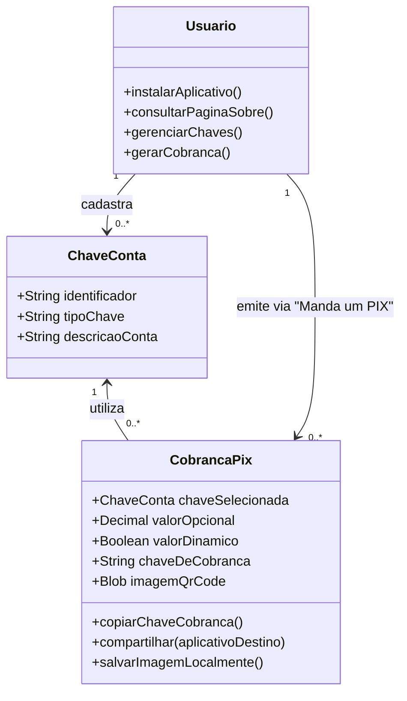

[Início](../README.md) > [Negócio](./overview.md) > **Modelo de Domínio**

# 📖 Modelo de Domínio e Linguagem Ubíqua

Este documento estabelece o vocabulário padronizado (**Linguagem Ubíqua**) e as regras de negócio centrais do **Manda um PIX**.

---

## 🗣️ Glossário (Linguagem Ubíqua)

| Termo                                    | Definição no Contexto do Manda um PIX                                                                                                                                                                                                                                                                                                                                                                                                                                                                  |
| :--------------------------------------- | :----------------------------------------------------------------------------------------------------------------------------------------------------------------------------------------------------------------------------------------------------------------------------------------------------------------------------------------------------------------------------------------------------------------------------------------------------------------------------------------------------- |
| **Chave de Conta (Chave PIX)**           | Identificador vinculado a uma conta bancária ou de pagamento (CPF, CNPJ, E-mail, Telefone celular ou Chave Aleatória EVP) cadastrado pelo usuário para receber transferências.                                                                                                                                                                                                                                                                                                                         |
| **Cobrança PIX**                         | Solicitação de pagamento gerada a partir de uma chave cadastrada e, opcionalmente, um valor monetário.                                                                                                                                                                                                                                                                                                                                                                                                 |
| **Valor Definido (Fixo)**                | Quantia monetária explícita informada pelo Recebedor antes de gerar a cobrança.                                                                                                                                                                                                                                                                                                                                                                                                                        |
| **Valor Dinâmico (Aberto)**              | Modalidade em que nenhum valor é preenchido pelo Recebedor na geração da cobrança, mantendo o valor em aberto no QR Code e na chave de cobrança gerada.                                                                                                                                                                                                                                                                                                                                                |
| **Ação "Manda um PIX"**                  | Gatilho principal da interface que processa os dados selecionados (chave + valor opcional) e gera o QR Code e a chave de cobrança.                                                                                                                                                                                                                                                                                                                                                                     |
| **Chave de Cobrança (PIX Copia e Cola)** | Código textual padronizado (payload EMV® / BR Code) gerado junto ao QR Code, que pode ser copiado para a área de transferência ou enviado por mensagem para pagamento sem câmera.                                                                                                                                                                                                                                                                                                                      |
| **QR Code de Cobrança**                  | Representação gráfica bidimensional da cobrança gerada na tela, passível de leitura óptica imediata ou download como arquivo de imagem local.                                                                                                                                                                                                                                                                                                                                                          |
| **Botão "Instalar"**                     | Elemento de interface apresentado de forma destacada exclusivamente para usuários que ainda não instalaram o aplicativo (PWA) no dispositivo, acionando a instalação local.                                                                                                                                                                                                                                                                                                                            |
| **Página "Sobre"**                       | Página de fácil acesso no aplicativo que apresenta o aplicativo (destacando que é **gratuito, livre e de código aberto**), informações sobre o **autor** (**Luiz Henrique Canet Filho** `<me@luizca.net>`) e sobre o **projeto**, um convite descontraído com emojis e a frase **"Manda um PIX"** para contribuição voluntária de qualquer valor via **QR Code com valor dinâmico** e **Chave copia e cola** para **`eu@luizca.net`**, além do incentivo para divulgar o aplicativo para mais pessoas. |
| **Origem Canônica (`mandaumpix.app`)**   | Endereço web oficial e verificado sob protocolo HTTPS no qual a aplicação legítima é servida e garantida via política de mesma origem (_Same-Origin Policy_).                                                                                                                                                                                                                                                                                                                                          |
| **Réplica Maliciosa (Phishing)**         | Clone não autorizado do código-fonte ou da interface do aplicativo hospedado em domínios fraudulentos ou pacotes Android adulterados, visando desviar pagamentos PIX ou capturar dados do usuário.                                                                                                                                                                                                                                                                                                     |
| **Monitoramento Ativo**                  | Rotina automatizada e contínua de inspeção em registros públicos de emissão de certificados (_Certificate Transparency_) e permutações de DNS (_Typosquatting_) para identificar domínios fraudulentos antes que atinjam usuários em massa.                                                                                                                                                                                                                                                            |
| **Derrubada (Takedown)**                 | Procedimento formal e emergencial acionado junto a navegadores (Google Safe Browsing), CSIRTs (CERT.br), provedores de nuvem/DNS e registradores de domínio para desativação de páginas golpistas.                                                                                                                                                                                                                                                                                                     |
| **Zero-Credential Architecture**         | Princípio de segurança em que a aplicação opera sem jamais solicitar, intermediar ou armazenar senhas bancárias, tokens de acesso, logins institucionais ou dados de cartões de crédito.                                                                                                                                                                                                                                                                                                               |

---

## 📏 Regras de Negócio Essenciais

### RN01 — Múltiplas Chaves Cadastradas

- O usuário pode cadastrar uma ou mais chaves PIX associadas às contas nas quais deseja receber valores.
- As chaves cadastradas ficam disponíveis para seleção rápida na geração de novas cobranças, evitando redigitação.

### RN02 — Seleção Obrigatória de Chave na Cobrança

- Para gerar uma cobrança, é obrigatório selecionar uma chave previamente cadastrada.

### RN03 — Opcionalidade do Valor da Cobrança

- O campo de valor monetário é **opcional**:
  - **Com valor preenchido**: A cobrança gerada incorpora o montante específico definido pelo Recebedor.
  - **Sem valor preenchido**: A cobrança é gerada com valor dinâmico (em aberto).

### RN04 — Geração Simultânea de QR Code e Chave de Cobrança

- Ao acionar **"Manda um PIX"**, o sistema deve apresentar na tela tanto a imagem do **QR Code** quanto a **chave de cobrança textual** correspondente.

### RN05 — Opções de Saída e Distribuição

- Toda cobrança gerada disponibiliza três ações de distribuição ao usuário:
  1. **Copiar**: Copia a chave de cobrança para a área de transferência do dispositivo.
  2. **Compartilhar**: Envia os dados da cobrança para aplicativos externos (como o **WhatsApp**).
  3. **Salvar Imagem**: Faz o download/salvamento local da imagem do QR Code gerado no dispositivo do usuário.

### RN06 — Exibição Destacada do Botão "Instalar" para Aplicativo Não Instalado

- O aplicativo deve apresentar de forma destacada um botão **"Instalar"** para usuários que ainda não instalaram o aplicativo no dispositivo.
- Quando o aplicativo já estiver instalado no dispositivo (ou após a conclusão da instalação pelo usuário), o botão **"Instalar"** não deve ser exibido.

### RN07 — Acesso Fácil à Página Sobre o Aplicativo (Autor, Projeto, Apoio Voluntário e Divulgação)

- O aplicativo deve apresentar na interface um acesso fácil e direto a uma página que fale sobre o aplicativo (**Página "Sobre"**).
- A página deve conter informações claras sobre:
  1. **O Aplicativo e Natureza Livre**: Descrição e propósito do **Manda um PIX** (`mandaumpix.app`), deixando explícito que o aplicativo é **gratuito, livre e de código aberto** (_Free, Libre and Open Source Software_), funcionando como PWA 100% local sem exigir abertura de aplicativos bancários.
  2. **O Projeto**: Versão (`v1.0.0`), licenciamento sob **GNU AGPL v3.0 (`AGPL-3.0-only`)** e links do repositório oficial ([`github.com/luizcanet/mandaumpix.app`](https://github.com/luizcanet/mandaumpix.app)).
  3. **O Autor**: Identificação e contato do criador e mantenedor do projeto, **Luiz Henrique Canet Filho** (`<me@luizca.net>`).
  4. **Contribuição Voluntária ("Manda um PIX")**: Caso o usuário ache que o aplicativo é útil para ele e para outras pessoas, deve ser convidado — de maneira **descontraída, utilizando emojis** e a frase **"Manda um PIX"** — a contribuir com **qualquer valor** para ajudar a manter o projeto, apresentando na própria página um **QR Code com valor dinâmico (aberto)** e a **Chave copia e cola** para **`eu@luizca.net`**.
  5. **Incentivo à Divulgação**: Deve incentivar o usuário a **divulgar e compartilhar o aplicativo para mais pessoas**, ajudando a comunidade a conhecer e utilizar a ferramenta.

### RN08 — Verificação de Autenticidade e Proteção contra Réplicas Maliciosas

- O aplicativo deve orientar ativamente o usuário sobre sua legitimidade e proveniência:
  1. **Indicação Explícita da Origem Oficial**: A interface (em seções de segurança ou na página "Sobre") deve explicitar que o endereço canônico e oficial do aplicativo é exclusivamente `https://mandaumpix.app`.
  2. **Reforço do Princípio Zero-Credential**: Deve constar alerta claro de que o **Manda um PIX nunca solicita senhas bancárias, chaves de acesso a contas ou dados de cartão de crédito**, orientando o usuário a desconfiar e denunciar qualquer versão ou site que faça tais exigências.
  3. **Conferência Obrigatória do Titular**: A interface deve instruir o usuário que, ao realizar pagamentos ou transferências via PIX, deve sempre validar o nome e documento do titular de destino exibidos pelo aplicativo bancário antes de confirmar o envio.

---

## 🧩 Diagrama Conceitual de Domínio

---

⬅️ **Anterior**: [Visão de Negócio](./overview.md) | ➡️ **Próximo**: [Fluxos de Trabalho e Jornadas](./workflows.md)
