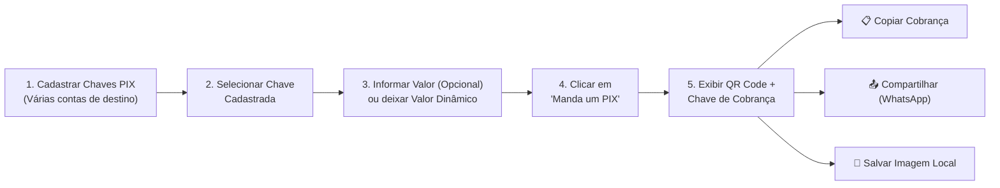

[Início](../README.md) > **Negócio: Visão Geral**

# 💼 Visão de Negócio e Proposta de Valor

## 🎯 Objetivo do Sistema

O **Manda um PIX** (`mandaumpix.app`) é um aplicativo web progressivo (**PWA — Progressive Web App**) gratuito projetado para simplificar e acelerar a geração de cobranças via **PIX** sem que o usuário precise abrir aplicativos de instituições bancárias a cada transação.

Abrir aplicativos de banco em dispositivos móveis ou públicos frequentemente envolve múltiplas etapas de autenticação biométrica/senha, carregamento lento, exposição de saldos bancários a terceiros e navegação complexa até a área de geração de QR Code. O **Manda um PIX** elimina esse atrito ao focar exclusivamente na operação de **recebimento/cobrança**.

---

## 💡 Proposta de Valor

1. **Agilidade Operacional**: Geração de cobranças em poucos toques — basta escolher a chave cadastrada, informar opcionalmente o valor e clicar em **"Manda um PIX"**.
2. **Privacidade Visual e Segurança Físico-Operacional**: Permite gerar cobranças na frente de clientes sem abrir o aplicativo do banco nem expor saldo, extrato ou limites de crédito.
3. **Gestão Multi-Contas**: Possibilita cadastrar várias chaves PIX pertencentes a diferentes contas onde o usuário deseja receber pagamentos.
4. **Flexibilidade de Cobrança**: Suporta tanto cobranças com **valor fixo definido** quanto cobranças com **valor dinâmico/aberto** (geradas sem valor pré-fixado).
5. **Omnicanalidade no Compartilhamento**:
   - Exibição imediata do **QR Code** em tela.
   - Cópia rápida da **chave/código de cobrança** (PIX Copia e Cola).
   - Compartilhamento direto com aplicativos externos de mensagens (como **WhatsApp**).
   - Opção de **salvar a imagem do QR Code localmente** no dispositivo para envio posterior ou impressão.
6. **Acesso Gratuito e Multiplataforma**: Distribuído como PWA gratuito, acessível diretamente pelo navegador e instalável na tela inicial do dispositivo.

---

## 👥 Público-Alvo, Persona e Atores

O aplicativo visa atender **exclusivamente ao Recebedor** — não há interface, jornada ou funcionalidade voltada para quem realiza o pagamento.

| Ator / Sistema                               | Tipo                    | Perfil e Objetivos no Sistema                                                                                                                                                                                                                                                                                                         |
| :------------------------------------------- | :---------------------- | :------------------------------------------------------------------------------------------------------------------------------------------------------------------------------------------------------------------------------------------------------------------------------------------------------------------------------------ |
| **Recebedor (Único Usuário do Aplicativo)**  | Persona / Ator Primário | Pessoa física, profissional autônomo, prestador de serviço ou comerciante que precisa receber via PIX com agilidade. Utiliza o aplicativo para cadastrar várias chaves de contas, selecionar a chave desejada, informar opcionalmente um valor e clicar em **"Manda um PIX"** para exibir, copiar, compartilhar ou salvar a cobrança. |
| **Aplicativos Externos de Compartilhamento** | Sistema Externo         | Aplicativos instalados no dispositivo do Recebedor (como **WhatsApp**) que recebem a chave de cobrança ou imagem compartilhada a partir do PWA.                                                                                                                                                                                       |

---

## 🗺️ Visão Macro da Jornada de Valor

---

⬅️ **Anterior**: [Índice Geral](../README.md) | ➡️ **Próximo**: [Modelo de Domínio e Linguagem Ubíqua](./domain_model.md)
