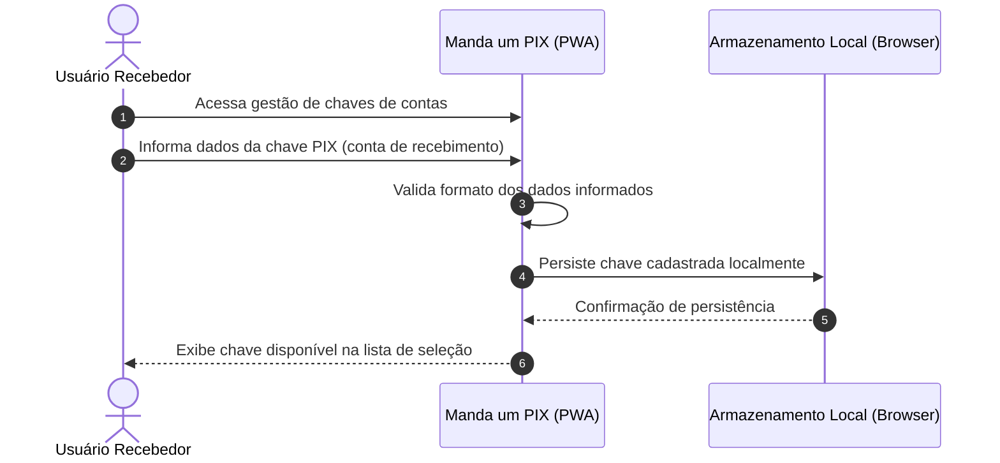
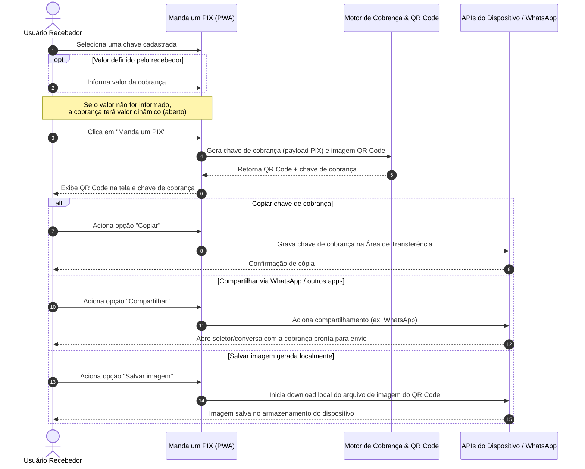
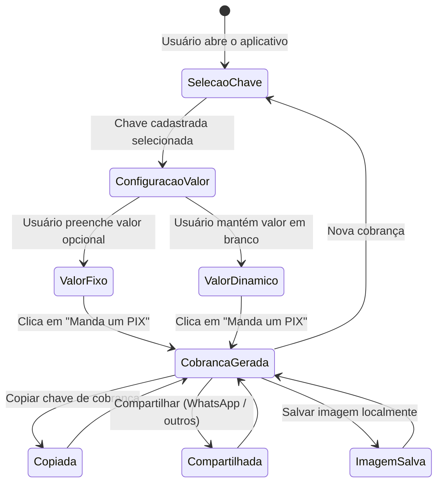

[Início](../README.md) > [Negócio](./overview.md) > **Fluxos de Trabalho**

# 🔄 Fluxos de Trabalho e Jornadas do Usuário

Este documento detalha os fluxos operacionais executados pelo usuário no **Manda um PIX**.

---

## 1. Fluxo de Cadastro de Chaves de Contas

O usuário registra as chaves PIX das contas nas quais deseja receber pagamentos para que fiquem disponíveis para uso recorrente.

---

## 2. Fluxo Principal: Geração e Compartilhamento de Cobrança ("Manda um PIX")

Jornada central de geração de cobrança com valor informado ou valor dinâmico, seguida de cópia, compartilhamento via WhatsApp ou download local da imagem do QR Code.

---

## 3. Máquina de Estados de uma Cobrança na Sessão

---

⬅️ **Anterior**: [Modelo de Domínio](./domain_model.md) | ➡️ **Próximo**: [Arquitetura do Sistema](../architecture/overview.md)
