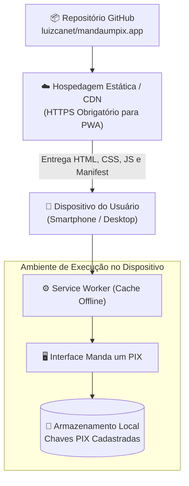

[Início](../README.md) > [Implantação](./pipeline.md) > **Infraestrutura**

# ☁️ Infraestrutura e Topologia de Execução

Por ser um **Progressive Web App (PWA)** gratuito baseado em módulos ES nativos para o navegador, a topologia do **Manda um PIX** dispensa servidores de aplicação backend dedicados ou bancos de dados gerenciados em nuvem.

---

## 🌐 Topologia de Entrega Estática e Execução Client-Side

---

## 🔒 Requisitos de Infraestrutura para PWA

1. **Servido sobre HTTPS**:
   - Exigência obrigatória dos navegadores modernos para registro de _Service Workers_, uso da **Clipboard API** (`navigator.clipboard`) e uso da **Web Share API** (`navigator.share`).
2. **Hospedagem de Ativos Estáticos**:
   - Como o pacote utiliza ES Modules nativos (`"type": "module"`), os arquivos estáticos devem ser servidos com o cabeçalho MIME `application/javascript; charset=utf-8`.
3. **Sem Containerização Backend**:
   - Não há `Dockerfile` ou `docker-compose.yml` no repositório, pois toda a carga de processamento (geração do código PIX e renderização do QR Code) ocorre no navegador do cliente.

---

⬅️ **Anterior**: [Pipeline de Implantação](./pipeline.md) | ➡️ **Próximo**: [Configuração e Ambiente](../configuration/environment.md)
