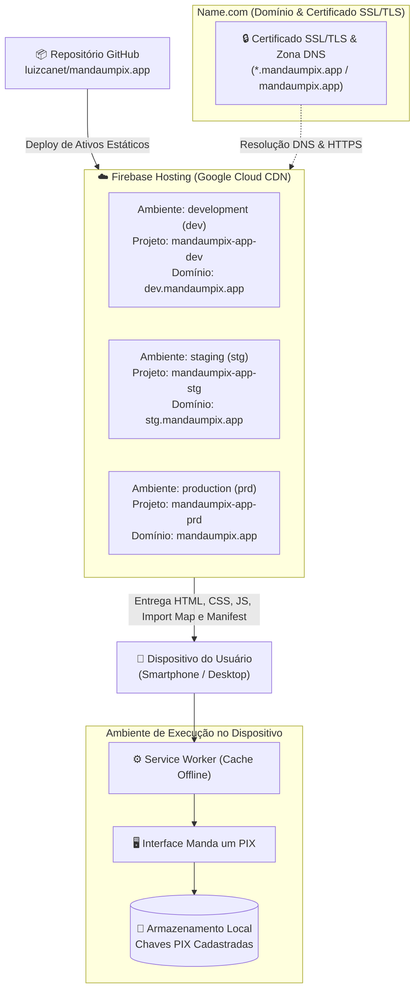

[Início](../README.md) > [Implantação](./pipeline.md) > **Infraestrutura**

# ☁️ Infraestrutura e Topologia de Execução

Por ser um **Progressive Web App (PWA)** gratuito, livre e de código aberto, baseado em módulos ES nativos para o navegador, a topologia do **Manda um PIX** dispensa servidores de aplicação backend dedicados ou bancos de dados gerenciados em nuvem, utilizando **Firebase Hosting** para distribuição estática global e **Name.com** para gestão de domínio e certificado digital.

---

## 🌍 Domínio, Certificado e Ambientes de Hospedagem

- **Registrador de Domínio e Autoridade de Certificado**: [**Name.com**](https://www.name.com/) — responsável pelo registro do domínio `mandaumpix.app`, gerenciamento de zonas DNS e fornecimento do certificado SSL/TLS.
- **Plataforma de Hospedagem e CDN**: [**Firebase Hosting**](https://firebase.google.com/docs/hosting) — hospedagem estática de alta performance segregada em três projetos independentes no Firebase (veja a decisão arquitetural em [ADR 0003](../architecture/decisions/0003-hospedagem-firebase-hosting-e-dominio-name-com.md)).

### Matriz de Ambientes, Branches (Git Flow) e Projetos Firebase

| Ambiente      | Sigla | Branch Git Flow ([ADR 0005](../architecture/decisions/0005-modelo-de-branching-git-flow.md)) | Domínio / URL                | Projeto no Firebase  | Finalidade Operacional                                                          |
| :------------ | :---: | :------------------------------------------------------------------------------------------- | :--------------------------- | :------------------- | :------------------------------------------------------------------------------ |
| `development` | `dev` | `develop`                                                                                    | `https://dev.mandaumpix.app` | `mandaumpix-app-dev` | Validação contínua de integrações e novas funcionalidades em desenvolvimento.   |
| `staging`     | `stg` | `release/*` / `hotfix/*`                                                                     | `https://stg.mandaumpix.app` | `mandaumpix-app-stg` | Homologação pré-produção, testes de aceitação e validação de release candidate. |
| `production`  | `prd` | `main` (tags `v*`)                                                                           | `https://mandaumpix.app`     | `mandaumpix-app-prd` | Ambiente produtivo oficial disponível para os usuários finais do PWA.           |

---

## 🌐 Topologia de Entrega Estática e Execução Client-Side

---

## 🔒 Requisitos de Infraestrutura para PWA

1. **Servido sobre HTTPS (`mandaumpix.app`)**:
   - O TLD `.app` pertence à lista HSTS Preload, exigindo HTTPS em todas as conexões.
   - O certificado fornecido via **Name.com** em conjunto com o **Firebase Hosting** garante conexões criptografadas para `mandaumpix.app`, `stg.mandaumpix.app` e `dev.mandaumpix.app`, requisito obrigatório dos navegadores modernos para registro de _Service Workers_, uso da **Clipboard API** (`navigator.clipboard`) e uso da **Web Share API** (`navigator.share`).
2. **Hospedagem de Ativos Estáticos no Firebase Hosting**:
   - Como o pacote utiliza ES Modules nativos (`"type": "module"`), os arquivos estáticos são servidos pela CDN do Firebase Hosting com cabeçalho MIME `application/javascript; charset=utf-8` e compressão automática (`Brotli`/`Gzip`).
3. **Sem Containerização Backend**:
   - Não há `Dockerfile` ou `docker-compose.yml` no repositório, pois toda a carga de processamento (geração do código PIX e renderização do QR Code) ocorre no navegador do cliente.

---

⬅️ **Anterior**: [Pipeline de Implantação](./pipeline.md) | ➡️ **Próximo**: [Configuração e Ambiente](../configuration/environment.md)
