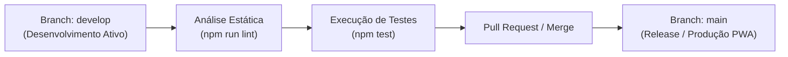

[Início](../README.md) > **Implantação: Pipeline**

# 🚀 Pipeline de Verificação e Implantação

Este documento descreve o fluxo de verificação contínua e entrega do **Manda um PIX** (`mandaumpix.app`).

---

## 🔄 Fluxo de Controle de Versão e Qualidade

Atualmente o repositório opera com o modelo de branches Git (`main` e `develop`, conforme histórico Git local e remoto em `https://github.com/luizcanet/mandaumpix.app.git`).

---

## 🛠️ Scripts de Automação Disponíveis ([`package.json`](../../package.json))

| Script         | Comando Executado                           | Status Atual                                                                                   |
| :------------- | :------------------------------------------ | :--------------------------------------------------------------------------------------------- |
| `npm run lint` | `eslint .`                                  | ✅ Ativo — valida arquivos `.js`, `.mjs`, `.cjs`, `.json`, `.jsonc`, `.json5`, `.md` e `.css`. |
| `npm test`     | `echo "Error: no test specified" && exit 1` | ⚠️ Placeholder inicial — aguardando configuração do runner de testes.                          |

> **Nota sobre Pipelines CI/CD**: Até o commit `1ba8b55`, ainda não há arquivos de workflow em `.github/workflows/`. Os quality gates são executados localmente via CLI (`npm run lint`) antes dos commits seguindo a convenção de _Conventional Commits_.

---

⬅️ **Anterior**: [Especificações e Contratos](../design/api_specs.md) | ➡️ **Próximo**: [Infraestrutura e Topologia](./infrastructure.md)
