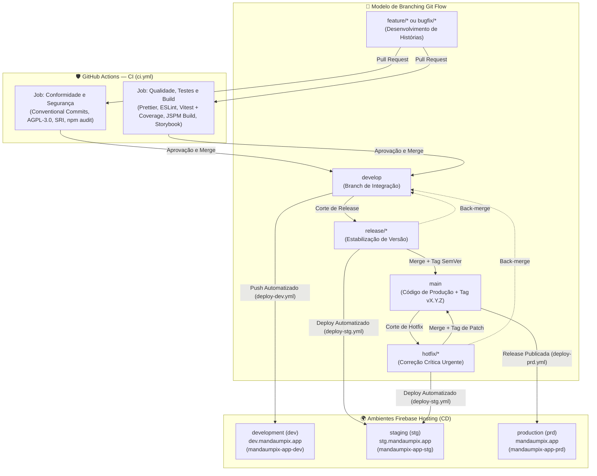
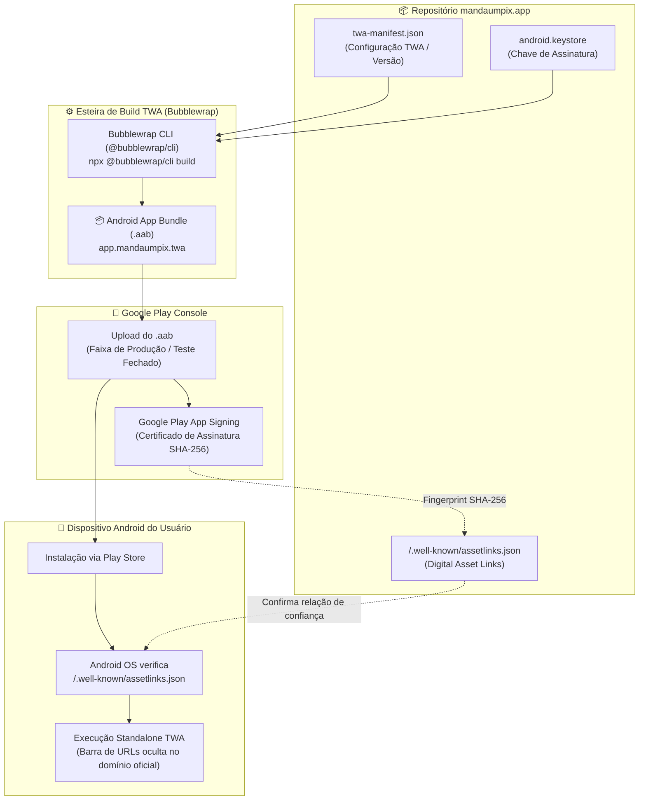

[Início](../README.md) > **Implantação: Pipeline**

# 🚀 Pipeline de Verificação e Implantação

Este documento descreve o fluxo de verificação contínua (CI) e entrega do **Manda um PIX** (`mandaumpix.app`).

---

## 🔄 Modelo de Branching Git Flow e Esteiras de Qualidade (GitHub Actions)

O repositório adota o modelo de branching **Git Flow** ([ADR 0005](../architecture/decisions/0005-modelo-de-branching-git-flow.md)), estruturado em duas branches permanentes (`main` e `develop`) e quatro tipos de branches temporárias de suporte (`feature/*`, `bugfix/*`, `release/*` e `hotfix/*`), integradas às esteiras de Integração Contínua (CI) e Entrega Contínua (CD) via **GitHub Actions** configuradas em [`.github/workflows/ci.yml`](../../.github/workflows/ci.yml) e [`.github/workflows/deploy-dev.yml`](../../.github/workflows/deploy-dev.yml).



### 🌿 Convenção e Ciclo de Vida das Branches (Git Flow)

| Tipo de Branch | Padrão de Nome              | Criada a partir de       | Mesclada em (Destino)        | Papel no Fluxo de Engenharia                                                                                      |
| :------------- | :-------------------------- | :----------------------- | :--------------------------- | :---------------------------------------------------------------------------------------------------------------- |
| **Produção**   | `main`                      | — (Permanente)           | —                            | Armazena exclusivamente o histórico oficial de releases estáveis em produção (marcadas com tags `vX.Y.Z`).        |
| **Integração** | `develop`                   | `main` (Permanente)      | —                            | Consolida continuamente as histórias concluídas para a próxima release e alimenta o ambiente `development`.       |
| **Feature**    | `feature/<escopo>`          | `develop`                | `develop` (via Pull Request) | Desenvolvimento isolado de novas funcionalidades ou tarefas técnicas do [Backlog](../business/backlog.md).        |
| **Bugfix**     | `bugfix/<escopo>`           | `develop` ou `release/*` | `develop` ou `release/*`     | Correção de defeitos não emergenciais identificados durante o desenvolvimento ou na estabilização de uma release. |
| **Release**    | `release/<versao>`          | `develop`                | `main` (com tag) e `develop` | Congelamento de escopo para homologação no ambiente `staging` (`stg`), ajustes finais de versão e documentação.   |
| **Hotfix**     | `hotfix/<versao-ou-escopo>` | `main`                   | `main` (com tag) e `develop` | Correção imediata de incidentes críticos detectados em produção (`prd`), com sincronização reversa na `develop`.  |

### 🌍 Promoção entre Ambientes (Firebase Hosting)

A entrega contínua direciona os artefatos estáticos gerados pelo build (`dist/`), mapeados via [`firebase.json`](../../firebase.json) e [`.firebaserc`](../../.firebaserc), para três ambientes isolados no **Firebase Hosting**, sob o domínio `mandaumpix.app` registrado e certificado no **Name.com** (detalhes em [Infraestrutura e Topologia](./infrastructure.md)):

| Ambiente      | Sigla | Branch / Evento Git Flow Associado | Domínio de Destino   | Projeto no Firebase  | Workflow de Automação                                                        |
| :------------ | :---: | :--------------------------------- | :------------------- | :------------------- | :--------------------------------------------------------------------------- |
| `development` | `dev` | `develop`                          | `dev.mandaumpix.app` | `mandaumpix-app-dev` | [`.github/workflows/deploy-dev.yml`](../../.github/workflows/deploy-dev.yml) |
| `staging`     | `stg` | `release/*` e `hotfix/*`           | `stg.mandaumpix.app` | `mandaumpix-app-stg` | [`.github/workflows/deploy-stg.yml`](../../.github/workflows/deploy-stg.yml) |
| `production`  | `prd` | Release publicada (`published`)    | `mandaumpix.app`     | `mandaumpix-app-prd` | [`.github/workflows/deploy-prd.yml`](../../.github/workflows/deploy-prd.yml) |

### 🚢 Implantação Automatizada em Development (`CD - Deploy Development`)

Configurado em [`.github/workflows/deploy-dev.yml`](../../.github/workflows/deploy-dev.yml), o workflow é disparado automaticamente em eventos de `push` na branch `develop` (como após o merge de um Pull Request) ou manualmente via `workflow_dispatch`:

- **Job `deploy` (`Build e Deploy (Development)`)**:
  - Vinculado ao GitHub Environment `development` (`https://dev.mandaumpix.app`).
  - Executa `npm ci`, validação de formatação (`npm run format:check`), análise estática (`npm run lint`), suíte de testes (`npm test`), empacotamento de produção (`npm run build` gerando `dist/`) e build do catálogo de componentes (`npm run build-storybook -- -o dist/storybook`, acessível em `https://dev.mandaumpix.app/storybook`).
  - Publica os ativos no canal `live` do projeto `mandaumpix-app-dev` utilizando `FirebaseExtended/action-hosting-deploy@v0` autenticado via secret `FIREBASE_SERVICE_ACCOUNT_DEV`.

### 🧪 Implantação Automatizada em Staging (`CD - Deploy Staging`)

Configurado em [`.github/workflows/deploy-stg.yml`](../../.github/workflows/deploy-stg.yml), o workflow é disparado automaticamente em eventos de `push` nas branches `release/*` e `hotfix/*` do Git Flow, ou manualmente via `workflow_dispatch`:

- **Job `deploy` (`Build e Deploy (Staging)`)**:
  - Vinculado ao GitHub Environment `staging` (`https://stg.mandaumpix.app`).
  - Executa a esteira estrita de qualidade: `npm ci`, validação de formatação (`npm run format:check`), análise estática (`npm run lint`), suíte de testes automatizados (`npm test`), empacotamento de produção (`npm run build` gerando `dist/`) e compilação do catálogo de componentes (`npm run build-storybook -- -o dist/storybook`, acessível em `https://stg.mandaumpix.app/storybook`).
  - Publica os ativos no canal `live` do projeto `mandaumpix-app-stg` utilizando `FirebaseExtended/action-hosting-deploy@v0` autenticado via secret `FIREBASE_SERVICE_ACCOUNT_STG`.

### 🚀 Implantação Automatizada em Production (`CD - Deploy Production`)

Configurado em [`.github/workflows/deploy-prd.yml`](../../.github/workflows/deploy-prd.yml), o workflow possui como gatilho exclusivo a publicação oficial de uma release no GitHub (`release: types: [published]`):

- **Job `deploy` (`Build e Deploy (Production)`)**:
  - Vinculado ao GitHub Environment `production` (`https://mandaumpix.app`).
  - Executa a esteira estrita de qualidade: `npm ci`, validação de formatação (`npm run format:check`), análise estática (`npm run lint`), suíte de testes automatizados (`npm test`) e empacotamento otimizado de produção (`npm run build` gerando `dist/` sem inclusão de assets de documentação).
  - Publica os ativos no canal `live` do projeto `mandaumpix-app-prd` utilizando `FirebaseExtended/action-hosting-deploy@v0` autenticado via secret `FIREBASE_SERVICE_ACCOUNT_PRD`.

### 🛡️ Verificações Executadas no Workflow (`CI - Qualidade e Conformidade`)

O workflow é disparado automaticamente em eventos de `pull_request` (`opened`, `synchronize`, `reopened`, `edited`, `ready_for_review`), `push` para `main` e `develop`, ou manualmente via `workflow_dispatch`:

1. **Job `compliance` (`Conformidade e Segurança`)**:
   - **Conventional Commits**: Valida se o título do Pull Request e todas as mensagens de commit seguem a especificação _Conventional Commits_ em inglês (`feat`, `fix`, `docs`, `style`, `refactor`, `perf`, `test`, `build`, `ci`, `chore`, `revert`).
   - **Licenciamento e Higiene**: Confirma a presença do arquivo [`LICENSE`](../../LICENSE), a declaração `"license": "AGPL-3.0-only"` no [`package.json`](../../package.json) e garante que nenhum arquivo `.env` sensível foi versionado.
   - **Integridade de Import Maps e SRI**: Verifica se [`index.html`](../../index.html) e [`importmap.js`](../../importmap.js) possuem o `<script type="importmap">` e os hashes de _Subresource Integrity_ (`"integrity"`).
   - **Auditoria de Dependências**: Instala com lockfile estrito (`npm ci`) e executa `npm audit --omit=dev --audit-level=high`.

2. **Job `quality` (`Qualidade, Testes e Build`)**:
   - **Formatação (`npm run format:check`)**: Verifica a aderência de código e documentação ao **Prettier v3** ([`.prettierrc`](../../.prettierrc) e [`.prettierignore`](../../.prettierignore)).
   - **Análise Estática (`npm run lint`)**: Executa o **ESLint v10** em arquivos JavaScript, JSON, JSONC, JSON5, Markdown e CSS ([`eslint.config.js`](../../eslint.config.js)).
   - **Testes e Cobertura (`npm run test:coverage`)**: Executa a suíte de testes unitários com **Vitest** e **JSDOM**, gerando e publicando o artefato de cobertura V8 (`coverage-report`).
   - **Validação de Builds (`npm run build` e `npm run build-storybook`)**: Garante que o pacote de produção (`dist/`) e o catálogo estático de componentes (`storybook-static/`) compilam sem erros.

---

## 📱 Publicação Oficial na Google Play Store via Trusted Web Activity (TWA) (`US-08.4`)

Como parte da estratégia defensiva de proteção da marca e integridade do software (`RN06`, `RN08`), o **Manda um PIX** disponibiliza empacotamento oficial para a **Google Play Store** utilizando a tecnologia **Trusted Web Activity (TWA)** via **Bubblewrap CLI** da Google Chrome Labs.

Essa abordagem oferece três benefícios fundamentais:

1. **Ocupação Defensiva da Loja**: Previne que golpistas registrem aplicativos fraudulentos, réplicas maliciosas ou trojans bancários utilizando a marca oficial `mandaumpix.app` na Google Play.
2. **Vinculação Criptográfica Bi-Direcional (Digital Asset Links)**: Garante que apenas o aplicativo Android oficial assinado com as chaves legítimas possa executar sem a barra de endereços do navegador (Custom Tab), abrindo o domínio canônico seguro `https://mandaumpix.app` em modo nativo / standalone.
3. **Distribuição Sem Overhead de Código**: Todo o código executado permanece 100% web, baseado nos módulos ES nativos hospedados no Firebase Hosting, beneficiando-se instantaneamente de atualizações de segurança e melhorias contínuas sem necessidade de novo ciclo de aprovação na loja para alterações puramente web.



### 1. Arquivos de Configuração Envolvidos

| Arquivo                        | Localização no Repositório                                         | Responsabilidade                                                                                                                                                                   |
| :----------------------------- | :----------------------------------------------------------------- | :--------------------------------------------------------------------------------------------------------------------------------------------------------------------------------- |
| **Manifesto TWA**              | [`twa-manifest.json`](../../twa-manifest.json)                     | Metadados do Bubblewrap: package name `app.mandaumpix.twa`, versão sincronizada com [`package.json`](../../package.json), cores de tema, ícones de 512px e parâmetros da keystore. |
| **Digital Asset Links**        | [`.well-known/assetlinks.json`](../../.well-known/assetlinks.json) | Declaração pública de permissão (`delegate_permission/common.handle_all_urls`) mapeando o SHA-256 da assinatura do Android ao domínio canônico `https://mandaumpix.app`.           |
| **Configuração de Cabeçalhos** | [`firebase.json`](../../firebase.json)                             | Garante que o arquivo `assetlinks.json` seja servido com `Content-Type: application/json` e cache estático adequado pelo Firebase Hosting.                                         |
| **Web App Manifest**           | [`manifest.json`](../../manifest.json)                             | Manifesto PWA padrão W3C que fornece as diretivas visuais de `display: standalone`, temas e ícones de inicialização.                                                               |

---

### 2. Pré-requisitos de Ambiente

Para compilar o Android App Bundle localmente ou em esteiras de automação, são necessárias as seguintes ferramentas instaladas e configuradas no ambiente:

1. **Node.js**: versão `20.x` LTS ou superior e `npm`.
2. **Java Development Kit (JDK)**: versão `17` LTS (ou superior) com a variável de ambiente `JAVA_HOME` configurada.
3. **Android SDK Command-Line Tools**: componentes `platforms;android-34`, `build-tools;34.0.0` e variável `ANDROID_HOME` configurada.
4. **Bubblewrap CLI**: executado diretamente via `npx @bubblewrap/cli` ou instalado globalmente com `npm install -g @bubblewrap/cli`.

---

### 3. Passo a Passo de Compilação do Android App Bundle (`.aab`)

#### Passo 1: Geração da Chave de Assinatura (Upload Keystore)

Caso ainda não possua uma keystore de upload oficial gerada, crie-a utilizando a ferramenta `keytool` do JDK:

```bash
keytool -genkeypair \
  -v \
  -keystore android.keystore \
  -alias mandaumpix \
  -keyalg RSA \
  -keysize 2048 \
  -validity 10000 \
  -storetype PKCS12
```

> ⚠️ **Atenção**: Armazene o arquivo `android.keystore` e suas credenciais em local seguro (gestor de segredos ou cofre criptografado). **Nunca versioná-lo em commits públicos do repositório**.

#### Passo 2: Extração da Impressão Digital SHA-256 da Chave

Extraia a impressão digital SHA-256 do certificado para registrar no Digital Asset Links:

```bash
keytool -list -v -keystore android.keystore -alias mandaumpix
```

Localize a linha contendo `SHA256:` (formato `XX:XX:XX:...:XX`) e assegure-se de que ela esteja adicionada à lista `sha256_cert_fingerprints` em [`.well-known/assetlinks.json`](../../.well-known/assetlinks.json).

#### Passo 3: Validação da Sincronização de Versão

Antes da compilação, execute a suíte de testes do manifesto para garantir conformidade entre [`twa-manifest.json`](../../twa-manifest.json) e [`package.json`](../../package.json):

```bash
npx vitest run test/security/twa-manifest.test.js
```

#### Passo 4: Compilação com Bubblewrap CLI

Execute a geração e build do projeto Android com o Bubblewrap a partir da raiz do repositório:

```bash
npx @bubblewrap/cli build
```

O comando irá:

1. Validar os metadados em [`twa-manifest.json`](../../twa-manifest.json).
2. Baixar e configurar as dependências Android Gradle (usando AndroidX e Custom Tabs).
3. Gerar o pacote otimizado **Android App Bundle** assinado em:
   ```text
   ./app-release-bundle.aab
   ```
4. Gerar também o arquivo APK assinado para testes locais (`./app-release-signed.apk`).

#### Passo 5: Teste Local em Dispositivo ou Emulador Android

Conecte um dispositivo Android via USB (com depuração USB ativada) ou inicie um emulador Android e instale o pacote de teste:

```bash
npx @bubblewrap/cli install
```

Verifique se o aplicativo abre sem a barra superior de URL do navegador. Se a barra for exibida, significa que a validação de Digital Asset Links falhou no dispositivo (verifique a conectividade de rede e a correspondência do SHA-256 em `https://mandaumpix.app/.well-known/assetlinks.json`).

---

### 4. Passo a Passo de Upload e Publicação no Google Play Console

#### Passo 1: Criação da Aplicação no Google Play Console

1. Acesse o [Google Play Console](https://play.google.com/console) com a conta oficial de desenvolvedor.
2. Clique em **Criar app** e preencha:
   - **Nome do app**: `Manda um PIX`
   - **Idioma padrão**: `Português (Brasil) - pt-BR`
   - **Tipo de aplicativo**: `App`
   - **Preço**: `Gratuito`
   - Aceite as declarações de conformidade e leis de exportação dos EUA.

#### Passo 2: Configuração do Google Play App Signing

1. Acesse **Configuração** > **Integridade do app** (_App Integrity_).
2. Selecione a opção recomendada do Google: **Usar o serviço de assinatura de apps do Google Play** (_Google Play App Signing_).
3. Após habilitado, copie a **Impressão digital do certificado de assinatura do app** (_App signing certificate SHA-256 fingerprint_).
4. Adicione esta impressão digital ao array `sha256_cert_fingerprints` em [`.well-known/assetlinks.json`](../../.well-known/assetlinks.json) e publique a atualização via Firebase Hosting.
   > ℹ️ **Importante**: O Google Play assina os APKs distribuídos aos usuários finais com uma chave gerada em nuvem pelo próprio Play Console. Portanto, o arquivo `assetlinks.json` deve conter **ambos** os hashes SHA-256: o da chave de upload local (usado em testes e durante a verificação inicial) e o da chave definitiva de assinatura do Google Play.

#### Passo 3: Envio do Android App Bundle (`.aab`)

1. No menu lateral, acesse **Produção** (ou **Teste interno** / **Teste fechado** para homologação).
2. Crie uma nova versão (_Create new release_).
3. Faça o upload do arquivo `app-release-bundle.aab`.
4. Preencha as notas de lançamento (Release Notes) em português, alinhadas ao [`docs/CHANGELOG.md`](../CHANGELOG.md).
5. Salve e revise a versão.

#### Passo 4: Ficha da Loja e Políticas de Privacidade

1. **Ficha principal da loja**:
   - Descrição curta: `Aplicativo web progressivo gratuito que facilita a geração de cobranças via PIX.`
   - Descrição completa: destacar a natureza livre, open-source (GNU AGPL v3.0), Zero-Backend, sem coleta de dados e sem solicitação de credenciais financeiras.
   - Ícones e capturas de tela: utilizar os assets oficiais de [`src/assets/icons/`](../../src/assets/icons/) em alta resolução.
2. **Conteúdo do app**:
   - **Política de Privacidade**: URL oficial `https://mandaumpix.app/docs/security/compliance.md` ou seção de segurança na página Sobre `https://mandaumpix.app/sobre`.
   - **Acesso a apps**: todas as funcionalidades estão disponíveis sem restrições ou credenciais.
   - **Classificação de conteúdo**: Livre (L / Todos).
   - **Segurança dos dados**: declarar explicitamente que o app **não coleta, não armazena em servidores remotos e não compartilha dados de usuários** (Arquitetura Local-First / Zero-Backend).

---

### 5. Auditoria e Validação do Digital Asset Links

Para auditar e confirmar que a relação entre o domínio canônico e a aplicação Android foi registrada com sucesso, utilize a API oficial de verificação do Google:

```bash
curl -s "https://digitalassetlinks.googleapis.com/v1/statements:check?source.web.site=https://mandaumpix.app&relation=delegate_permission/common.handle_all_urls&target.android_app.package_name=app.mandaumpix.twa&target.android_app.certificate.sha256_fingerprint=SEU_SHA256_AQUI"
```

A resposta deve conter:

```json
{
  "linked": true
}
```

Essa resposta positiva confirma que o ecossistema Android reconhece a aplicação como proprietária legítima do domínio `mandaumpix.app`, garantindo experiência nativa segura e imunidade contra tentativas de spoofing de origem.

---

## 🛠️ Scripts de Automação Disponíveis ([`package.json`](../../package.json))

| Script                    | Comando Executado                                                  | Status Atual                                                                                   |
| :------------------------ | :----------------------------------------------------------------- | :--------------------------------------------------------------------------------------------- |
| `npm start`               | `jspm serve`                                                       | ✅ Ativo — inicia o servidor de desenvolvimento baseado em padrões web na porta `5776`.        |
| `npm run serve`           | `jspm serve --watch`                                               | ✅ Ativo — inicia o servidor local com monitoramento de alterações e live-reload.              |
| `npm run importmap`       | `jspm install && jspm install -o index.html --preload --integrity` | ✅ Ativo — gera `importmap.js` e injeta Import Map, `modulepreload` e SRI no `index.html`.     |
| `npm run build`           | `node scripts/build.js`                                            | ✅ Ativo — gera o pacote estático de produção em `dist/` com validação de SRI e preloads.      |
| `npm run lint`            | `eslint .`                                                         | ✅ Ativo — valida arquivos `.js`, `.mjs`, `.cjs`, `.json`, `.jsonc`, `.json5`, `.md` e `.css`. |
| `npm run format`          | `prettier --write .`                                               | ✅ Ativo — formata os arquivos do repositório com Prettier.                                    |
| `npm run format:check`    | `prettier --check .`                                               | ✅ Ativo — verifica a formatação dos arquivos sem modificá-los (utilizado no CI).              |
| `npm test`                | `vitest run`                                                       | ✅ Ativo — executa a suíte de testes automatizados com Vitest e JSDOM.                         |
| `npm run test:watch`      | `vitest`                                                           | ✅ Ativo — executa o Vitest em modo interativo de observação (_watch mode_).                   |
| `npm run test:coverage`   | `vitest run --coverage`                                            | ✅ Ativo — executa a suíte de testes e gera relatório de cobertura via V8.                     |
| `npm run storybook`       | `storybook dev -p 6006 --no-open`                                  | ✅ Ativo — inicia o servidor do Storybook na porta `6006` para componentes compartilhados.     |
| `npm run build-storybook` | `storybook build -o storybook-static`                              | ✅ Ativo — gera a versão estática do catálogo de componentes em `storybook-static/`.           |

---

⬅️ **Anterior**: [Proposta de Interface (UI)](../design/ui_proposal.md) | ➡️ **Próximo**: [Infraestrutura e Topologia](./infrastructure.md)
