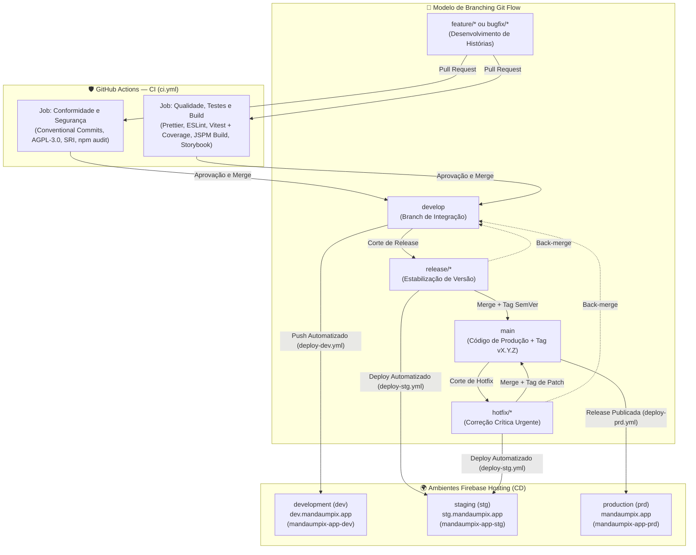

[Início](../README.md) > **Implantação: Pipeline**

# 🚀 Pipeline de Verificação e Implantação

Este documento descreve o fluxo de verificação contínua (CI) e entrega do **Manda um PIX** (`mandaumpix.app`).

---

## 🔄 Modelo de Branching Git Flow e Esteiras de Qualidade (GitHub Actions)

O repositório adota o modelo de branching **Git Flow** ([ADR 0005](../architecture/decisions/0005-modelo-de-branching-git-flow.md)), estruturado em duas branches permanentes (`main` e `develop`) e quatro tipos de branches temporárias de suporte (`feature/*`, `bugfix/*`, `release/*` e `hotfix/*`), integradas às esteiras de Integração Contínua (CI) e Entrega Contínua (CD) via **GitHub Actions** configuradas em [`.github/workflows/ci.yml`](../../.github/workflows/ci.yml) e [`.github/workflows/deploy-dev.yml`](../../.github/workflows/deploy-dev.yml).

### 🌿 Convenção e Ciclo de Vida das Branches (Git Flow)

| Tipo de Branch | Padrão de Nome              | Criada a partir de       | Mesclada em (Destino)        | Papel no Fluxo de Engenharia                                                                                      |
| :------------- | :-------------------------- | :----------------------- | :--------------------------- | :---------------------------------------------------------------------------------------------------------------- |
| **Produção**   | `main`                      | — (Permanente)           | —                            | Armazena exclusivamente o histórico oficial de releases estáveis em produção (marcadas com tags `vX.Y.Z`).        |
| **Integração** | `develop`                   | `main` (Permanente)      | —                            | Consolida continuamente as histórias concluídas para a próxima release e alimenta o ambiente `development`.       |
| **Feature**    | `feature/<escopo>`          | `develop`                | `develop` (via Pull Request) | Desenvolvimento isolado de novas funcionalidades ou tarefas técnicas do [Backlog](../business/backlog.md).        |
| **Bugfix**     | `bugfix/<escopo>`           | `develop` ou `release/*` | `develop` ou `release/*`     | Correção de defeitos não emergenciais identificados durante o desenvolvimento ou na estabilização de uma release. |
| **Release**    | `release/<versao>`          | `develop`                | `main` (com tag) e `develop` | Congelamento de escopo para homologação no ambiente `staging` (`stg`), ajustes finais de versão e documentação.   |
| **Hotfix**     | `hotfix/<versao-ou-escopo>` | `main`                   | `main` (com tag) e `develop` | Correção imediata de incidentes críticos detectados em produção (`prd`), com sincronização reversa na `develop`.  |

### 🌍 Promoção entre Ambientes (Firebase Hosting)

A entrega contínua direciona os artefatos estáticos gerados pelo build (`dist/`), mapeados via [`firebase.json`](../../firebase.json) e [`.firebaserc`](../../.firebaserc), para três ambientes isolados no **Firebase Hosting**, sob o domínio `mandaumpix.app` registrado e certificado no **Name.com** (detalhes em [Infraestrutura e Topologia](./infrastructure.md)):

| Ambiente      | Sigla | Branch / Evento Git Flow Associado | Domínio de Destino   | Projeto no Firebase  | Workflow de Automação                                                        |
| :------------ | :---: | :--------------------------------- | :------------------- | :------------------- | :--------------------------------------------------------------------------- |
| `development` | `dev` | `develop`                          | `dev.mandaumpix.app` | `mandaumpix-app-dev` | [`.github/workflows/deploy-dev.yml`](../../.github/workflows/deploy-dev.yml) |
| `staging`     | `stg` | `release/*` e `hotfix/*`           | `stg.mandaumpix.app` | `mandaumpix-app-stg` | [`.github/workflows/deploy-stg.yml`](../../.github/workflows/deploy-stg.yml) |
| `production`  | `prd` | Release publicada (`published`)    | `mandaumpix.app`     | `mandaumpix-app-prd` | [`.github/workflows/deploy-prd.yml`](../../.github/workflows/deploy-prd.yml) |

### 🚢 Implantação Automatizada em Development (`CD - Deploy Development`)

Configurado em [`.github/workflows/deploy-dev.yml`](../../.github/workflows/deploy-dev.yml), o workflow é disparado automaticamente em eventos de `push` na branch `develop` (como após o merge de um Pull Request) ou manualmente via `workflow_dispatch`:

- **Job `deploy` (`Build e Deploy (Development)`)**:
  - Vinculado ao GitHub Environment `development` (`https://dev.mandaumpix.app`).
  - Executa `npm ci`, validação de formatação (`npm run format:check`), análise estática (`npm run lint`), suíte de testes (`npm test`), empacotamento de produção (`npm run build` gerando `dist/`) e build do catálogo de componentes (`npm run build-storybook -- -o dist/storybook`, acessível em `https://dev.mandaumpix.app/storybook`).
  - Publica os ativos no canal `live` do projeto `mandaumpix-app-dev` utilizando `FirebaseExtended/action-hosting-deploy@v0` autenticado via secret `FIREBASE_SERVICE_ACCOUNT_DEV`.

### 🧪 Implantação Automatizada em Staging (`CD - Deploy Staging`)

Configurado em [`.github/workflows/deploy-stg.yml`](../../.github/workflows/deploy-stg.yml), o workflow é disparado automaticamente em eventos de `push` nas branches `release/*` e `hotfix/*` do Git Flow, ou manualmente via `workflow_dispatch`:

- **Job `deploy` (`Build e Deploy (Staging)`)**:
  - Vinculado ao GitHub Environment `staging` (`https://stg.mandaumpix.app`).
  - Executa a esteira estrita de qualidade: `npm ci`, validação de formatação (`npm run format:check`), análise estática (`npm run lint`), suíte de testes automatizados (`npm test`), empacotamento de produção (`npm run build` gerando `dist/`) e compilação do catálogo de componentes (`npm run build-storybook -- -o dist/storybook`, acessível em `https://stg.mandaumpix.app/storybook`).
  - Publica os ativos no canal `live` do projeto `mandaumpix-app-stg` utilizando `FirebaseExtended/action-hosting-deploy@v0` autenticado via secret `FIREBASE_SERVICE_ACCOUNT_STG`.

### 🚀 Implantação Automatizada em Production (`CD - Deploy Production`)

Configurado em [`.github/workflows/deploy-prd.yml`](../../.github/workflows/deploy-prd.yml), o workflow possui como gatilho exclusivo a publicação oficial de uma release no GitHub (`release: types: [published]`):

- **Job `deploy` (`Build e Deploy (Production)`)**:
  - Vinculado ao GitHub Environment `production` (`https://mandaumpix.app`).
  - Executa a esteira estrita de qualidade: `npm ci`, validação de formatação (`npm run format:check`), análise estática (`npm run lint`), suíte de testes automatizados (`npm test`) e empacotamento otimizado de produção (`npm run build` gerando `dist/` sem inclusão de assets de documentação).
  - Publica os ativos no canal `live` do projeto `mandaumpix-app-prd` utilizando `FirebaseExtended/action-hosting-deploy@v0` autenticado via secret `FIREBASE_SERVICE_ACCOUNT_PRD`.

### 🛡️ Verificações Executadas no Workflow (`CI - Qualidade e Conformidade`)

O workflow é disparado automaticamente em eventos de `pull_request` (`opened`, `synchronize`, `reopened`, `edited`, `ready_for_review`), `push` para `main` e `develop`, ou manualmente via `workflow_dispatch`:

1. **Job `compliance` (`Conformidade e Segurança`)**:
   - **Conventional Commits**: Valida se o título do Pull Request e todas as mensagens de commit seguem a especificação _Conventional Commits_ em inglês (`feat`, `fix`, `docs`, `style`, `refactor`, `perf`, `test`, `build`, `ci`, `chore`, `revert`).
   - **Licenciamento e Higiene**: Confirma a presença do arquivo [`LICENSE`](../../LICENSE), a declaração `"license": "AGPL-3.0-only"` no [`package.json`](../../package.json) e garante que nenhum arquivo `.env` sensível foi versionado.
   - **Integridade de Import Maps e SRI**: Verifica se [`index.html`](../../index.html) e [`importmap.js`](../../importmap.js) possuem o `<script type="importmap">` e os hashes de _Subresource Integrity_ (`"integrity"`).
   - **Auditoria de Dependências**: Instala com lockfile estrito (`npm ci`) e executa `npm audit --omit=dev --audit-level=high`.

2. **Job `quality` (`Qualidade, Testes e Build`)**:
   - **Formatação (`npm run format:check`)**: Verifica a aderência de código e documentação ao **Prettier v3** ([`.prettierrc`](../../.prettierrc) e [`.prettierignore`](../../.prettierignore)).
   - **Análise Estática (`npm run lint`)**: Executa o **ESLint v10** em arquivos JavaScript, JSON, JSONC, JSON5, Markdown e CSS ([`eslint.config.js`](../../eslint.config.js)).
   - **Testes e Cobertura (`npm run test:coverage`)**: Executa a suíte de testes unitários com **Vitest** e **JSDOM**, gerando e publicando o artefato de cobertura V8 (`coverage-report`).
   - **Validação de Builds (`npm run build` e `npm run build-storybook`)**: Garante que o pacote de produção (`dist/`) e o catálogo estático de componentes (`storybook-static/`) compilam sem erros.

---

## 🛠️ Scripts de Automação Disponíveis ([`package.json`](../../package.json))

| Script                    | Comando Executado                                                  | Status Atual                                                                                   |
| :------------------------ | :----------------------------------------------------------------- | :--------------------------------------------------------------------------------------------- |
| `npm start`               | `jspm serve`                                                       | ✅ Ativo — inicia o servidor de desenvolvimento baseado em padrões web na porta `5776`.        |
| `npm run serve`           | `jspm serve --watch`                                               | ✅ Ativo — inicia o servidor local com monitoramento de alterações e live-reload.              |
| `npm run importmap`       | `jspm install && jspm install -o index.html --preload --integrity` | ✅ Ativo — gera `importmap.js` e injeta Import Map, `modulepreload` e SRI no `index.html`.     |
| `npm run build`           | `jspm build -o dist`                                               | ✅ Ativo — empacota e otimiza o projeto para produção no diretório `dist/`.                    |
| `npm run lint`            | `eslint .`                                                         | ✅ Ativo — valida arquivos `.js`, `.mjs`, `.cjs`, `.json`, `.jsonc`, `.json5`, `.md` e `.css`. |
| `npm run format`          | `prettier --write .`                                               | ✅ Ativo — formata os arquivos do repositório com Prettier.                                    |
| `npm run format:check`    | `prettier --check .`                                               | ✅ Ativo — verifica a formatação dos arquivos sem modificá-los (utilizado no CI).              |
| `npm test`                | `vitest run`                                                       | ✅ Ativo — executa a suíte de testes automatizados com Vitest e JSDOM.                         |
| `npm run test:watch`      | `vitest`                                                           | ✅ Ativo — executa o Vitest em modo interativo de observação (_watch mode_).                   |
| `npm run test:coverage`   | `vitest run --coverage`                                            | ✅ Ativo — executa a suíte de testes e gera relatório de cobertura via V8.                     |
| `npm run storybook`       | `storybook dev -p 6006 --no-open`                                  | ✅ Ativo — inicia o servidor do Storybook na porta `6006` para componentes compartilhados.     |
| `npm run build-storybook` | `storybook build -o storybook-static`                              | ✅ Ativo — gera a versão estática do catálogo de componentes em `storybook-static/`.           |

---

⬅️ **Anterior**: [Proposta de Interface (UI)](../design/ui_proposal.md) | ➡️ **Próximo**: [Infraestrutura e Topologia](./infrastructure.md)
