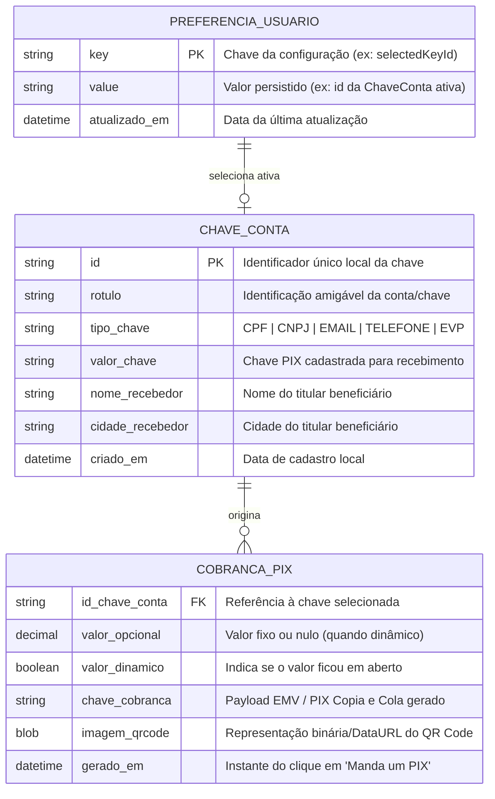

[Início](../README.md) > [Design](./modules.md) > **Modelo de Dados**

# 🗄️ Modelo de Dados

Este documento descreve as estruturas de dados de domínio manipuladas pelo **Manda um PIX** para o cadastro de chaves de contas e geração de cobranças PIX, bem como o esquema físico de persistência local no **IndexedDB** ([ADR 0004](../architecture/decisions/0004-persistencia-local-indexeddb.md)).

---

## 📊 Diagrama Entidade-Relacionamento (ERD Conceitual)

Os dados do usuário residem no banco de dados local **IndexedDB** (`mandaumpix_db`) do navegador, e o modelo relacional conceitual entre as preferências do usuário, as chaves cadastradas e as cobranças geradas segue a estrutura abaixo:

---

## 🗄️ Esquema Físico no IndexedDB (`mandaumpix_db`)

Os dados do usuário são persistidos no navegador utilizando a API nativa **IndexedDB** (`window.indexedDB`), com controle de versão e migração via evento `onupgradeneeded`:

- **Nome do Banco (`dbName`)**: `mandaumpix_db`
- **Versão do Esquema (`version`)**: `1`

| Object Store    | Chave Primária (`keyPath`) | Índices (`IDBIndex`)                                         | Finalidade                                                                                                          |
| :-------------- | :------------------------: | :----------------------------------------------------------- | :------------------------------------------------------------------------------------------------------------------ |
| `pix_keys`      |           `"id"`           | `by_tipo_chave` (`tipo_chave`), `by_criado_em` (`criado_em`) | Armazena os objetos estruturados de [`ChaveConta`](#1-chaveconta-persistida-no-indexedDB) cadastrados pelo usuário. |
| `user_settings` |          `"key"`           | —                                                            | Armazena dados e preferências do usuário no dispositivo, como `{ key: "selectedKeyId", value: "<id>", updatedAt }`. |

---

## 📑 Detalhamento das Entidades

### 1. `ChaveConta` (Persistida no IndexedDB)

Representa cada uma das chaves de contas nas quais o usuário deseja receber transferências via PIX, persistida na _object store_ `pix_keys` do **IndexedDB**.

| Campo              | Obrigatório | Descrição                                                                                     |
| :----------------- | :---------: | :-------------------------------------------------------------------------------------------- |
| `id`               |     Sim     | Identificador único local do registro (`keyPath` na store `pix_keys`).                        |
| `valor_chave`      |     Sim     | Chave PIX propriamente dita (CPF, CNPJ, e-mail, telefone ou chave aleatória).                 |
| `tipo_chave`       |     Sim     | Classificação da chave para validação de formato (`CPF`, `CNPJ`, `EMAIL`, `TELEFONE`, `EVP`). |
| `rotulo`           |  Opcional   | Apelido ou nome da instituição/conta para facilitar a seleção pelo usuário.                   |
| `nome_recebedor`   |     Sim     | Nome do titular beneficiário normalizado para o padrão EMV (até 25 caracteres).               |
| `cidade_recebedor` |     Sim     | Cidade do titular beneficiário normalizada para o padrão EMV (até 15 caracteres).             |
| `criado_em`        |     Sim     | Data/hora ISO de criação do registro no dispositivo.                                          |

### 2. `CobrancaPix` (Efêmera / Gerada em Tempo de Execução)

Representa o resultado produzido quando o usuário seleciona uma chave cadastrada, informa opcionalmente um valor e aciona **"Manda um PIX"**.

| Campo            | Obrigatório  | Descrição                                                                                                     |
| :--------------- | :----------: | :------------------------------------------------------------------------------------------------------------ |
| `id_chave_conta` |     Sim      | Chave selecionada pelo usuário para o recebimento.                                                            |
| `valor_opcional` |   **Não**    | Quando informado, define o valor exato da cobrança; quando omitido, permite que o valor seja dinâmico/aberto. |
| `chave_cobranca` | Sim (Gerado) | Código PIX Copia e Cola pronto para ser copiado ou compartilhado via WhatsApp.                                |
| `imagem_qrcode`  | Sim (Gerado) | Imagem do QR Code exibida na tela e disponível para salvamento local.                                         |

---

⬅️ **Anterior**: [Design e Módulos](./modules.md) | ➡️ **Próximo**: [Especificações e Contratos](./api_specs.md)
