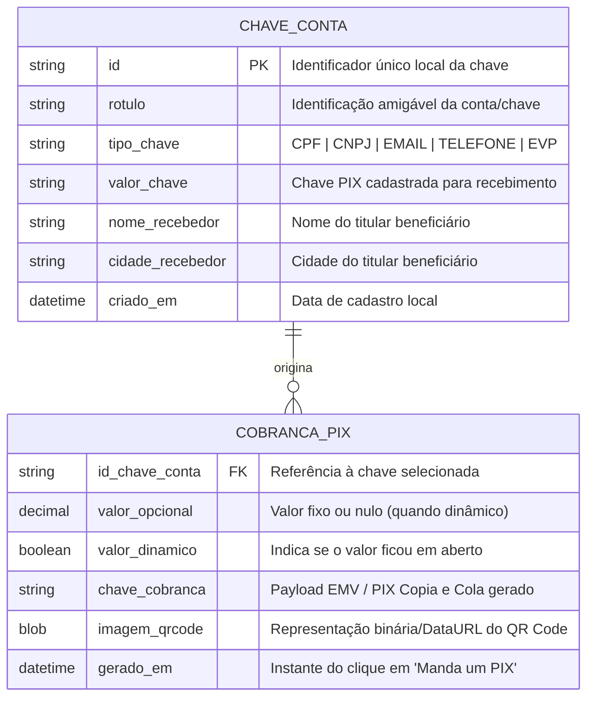

[Início](../README.md) > [Design](./modules.md) > **Modelo de Dados**

# 🗄️ Modelo de Dados

Este documento descreve as estruturas de dados de domínio manipuladas pelo **Manda um PIX** para o cadastro de chaves de contas e para a geração de cobranças PIX.

---

## 📊 Diagrama Entidade-Relacionamento (ERD Conceitual)

Embora os dados residam no armazenamento local do navegador do usuário, o modelo relacional conceitual entre as chaves cadastradas e as cobranças geradas segue a estrutura abaixo:

---

## 📑 Detalhamento das Entidades

### 1. `ChaveConta` (Persistida Localmente)

Representa cada uma das chaves de contas nas quais o usuário deseja receber transferências via PIX.

| Campo         | Obrigatório | Descrição                                                                     |
| :------------ | :---------: | :---------------------------------------------------------------------------- |
| `id`          |     Sim     | Identificador único local do registro.                                        |
| `valor_chave` |     Sim     | Chave PIX propriamente dita (CPF, CNPJ, e-mail, telefone ou chave aleatória). |
| `tipo_chave`  |     Sim     | Classificação da chave para validação de formato.                             |
| `rotulo`      |  Opcional   | Apelido ou nome da instituição/conta para facilitar a seleção pelo usuário.   |

### 2. `CobrancaPix` (Efêmera / Gerada em Tempo de Execução)

Representa o resultado produzido quando o usuário seleciona uma chave cadastrada, informa opcionalmente um valor e aciona **"Manda um PIX"**.

| Campo            | Obrigatório  | Descrição                                                                                                     |
| :--------------- | :----------: | :------------------------------------------------------------------------------------------------------------ |
| `id_chave_conta` |     Sim      | Chave selecionada pelo usuário para o recebimento.                                                            |
| `valor_opcional` |   **Não**    | Quando informado, define o valor exato da cobrança; quando omitido, permite que o valor seja dinâmico/aberto. |
| `chave_cobranca` | Sim (Gerado) | Código PIX Copia e Cola pronto para ser copiado ou compartilhado via WhatsApp.                                |
| `imagem_qrcode`  | Sim (Gerado) | Imagem do QR Code exibida na tela e disponível para salvamento local.                                         |

---

⬅️ **Anterior**: [Design e Módulos](./modules.md) | ➡️ **Próximo**: [Especificações e Contratos](./api_specs.md)
