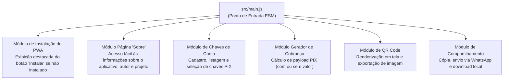

[Início](../README.md) > **Design: Módulos**

# 🎨 Design e Organização de Módulos

Este documento descreve a organização física atual do repositório **Manda um PIX** e a decomposição modular para os recursos de negócio do PWA.

---

## 📂 Estrutura Atual do Repositório

O repositório conta com a fundação de módulos ES nativos gerenciados pelo **JSPM**, casca HTML com Import Maps W3C, `modulepreload` e integridade criptográfica (SRI), além das ferramentas de qualidade:

```text
mandaumpix.app/
├── .storybook/            # Configuração do Storybook (@storybook/html-vite, addons docs & a11y)
│   ├── main.js            # Descoberta de stories, framework e diretórios estáticos
│   └── preview.js         # Tokens globais, reset CSS, VectorIcon e backgrounds da marca
├── docs/                  # Documentação viva técnica e de negócio
├── src/
│   ├── application/
│   │   └── use-cases/     # Casos de uso da aplicação (generate/distribute-pix-charge, save/list/select/delete-pix-key, install-pwa e testes)
│   ├── assets/
│   │   └── icons/         # Logotipo vetorial (icon.svg) e ícones PNG do PWA (192x192, 512x512, maskable, apple-touch-icon)
│   ├── domain/
│   │   └── entities/      # Entidades de domínio e validadores puros (pix-key.entity.js, pix-charge.entity.js e testes)
│   ├── infrastructure/
│   │   ├── pwa/           # Adaptador de instalação do PWA (pwa-install.adapter.js e testes)
│   │   └── storage/       # Repositório local de chaves PIX e preferências no IndexedDB (indexed-db-pix-key.repository.js e testes)
│   ├── presentation/
│   │   ├── components/
│   │   │   └── vector-icon/ # Web Component compartilhado <vector-icon> (VectorIcon, sprite icon.svg, CSS, stories e testes)
│   │   └── styles/        # Design tokens (:root) e reset CSS moderno
│   └── main.js            # Ponto de entrada ESM da aplicação cliente
├── index.html             # Casca HTML5 com Import Map W3C, es-module-shims, modulepreload, SRI e links de ícones/manifest
├── manifest.json          # Web App Manifest W3C com paleta azul/verde e ícones do aplicativo
├── importmap.js           # Script de injeção de Import Map gerenciado pelo JSPM
├── eslint.config.js       # Configuração Flat Config do ESLint v10 (JS, JSON, CSS, MD)
├── vitest.config.js       # Configuração do Vitest (JSDOM e cobertura V8)
├── package.json           # Manifesto do projeto, exports, scripts JSPM/Vitest/Storybook e devDependencies
├── package-lock.json      # Lockfile determinístico da árvore de pacotes npm
├── LICENSE                # Texto integral da licença GNU Affero General Public License v3.0 (AGPL-3.0-only)
├── .prettierrc            # Configuração do formatador Prettier
├── .gitignore             # Regras de exclusão do controle de versão Git
└── README.md              # Ponto de entrada e apresentação do repositório
```

### Papel dos Arquivos Principais

| Arquivo                                                                                                                            | Responsabilidade                                                                                                                                                                                                                                                     |
| :--------------------------------------------------------------------------------------------------------------------------------- | :------------------------------------------------------------------------------------------------------------------------------------------------------------------------------------------------------------------------------------------------------------------- |
| [`index.html`](../../index.html)                                                                                                   | Casca HTML semântica da aplicação contendo `es-module-shims`, `<script type="importmap">`, `<link rel="modulepreload">` com hashes `integrity` (SRI), ícones e carregamento de `main.js`.                                                                            |
| [`manifest.json`](../../manifest.json)                                                                                             | Web App Manifest W3C para instalação do PWA, declarando cores de tema (`#0b1834` / `#060d1e`) e ícones vetoriais e rasterizados (`any` e `maskable`).                                                                                                                |
| [`src/assets/icons/`](../../src/assets/icons/icon.svg)                                                                             | Logotipo oficial em formato vetorial (`icon.svg`) e ícones de aplicativo (`icon-192.png`, `icon-512.png`, `icon-maskable-512.png`, `apple-touch-icon.png`) nas cores azul e verde.                                                                                   |
| [`.storybook/`](../../.storybook/main.js)                                                                                          | Configuração do Storybook v10 (`@storybook/html-vite`) com addons de documentação automática (`@storybook/addon-docs`) e acessibilidade (`@storybook/addon-a11y`).                                                                                                   |
| [`src/presentation/components/vector-icon/`](../../src/presentation/components/vector-icon/vector-icon.component.js)               | Web Component compartilhado `<vector-icon>` construído sobre `@modnes/custom-element`, sprite SVG centralizado (`icon.svg`), estilização fluida (`1em` + `currentColor`) e stories no Storybook.                                                                     |
| [`src/domain/entities/pix-key.entity.js`](../../src/domain/entities/pix-key.entity.js)                                             | Entidade imutável de domínio `ChaveConta` (`PixKeyEntity`), erro `PixKeyValidationError`, validadores (`CPF`, `CNPJ`, `EMAIL`, `TELEFONE`, `EVP`) e normalizadores EMV (`nome_recebedor`, `cidade_recebedor`).                                                       |
| [`src/domain/entities/pix-charge.entity.js`](../../src/domain/entities/pix-charge.entity.js)                                       | Entidade imutável de domínio `CobrancaPix` (`PixChargeEntity`), erro `PixChargeValidationError` e sanitizadores de cobrança (`normalizeTransactionAmount`, `normalizeTxid`, `normalizeAdditionalInfo`).                                                              |
| [`src/application/use-cases/generate-pix-charge.use-case.js`](../../src/application/use-cases/generate-pix-charge.use-case.js)     | Caso de uso `GeneratePixChargeUseCase` (`executeGeneratePixCharge`) que orquestra a validação de `ChaveConta` (`RN02`), valor fixo/dinâmico (`RN03`) e emissão simultânea de BR Code + QR Code (`RN04`).                                                             |
| [`src/application/use-cases/save-pix-key.use-case.js`](../../src/application/use-cases/save-pix-key.use-case.js)                   | Caso de uso `SavePixKeyUseCase` (`executeSavePixKey`), erro `PixKeyManagementError` e helpers (`assertPixKeyRepository`, `hydrateChaveContaList`) para cadastro com deduplicação e auto-seleção (`RN01`/`RN02`).                                                     |
| [`src/application/use-cases/list-pix-keys.use-case.js`](../../src/application/use-cases/list-pix-keys.use-case.js)                 | Caso de uso `ListPixKeysUseCase` (`executeListPixKeys`) para listagem hidratada de `ChaveConta` e auto-recuperação de seleção ativa (`RN01`/`RN02`).                                                                                                                 |
| [`src/application/use-cases/select-pix-key.use-case.js`](../../src/application/use-cases/select-pix-key.use-case.js)               | Caso de uso `SelectPixKeyUseCase` (`executeSelectPixKey`, `resolveRequiredPixKeyId`) para troca explícita da `ChaveConta` ativa para emissão de cobrança (`RN02`).                                                                                                   |
| [`src/application/use-cases/delete-pix-key.use-case.js`](../../src/application/use-cases/delete-pix-key.use-case.js)               | Caso de uso `DeletePixKeyUseCase` (`executeDeletePixKey`) para exclusão de chave PIX e reatribuição/limpeza automática da seleção ativa (`RN01`/`RN02`).                                                                                                             |
| [`src/application/use-cases/distribute-pix-charge.use-case.js`](../../src/application/use-cases/distribute-pix-charge.use-case.js) | Caso de uso `DistributePixChargeUseCase` (`executeDistributePixCharge`), erro `PixChargeDistributionError` e helpers para cópia, compartilhamento nativo/WhatsApp e download PNG do QR Code (`RN05`).                                                                |
| [`src/application/use-cases/install-pwa.use-case.js`](../../src/application/use-cases/install-pwa.use-case.js)                     | Caso de uso `InstallPwaUseCase` (`executeInstallPwa`), erro `PwaInstallError` e normalizadores para controle de visibilidade do botão destacado **"Instalar"** e disparo do prompt nativo de instalação do PWA (`RN06`).                                             |
| [`src/infrastructure/pwa/pwa-install.adapter.js`](../../src/infrastructure/pwa/pwa-install.adapter.js)                             | Adaptador `PwaInstallAdapter` (`createPwaInstallAdapter`), erro `PwaInstallAdapterError`, detector de standalone e ciclo de eventos nativos do navegador (`beforeinstallprompt`, `appinstalled`) com reatividade `@modnes/data-controller` (`RN06`).                 |
| [`src/infrastructure/share/browser-share.adapter.js`](../../src/infrastructure/share/browser-share.adapter.js)                     | Adaptador `BrowserShareAdapter` (`createBrowserShareAdapter`), erro `BrowserShareAdapterError` e códigos `BROWSER_SHARE_ADAPTER_ERROR_CODES` para integração com Clipboard API, Web Share API (com fallback para WhatsApp) e download local de QR Code PNG (`RN05`). |
| [`src/infrastructure/storage/indexed-db-pix-key.repository.js`](../../src/infrastructure/storage/indexed-db-pix-key.repository.js) | Adaptador `IndexedDbPixKeyRepository` (`createIndexedDbPixKeyRepository`), erro `PixKeyStorageError` e migração `openPixKeyDatabase` para persistência local no `IndexedDB` (`mandaumpix_db`) com `@modnes/data-controller`.                                         |
| [`src/presentation/styles/`](../../src/presentation/styles/tokens.css)                                                             | Design Tokens globais (`tokens.css`) com paleta da marca (`#0b1834`, `#00d37f`), tipografia, espaçamentos e reset CSS (`reset.css`).                                                                                                                                 |
| [`importmap.js`](../../importmap.js)                                                                                               | Mapa de importação gerado pelo JSPM (`jspm install`) que resolve `mandaumpix.app`, `@modnes/*`, `pix-utils`, `qr` e `qr/dom.js`.                                                                                                                                     |
| [`src/main.js`](../../src/main.js)                                                                                                 | Ponto de entrada principal ESM integrando o ecossistema `@modnes/*`, `pix-utils` (`generatePixCharge`, `parsePixCharge`) e `qr` (`encodeQR`, `exportQrCodePng`).                                                                                                     |
| [`package.json`](../../package.json)                                                                                               | Define o pacote `mandaumpix.app` (`1.0.0`, licença `AGPL-3.0-only`), habilita ES Modules nativos, declara `"exports"`, `"dependencies"` (`@modnes/*`, `pix-utils`, `qr`) e scripts JSPM.                                                                             |
| [`LICENSE`](../../LICENSE)                                                                                                         | Termos oficiais da licença de código aberto **GNU Affero General Public License v3.0** (`AGPL-3.0-only`).                                                                                                                                                            |
| [`eslint.config.js`](../../eslint.config.js)                                                                                       | Orquestra os plugins `@eslint/js`, `@eslint/json`, `@eslint/markdown`, `@eslint/css` e `eslint-config-prettier`, definindo variáveis globais de navegador (`globals.browser`).                                                                                       |
| [`.prettierrc`](../../.prettierrc)                                                                                                 | Ativa formatação padronizada do Prettier com configuração default (`{}`).                                                                                                                                                                                            |

---

## 🧩 Decomposição Funcional dos Módulos de Domínio (PWA)

Para atender aos requisitos funcionais do **Manda um PIX**, o design funcional do aplicativo divide-se em seis responsabilidades coesas (cujo layout visual, fluxo em 3 toques, modal `<dialog>` de chaves e mapeamento de Web Components e classes BEM estão detalhados na [Proposta de Interface (UI)](./ui_proposal.md)):



1. **Módulo de Instalação do Aplicativo (Botão "Instalar")**:
   - Verifica se o aplicativo já foi instalado no dispositivo do usuário (ex.: execução em modo `standalone` ou evento `appinstalled`).
   - Apresenta de forma destacada um botão **"Instalar"** para usuários que ainda não instalaram o aplicativo no dispositivo.
   - Dispara o fluxo nativo de instalação quando o usuário aciona o botão **"Instalar"** e oculta o botão após a instalação.
2. **Módulo Institucional / Página "Sobre" (Autor, Projeto, Apoio e Divulgação)**:
   - Oferece um ponto de acesso fácil e visível na interface para uma página que fala sobre o aplicativo, destacando que ele é **gratuito, livre e de código aberto**.
   - Apresenta informações sobre o **autor** (**Luiz Henrique Canet Filho** — `<me@luizca.net>`) e sobre o **projeto** (**Manda um PIX** — `mandaumpix.app`, propósito do PWA, repositório GitHub e licença **GNU AGPL v3.0**).
   - Exibe um convite descontraído com emojis e a frase **"Manda um PIX"** para que o usuário que achar o aplicativo útil para si e para outras pessoas possa contribuir voluntariamente com qualquer valor para ajudar a manter o projeto, renderizando um **QR Code com valor dinâmico** e a **Chave copia e cola** para **`eu@luizca.net`**, além de incentivar a divulgação do aplicativo para mais pessoas.
3. **Módulo de Chaves de Conta**:
   - Cadastro de múltiplas chaves nas quais o usuário deseja receber.
   - Persistência e recuperação local assíncrona dos dados do usuário via **IndexedDB** para seleção rápida.
4. **Módulo Gerador de Cobrança ("Manda um PIX")**:
   - Recebe a chave selecionada e o valor opcional.
   - Caso o valor não seja informado, configura a cobrança como valor dinâmico/aberto.
   - Gera a chave de cobrança (PIX Copia e Cola).
5. **Módulo de Renderização de QR Code**:
   - Transforma a chave de cobrança em um QR Code visível na tela.
   - Exporta o gráfico gerado em formato de imagem para salvamento local.
6. **Módulo de Compartilhamento e Saída**:
   - Cópia da chave de cobrança para a área de transferência.
   - Compartilhamento externo (ex.: WhatsApp).
   - Download local da imagem do QR Code.

---

⬅️ **Anterior**: [ADR 0004](../architecture/decisions/0004-persistencia-local-indexeddb.md) | ➡️ **Próximo**: [Modelo de Dados](./data_models.md)
