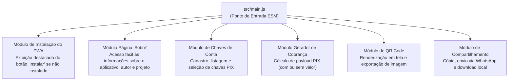
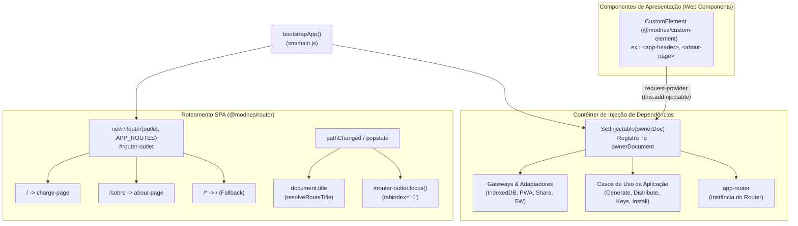

[Início](../README.md) > **Design: Módulos**

# 🎨 Design e Organização de Módulos

Este documento descreve a organização física atual do repositório **Manda um PIX** e a decomposição modular para os recursos de negócio do PWA.

---

## 📂 Estrutura Atual do Repositório

O repositório conta com a fundação de módulos ES nativos gerenciados pelo **JSPM**, casca HTML com Import Maps W3C, `modulepreload` e integridade criptográfica (SRI), além das ferramentas de qualidade:

```text
mandaumpix.app/
├── .storybook/            # Configuração do Storybook (@storybook/html-vite, addons docs & a11y)
│   ├── main.js            # Descoberta de stories, framework e diretórios estáticos
│   └── preview.js         # Tokens globais, reset CSS, VectorIcon e backgrounds da marca
├── docs/                  # Documentação viva técnica e de negócio
├── src/
│   ├── application/
│   │   └── use-cases/     # Casos de uso da aplicação (generate/distribute-pix-charge, save/list/select/delete-pix-key, install-pwa e testes)
│   ├── assets/
│   │   └── icons/         # Logotipo vetorial (icon.svg) e ícones PNG do PWA (192x192, 512x512, maskable, apple-touch-icon)
│   ├── domain/
│   │   └── entities/      # Entidades de domínio e validadores puros (pix-key.entity.js, pix-charge.entity.js e testes)
│   ├── infrastructure/
│   │   ├── pix/           # Serviços de geração e parsing de BR Code e QR Code (pix-qr.service.js e testes)
│   │   ├── pwa/           # Adaptadores PWA (pwa-install.adapter.js, service-worker.adapter.js e testes)
│   │   ├── share/         # Adaptador de saída e compartilhamento (browser-share.adapter.js e testes)
│   │   └── storage/       # Repositório local de chaves PIX e preferências no IndexedDB (indexed-db-pix-key.repository.js e testes)
│   ├── presentation/
│   │   ├── bootstrap/     # Orquestrador de inicialização e amarração da aplicação (bootstrap-app.js e testes)
│   │   ├── components/
│   │   │   ├── app-header/          # Web Component <app-header>
│   │   │   ├── pix-charge-dialog/   # Web Component <pix-charge-dialog>, constantes canônicas, CSS BEM, testes e stories
│   │   │   ├── pix-charge-form/     # Web Component <pix-charge-form>, constantes canônicas, CSS BEM, testes e stories
│   │   │   ├── pix-charge-result/   # Web Component <pix-charge-result>, constantes canônicas, CSS BEM, testes e stories
│   │   │   ├── pix-key-dialog/      # Web Component <pix-key-dialog>, constantes canônicas, CSS BEM, testes e stories
│   │   │   ├── pix-key-empty/       # Web Component <pix-key-empty>, constantes canônicas, CSS BEM, testes e stories
│   │   │   ├── pix-key-selector/    # Web Component <pix-key-selector>, constantes canônicas, CSS BEM, testes e stories
│   │   │   └── vector-icon/         # Web Component compartilhado <vector-icon>
│   │   ├── di/            # Fábrica e contêiner de injeção de dependências SetInjectable (container.js e testes)
│   │   ├── pages/
│   │   │   └── about-page/  # Web Component institucional <about-page>, constantes canônicas, CSS BEM, testes e stories
│   │   ├── router/        # Roteamento SPA declarativo, interceptação e acessibilidade (app-router.js e testes)
│   │   └── styles/        # Folhas de estilo modulares: Design tokens (tokens.css), reset moderno (reset.css), grid/split-view (layout.css), casca BEM (app-shell.css) e testes
│   └── main.js            # Ponto de entrada ESM e API pública da aplicação cliente
├── sw.js                  # Service Worker com pré-cache da App Shell e estratégias de cache offline (Network-First / Stale-While-Revalidate)
├── index.html             # Casca HTML5 com Import Map W3C, es-module-shims, modulepreload, SRI e links de ícones/manifest
├── manifest.json          # Web App Manifest W3C com paleta azul/verde e ícones do aplicativo
├── importmap.js           # Script de injeção de Import Map gerenciado pelo JSPM
├── eslint.config.js       # Configuração Flat Config do ESLint v10 (JS, JSON, CSS, MD)
├── vitest.config.js       # Configuração do Vitest (JSDOM e cobertura V8)
├── package.json           # Manifesto do projeto, exports, scripts JSPM/Vitest/Storybook e devDependencies
├── package-lock.json      # Lockfile determinístico da árvore de pacotes npm
├── LICENSE                # Texto integral da licença GNU Affero General Public License v3.0 (AGPL-3.0-only)
├── .prettierrc            # Configuração do formatador Prettier
├── .gitignore             # Regras de exclusão do controle de versão Git
└── README.md              # Ponto de entrada e apresentação do repositório
```

### Papel dos Arquivos Principais

| Arquivo                                                                                                                                | Responsabilidade                                                                                                                                                                                                                                                                                                                                                                                                                                                                                                                                                                                                                                                                                                                                                                                                                                                                                                                                                                                                                              |
| :------------------------------------------------------------------------------------------------------------------------------------- | :-------------------------------------------------------------------------------------------------------------------------------------------------------------------------------------------------------------------------------------------------------------------------------------------------------------------------------------------------------------------------------------------------------------------------------------------------------------------------------------------------------------------------------------------------------------------------------------------------------------------------------------------------------------------------------------------------------------------------------------------------------------------------------------------------------------------------------------------------------------------------------------------------------------------------------------------------------------------------------------------------------------------------------------------- |
| [`index.html`](../../index.html)                                                                                                       | Casca HTML semântica da aplicação contendo `es-module-shims`, `<script type="importmap">`, `<link rel="modulepreload">` com hashes `integrity` (SRI), ícones e carregamento de `main.js`.                                                                                                                                                                                                                                                                                                                                                                                                                                                                                                                                                                                                                                                                                                                                                                                                                                                     |
| [`manifest.json`](../../manifest.json)                                                                                                 | Web App Manifest W3C para instalação do PWA, declarando cores de tema (`#0b1834` / `#060d1e`) e ícones vetoriais e rasterizados (`any` e `maskable`).                                                                                                                                                                                                                                                                                                                                                                                                                                                                                                                                                                                                                                                                                                                                                                                                                                                                                         |
| [`src/assets/icons/`](../../src/assets/icons/icon.svg)                                                                                 | Logotipo oficial em formato vetorial (`icon.svg`) e ícones de aplicativo (`icon-192.png`, `icon-512.png`, `icon-maskable-512.png`, `apple-touch-icon.png`) nas cores azul e verde.                                                                                                                                                                                                                                                                                                                                                                                                                                                                                                                                                                                                                                                                                                                                                                                                                                                            |
| [`.storybook/`](../../.storybook/main.js)                                                                                              | Configuração do Storybook v10 (`@storybook/html-vite`) com addons de documentação automática (`@storybook/addon-docs`) e acessibilidade (`@storybook/addon-a11y`).                                                                                                                                                                                                                                                                                                                                                                                                                                                                                                                                                                                                                                                                                                                                                                                                                                                                            |
| [`src/presentation/components/vector-icon/`](../../src/presentation/components/vector-icon/vector-icon.component.js)                   | Web Component compartilhado `<vector-icon>` construído sobre `@modnes/custom-element`, sprite SVG centralizado (`icon.svg`), estilização fluida (`1em` + `currentColor`) e stories no Storybook.                                                                                                                                                                                                                                                                                                                                                                                                                                                                                                                                                                                                                                                                                                                                                                                                                                              |
| [`src/presentation/components/app-header/`](../../src/presentation/components/app-header/app-header.component.js)                      | Web Component reativo `<app-header>` construído sobre `@modnes/custom-element`, com template BEM para marca, ações, atalho institucional `/sobre` (`RN07`), integração reativa com `InstallPwaUseCase` / `PwaInstallAdapter` para o botão destacado "Instalar" (`RN06`), testes unitários (`app-header.test.js`) e stories no Storybook (`app-header.stories.js`).                                                                                                                                                                                                                                                                                                                                                                                                                                                                                                                                                                                                                                                                            |
| [`src/presentation/components/pix-key-empty/`](../../src/presentation/components/pix-key-empty/pix-key-empty.component.js)             | Web Component `<pix-key-empty>` (`PixKeyEmptyComponent`) estendendo `CustomElement` (`@modnes/custom-element`), com template BEM para estado inicial sem chaves (`.key-empty-state`), mensagem explicativa de privacidade 100% local no dispositivo, botão CTA destacado ("Adicionar Minha Primeira Chave") com disparo de evento desacoplado `open-key-dialog`, testes unitários (`pix-key-empty.test.js`, `pix-key-empty.constants.test.js`, `pix-key-empty.css.test.js`) e stories interativas no Storybook (`pix-key-empty.stories.js`) com auditoria de acessibilidade `@storybook/addon-a11y` (`RN01`, `RN02`).                                                                                                                                                                                                                                                                                                                                                                                                                         |
| [`src/presentation/components/pix-key-selector/`](../../src/presentation/components/pix-key-selector/pix-key-selector.component.js)    | Web Component `<pix-key-selector>` (`PixKeySelectorComponent`) estendendo `CustomElement` (`@modnes/custom-element`), com template BEM para seleção de chaves cadastradas (`.key-selector`), padrão W3C ARIA `radiogroup`/`radio` com roving tabindex por teclado, cabeçalho de passo numérico com botão "+ Nova chave" (`open-key-dialog`), cartões interativos com badges monoespaçados de tipo de chave (`CPF`, `CNPJ`, `EMAIL`, etc.), botão de exclusão com `stopPropagation`, integração com `SelectPixKeyUseCase` e `DeletePixKeyUseCase`, testes unitários (`pix-key-selector.test.js`, `pix-key-selector.constants.test.js`, `pix-key-selector.css.test.js`) e stories no Storybook (`pix-key-selector.stories.js`) com auditoria `@storybook/addon-a11y` (`RN01`, `RN02`).                                                                                                                                                                                                                                                          |
| [`src/presentation/components/pix-key-dialog/`](../../src/presentation/components/pix-key-dialog/pix-key-dialog.component.js)          | Web Component `<pix-key-dialog>` (`PixKeyDialogComponent`) estendendo `CustomElement` (`@modnes/custom-element`), operando o elemento nativo `<dialog>`, seletor de tipo de chave com pílulas dinâmicas, validação de campos obrigatórios (`valor_chave`, `nome_recebedor`, `cidade_recebedor`, `rotulo`), persistência com `SavePixKeyUseCase`, testes unitários (`pix-key-dialog.test.js`, `pix-key-dialog.constants.test.js`, `pix-key-dialog.css.test.js`) e stories no Storybook (`pix-key-dialog.stories.js`) com auditoria `@storybook/addon-a11y` (`RN01`, `RN02`).                                                                                                                                                                                                                                                                                                                                                                                                                                                                   |
| [`src/presentation/components/pix-charge-form/`](../../src/presentation/components/pix-charge-form/pix-charge-form.component.js)       | Web Component `<pix-charge-form>` (`PixChargeFormComponent`) estendendo `CustomElement` (`@modnes/custom-element`), com template BEM para definição de valor opcional (`.charge-form`, `.amount-field`), indicador dinâmico de status (`aria-live="polite"`), atalhos pré-configurados (`Livre`, `R$ 25`, `R$ 50`), botão de limpeza rápida, CTA destacado "Manda um PIX" (`.charge-cta`), integração com `GeneratePixChargeUseCase` e disparo de `charge-generated` e `charge-amount-changed`, testes unitários (`pix-charge-form.test.js`, `pix-charge-form.constants.test.js`, `pix-charge-form.css.test.js`) e stories no Storybook (`pix-charge-form.stories.js`) com auditoria `@storybook/addon-a11y` (`RN02`, `RN03`, `RN04`).                                                                                                                                                                                                                                                                                                        |
| [`src/presentation/components/pix-charge-dialog/`](../../src/presentation/components/pix-charge-dialog/pix-charge-dialog.component.js) | Web Component `<pix-charge-dialog>` (`PixChargeDialogComponent`) estendendo `CustomElement` (`@modnes/custom-element`), operando o elemento nativo `<dialog class="charge-dialog">` para exibição modal acessível do resultado da cobrança PIX gerada, com foco aprisionado (focus trap), backdrop escurecido com blur, escuta reativa a `charge-generated` do formulário, suporte a fechamento por `Escape`, clique no backdrop, botão fechar no topo e botão inferior de conclusão, testes unitários (`pix-charge-dialog.test.js`, `pix-charge-dialog.constants.test.js`, `pix-charge-dialog.css.test.js`) e stories no Storybook (`pix-charge-dialog.stories.js`) com auditoria `@storybook/addon-a11y` (`RN03`, `RN04`, `RN05`, `US-07.4`). |
| [`src/presentation/components/pix-charge-result/`](../../src/presentation/components/pix-charge-result/pix-charge-result.component.js) | Web Component `<pix-charge-result>` (`PixChargeResultComponent`) estendendo `CustomElement` (`@modnes/custom-element`), com template BEM para exibição da cobrança gerada (`.charge-result`), palco com moldura de alto contraste (`.charge-result__qr-frame`) contendo QR Code em SVG vetorial (`cobranca.imagem_qrcode.svg`), cabeçalho com identificador de conta e pílula de valor fixo ou aberto (`RN03`), caixa monoespaçada selecionável do código EMV PIX Copia e Cola (`.charge-result__brcode`), grade de ações com botões de distribuição integrados (`.charge-result__actions`: Copiar com feedback visual de 2,5s, WhatsApp e Salvar PNG - `RN05`/`US-06.3`), integração via DI com `DistributePixChargeUseCase`, eventos `charge-copied`, `charge-shared` e `charge-downloaded`, testes unitários (`pix-charge-result.test.js`, `pix-charge-result.constants.test.js`, `pix-charge-result.css.test.js`) e stories no Storybook (`pix-charge-result.stories.js`) com auditoria `@storybook/addon-a11y` (`RN03`, `RN04`, `RN05`). |
| [`src/presentation/pages/about-page/`](../../src/presentation/pages/about-page/about-page.component.js)                                | Web Component institucional `<about-page>` (`AboutPageComponent`) estendendo `CustomElement` (`@modnes/custom-element`), com template BEM para informações do autor (**Luiz Henrique Canet Filho**), projeto (**AGPL-3.0-only**), card de contribuição voluntária via **"Manda um PIX"** para `eu@luizca.net` (com QR Code dinâmico, cópia do BR Code e feedback `aria-live`), incentivo à divulgação com Web Share/WhatsApp, testes (`about-page.test.js`) e stories no Storybook (`about-page.stories.js`).                                                                                                                                                                                                                                                                                                                                                                                                                                                                                                                                 |
| [`src/domain/entities/pix-key.entity.js`](../../src/domain/entities/pix-key.entity.js)                                                 | Entidade imutável de domínio `ChaveConta` (`PixKeyEntity`), erro `PixKeyValidationError`, validadores (`CPF`, `CNPJ`, `EMAIL`, `TELEFONE`, `EVP`) e normalizadores EMV (`nome_recebedor`, `cidade_recebedor`).                                                                                                                                                                                                                                                                                                                                                                                                                                                                                                                                                                                                                                                                                                                                                                                                                                |
| [`src/domain/entities/pix-charge.entity.js`](../../src/domain/entities/pix-charge.entity.js)                                           | Entidade imutável de domínio `CobrancaPix` (`PixChargeEntity`), erro `PixChargeValidationError` e sanitizadores de cobrança (`normalizeTransactionAmount`, `normalizeTxid`, `normalizeAdditionalInfo`).                                                                                                                                                                                                                                                                                                                                                                                                                                                                                                                                                                                                                                                                                                                                                                                                                                       |
| [`src/application/use-cases/generate-pix-charge.use-case.js`](../../src/application/use-cases/generate-pix-charge.use-case.js)         | Caso de uso `GeneratePixChargeUseCase` (`executeGeneratePixCharge`) que orquestra a validação de `ChaveConta` (`RN02`), valor fixo/dinâmico (`RN03`) e emissão simultânea de BR Code + QR Code (`RN04`).                                                                                                                                                                                                                                                                                                                                                                                                                                                                                                                                                                                                                                                                                                                                                                                                                                      |
| [`src/application/use-cases/save-pix-key.use-case.js`](../../src/application/use-cases/save-pix-key.use-case.js)                       | Caso de uso `SavePixKeyUseCase` (`executeSavePixKey`), erro `PixKeyManagementError` e helpers (`assertPixKeyRepository`, `hydrateChaveContaList`) para cadastro com deduplicação e auto-seleção (`RN01`/`RN02`).                                                                                                                                                                                                                                                                                                                                                                                                                                                                                                                                                                                                                                                                                                                                                                                                                              |
| [`src/application/use-cases/list-pix-keys.use-case.js`](../../src/application/use-cases/list-pix-keys.use-case.js)                     | Caso de uso `ListPixKeysUseCase` (`executeListPixKeys`) para listagem hidratada de `ChaveConta` e auto-recuperação de seleção ativa (`RN01`/`RN02`).                                                                                                                                                                                                                                                                                                                                                                                                                                                                                                                                                                                                                                                                                                                                                                                                                                                                                          |
| [`src/application/use-cases/select-pix-key.use-case.js`](../../src/application/use-cases/select-pix-key.use-case.js)                   | Caso de uso `SelectPixKeyUseCase` (`executeSelectPixKey`, `resolveRequiredPixKeyId`) para troca explícita da `ChaveConta` ativa para emissão de cobrança (`RN02`).                                                                                                                                                                                                                                                                                                                                                                                                                                                                                                                                                                                                                                                                                                                                                                                                                                                                            |
| [`src/application/use-cases/delete-pix-key.use-case.js`](../../src/application/use-cases/delete-pix-key.use-case.js)                   | Caso de uso `DeletePixKeyUseCase` (`executeDeletePixKey`) para exclusão de chave PIX e reatribuição/limpeza automática da seleção ativa (`RN01`/`RN02`).                                                                                                                                                                                                                                                                                                                                                                                                                                                                                                                                                                                                                                                                                                                                                                                                                                                                                      |
| [`src/application/use-cases/distribute-pix-charge.use-case.js`](../../src/application/use-cases/distribute-pix-charge.use-case.js)     | Caso de uso `DistributePixChargeUseCase` (`executeDistributePixCharge`), erro `PixChargeDistributionError` e helpers para cópia, compartilhamento nativo/WhatsApp e download PNG do QR Code (`RN05`).                                                                                                                                                                                                                                                                                                                                                                                                                                                                                                                                                                                                                                                                                                                                                                                                                                         |
| [`src/application/use-cases/install-pwa.use-case.js`](../../src/application/use-cases/install-pwa.use-case.js)                         | Caso de uso `InstallPwaUseCase` (`executeInstallPwa`), erro `PwaInstallError` e normalizadores para controle de visibilidade do botão destacado **"Instalar"** e disparo do prompt nativo de instalação do PWA (`RN06`).                                                                                                                                                                                                                                                                                                                                                                                                                                                                                                                                                                                                                                                                                                                                                                                                                      |
| [`src/infrastructure/pwa/pwa-install.adapter.js`](../../src/infrastructure/pwa/pwa-install.adapter.js)                                 | Adaptador `PwaInstallAdapter` (`createPwaInstallAdapter`), erro `PwaInstallAdapterError`, detector de standalone e ciclo de eventos nativos do navegador (`beforeinstallprompt`, `appinstalled`) com reatividade `@modnes/data-controller` (`RN06`).                                                                                                                                                                                                                                                                                                                                                                                                                                                                                                                                                                                                                                                                                                                                                                                          |
| [`src/infrastructure/pwa/service-worker.adapter.js`](../../src/infrastructure/pwa/service-worker.adapter.js)                           | Adaptador `ServiceWorkerAdapter` (`createServiceWorkerAdapter`), erro `ServiceWorkerAdapterError`, monitoramento de conectividade (`online`/`offline`) e gerenciamento de ciclo de vida e estado reativo do Service Worker com `@modnes/data-controller`.                                                                                                                                                                                                                                                                                                                                                                                                                                                                                                                                                                                                                                                                                                                                                                                     |
| [`sw.js`](../../sw.js)                                                                                                                 | Script do Service Worker na raiz da aplicação contendo pré-cache da App Shell (`mandaumpix-v1.0.0-precache`), estratégias de cache (Network-First para páginas e Stale-While-Revalidate para CDN/ativos) e expurgo de caches legados na ativação (`claim`).                                                                                                                                                                                                                                                                                                                                                                                                                                                                                                                                                                                                                                                                                                                                                                                   |
| [`src/infrastructure/share/browser-share.adapter.js`](../../src/infrastructure/share/browser-share.adapter.js)                         | Adaptador `BrowserShareAdapter` (`createBrowserShareAdapter`), erro `BrowserShareAdapterError` e códigos `BROWSER_SHARE_ADAPTER_ERROR_CODES` para integração com Clipboard API, Web Share API (com fallback para WhatsApp) e download local de QR Code PNG (`RN05`).                                                                                                                                                                                                                                                                                                                                                                                                                                                                                                                                                                                                                                                                                                                                                                          |
| [`src/infrastructure/storage/indexed-db-pix-key.repository.js`](../../src/infrastructure/storage/indexed-db-pix-key.repository.js)     | Adaptador `IndexedDbPixKeyRepository` (`createIndexedDbPixKeyRepository`), erro `PixKeyStorageError` e migração `openPixKeyDatabase` para persistência local no `IndexedDB` (`mandaumpix_db`) com `@modnes/data-controller`.                                                                                                                                                                                                                                                                                                                                                                                                                                                                                                                                                                                                                                                                                                                                                                                                                  |
| [`src/presentation/styles/tokens.css`](../../src/presentation/styles/tokens.css)                                                       | Design Tokens globais com paleta oficial da marca (`#0b1834`, `#00d37f`), superfícies, tipografia, espaçamentos, raios e sombras.                                                                                                                                                                                                                                                                                                                                                                                                                                                                                                                                                                                                                                                                                                                                                                                                                                                                                                             |
| [`src/presentation/styles/reset.css`](../../src/presentation/styles/reset.css)                                                         | Normalização moderna de estilos, foco acessível (`:focus-visible`) e respeito às preferências do usuário (`prefers-reduced-motion: reduce`).                                                                                                                                                                                                                                                                                                                                                                                                                                                                                                                                                                                                                                                                                                                                                                                                                                                                                                  |
| [`src/presentation/styles/layout.css`](../../src/presentation/styles/layout.css)                                                       | Arquitetura de layout responsivo com sistema de grid, container central `.app-container`, modo Mobile-First em coluna única e Desktop Split-View em 2 colunas (`.charge-page`, `.charge-page--split`, `.card`, `.hidden`).                                                                                                                                                                                                                                                                                                                                                                                                                                                                                                                                                                                                                                                                                                                                                                                                                    |
| [`src/presentation/styles/app-shell.css`](../../src/presentation/styles/app-shell.css)                                                 | Estilos BEM da casca global da aplicação: container raiz `.app-root`, cabeçalho `.app-header` com ações (`.app-header__install-btn`, `.app-header__about-link`), área principal `.app-main` e rodapé minimalista `.app-footer` com selo local e licença AGPLv3.                                                                                                                                                                                                                                                                                                                                                                                                                                                                                                                                                                                                                                                                                                                                                                               |
| [`src/presentation/styles/*.test.js`](../../src/presentation/styles/layout.test.js)                                                    | Suíte de testes automatizados (`layout.test.js`, `app-shell.test.js`) validando conformidade das regras CSS, marcos semânticos W3C (Landmarks) e acessibilidade no `index.html`.                                                                                                                                                                                                                                                                                                                                                                                                                                                                                                                                                                                                                                                                                                                                                                                                                                                              |
| [`importmap.js`](../../importmap.js)                                                                                                   | Mapa de importação gerado pelo JSPM (`jspm install`) que resolve `mandaumpix.app`, `@modnes/*`, `pix-utils`, `qr` e `qr/dom.js`.                                                                                                                                                                                                                                                                                                                                                                                                                                                                                                                                                                                                                                                                                                                                                                                                                                                                                                              |
| [`src/main.js`](../../src/main.js)                                                                                                     | Ponto de entrada ESM e bootstrap da aplicação: roteamento SPA declarativo via `@modnes/router` (`APP_ROUTES`), contêiner de injeção de dependências via `SetInjectable` no `ownerDocument`, interceptação de links internos (`Router.goTo`), foco acessível no `#router-outlet` e sincronização de `document.title`.                                                                                                                                                                                                                                                                                                                                                                                                                                                                                                                                                                                                                                                                                                                          |
| [`package.json`](../../package.json)                                                                                                   | Define o pacote `mandaumpix.app` (`1.0.0`, licença `AGPL-3.0-only`), habilita ES Modules nativos, declara `"exports"`, `"dependencies"` (`@modnes/*`, `pix-utils`, `qr`) e scripts JSPM.                                                                                                                                                                                                                                                                                                                                                                                                                                                                                                                                                                                                                                                                                                                                                                                                                                                      |
| [`LICENSE`](../../LICENSE)                                                                                                             | Termos oficiais da licença de código aberto **GNU Affero General Public License v3.0** (`AGPL-3.0-only`).                                                                                                                                                                                                                                                                                                                                                                                                                                                                                                                                                                                                                                                                                                                                                                                                                                                                                                                                     |
| [`eslint.config.js`](../../eslint.config.js)                                                                                           | Orquestra os plugins `@eslint/js`, `@eslint/json`, `@eslint/markdown`, `@eslint/css` e `eslint-config-prettier`, definindo variáveis globais de navegador (`globals.browser`).                                                                                                                                                                                                                                                                                                                                                                                                                                                                                                                                                                                                                                                                                                                                                                                                                                                                |
| [`.prettierrc`](../../.prettierrc)                                                                                                     | Ativa formatação padronizada do Prettier com configuração default (`{}`).                                                                                                                                                                                                                                                                                                                                                                                                                                                                                                                                                                                                                                                                                                                                                                                                                                                                                                                                                                     |

---

## 🧩 Decomposição Funcional dos Módulos de Domínio (PWA)

Para atender aos requisitos funcionais do **Manda um PIX**, o design funcional do aplicativo divide-se em seis responsabilidades coesas (cujo layout visual, fluxo em 3 toques, modal `<dialog>` de chaves e mapeamento de Web Components e classes BEM estão detalhados na [Proposta de Interface (UI)](./ui_proposal.md)):



1. **Módulo de Instalação do Aplicativo (Botão "Instalar")**:
   - Verifica se o aplicativo já foi instalado no dispositivo do usuário (ex.: execução em modo `standalone` ou evento `appinstalled`).
   - Apresenta de forma destacada um botão **"Instalar"** para usuários que ainda não instalaram o aplicativo no dispositivo.
   - Dispara o fluxo nativo de instalação quando o usuário aciona o botão **"Instalar"** e oculta o botão após a instalação.
2. **Módulo Institucional / Página "Sobre" (Autor, Projeto, Apoio e Divulgação)**:
   - Oferece um ponto de acesso fácil e visível na interface para uma página que fala sobre o aplicativo, destacando que ele é **gratuito, livre e de código aberto**.
   - Apresenta informações sobre o **autor** (**Luiz Henrique Canet Filho** — `<me@luizca.net>`) e sobre o **projeto** (**Manda um PIX** — `mandaumpix.app`, propósito do PWA, repositório GitHub e licença **GNU AGPL v3.0**).
   - Exibe um convite descontraído com emojis e a frase **"Manda um PIX"** para que o usuário que achar o aplicativo útil para si e para outras pessoas possa contribuir voluntariamente com qualquer valor para ajudar a manter o projeto, renderizando um **QR Code com valor dinâmico** e a **Chave copia e cola** para **`eu@luizca.net`**, além de incentivar a divulgação do aplicativo para mais pessoas.
3. **Módulo de Chaves de Conta**:
   - Cadastro de múltiplas chaves nas quais o usuário deseja receber.
   - Persistência e recuperação local assíncrona dos dados do usuário via **IndexedDB** para seleção rápida.
4. **Módulo Gerador de Cobrança ("Manda um PIX")**:
   - Recebe a chave selecionada e o valor opcional.
   - Caso o valor não seja informado, configura a cobrança como valor dinâmico/aberto.
   - Gera a chave de cobrança (PIX Copia e Cola).
5. **Módulo de Renderização de QR Code**:
   - Transforma a chave de cobrança em um QR Code visível na tela.
   - Exporta o gráfico gerado em formato de imagem para salvamento local.
6. **Módulo de Compartilhamento e Saída**:
   - Cópia da chave de cobrança para a área de transferência.
   - Compartilhamento externo (ex.: WhatsApp).
   - Download local da imagem do QR Code.

---

## 🧭 Roteamento SPA e Injeção de Dependências (`@modnes/router` & `SetInjectable`)

Para viabilizar a arquitetura Single-Page Application (SPA) desacoplada, modular e sem recarregamento de página, a aplicação orquestra a navegação e o contêiner de dependências na função `bootstrapApp()` em [`src/main.js`](../../src/main.js).

### 1. Roteador SPA Declarativo (`@modnes/router`)

O roteamento da aplicação é configurado através da constante imutável `APP_ROUTES`, montada sobre o contêiner `#router-outlet` na casca HTML:

| Rota     | Componente / Classe CSS Alvo     | Descrição                                                                                     |
| :------- | :------------------------------- | :-------------------------------------------------------------------------------------------- |
| `/`      | `charge-page charge-page--split` | Tela principal de cobrança PIX com layout split-view responsivo.                              |
| `/sobre` | `about-page`                     | Página institucional com informações sobre o aplicativo, autor, licença, doação e divulgação. |
| `/*`     | `/` (Wildcard Fallback)          | Rota curinga que redireciona qualquer URL não mapeada para a raiz `/`.                        |

- **Limpeza Segura de Filhos**: Antes de instanciar `Router`, `bootstrapApp()` invoca `outletElement.replaceChildren()`, prevenindo duplicações de elementos ou acúmulo de placeholders ao acessar rotas diretamente via deep linking.
- **Interceptação de Links Internos**: A navegação interna é interceptada por um listener delegado em nível de contêiner e no cabeçalho/marca, utilizando `Router.goTo(href)` para preservar a History API sem disparar requisições completas ao servidor.
- **Acessibilidade e Gestão de Foco**: O contêiner de rota `#router-outlet` recebe `tabindex="-1"` e foco programático a cada transição (`pathChanged` / `popstate`), permitindo que leitores de tela anunciem o novo contexto.
- **Sincronização de Título (`document.title`)**: O título da janela é atualizado dinamicamente via `resolveRouteTitle(pathname)` e `ROUTE_TITLES` (`"Manda um PIX — Cobrança rápida"` para `/` e `"Sobre o aplicativo — Manda um PIX"` para `/sobre`).

---

### 2. Contêiner de Injeção de Dependências (`SetInjectable`)

Em conformidade com o padrão `@modnes/custom-element`, as dependências da aplicação (casos de uso e adaptadores de infraestrutura) são registradas no documento (`ownerDocument`) através do utilitário `SetInjectable(ownerDoc, name, provider)`.

Qualquer Web Component descendente resolve suas dependências de forma declarativa e desacoplada em seu ciclo de vida (`connectedCallback`) disparando o evento DOM `request-provider` via `this.addInjectable(name, prop)`:

| Nome do Provedor (`provider`)    | Contrato / Tipo                                     | Descrição                                                                                                |
| :------------------------------- | :-------------------------------------------------- | :------------------------------------------------------------------------------------------------------- |
| `pix-key-repository`             | `PixKeyRepository` (`IndexedDbPixKeyRepository`)    | Repositório local transacional no IndexedDB (`mandaumpix_db`) com reatividade `@modnes/data-controller`. |
| `pwa-install-gateway`            | `PwaInstallGateway` (`PwaInstallAdapter`)           | Adaptador dos eventos nativos `beforeinstallprompt`, `appinstalled` e detecção de standalone.            |
| `browser-share-gateway`          | `ChargeDistributionGateway` (`BrowserShareAdapter`) | Adaptador para Clipboard API, Web Share API, WhatsApp e exportação/download de QR Code PNG.              |
| `service-worker-gateway`         | `ServiceWorkerGateway` (`ServiceWorkerAdapter`)     | Adaptador do Service Worker para monitoramento de conectividade (online/offline) e atualizações.         |
| `generate-pix-charge-use-case`   | `GeneratePixChargeUseCase`                          | Caso de uso para validação e emissão de cobranças PIX (BR Code e QR Code).                               |
| `distribute-pix-charge-use-case` | `DistributePixChargeUseCase`                        | Caso de uso para distribuição da cobrança (cópia, envio e download).                                     |
| `install-pwa-use-case`           | `InstallPwaUseCase`                                 | Caso de uso para consulta de estado de instalação e acionamento do prompt nativo PWA.                    |
| `save-pix-key-use-case`          | `SavePixKeyUseCase`                                 | Caso de uso para cadastro e persistência com auto-seleção de chave PIX.                                  |
| `list-pix-keys-use-case`         | `ListPixKeysUseCase`                                | Caso de uso para listagem ordenada e hidratação de chaves PIX.                                           |
| `select-pix-key-use-case`        | `SelectPixKeyUseCase`                               | Caso de uso para seleção e alteração da chave PIX ativa.                                                 |
| `delete-pix-key-use-case`        | `DeletePixKeyUseCase`                               | Caso de uso para exclusão de chave PIX com reatribuição da chave ativa.                                  |
| `app-router`                     | `Router` (`@modnes/router`)                         | Instância ativa do roteador SPA no cliente.                                                              |

---

### 3. Diagrama de Roteamento e Injeção de Dependências



---

### 4. Página Institucional `<about-page>` (`RN07` e `US-04.4`)

A página institucional é implementada pelo Web Component `AboutPageComponent` em [`src/presentation/pages/about-page/about-page.component.js`](../../src/presentation/pages/about-page/about-page.component.js), montado dinamicamente na rota `/sobre` dentro de `#router-outlet`:

- **Arquitetura BEM e Semântica W3C**: Estruturado sob o bloco `.about-page`, com modificadores coesos (`.about-page__box--support`, `.about-page__box--share`), área semântica `<section class="card about-page" aria-label="Sobre o aplicativo">` e alvos de toque `>= 44x44px`.
- **Cabeçalho com Retorno à Home**: Exibe o logotipo oficial (`icon.svg`), o título `"Sobre o Manda um PIX"`, versão `"mandaumpix.app • v1.0.0"` e o botão de ação rápida `"Início"` (`.about-page__home-btn`) que consome o `app-router` injetado (ou fallback) para retornar à rota `/` via `Router.goTo("/")`.
- **Sobre o Autor e Sobre o Projeto**: Apresenta dados canônicos centralizados em [`about-page.constants.js`](../../src/presentation/pages/about-page/about-page.constants.js), identificando o autor (**Luiz Henrique Canet Filho**, `me@luizca.net`, link GitHub com `target="_blank"` e `rel="noopener noreferrer"`) e o projeto (**Manda um PIX**, licença **AGPL-3.0-only**, repositório GitHub).
- **Apoio Voluntário ("Manda um PIX")**: Exibe convite descontraído, QR Code em fundo branco de alto contraste gerado deterministicamente para a chave `eu@luizca.net` na modalidade de valor dinâmico (aberto), caixa de texto com payload BR Code canônico e botão de cópia com feedback visual (`check`) e anúncio acessível via `aria-live="polite"`.
- **Incentivo à Divulgação**: Botão `"Compartilhar e Divulgar o Aplicativo"` com integração ao `DistributePixChargeUseCase` (`Web Share API`), fallback resiliente para WhatsApp (`https://wa.me/?text=...`) ou área de transferência, e disparo dos eventos customizados `app-shared` e `app-share-error`.
- **Resiliência e Execução Autônoma**: Injeção opcional de dependências (`app-router`, `distribute-pix-charge-use-case`) via `this.addInjectable()` com fallbacks automáticos para garantir funcionamento perfeito em ambientes isolados como Storybook e testes unitários.

---

### 5. Estado Inicial Sem Chaves `<pix-key-empty>` (`RN01`, `RN02` e `US-05.1`)

O componente de estado vazio é implementado pelo Web Component `PixKeyEmptyComponent` em [`src/presentation/components/pix-key-empty/pix-key-empty.component.js`](../../src/presentation/components/pix-key-empty/pix-key-empty.component.js), renderizado na tela principal (`.charge-page`) quando nenhuma chave PIX estiver cadastrada no dispositivo:

- **Arquitetura BEM e Semântica W3C**: Estruturado sob o bloco `.key-empty-state`, com contêiner semântico `<section class="card key-empty-state" aria-label="Primeiro acesso sem chaves" role="region">`, ícone de destaque centralizado `.key-empty-state__icon` com `<vector-icon name="key">` e alvo de toque do botão primário $\ge 44\times 44\text{px}$ (`min-height: 52px`).
- **Mensagem Tranquilizadora e Privacidade Local**: Apresenta título semântico `<h2>` (`"Cadastre sua primeira chave PIX"`) e parágrafo explicativo ressaltando que as chaves de recebimento ficam salvas **100% localmente no próprio aparelho**, sem envio para servidores externos ou nuvem (`RN01`).
- **Call-to-Action e Desacoplamento via Eventos DOM**: Botão destacado `.key-empty-state__cta.charge-cta` com ícone `<vector-icon name="plus">` e rótulo `"Adicionar Minha Primeira Chave"`. Ao ser acionado (por clique do mouse ou navegação por teclado via `Enter`/`Space`), despacha o evento customizado borbulhante `CustomEvent("open-key-dialog", { bubbles: true, composed: true, detail: { source: "pix-key-empty" } })`, permitindo que a tela ou orquestrador abra o modal `<pix-key-dialog>` sem acoplamento direto.
- **Reatividade e Parametrização**: Suporta os atributos observados `title-text`, `description-text` e `cta-text` (com constantes canônicas centralizadas em [`pix-key-empty.constants.js`](../../src/presentation/components/pix-key-empty/pix-key-empty.constants.js)), com sincronização em `attributeChangedCallback` e setters reativos com re-renderização (`this.render()`).
- **Acessibilidade e Catálogo Storybook**: Total conformidade com WCAG 2.2 AA (foco visível `:focus-visible`, suporte a `prefers-reduced-motion: reduce`, contraste verificado) e suíte completa no Storybook ([`pix-key-empty.stories.js`](../../src/presentation/components/pix-key-empty/pix-key-empty.stories.js)) com auditoria `@storybook/addon-a11y`.

---

### 6. Seletor de Chaves PIX `<pix-key-selector>` (`RN01`, `RN02` e `US-05.2`)

O componente de seleção de chaves é implementado pelo Web Component `PixKeySelectorComponent` em [`src/presentation/components/pix-key-selector/pix-key-selector.component.js`](../../src/presentation/components/pix-key-selector/pix-key-selector.component.js), renderizado na tela principal (`.charge-page`) quando o usuário já possui ao menos uma chave PIX cadastrada no dispositivo:

- **Arquitetura BEM e Semântica W3C**: Estruturado sob o bloco `.key-selector`, contido semanticamente em `<section class="card key-selector" aria-labelledby="key-selector-title">`. O cabeçalho `.section-header` exibe o identificador numérico de passo `<span class="step-badge">1</span>`, o título `<h2 id="key-selector-title" class="section-header__title">Chave para recebimento</h2>` e a ação secundária "+ Nova chave" (`.key-selector__add-btn`), que despacha o evento borbulhante `CustomEvent("open-key-dialog", { bubbles: true, composed: true, detail: { source: "pix-key-selector" } })`.
- **Acessibilidade W3C ARIA Radiogroup e Roving Tabindex**: A lista `.key-selector__list` adota `role="radiogroup"` com `aria-labelledby="key-selector-title"`. Cada cartão `.key-selector__card` implementa `role="radio"`, `aria-checked="true|false"` e a técnica de _roving tabindex_ (`tabindex="0"` para o cartão ativo/selecionado e `tabindex="-1"` para os demais). O componente gerencia navegação fluida por teclado com as teclas `ArrowDown`, `ArrowRight`, `ArrowUp`, `ArrowLeft`, `Enter` e `Space` (WCAG 2.2 AA).
- **Cartões de Conta e Badges de Tipo**: Cada cartão renderiza o indicador óptico `.key-selector__radio` (com ponto interno `.key-selector__radio-dot`), metadados `.key-selector__meta` contendo apelido/rótulo `.key-selector__label`, badge de tipo `.key-selector__type-badge` (com formatação monoespaçada para `CPF`, `CNPJ`, `EMAIL`, `TELEFONE`, `EVP`), e valor normalizado `.key-selector__value`.
- **Exclusão Segura e Prevenção de Efeitos Colaterais (`stopPropagation`)**: Cada cartão possui um botão dedicado de exclusão `.key-selector__delete-btn` (`<vector-icon name="trash">`) com alvo de toque mínimo de $44\times 44\text{px}$. O acionamento executa estritamente `event.stopPropagation()` para não disparar a seleção indesejada do cartão e invoca o `DeletePixKeyUseCase` injetado (ou despacha `delete-key`), disparando a reatribuição automática da chave ativa.
- **Injeção de Dependências e Reatividade**: Registra dependências via `this.addInjectable()` (`select-pix-key-use-case`, `delete-pix-key-use-case`, `list-pix-keys-use-case`, `pix-key-repository`), com auto-inscrição reativa às alterações do repositório local (`subscribe()`) e suporte a propriedades diretas `keys` e `selectedKeyId` para execução autônoma em Storybook e testes.
- **Catálogo Interativo no Storybook**: Stories dedicadas em [`pix-key-selector.stories.js`](../../src/presentation/components/pix-key-selector/pix-key-selector.stories.js) cobrindo chave única selecionada, múltiplas chaves cadastradas e alternância interativa de seleção, 100% auditadas com `@storybook/addon-a11y`.

---

### 7. Modal de Cadastro de Chave PIX `<pix-key-dialog>` (`RN01`, `RN02` e `US-05.3`)

O modal de cadastro é implementado pelo Web Component `PixKeyDialogComponent` em [`src/presentation/components/pix-key-dialog/pix-key-dialog.component.js`](../../src/presentation/components/pix-key-dialog/pix-key-dialog.component.js), renderizado na casca da aplicação ou tela principal para permitir a adição rápida de novas contas bancárias sem mudança de contexto:

- **Arquitetura BEM e Elemento Semântico Nativo `<dialog>`**: Estruturado sob o bloco BEM `.key-dialog`, operando internamente um elemento `<dialog class="key-dialog">` via métodos nativos do navegador (`.showModal()` e `.close()`). Proporciona isolamento visual, aprisionamento de foco nativo (_focus trap_) e renderização estilizada da camada de fundo via `::backdrop` com desfoque e escurecimento suave (`@supports (backdrop-filter: blur(4px))`).
- **Seletor de Tipo com Pílulas Reativas**: O cabeçalho do diálogo disponibiliza a barra de seleção `.key-dialog__types` com botões acessíveis para os 5 tipos de chave canônicos (`CPF`, `CNPJ`, `EMAIL`, `TELEFONE`, `EVP`), identificados por `data-type` e `aria-pressed="true|false"`. A seleção da pílula ativa (`.key-dialog__type-btn--active`) reconfigura dinamicamente o `placeholder`, o tipo de teclado virtual (`inputmode="numeric" | "email" | "tel" | "text"`), o comprimento máximo (`maxlength`) e a validação do campo de valor da chave.
- **Campos Obrigatórios e Sanitização EMV**: Formulário `<form method="dialog" class="key-dialog__form">` contendo campos com etiquetas flutuantes ou associadas:
  - `valor_chave`: Chave PIX com validação em tempo real e formato canônico.
  - `rotulo`: Apelido opcional da conta (com fallback automático para `DEFAULT_PIX_KEY_LABELS[tipo_chave]` caso em branco).
  - `nome_recebedor`: Nome do titular com limite EMV de 25 caracteres.
  - `cidade_recebedor`: Cidade do titular com limite EMV de 15 caracteres.
- **Feedback Visual de Erros e Região de Alerta Acessível (`role="alert"`)**: Validações locais ou erros propagados pela camada de domínio (`PixKeyValidationError` ou conflito `DUPLICATE_PIX_KEY`) renderizam dinamicamente a área `.key-dialog__alert` contendo o ícone `<vector-icon name="circle-exclamation">`, semântica `role="alert"` e `aria-live="assertive"`, sinalizando os campos com a classe `.key-dialog__input--error`.
- **Submissão, Persistência Local e Seleção Automática**: Ao submeter o formulário (botão primário `.key-dialog__btn-save` com ícone `<vector-icon name="check">` ou tecla `Enter`), consome o `SavePixKeyUseCase` injetado (com fallback resiliente para entidade `ChaveConta`), persistindo os dados 100% no IndexedDB do navegador (`RN01`). Ao salvar com sucesso:
  1. Fecha o diálogo via `.closeModal()`;
  2. Reseta o estado do formulário para os valores padrão;
  3. Despacha o evento customizado borbulhante `CustomEvent("key-saved", { bubbles: true, composed: true, detail: { chaveConta, selectedKeyId } })`.
- **Fechamento Seguro e Gestão de Eventos**: Suporta múltiplos fluxos de saída sem alteração de dados: botão de fechar no topo (`.key-dialog__close-btn`), botão de cancelamento secundário (`.key-dialog__btn-cancel`), clique no `::backdrop` (fora do retângulo do diálogo) ou acionamento da tecla `Escape` (evento nativo `cancel` do `<dialog>`). O fechamento emite `CustomEvent("close-key-dialog", { bubbles: true, composed: true })`.
- **Injeção de Dependências e Resiliência**: Registra dependências através de `this.addInjectable()` (`save-pix-key-use-case`, `pix-key-repository`), permitindo testes unitários simplificados e execução autônoma isolada no Storybook.
- **Acessibilidade W3C e Catálogo Storybook**: Alvos de toque $\ge 44\times 44\text{px}$ para todos os botões e pílulas, gestão de foco com redirecionamento ao primeiro input e suíte de stories em [`pix-key-dialog.stories.js`](../../src/presentation/components/pix-key-dialog/pix-key-dialog.stories.js) auditadas via `@storybook/addon-a11y`.

---

### 8. Formulário Gerador de Cobrança `<pix-charge-form>` (`RN02`, `RN03`, `RN04` e `US-06.1`)

O componente de entrada de valor opcional e submissão da cobrança é implementado pelo Web Component `PixChargeFormComponent` em [`src/presentation/components/pix-charge-form/pix-charge-form.component.js`](../../src/presentation/components/pix-charge-form/pix-charge-form.component.js), integrando os Passos 2 e 3 do fluxo central da aplicação na tela principal (`.charge-page`):

- **Arquitetura BEM e Semântica W3C**: Estruturado sob o bloco `.charge-form`, encapsulado semanticamente em `<form class="charge-form" aria-label="Gerador de cobrança PIX" novalidate>` contendo a seção de valor `.amount-field` e o botão de ação principal `.charge-cta`.
- **Passo 2 — Campo de Valor Monetário e Sanitização (`RN03`)**: O cabeçalho da seção renderiza o identificador de passo `<span class="step-badge">2</span>`, o rótulo associado `<label for="charge-amount" class="section-header__title">Valor da cobrança</label>` e a badge informativa `<span class="amount-field__optional-badge">Opcional</span>`. A caixa de entrada agrupa:
  - Prefixo monetário fixo `.amount-field__currency` (`R$`);
  - Campo numérico `.amount-field__input` (`inputmode="decimal"`, `placeholder="0,00 (Valor aberto)"`), com suporte à digitação no padrão brasileiro (`1.234,56`) e parsing resiliente via `parseChargeAmount()`;
  - Botão de limpeza rápida `.amount-field__clear-btn` (`<vector-icon name="xmark">`, `aria-label="Limpar valor e manter aberto"`), interativo quando há texto digitado, limpando o valor com 1 toque e devolvendo o foco ao campo de entrada.
- **Pílula Reativa de Modalidade de Cobrança (`RN03`)**: Rodapé `.amount-field__footer` contendo a pílula de status `.amount-field__status` com acessibilidade `aria-live="polite"`:
  - **Valor Aberto**: Quando o campo está vazio ou com valor zero, exibe `.amount-field__status--open` e o texto `"Valor aberto (pagador define)"`.
  - **Valor Fixo**: Quando um valor positivo válido é inserido, exibe `.amount-field__status--fixed` e o texto formatado `"Valor fixo: R$ XX,XX"`.
- **Atalhos Rápidos de Valor Predefinido**: Grupo de botões `.amount-field__shortcuts` com opções convenientes:
  - Botão `"Aberto"`: Limpa o campo e restaura o modo de valor aberto;
  - Botões `"R$ 25"` e `"R$ 50"`: Preenchem instantaneamente o valor formatado e atualizam a pílula para fixo.
- **Passo 3 — Botão Call-to-Action "Manda um PIX" (`RN02`, `RN04`)**: Botão proeminente `.charge-cta` exibindo o ícone `<vector-icon name="qrcode">` e o texto `"Manda um PIX"`:
  - **Bloqueio sem Chave Ativa (`RN02`)**: Se nenhuma chave estiver selecionada, permanece desabilitado (`disabled`, `aria-disabled="true"`, classe `.charge-cta--disabled`) e exibe dica explicativa acessível (`title="Selecione ou cadastre uma chave PIX para gerar a cobrança"`).
  - **Pronto para Emissão**: Com chave ativa, habilita-se com o gradiente da marca (`--color-brand-accent`).
- **Submissão, Orquestração e Disparo de Eventos**: Ao submeter (clique no botão ou tecla `Enter`), consome o `GeneratePixChargeUseCase` injetado com fallback de sanitização, gerando a entidade `CobrancaPix` (BR Code + QR Code dinâmico) e despachando os eventos customizados:
  - `CustomEvent("charge-generated", { bubbles: true, composed: true, detail: { cobrancaPix, rawAmount, chaveConta } })`;
  - `CustomEvent("charge-amount-changed", { bubbles: true, composed: true, detail: { rawAmount, amount, formattedStatus } })`.
- **Injeção de Dependências e Reatividade**: Registra dependências através de `this.addInjectable()` (`generate-pix-charge-use-case`, `pix-key-repository`), com auto-inscrição reativa às alterações do repositório de chaves e setters reativos para `selectedKey` e `amount`.
- **Acessibilidade W3C e Storybook**: Alvos de toque $\ge 44\times 44\text{px}$, foco visível `:focus-visible`, total respeito a `prefers-reduced-motion` e suíte de stories em [`pix-charge-form.stories.js`](../../src/presentation/components/pix-charge-form/pix-charge-form.stories.js) com auditoria `@storybook/addon-a11y`.

---

### 9. Palco de QR Code, PIX Copia e Cola, Ações de Distribuição e Diálogo Modal `<pix-charge-result>` / `<dialog class="charge-dialog">` (`RN03`, `RN04`, `RN05`, `US-06.2`, `US-06.3` e `US-07.4`)

O componente de exibição do resultado e distribuição da cobrança gerada é implementado pelo Web Component `PixChargeResultComponent` em [`src/presentation/components/pix-charge-result/pix-charge-result.component.js`](../../src/presentation/components/pix-charge-result/pix-charge-result.component.js). Conforme refinado em `US-07.4`, o resultado é encapsulado em uma **caixa de diálogo modal nativa (`<dialog class="charge-dialog">`)**, sendo apresentado imediatamente após a submissão de "Manda um PIX" e dispensando colunas estáticas ou mensagens de "Aguardando geração" na tela principal (`.charge-page`):

- **Arquitetura BEM e Semântica W3C**: Estruturado sob o bloco `.charge-result` e acomodado dentro do modal `<dialog class="charge-dialog" aria-labelledby="charge-dialog-title" aria-modal="true">`.
- **Apresentação em Caixa de Diálogo Modal (`US-07.4`)**: Disparada via `showModal()` na geração da cobrança, com backdrop escurecido (`rgba(6, 13, 30, 0.65)` com blur), barra de topo `.charge-dialog__top-bar`, botão de fechamento `.charge-dialog__close-btn` com `<vector-icon name="xmark">`, fechamento por `Esc` ou backdrop e retorno seguro de foco para o botão gerador.
- **Eliminação do Estado Aguardando na Tela Principal**: O layout principal passa a operar em coluna única contida e limpa, eliminando a dependência do split-view com coluna ociosa exibindo "Aguardando geração". O componente de resultado é ativado exclusivamente no contexto do diálogo com dados válidos de cobrança.
- **Cabeçalho de Resumo da Cobrança (`RN03`)**: Exibe `.charge-result__header` contendo o badge `.charge-result__badge-ready` com `<vector-icon name="check">`, identificador da conta/titular `.charge-result__account` e a pílula de valor `.charge-result__amount-pill` (`.charge-result__amount-pill--open` para valor aberto ou com formatação monetária brasileira para valor fixo).
- **Palco do QR Code de Alto Contraste Óptico (`RN04`)**: Contêiner centralizado `.charge-result__qr-stage` com moldura de fundo branco `#ffffff` e borda `#0b1834` (`.charge-result__qr-frame`), contendo o elemento SVG vetorial responsivo (`.charge-result__qr-svg`) e legenda de metadados `.charge-result__meta`.
- **Caixa de Código PIX Copia e Cola**: Bloco `.charge-result__brcode` com tipografia monoespaçada (`--font-mono`), `user-select: all`, acessível via teclado e leitor de tela (`role="region"`, `aria-label="Código PIX Copia e Cola"`).
- **Ações de Distribuição Integradas (`RN05` e `US-06.3`)**: Grade `.charge-result__actions` contendo 3 botões com touch targets acessíveis ($\ge 48\times 44\text{px}$) e anéis de foco `:focus-visible`:
  - **Copiar Código (`.charge-result__btn--copy`)**: Copia o BR Code para a área de transferência com transição de 2,5s para feedback visual "Copiado!" (`.charge-result__btn--copied`), anúncio acessível em `aria-live="polite"` e fallback com seleção textual automática via `window.getSelection()` caso a API Clipboard falhe. Emite o evento `charge-copied`.
  - **Compartilhar via WhatsApp / Web Share (`.charge-result__btn--share`)**: Dispara o compartilhamento contextualizado da cobrança com link dinâmico formatado ou Web Share API nativa. Emite o evento `charge-shared`.
  - **Salvar Imagem PNG (`.charge-result__btn--download`)**: Exporta o QR Code em imagem PNG com dimensões padrão de $512\times 512\text{px}$ e download automático no navegador. Emite o evento `charge-downloaded`.
- **Injeção de Dependências Desacoplada**: Integração dinâmica com o caso de uso `DistributePixChargeUseCase` via `this.addInjectable("distribute-pix-charge-use-case")` e suporte a injeção declarativa ou via construtor/propriedade.
- **Acessibilidade W3C e Storybook**: Anúncio de geração e feedback de ações via `aria-live="polite"`, suporte a alto contraste e Dark Mode, alvos de toque e suíte de stories em [`pix-charge-result.stories.js`](../../src/presentation/components/pix-charge-result/pix-charge-result.stories.js) auditadas via `@storybook/addon-a11y`.

---

⬅️ **Anterior**: [ADR 0004](../architecture/decisions/0004-persistencia-local-indexeddb.md) | ➡️ **Próximo**: [Modelo de Dados](./data_models.md)
