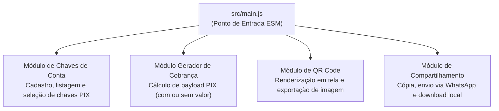

[Início](../README.md) > **Design: Módulos**

# 🎨 Design e Organização de Módulos

Este documento descreve a organização física atual do repositório **Manda um PIX** e a decomposição modular para os recursos de negócio do PWA.

---

## 📂 Estrutura Atual do Repositório

O repositório conta com a fundação de módulos ES nativos gerenciados pelo **JSPM**, casca HTML com Import Maps W3C, `modulepreload` e integridade criptográfica (SRI), além das ferramentas de qualidade:

```text
mandaumpix.app/
├── .storybook/            # Configuração do Storybook (@storybook/html-vite, addons docs & a11y)
│   ├── main.js            # Descoberta de stories, framework e diretórios estáticos
│   └── preview.js         # Tokens globais, reset CSS, VectorIcon e backgrounds da marca
├── docs/                  # Documentação viva técnica e de negócio
├── src/
│   ├── assets/
│   │   └── icons/         # Logotipo vetorial (icon.svg) e ícones PNG do PWA (192x192, 512x512, maskable, apple-touch-icon)
│   ├── presentation/
│   │   ├── components/
│   │   │   └── vector-icon/ # Web Component compartilhado <vector-icon> (VectorIcon, sprite icon.svg, CSS, stories e testes)
│   │   └── styles/        # Design tokens (:root) e reset CSS moderno
│   └── main.js            # Ponto de entrada ESM da aplicação cliente
├── index.html             # Casca HTML5 com Import Map W3C, es-module-shims, modulepreload, SRI e links de ícones/manifest
├── manifest.json          # Web App Manifest W3C com paleta azul/verde e ícones do aplicativo
├── importmap.js           # Script de injeção de Import Map gerenciado pelo JSPM
├── eslint.config.js       # Configuração Flat Config do ESLint v10 (JS, JSON, CSS, MD)
├── vitest.config.js       # Configuração do Vitest (JSDOM e cobertura V8)
├── package.json           # Manifesto do projeto, exports, scripts JSPM/Vitest/Storybook e devDependencies
├── package-lock.json      # Lockfile determinístico da árvore de pacotes npm
├── LICENSE                # Texto integral da licença GNU Affero General Public License v3.0 (AGPL-3.0-only)
├── .prettierrc            # Configuração do formatador Prettier
├── .gitignore             # Regras de exclusão do controle de versão Git
└── README.md              # Ponto de entrada e apresentação do repositório
```

### Papel dos Arquivos Principais

| Arquivo                                                                                                              | Responsabilidade                                                                                                                                                                                 |
| :------------------------------------------------------------------------------------------------------------------- | :----------------------------------------------------------------------------------------------------------------------------------------------------------------------------------------------- |
| [`index.html`](../../index.html)                                                                                     | Casca HTML semântica da aplicação contendo `es-module-shims`, `<script type="importmap">`, `<link rel="modulepreload">` com hashes `integrity` (SRI), ícones e carregamento de `main.js`.        |
| [`manifest.json`](../../manifest.json)                                                                               | Web App Manifest W3C para instalação do PWA, declarando cores de tema (`#0b1834` / `#060d1e`) e ícones vetoriais e rasterizados (`any` e `maskable`).                                            |
| [`src/assets/icons/`](../../src/assets/icons/icon.svg)                                                               | Logotipo oficial em formato vetorial (`icon.svg`) e ícones de aplicativo (`icon-192.png`, `icon-512.png`, `icon-maskable-512.png`, `apple-touch-icon.png`) nas cores azul e verde.               |
| [`.storybook/`](../../.storybook/main.js)                                                                            | Configuração do Storybook v10 (`@storybook/html-vite`) com addons de documentação automática (`@storybook/addon-docs`) e acessibilidade (`@storybook/addon-a11y`).                               |
| [`src/presentation/components/vector-icon/`](../../src/presentation/components/vector-icon/vector-icon.component.js) | Web Component compartilhado `<vector-icon>` construído sobre `@modnes/custom-element`, sprite SVG centralizado (`icon.svg`), estilização fluida (`1em` + `currentColor`) e stories no Storybook. |
| [`src/presentation/styles/`](../../src/presentation/styles/tokens.css)                                               | Design Tokens globais (`tokens.css`) com paleta da marca (`#0b1834`, `#00d37f`), tipografia, espaçamentos e reset CSS (`reset.css`).                                                             |
| [`importmap.js`](../../importmap.js)                                                                                 | Mapa de importação gerado pelo JSPM (`jspm install`) que resolve `mandaumpix.app`, `@modnes/*`, `pix-utils`, `qr` e `qr/dom.js`.                                                                 |
| [`src/main.js`](../../src/main.js)                                                                                   | Ponto de entrada principal ESM integrando o ecossistema `@modnes/*`, `pix-utils` (`generatePixCharge`, `parsePixCharge`) e `qr` (`encodeQR`, `exportQrCodePng`).                                 |
| [`package.json`](../../package.json)                                                                                 | Define o pacote `mandaumpix.app` (`1.0.0`, licença `AGPL-3.0-only`), habilita ES Modules nativos, declara `"exports"`, `"dependencies"` (`@modnes/*`, `pix-utils`, `qr`) e scripts JSPM.         |
| [`LICENSE`](../../LICENSE)                                                                                           | Termos oficiais da licença de código aberto **GNU Affero General Public License v3.0** (`AGPL-3.0-only`).                                                                                        |
| [`eslint.config.js`](../../eslint.config.js)                                                                         | Orquestra os plugins `@eslint/js`, `@eslint/json`, `@eslint/markdown`, `@eslint/css` e `eslint-config-prettier`, definindo variáveis globais de navegador (`globals.browser`).                   |
| [`.prettierrc`](../../.prettierrc)                                                                                   | Ativa formatação padronizada do Prettier com configuração default (`{}`).                                                                                                                        |

---

## 🧩 Decomposição Funcional dos Módulos de Domínio (PWA)

Para atender aos requisitos funcionais do **Manda um PIX**, o design funcional do aplicativo divide-se em quatro responsabilidades coesas:



1. **Módulo de Chaves de Conta**:
   - Cadastro de múltiplas chaves nas quais o usuário deseja receber.
   - Persistência e recuperação local das chaves para seleção rápida.
2. **Módulo Gerador de Cobrança ("Manda um PIX")**:
   - Recebe a chave selecionada e o valor opcional.
   - Caso o valor não seja informado, configura a cobrança como valor dinâmico/aberto.
   - Gera a chave de cobrança (PIX Copia e Cola).
3. **Módulo de Renderização de QR Code**:
   - Transforma a chave de cobrança em um QR Code visível na tela.
   - Exporta o gráfico gerado em formato de imagem para salvamento local.
4. **Módulo de Compartilhamento e Saída**:
   - Cópia da chave de cobrança para a área de transferência.
   - Compartilhamento externo (ex.: WhatsApp).
   - Download local da imagem do QR Code.

---

⬅️ **Anterior**: [ADR 0002](../architecture/decisions/0002-arquitetura-pwa-client-side-es-modules.md) | ➡️ **Próximo**: [Modelo de Dados](./data_models.md)
