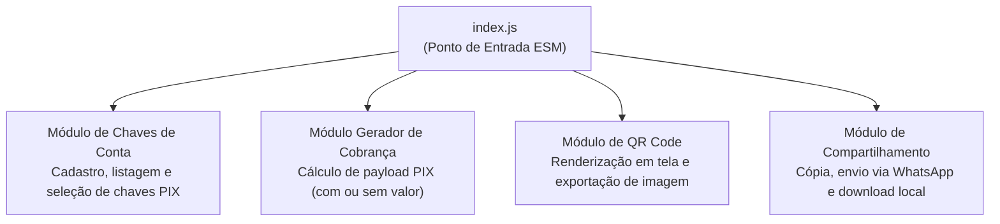

[Início](../README.md) > **Design: Módulos**

# 🎨 Design e Organização de Módulos

Este documento descreve a organização física atual do repositório **Manda um PIX** e a decomposição modular para os recursos de negócio do PWA.

---

## 📂 Estrutura Atual do Repositório

No estágio atual (`commit 1ba8b55`), o repositório contém a fundação de gerenciamento de pacotes, configuração de módulo ES e ferramentas de qualidade:

```text
mandaumpix.app/
├── docs/                  # Documentação viva técnica e de negócio
├── eslint.config.js       # Configuração Flat Config do ESLint v10 (JS, JSON, CSS, MD)
├── package.json           # Manifesto do projeto, scripts e devDependencies
├── package-lock.json      # Lockfile determinístico da árvore de pacotes npm
├── .prettierrc            # Configuração do formatador Prettier
├── .gitignore             # Regras de exclusão do controle de versão Git
└── README.md              # Ponto de entrada e apresentação do repositório
```

### Papel dos Arquivos de Raiz

| Arquivo                                      | Responsabilidade                                                                                                                                                               |
| :------------------------------------------- | :----------------------------------------------------------------------------------------------------------------------------------------------------------------------------- |
| [`package.json`](../../package.json)         | Define o pacote `mandaumpix.app` (`1.0.0`), habilita ES Modules nativos (`"type": "module"`), declara o ponto de entrada `"main": "index.js"` e o script `"lint": "eslint ."`. |
| [`eslint.config.js`](../../eslint.config.js) | Orquestra os plugins `@eslint/js`, `@eslint/json`, `@eslint/markdown`, `@eslint/css` e `eslint-config-prettier`, definindo variáveis globais de navegador (`globals.browser`). |
| [`.prettierrc`](../../.prettierrc)           | Ativa formatação padronizada do Prettier com configuração default (`{}`).                                                                                                      |

---

## 🧩 Decomposição Funcional dos Módulos de Domínio (PWA)

Para atender aos requisitos funcionais do **Manda um PIX**, o design funcional do aplicativo divide-se em quatro responsabilidades coesas:



1. **Módulo de Chaves de Conta**:
   - Cadastro de múltiplas chaves nas quais o usuário deseja receber.
   - Persistência e recuperação local das chaves para seleção rápida.
2. **Módulo Gerador de Cobrança ("Manda um PIX")**:
   - Recebe a chave selecionada e o valor opcional.
   - Caso o valor não seja informado, configura a cobrança como valor dinâmico/aberto.
   - Gera a chave de cobrança (PIX Copia e Cola).
3. **Módulo de Renderização de QR Code**:
   - Transforma a chave de cobrança em um QR Code visível na tela.
   - Exporta o gráfico gerado em formato de imagem para salvamento local.
4. **Módulo de Compartilhamento e Saída**:
   - Cópia da chave de cobrança para a área de transferência.
   - Compartilhamento externo (ex.: WhatsApp).
   - Download local da imagem do QR Code.

---

⬅️ **Anterior**: [ADR 0002](../architecture/decisions/0002-arquitetura-pwa-client-side-es-modules.md) | ➡️ **Próximo**: [Modelo de Dados](./data_models.md)
