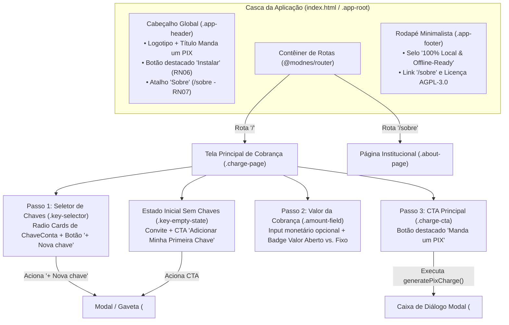

[Início](../README.md) > [Design](./modules.md) > **Proposta de Interface (UI)**

# 🖼️ Proposta de Interface do Usuário (UI)

Este documento especifica a arquitetura visual, ergonomia de interação, estrutura de telas, hierarquia de Web Components (`@modnes/*`) e convenções BEM para a interface do **Manda um PIX** (`mandaumpix.app`).

> 💡 **Protótipo Navegável Autônomo**: O protótipo HTML interativo e 100% autocontido desta especificação está salvo em [`docs/design/ui_prototype.html`](./ui_prototype.html), podendo ser aberto diretamente em qualquer navegador para testar os fluxos de cobrança, o modal `<dialog>` de chaves, os modos Mobile e Desktop Split-View, o botão **"Instalar"** e a página **"Sobre"**.

---

## 1. Princípios Visuais e Ergonomia

1. **Fluxo de Cobrança em 3 Toques (Zero Atrito)**:
   - A jornada principal ([Fluxos de Trabalho](../business/workflows.md)) ocorre integralmente na tela inicial (`/`): **Selecionar chave → Informar valor opcional → Clicar em "Manda um PIX"**.
2. **Cadastro de Chaves sem Mudança de Contexto (`<dialog>`)**:
   - A inclusão de novas chaves PIX ([`ChaveConta`](./data_models.md)) utiliza um modal/gaveta nativo (`<dialog class="key-dialog">`) integrado à tela principal, permitindo cadastrar uma chave e retornar imediatamente à geração da cobrança.
3. **Contraste Óptico para Leitura de QR Code**:
   - A casca superior utiliza o azul profundo da marca (`--color-brand-primary: #0b1834` e `--color-brand-primary-dark: #060d1e`) combinado ao verde de destaque (`--color-brand-accent: #00d37f`), enquanto os cartões operacionais e o palco do QR Code preservam superfície clara (`--color-surface: #ffffff`) para leitura imediata por câmeras de qualquer aplicativo bancário.
4. **Interface Limpa e Focada com Caixa de Diálogo Modal (`<dialog class="charge-dialog">`)**:
   - **Coluna Única Fluida**: Em qualquer dispositivo (Mobile ou Desktop), a tela principal (`.charge-page`) opera em coluna única contida e limpa (largura de 460px a 520px), contendo exclusivamente o seletor de chaves, o campo de valor e o botão CTA **"Manda um PIX"**.
   - **Eliminação do Estado "Aguardando geração"**: Não há divisão em colunas estáticas ociosas ou cartões de espera. O resultado da cobrança só é exibido quando ela é de fato gerada, surgindo imediatamente em uma **caixa de diálogo modal nativa (`<dialog>`)** com foco exclusivo no QR Code e nas opções de distribuição (`Copiar`, `WhatsApp`, `Salvar PNG`).

---

## 2. Arquitetura de Telas e Navegação

---

## 3. Especificação Detalhada das Regiões da UI

### 3.1. Cabeçalho Global (`.app-header`)

- **Identidade da Marca**: Exibe o logotipo vetorial ([`src/assets/icons/icon.svg`](../../src/assets/icons/icon.svg)) ao lado do título **Manda um PIX** e subtítulo sintetizando a proposta do aplicativo.
- **Botão Destacado "Instalar" (`.app-header__install-btn` — `RN06`)**:
  - Pílula de alto contraste preenchida em Verde PIX (`--color-brand-accent: #00d37f`) com texto escuro (`#060d1e`) e ícone `<vector-icon name="download">`.
  - Renderizado exclusivamente quando o PWA ainda não está instalado no dispositivo (fora de `display-mode: standalone` e mediante disponibilidade do prompt de instalação), ocultando-se automaticamente após o evento `appinstalled`.
- **Acesso Fácil à Página "Sobre" (`.app-header__about-link` — `RN07`)**:
  - Botão de navegação com `<vector-icon name="circle-info">` posicionado no cabeçalho para acesso direto à rota `/sobre`.

### 3.2. Tela Principal (`/`) — Gerador de Cobrança (`.charge-page`)

#### A. Estado de Primeiro Uso / Sem Chaves (`.key-empty-state`)

- Exibido automaticamente quando o armazenamento local ainda não possui registros de `ChaveConta`.
- Apresenta ícone `<vector-icon name="key">`, explicação de que os dados permanecem **100% locais no dispositivo** e botão primário **"Adicionar Minha Primeira Chave"** que abre o modal `<dialog class="key-dialog">`.

#### B. Passo 1 — Seletor de Chaves Cadastradas (`.key-selector`)

- Lista as chaves salvas localmente como um grupo de cartões selecionáveis (`role="radiogroup"`):
  - Cada cartão (`.key-selector__card`) exibe indicador visual de seleção, **rótulo amigável** (ex.: _Nubank Pessoal_), badge do **tipo de chave** (`CPF`, `CNPJ`, `EMAIL`, `TELEFONE`, `EVP`), **valor da chave** em `--font-mono` e botão de remoção (`<vector-icon name="trash">`).
  - O cartão ativo aplica o modificador `.key-selector__card--selected` com borda `#00d37f`.
- No topo da seção, o botão **"+ Nova chave"** (`<vector-icon name="plus">`) abre o modal de cadastro sem abandonar a tela.

#### C. Modal / Gaveta de Cadastro de Chave (`<dialog class="key-dialog">`)

- Construído sobre o elemento semântico nativo `<dialog>` com suporte a fechamento por `Esc`, botão `<vector-icon name="xmark">` e gerenciamento de foco:
  - **Seletor de Tipo (`tipo_chave`)**: Pílulas interativas para `CPF`, `CNPJ`, `E-mail`, `Celular` e `Aleatória (EVP)`, ajustando dinamicamente o `placeholder` e a validação do campo principal.
  - **Campo Chave PIX (`valor_chave`)**: Input obrigatório em fonte monoespaçada.
  - **Campo Apelido da Conta (`rotulo`)**: Identificação amigável para facilitar a seleção recorrente.
  - **Dados do Beneficiário EMV (`nome_recebedor` e `cidade_recebedor`)**: Campos alinhados aos limites do padrão BR Code (até 25 e 15 caracteres, respectivamente).

#### D. Passo 2 — Valor da Cobrança Opcional (`.amount-field`)

- **Input Monetário (`.amount-field__input`)**: Campo amplo (`inputmode="decimal"`) precedido pelo símbolo `R$` e acompanhado de botão rápido para limpar o valor (`<vector-icon name="xmark">`).
- **Indicador Reativo de Modalidade (`RN02` e `RN03`)**:
  - **Quando em branco ou `0,00`**: Exibe pílula de status _"Valor aberto (pagador define)"_, omitindo o campo `54` (_Transaction Amount_) no payload EMV.
  - **Quando preenchido (`> 0`)**: Exibe pílula em verde _"Valor fixo: R$ XX,XX"_.
- **Atalhos Rápidos**: Botões compactos (`Valor aberto`, `R$ 25`, `R$ 50`) para preenchimento com um toque.

#### E. Passo 3 — Botão de Ação Principal (`.charge-cta`)

- Botão de largura total com gradiente verde da marca, tipografia em negrito, sombra suave e ícone `<vector-icon name="qrcode">` com o rótulo **"Manda um PIX"** (`RN04`).

### 3.3. Caixa de Diálogo de Resultado da Cobrança (`<dialog class="charge-dialog">`)

Apresentada imediatamente após o acionamento de **"Manda um PIX"** (`RN04`) sobre uma camada escurecida de backdrop (`rgba(6, 13, 30, 0.65)` com `backdrop-filter: blur(2px)`), eliminando qualquer mensagem ou coluna estática de "Aguardando geração" na tela principal:

1. **Barra Superior e Fechamento (`.charge-dialog__top-bar`)**: Exibe o título semântico da janela modal com ícone `<vector-icon name="check">` e o botão de fechamento com `<vector-icon name="xmark">` (`aria-label="Fechar diálogo de cobrança"`), além de fechamento nativo por tecla `Esc` ou clique externo no backdrop.
2. **Resumo da Cobrança (`.charge-result__header`)**: Exibe o rótulo da conta, o nome do recebedor e uma pílula destacando o valor fixo formatado em BRL ou o selo _"Valor Aberto"_.
3. **Palco do QR Code (`.charge-result__qr-stage`)**: Moldura centralizada de fundo branco puro e borda `#0b1834` contendo o SVG vetorial produzido por [`generatePixCharge`](../../src/main.js).
4. **Bloco PIX Copia e Cola (`.charge-result__brcode`)**: Caixa de código com a chave de cobrança (`brCode`) em fonte `--font-mono`, permitindo seleção integral imediata com um clique (`user-select: all`).
5. **Grade Tripla de Ações de Saída (`.charge-result__actions` — `RN05`)**:
   - **Copiar (`.charge-result__btn--copy`)**: Aciona `navigator.clipboard.writeText(brCode)`, alternando temporariamente o ícone `<vector-icon name="copy">` para `<vector-icon name="check">` com o texto _"Copiado!"_.
   - **Compartilhar / WhatsApp (`.charge-result__btn--share`)**: Aciona `<vector-icon name="share">` integrando `navigator.share` (Web Share API) ou fallback via URL `https://wa.me/?text=...`.
   - **Salvar PNG (`.charge-result__btn--download`)**: Aciona `<vector-icon name="download">` convertendo o QR Code via [`exportQrCodePng`](../../src/main.js) para download local (`mandaumpix-qrcode.png`).
6. **Botão de Conclusão**: Botão inferior permitindo concluir a visualização e fechar a caixa de diálogo, retornando o foco de forma acessível para a tela principal de cobrança.

### 3.4. Página Institucional "Sobre" (`/sobre` — `.about-page`)

Acessível a partir do cabeçalho ou rodapé e gerenciada pelo `@modnes/router` (`RN07`):

- **Sobre o Aplicativo (Gratuito, Livre e de Código Aberto)**: Apresenta o propósito do **Manda um PIX** (facilitar a geração rápida de cobranças via PIX sem abrir aplicativos de banco, com privacidade e armazenamento 100% local), deixando explícito que o aplicativo é **gratuito, livre e de código aberto**, acompanhado do botão **"Início"** (`<vector-icon name="home">`) para retornar à tela de cobrança.
- **Sobre o Autor**: Card dedicado identificando **Luiz Henrique Canet Filho**, e-mail `<me@luizca.net>`, perfil GitHub [`@luizcanet`](https://github.com/luizcanet) e perfil LinkedIn [`in/luizcanet`](https://www.linkedin.com/in/luizcanet/).
- **Sobre o Projeto e Licença**: Card destacando o domínio `mandaumpix.app` (`1.0.0`), link para o código-fonte oficial ([`github.com/luizcanet/mandaumpix.app`](https://github.com/luizcanet/mandaumpix.app)) e termos da licença livre **GNU Affero General Public License v3.0 (`AGPL-3.0-only`)**.
- **Card de Contribuição Voluntária (`.about-page__support` — "Manda um PIX")**:
  - Exibe uma mensagem **descontraída e com emojis** informando que o aplicativo é gratuito, livre e de código aberto, mas que se o usuário achar que o aplicativo é útil para ele e para outras pessoas, pode contribuir para ajudar a manter o projeto com **qualquer valor**, utilizando em destaque a frase **"Manda um PIX"** (ex.: _"🎉 O **Manda um PIX** é 100% gratuito, livre e de código aberto! Mas se você acha que ele é útil pra você e pra outras pessoas e quiser dar uma força pra ajudar a manter o projeto com qualquer valor... ☕🚀 **Manda um PIX!** 💚"_).
  - Apresenta o palco do **QR Code com valor dinâmico (aberto)** gerado para a chave **`eu@luizca.net`** com a mensagem **"Doação para o Manda um PIX"**, a identificação da chave (`eu@luizca.net`), a caixa com a **Chave copia e cola** (`00020126650014br.gov.bcb.pix0113eu@luizca.net0226Doacao para o Manda um PIX5204000053039865802BR5925LUIZ HENRIQUE CANET FILHO6008BRASILIA62070503***63048BC9`) e o botão **"Copiar Chave Copia e Cola"** (`<vector-icon name="copy">`).
- **Card de Incentivo à Divulgação (`.about-page__share`)**:
  - Convida de forma amigável e com emojis o usuário a espalhar a novidade e **divulgar o aplicativo para mais pessoas** (ex.: _"📣 Curtiu o app? Espalhe a palavra! Indique e compartilhe o **mandaumpix.app** com amigos, clientes e colegas para ajudar mais pessoas a gerarem cobranças PIX sem complicação! 🤝✨"_), acompanhado do botão **"Compartilhar o Aplicativo"** (`<vector-icon name="share">`).

---

## 4. Mapeamento de Web Components (`@modnes/*`), BEM e `<vector-icon>`

Todos os ícones da interface são consumidos exclusivamente por meio do Web Component compartilhado [`<vector-icon>`](../../src/presentation/components/vector-icon/vector-icon.component.js) acoplado ao sprite [`icon.svg`](../../src/presentation/components/vector-icon/icon.svg):

| Região / Componente                | Custom Element (`@modnes/custom-element`)     | Bloco BEM Principal                 | Símbolos `<vector-icon>` Utilizados                       |
| :--------------------------------- | :-------------------------------------------- | :---------------------------------- | :-------------------------------------------------------- |
| **Cabeçalho & Botão Instalar**     | `<app-header>`                                | `.app-header`                       | `download`, `circle-info`, `home`                         |
| **Estado Inicial Sem Chaves**      | `<pix-key-empty>`                             | `.key-empty-state`                  | `key`, `plus`, `check`                                    |
| **Seletor de Chaves de Conta**     | `<pix-key-selector>`                          | `.key-selector`                     | `key`, `plus`, `trash`, `check`                           |
| **Modal de Cadastro (`<dialog>`)** | `<pix-key-dialog>`                            | `.key-dialog`                       | `key`, `check`, `xmark`, `circle-exclamation`             |
| **Formulário Gerador de Cobrança** | `<pix-charge-form>`                           | `.charge-form`                      | `qrcode`, `xmark`                                         |
| **Modal de Cobrança (`<dialog>`)** | `<pix-charge-dialog>` / `<pix-charge-result>` | `.charge-dialog` / `.charge-result` | `qrcode`, `copy`, `share`, `download`, `check`, `xmark`   |
| **Página Sobre (`/sobre`)**        | `<about-page>`                                | `.about-page`                       | `circle-info`, `home`, `qrcode`, `copy`, `share`, `check` |

---

## 5. Tokens Visuais e Acessibilidade (WCAG 2.2 AA)

A interface consome diretamente as CSS Custom Properties declaradas em [`src/presentation/styles/tokens.css`](../../src/presentation/styles/tokens.css):

| Token CSS                    |       Valor       | Aplicação na Interface                                                                    |
| :--------------------------- | :---------------: | :---------------------------------------------------------------------------------------- |
| `--color-brand-primary`      |     `#0b1834`     | Fundo do cabeçalho, badges de tipo de chave, botão de cópia e moldura do QR Code          |
| `--color-brand-primary-dark` |     `#060d1e`     | Gradiente profundo do cabeçalho e texto sobre botões Verde PIX                            |
| `--color-brand-accent`       |     `#00d37f`     | Botão principal **"Manda um PIX"**, botão destacado **"Instalar"** e borda de chave ativa |
| `--color-surface`            |     `#ffffff`     | Superfície dos cartões de seleção, formulário, modal `<dialog>` e palco do QR Code        |
| `--color-surface-muted`      |     `#f8fafc`     | Plano de fundo geral da aplicação e interior de inputs                                    |
| `--color-text-primary`       |     `#0f172a`     | Títulos, valores monetários e rótulos principais                                          |
| `--color-text-secondary`     |     `#475569`     | Textos de apoio, legendas e metadados secundários                                         |
| `--font-mono`                | `ui-monospace...` | Exibição de chaves PIX e do payload BR Code (PIX Copia e Cola)                            |

### Requisitos de Acessibilidade Aplicados

- **Alvos de Toque (`>= 44x44px`)**: Todos os cartões de chave, botões de ação (`Copiar`, `WhatsApp`, `Salvar PNG`, `Instalar`, `Sobre`) e controles do modal respeitam área mínima táctil de `44px`.
- **Semântica Nativa**: Uso de `<header>`, `<main>`, `<section>`, `<dialog>`, `<footer>`, `role="radiogroup"` / `role="radio"` para seleção de chaves e `aria-live="polite"` para anúncios de feedback (_"Código copiado!"_).
- **Iconografia Acessível**: Ícones decorativos acompanhados de texto utilizam `aria-hidden="true"`, enquanto botões compactos possuem `aria-label` descritivo.

---

⬅️ **Anterior**: [Especificações e Contratos](./api_specs.md) | ➡️ **Próximo**: [Pipeline de Implantação](../deployment/pipeline.md)
