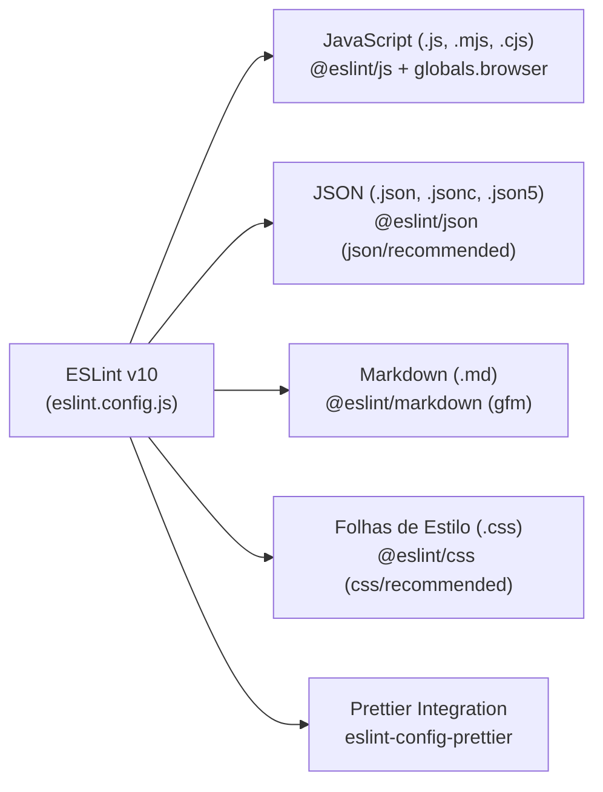

[Início](../README.md) > [Qualidade](./testing_strategy.md) > **Análise Estática**

# 🔍 Análise Estática e Formatação de Código

O **Manda um PIX** conta com uma suíte moderna de análise estática multi-linguagem configurada via **ESLint v10 (Flat Config)** em [`eslint.config.js`](../../eslint.config.js) e formatação via **Prettier v3** em [`.prettierrc`](../../.prettierrc).

---

## 🧩 Arquitetura do Linter ([`eslint.config.js`](../../eslint.config.js))



---

## 📋 Regras por Tipo de Arquivo

| Extensões Alvo      | Plugin / Linguagem                  | Configuração Base      | Observações                                                                                                       |
| :------------------ | :---------------------------------- | :--------------------- | :---------------------------------------------------------------------------------------------------------------- |
| `**/*.{js,mjs,cjs}` | `@eslint/js`                        | `js/recommended`       | Habilita `globals.browser` para permitir APIs nativas do navegador (`window`, `document`, `navigator`, etc.).     |
| `**/*.json`         | `@eslint/json` (`json/json`)        | `json/recommended`     | Verifica chaves duplicadas, chaves vazias (`json/no-empty-keys`) e sintaxe JSON estrita.                          |
| `**/*.jsonc`        | `@eslint/json` (`json/jsonc`)       | `json/recommended`     | Suporta JSON com comentários.                                                                                     |
| `**/*.json5`        | `@eslint/json` (`json/json5`)       | `json/recommended`     | Suporta especificação JSON5.                                                                                      |
| `**/*.md`           | `@eslint/markdown` (`markdown/gfm`) | `markdown/recommended` | Audita cabeçalhos, blocos de código, links e estrutura de todos os arquivos Markdown do repositório e de `docs/`. |
| `**/*.css`          | `@eslint/css` (`css/css`)           | `css/recommended`      | Valida propriedades, seletores e sintaxe CSS.                                                                     |

---

## 🏃 Como Executar

```bash
# Executar análise estática em todo o projeto
npm run lint

# Executar análise estática apenas na documentação Markdown
npx eslint docs/ README.md
```

> ⚠️ **Observação Conhecida sobre `package-lock.json`**: Como a regra `**/*.json` aplica `json/recommended` sobre todos os arquivos `.json` do diretório e o `package-lock.json` v3 do npm utiliza a chave raiz `""` dentro do objeto `"packages"`, o plugin `@eslint/json` sinaliza `json/no-empty-keys` na linha 7 do `package-lock.json` caso ele não esteja listado em `ignores` no `eslint.config.js`.

---

## 🔒 Verificação de Integridade Criptográfica e Checksums de Build (US-08.5)

Além da análise estática de código-fonte via ESLint e formatação via Prettier, o projeto implementa uma esteira de integridade criptográfica contínua para validar os artefatos estáticos compilados em `dist/`:

1. **Subresource Integrity (SRI) no Import Map**:
   - O comando de build valida que todas as dependências locais importadas em [`index.html`](../../index.html) possuem hashes SHA-384 (`integrity="sha384-..."`) devidamente calculados e conferidos contra os arquivos reais compilados ([`scripts/build.js`](../../scripts/build.js)).

2. **Geração Determinística de Checksums (`dist/SHA256SUMS`)**:
   - O script [`scripts/generate-checksums.js`](../../scripts/generate-checksums.js) (disponível via `npm run build:checksums`) calcula hashes SHA-256 para todos os artefatos estáticos compilados, ordenando-os deterministicamente no formato compatível com GNU coreutils `sha256sum`.
   - Executado automaticamente durante o `npm run build` (**INV-01**).

3. **Verificação de Integridade via Linha de Comando**:

   ```bash
   # Gerar ou regenerar o manifesto de hashes
   npm run build:checksums

   # Validar integridade matemática de todos os arquivos em dist/
   cd dist && sha256sum -c SHA256SUMS
   ```

4. **Garantia de Qualidade em CI/CD (INV-02)**:
   - Toda compilação nos workflows de CI ([`ci.yml`](../../.github/workflows/ci.yml)) e CD ([`deploy-dev.yml`](../../.github/workflows/deploy-dev.yml), [`deploy-stg.yml`](../../.github/workflows/deploy-stg.yml), [`deploy-prd.yml`](../../.github/workflows/deploy-prd.yml)) executa `cd dist && sha256sum -c SHA256SUMS` como gate bloqueante antes de qualquer publicação no Firebase Hosting.
   - Orientações detalhadas de auditoria pública estão documentadas em [Monitoramento Ativo e Procedimentos de Derrubada](../security/takedown_and_monitoring.md#plano-de-acao-6-auditoria-criptografica-de-releases-e-integridade-de-builds-us-085).

---

⬅️ **Anterior**: [Estratégia de Testes](./testing_strategy.md) | 🏠 **Voltar ao Índice**: [Documentação do Sistema](../README.md)
