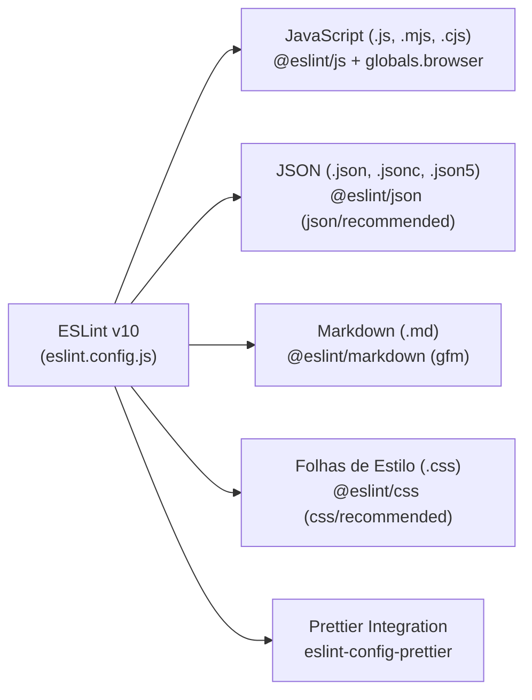

[Início](../README.md) > [Qualidade](./testing_strategy.md) > **Análise Estática**

# 🔍 Análise Estática e Formatação de Código

O **Manda um PIX** conta com uma suíte moderna de análise estática multi-linguagem configurada via **ESLint v10 (Flat Config)** em [`eslint.config.js`](../../eslint.config.js) e formatação via **Prettier v3** em [`.prettierrc`](../../.prettierrc).

---

## 🧩 Arquitetura do Linter ([`eslint.config.js`](../../eslint.config.js))



---

## 📋 Regras por Tipo de Arquivo

| Extensões Alvo      | Plugin / Linguagem                  | Configuração Base      | Observações                                                                                                       |
| :------------------ | :---------------------------------- | :--------------------- | :---------------------------------------------------------------------------------------------------------------- |
| `**/*.{js,mjs,cjs}` | `@eslint/js`                        | `js/recommended`       | Habilita `globals.browser` para permitir APIs nativas do navegador (`window`, `document`, `navigator`, etc.).     |
| `**/*.json`         | `@eslint/json` (`json/json`)        | `json/recommended`     | Verifica chaves duplicadas, chaves vazias (`json/no-empty-keys`) e sintaxe JSON estrita.                          |
| `**/*.jsonc`        | `@eslint/json` (`json/jsonc`)       | `json/recommended`     | Suporta JSON com comentários.                                                                                     |
| `**/*.json5`        | `@eslint/json` (`json/json5`)       | `json/recommended`     | Suporta especificação JSON5.                                                                                      |
| `**/*.md`           | `@eslint/markdown` (`markdown/gfm`) | `markdown/recommended` | Audita cabeçalhos, blocos de código, links e estrutura de todos os arquivos Markdown do repositório e de `docs/`. |
| `**/*.css`          | `@eslint/css` (`css/css`)           | `css/recommended`      | Valida propriedades, seletores e sintaxe CSS.                                                                     |

---

## 🏃 Como Executar

```bash
# Executar análise estática em todo o projeto
npm run lint

# Executar análise estática apenas na documentação Markdown
npx eslint docs/ README.md
```

> ⚠️ **Observação Conhecida sobre `package-lock.json`**: Como a regra `**/*.json` aplica `json/recommended` sobre todos os arquivos `.json` do diretório e o `package-lock.json` v3 do npm utiliza a chave raiz `""` dentro do objeto `"packages"`, o plugin `@eslint/json` sinaliza `json/no-empty-keys` na linha 7 do `package-lock.json` caso ele não esteja listado em `ignores` no `eslint.config.js`.

---

⬅️ **Anterior**: [Estratégia de Testes](./testing_strategy.md) | 🏠 **Voltar ao Índice**: [Documentação do Sistema](../README.md)
