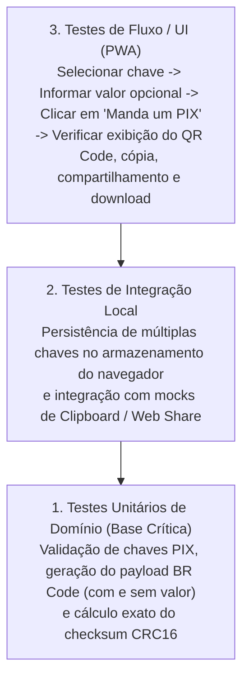

[Início](../README.md) > **Qualidade: Estratégia de Testes**

# 🧪 Estratégia de Qualidade e Testes

Este documento descreve o estado atual dos testes no repositório e a estratégia de verificação para os módulos do **Manda um PIX**.

---

## 📊 Estado Atual no Repositório

Em [`package.json`](../../package.json), o script de testes encontra-se definido com o placeholder padrão de inicialização do npm:

```json
{
  "scripts": {
    "test": "echo \"Error: no test specified\" && exit 1",
    "lint": "eslint ."
  }
}
```

---

## 🔺 Pirâmide de Testes Planejada para o Domínio PIX

À medida que os módulos de negócio forem implementados a partir do ponto de entrada `index.js`, a cobertura de testes foca nas três camadas abaixo:



### Escopos Prioritários de Teste Unitário

1. **Geração de Cobrança com Valor Definido**:
   - Garantir que o campo EMV `54` (_Transaction Amount_) seja formatado corretamente com duas casas decimais e que o `CRC16` final seja válido.
2. **Geração de Cobrança com Valor Dinâmico (Opcional Omitido)**:
   - Garantir que, quando o usuário não informar valor, o campo EMV `54` seja omitido e o `CRC16` seja recalculado adequadamente.
3. **Cadastro e Seleção de Chaves de Contas**:
   - Validar o armazenamento e a seleção entre múltiplas chaves cadastradas pelo usuário.

---

⬅️ **Anterior**: [Stack Tecnológica](../technology/stack.md) | ➡️ **Próximo**: [Análise Estática e Linters](./static_analysis.md)
