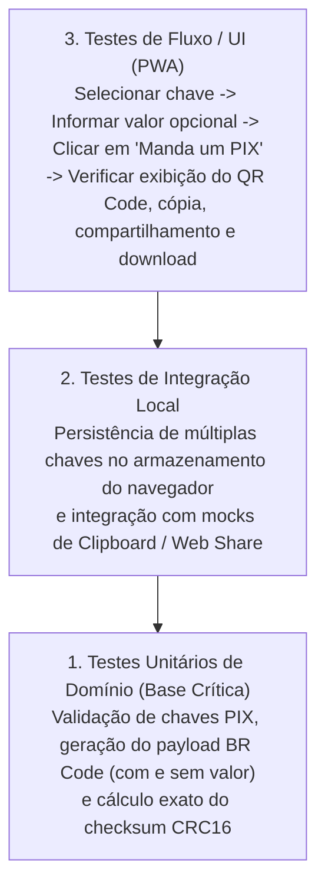

[Início](../README.md) > **Qualidade: Estratégia de Testes**

# 🧪 Estratégia de Qualidade e Testes

Este documento descreve o estado atual dos testes no repositório e a estratégia de verificação para os módulos do **Manda um PIX**.

---

## 📊 Estado Atual no Repositório

O repositório utiliza o **Vitest** (`^5.1.0`) configurado em [`vitest.config.js`](../../vitest.config.js) com ambiente DOM simulado via **JSDOM** (`^31.0.0`) e cobertura de código nativa via **`@vitest/coverage-v8`** (`^5.1.0`).

Em [`package.json`](../../package.json), os scripts de teste estão definidos como:

```json
{
  "scripts": {
    "test": "vitest run",
    "test:watch": "vitest",
    "test:coverage": "vitest run --coverage",
    "storybook": "storybook dev -p 6006 --no-open",
    "build-storybook": "storybook build -o storybook-static",
    "lint": "eslint ."
  }
}
```

A suíte de testes unitários valida:
- [`src/main.test.js`](../../src/main.test.js): Metadados da aplicação, geração e parsing de cobranças PIX estáticas (com valor fixo e com valor aberto), inicialização do DOM (`bootstrapApp`) e reexportações do ecossistema `@modnes`.
- [`src/presentation/components/vector-icon/vector-icon.test.js`](../../src/presentation/components/vector-icon/vector-icon.test.js): Registro do Custom Element `<vector-icon>`, renderização do símbolo SVG e atualização reativa de atributos (`name` e `sprite-path`).

Para o desenvolvimento isolado, inspeção visual e validação de acessibilidade de Web Components compartilhados, o projeto utiliza o **Storybook v10** (`@storybook/html-vite`, `@storybook/addon-docs` e `@storybook/addon-a11y`) configurado em [`.storybook/main.js`](../../.storybook/main.js) e [`.storybook/preview.js`](../../.storybook/preview.js).

---

## 🔺 Pirâmide de Testes Planejada para o Domínio PIX

À medida que os módulos de negócio forem implementados a partir do ponto de entrada `index.js`, a cobertura de testes foca nas três camadas abaixo:



### Escopos Prioritários de Teste Unitário

1. **Geração de Cobrança com Valor Definido**:
   - Garantir que o campo EMV `54` (_Transaction Amount_) seja formatado corretamente com duas casas decimais e que o `CRC16` final seja válido.
2. **Geração de Cobrança com Valor Dinâmico (Opcional Omitido)**:
   - Garantir que, quando o usuário não informar valor, o campo EMV `54` seja omitido e o `CRC16` seja recalculado adequadamente.
3. **Cadastro e Seleção de Chaves de Contas**:
   - Validar o armazenamento e a seleção entre múltiplas chaves cadastradas pelo usuário.

---

⬅️ **Anterior**: [Stack Tecnológica](../technology/stack.md) | ➡️ **Próximo**: [Análise Estática e Linters](./static_analysis.md)
