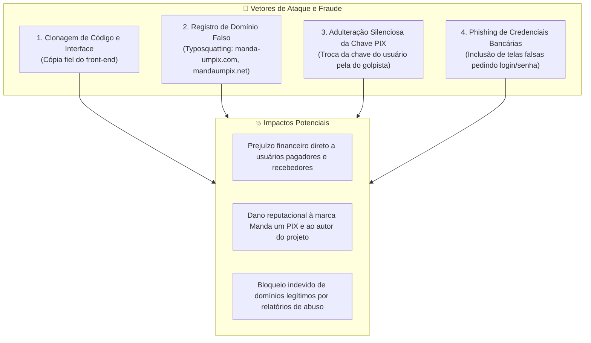
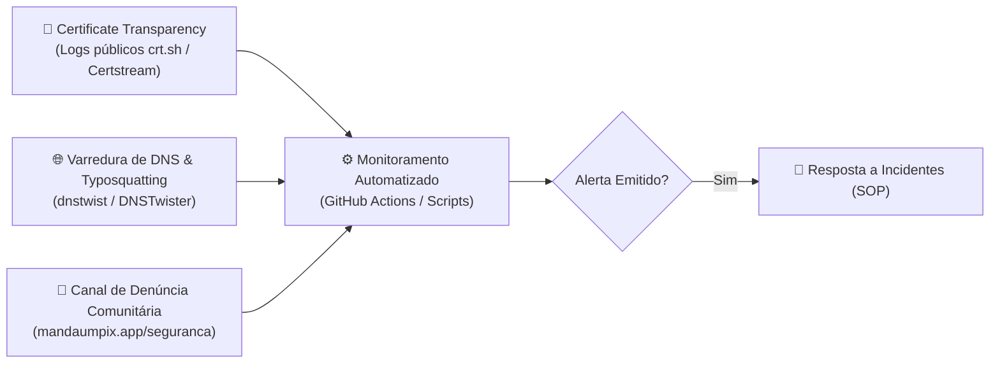
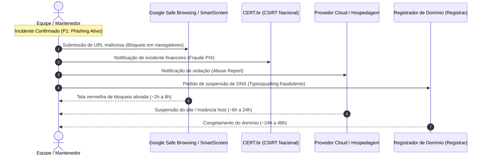
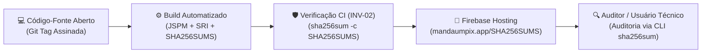

[Início](../README.md) > [Segurança](./auth_and_access.md) > **Monitoramento Ativo e Takedown**

# 🛡️ Monitoramento Ativo e Procedimentos de Derrubada (Takedown)

Este documento estabelece as diretrizes estratégicas, técnicas e operacionais para a **proteção contra réplicas maliciosas, golpes de phishing, desvio de pagamentos PIX e uso indevido de marca** relacionados ao ecossistema do **Manda um PIX** (`mandaumpix.app`).

---

## ⚠️ Cenário de Ameaça em Aplicações Open-Source e PWA

O **Manda um PIX** é distribuído como software livre sob a licença **GNU AGPL v3.0 (`AGPL-3.0-only`)**. Isso garante transparência e auditabilidade pública de todo o código-fonte, mas também expõe o projeto a riscos específicos de engenharia social e fraudes financeiras executadas por terceiros mal-intencionados:



### Vetores de Ataque Mapeados

1. **Desvio Silencioso de Recebimento (Chave Corrompida / Adulterada)**:
   - O golpista hospeda um clone do site em que o gerador de QR Code substitui silenciosamente a chave PIX digitada pelo usuário pela chave PIX do fraudador.
2. **Typosquatting e Combosquatting**:
   - Registro de domínios com nomes visualmente idênticos ou complementares (ex.: `mandaumpix-app.com`, `mandaumpix.online`, `manda-um-pix.org`) para enganar usuários em buscas orgânicas ou anúncios fraudulentos.
3. **Phishing de Senhas Bancárias (Violação do Princípio Zero-Credential)**:
   - Réplica que simula o aplicativo legítimo e solicita login bancário, senha de 4/6 dígitos, tokens ou dados de cartão de crédito.
4. **Distribuição de APKs Maliciosos**:
   - Compilação do PWA em pacote Android (`.apk`) contendo trojans bancários ou malwares de sobreposição de tela (_overlay attacks_), distribuídos fora da Google Play Store.

---

## 🏛️ Plano de Ação 1: Proteção de Marca e Amparo Legal (INPI vs. AGPLv3)

A licença de software livre `AGPL-3.0` confere liberdade sobre o **código-fonte**, mas **não transfere direitos de exploração comercial de marcas registradas, logotipos e nomes fantasia**:

| Elemento                         | Status Legal                    | Amparo Jurídico                                                 |
| :------------------------------- | :------------------------------ | :-------------------------------------------------------------- |
| **Código-Fonte (`src/`)**        | Livre / Aberto                  | Licença GNU AGPL v3.0 (`AGPL-3.0-only`)                         |
| **Nome "Manda um PIX"**          | Propriedade Intelectual / Marca | Registro de Marca no INPI (Classes Nice 09 e 42/36)             |
| **Logotipo e Identidade Visual** | Direitos Autorais Reservados    | Lei de Direitos Autorais (Lei Federal nº 9.610/1998)            |
| **Domínio Oficial Canônico**     | Titularidade Exclusiva          | Registro sob autoridade IANA/ICANN (`.app` via Google Registry) |

### Diretrizes de Ação Jurídica:

- **Registro de Marca no INPI**: Submeter e acompanhar pedido de registro da marca mista (nome + logotipo) para garantir titularidade incontestável no território brasileiro.
- **Cláusula de Uso de Marca no Repositório**: Manter no `README.md` e em `LICENSE` a nota expressa de que a licença de código não autoriza terceiros a utilizarem a marca e logotipo para induzir o público a erro ou promover golpes.
- **Notificação Extrajudicial Preliminar**: Utilizar modelos padronizados para notificar registradores e provedores de hospedagem com base na violação marcária e infração penal de estelionato digital (Art. 171, § 2º-A do Código Penal Brasileiro).

---

## 📡 Plano de Ação 2: Monitoramento Ativo e Detecção Precoce

A velocidade de detecção é o fator determinante para mitigar danos antes que uma réplica maliciosa faça vítimas em larga escala:



### 1. Monitoramento de Emissão de Certificados SSL/TLS (Certificate Transparency)

- Todo certificado SSL/TLS emitido por autoridades certificadoras (Let's Encrypt, Cloudflare, DigiCert) é registrado publicamente em logs de **Certificate Transparency (CT)**.
- **Implementação Ativa**:
  - Script em Node.js [`scripts/security/monitor-ct-logs.js`](../../scripts/security/monitor-ct-logs.js) com suíte de testes unitários em Vitest [`test/security/monitor-ct-logs.test.js`](../../test/security/monitor-ct-logs.test.js).
  - Consulta automatizada via API ao serviço `https://crt.sh/?q=%25mandaumpix%25&output=json` e `https://crt.sh/?q=%25manda-um-pix%25&output=json` com mecanismo de resiliência e **exponential backoff** (até 3 tentativas) para tolerância a falhas `HTTP 503` ou instabilidade de rede.
  - Filtragem estrita de origens oficiais (`mandaumpix.app`, `*.mandaumpix.app`, `mandaumpix-app-*.web.app`, `mandaumpix-app-*.firebaseapp.com`) garantindo **zero falsos positivos**.
- **Automação GitHub Actions e Alertas ([`.github/workflows/security-ct-monitor.yml`](../../.github/workflows/security-ct-monitor.yml))**:
  - Execução cron agendada diária (às 06:00 UTC / 03:00 BRT) e suporte a disparo manual (`workflow_dispatch`).
  - Geração e retenção de relatório de auditoria `security-ct-report.json` como artefato de build por 30 dias.
  - **Abertura automática de Issue**: Ao identificar novos domínios suspeitos, uma issue é criada no repositório com o label `security-incident` contendo tabela com domínios, autoridade emissora (CA), data e orientações de takedown (atualizando a thread se já existir issue aberta).
  - **Notificação Webhook Instantânea**: Caso o segredo [`SECURITY_WEBHOOK_URL`](../configuration/environment.md#segredo-de-monitoramento-e-resposta-a-incidentes-security_webhook_url) esteja configurado no repositório, o workflow envia o relatório JSON diretamente para canais operacionais (Discord, Slack, Teams, Telegram ou SIEM).

### 2. Varredura Contínua de Typosquatting e Combosquatting

- Execução regular de ferramentas de detecção de variações de domínio, como `dnstwist`:
  ```bash
  # Varredura de domínios permutados e detecção de registros ativos
  dnstwist --registered --format json mandaumpix.app
  ```
- Monitoramento de domínios com prefixos e sufixos comuns em golpes bancários: `app`, `oficial`, `seguro`, `pix`, `pagamentos`, `online`, `net`, `org`, `com.br`.

### 3. Monitoramento em Mecanismos de Busca e Lojas de Aplicativos

- **Google Alerts**: Alertas configurados para `"manda um pix" aplicativo OR pwa OR apk`.
- **Google Play Console**: Verificação semestral de apps que utilizem o nome idêntico ou imagens do repositório em lojas de aplicativos Android.

---

## 🛡️ Plano de Ação 3: UX Defensiva e Validação de Origem Canônica no PWA

A própria aplicação legítima deve educar e proteger o usuário contra confusões com links adulterados:

### 1. Verificação de Origem no Código Client-Side

- A aplicação pode validar se está em execução na origem legítima esperada:
  ```javascript
  const CANONICAL_ORIGINS = [
    "https://mandaumpix.app",
    "https://stg.mandaumpix.app",
    "https://dev.mandaumpix.app",
    "http://localhost:5776",
    "http://localhost:6006",
  ];

  export function isOfficialOrigin() {
    return CANONICAL_ORIGINS.includes(window.location.origin);
  }
  ```
- Se executada a partir de uma origem não reconhecida (clone não modificado), a aplicação pode apresentar um aviso ostensivo:
  > _"⚠️ ATENÇÃO: Você está acessando uma cópia não oficial deste aplicativo. O endereço legítimo e seguro é **https://mandaumpix.app**."_

### 2. Alerta Permanente da Arquitetura Zero-Credential

- Inclusão de advertência explícita na tela "Sobre" e no rodapé do aplicativo:
  - _"O Manda um PIX **nunca** solicita senhas bancárias, dados de cartão ou códigos de verificação."_
  - _"Confira sempre o nome do titular exibido na tela do seu banco antes de efetuar qualquer pagamento via PIX."_

### 3. Publicação Oficial via Trusted Web Activity (TWA) na Google Play Store

- Vinculação criptográfica do aplicativo Android ao domínio web via **Digital Asset Links** ([`.well-known/assetlinks.json`](../../.well-known/assetlinks.json)):
  - Garante que apenas a aplicação oficial possa abrir links com a barra de endereços oculta como app nativo no ecossistema Android.
  - Impede que clones usem o mesmo namespace oficial de pacote Android.

---

## ⚡ Plano de Ação 4: Procedimento Operacional Padrão (SOP) de Derrubada (Takedown)

Quando uma réplica fraudulenta for confirmada, o procedimento operacional deve ser executado seguindo o fluxo de resposta rápida multicanal:



### Matriz de Escalonamento e Prioridade de Resposta

| Nível de Severidade | Critério do Incidente                                                     | Tempo Alvo de Disparo (SLA) | Ações Imediatas                                                                                                                             |
| :-----------------: | :------------------------------------------------------------------------ | :-------------------------: | :------------------------------------------------------------------------------------------------------------------------------------------ |
|  **P1 — Crítico**   | Réplica ativa adulterando chaves PIX ou coletando senhas bancárias        |        **< 2 horas**        | 1. Submissão Google Safe Browsing<br/>2. Notificação ao CERT.br<br/>3. Abuse report para Cloudflare/Host<br/>4. Aviso nas redes/repositório |
|    **P2 — Alto**    | Clone publicado usando a mesma marca/logo, sem roubo aparente de chaves   |       **< 12 horas**        | 1. Abuse report ao provedor de hospedagem por violação marcária<br/>2. Notificação extrajudicial ao proprietário                            |
|   **P3 — Médio**    | Domínio typosquatting registrado, com página padrão ou sem conteúdo ativo |       **< 48 horas**        | 1. Registro em lista de monitoramento ativo de CT logs<br/>2. Preparação de processo UDRP caso haja ofensiva comercial                      |

---

## 📋 Plano de Ação 5: Playbook e Templates Oficiais de Notificação de Abuso

Para garantir agilidade sem perda de tempo na redação dos chamados, os templates abaixo devem ser utilizados:

### Template 1: Denúncia de Phishing ao Google Safe Browsing & Microsoft SmartScreen

- **Canais**:
  - Google: [safebrowsing.google.com/safebrowsing/report_phish](https://safebrowsing.google.com/safebrowsing/report_phish/)
  - Microsoft: [microsoft.com/wdsi/support/report-unsafe-site](https://www.microsoft.com/wdsi/support/report-unsafe-site)
- **Mensagem / Justificativa**:
  > _"The reported URL is a malicious phishing replica of the open-source financial utility 'Manda um PIX' (legitimate domain: https://mandaumpix.app). The cloned site impersonates our application interface and actively intercepts financial transactions by replacing users' genuine PIX payment keys with attacker-controlled credentials. Please mark this URL as a deceptive phishing website to protect end users across Google Chrome and affiliated browsers."_

### Template 2: Notificação de Incidente ao CERT.br (Português)

- **Canal**: `cert@cert.br` (com cópia para `mail-abuse@cert.br`)
- **Assunto**: `[FRAUDE PIX / PHISHING] Notificação de réplica maliciosa do aplicativo Manda um PIX - <URL_DO_GOLPE>`
- **Corpo da Mensagem**:
  ```text
  Prezados analistas do CERT.br,

  Identificamos uma campanha de fraude financeira envolvendo uma réplica maliciosa do aplicativo web Manda um PIX (aplicativo legítimo: https://mandaumpix.app).

  Detalhes do Incidente:
  - URL Maliciosa: https://<dominio-falso>/<caminho>
  - Endereço IP / ASN: <IP_DO_HOST> (<NOME_DA_NUVEM>)
  - Domínio Canônico Legítimo: https://mandaumpix.app
  - Natureza da Fraude: O site denunciado clonou a interface gráfica e o código do projeto e está aplicando golpes de desvio de transferências via PIX (substituição de chaves públicas por chaves de criminosos) e/ou coleta indevida de dados financeiros.
  - Evidências: Em anexo, enviamos capturas de tela comparativas, logs de DNS e o código adulterado coletado na página falsa.

  Solicitamos o apoio do CERT.br na coordenação do tratamento deste incidente junto aos provedores de conexão e hospedagem responsáveis para a imediata desativação do endereço fraudulento.

  Atenciosamente,
  Luiz Henrique Canet Filho
  Mantenedor do projeto Manda um PIX
  me@luizca.net
  ```

### Template 3: Notificação de Abuso para Provedores de Hospedagem / CDN (Cloudflare, Firebase, Vercel, AWS)

- **Canal**: Formulário de Abuso do Provedor (`abuse@cloudflare.com`, `abuse@vercel.com`, etc.)
- **Assunto**: `URGENT: Phishing and Financial Fraud Incident - Immediate Takedown Request (<URL_DO_GOLPE>)`
- **Corpo da Mensagem**:
  ```text
  Dear Abuse Team,

  We are writing to report a fraudulent phishing website hosted on your infrastructure that is actively engaging in financial fraud and intellectual property infringement:

  - Fraudulent URL: https://<dominio-falso>/
  - Host / Server IP: <IP_OU_NAMESERVER>
  - Legitimate Service: https://mandaumpix.app
  - Legitimate Repository: https://github.com/luizcanet/mandaumpix.app

  The reported website is an unauthorized, deceptive clone of our open-source application 'Manda um PIX'. The perpetrators have duplicated our copyrighted UI and trademark, modifying the client code to intercept Brazilian Central Bank PIX payment keys, routing financial transactions to their own illicit accounts.

  This constitutes active electronic fraud, consumer deception, and a critical violation of your Acceptable Use Policy (AUP).

  We request immediate suspension/takedown of the offending resource to prevent further financial harm to victims.

  Best regards,
  Luiz Henrique Canet Filho
  Creator & Maintainer of Manda um PIX
  me@luizca.net
  ```

---

## 🔐 Plano de Ação 6: Auditoria Criptográfica de Releases e Integridade de Builds (US-08.5)

Para combater adulterações silenciosas no código em trânsito ou na esteira de implantação (_supply-chain attacks_), o **Manda um PIX** disponibiliza verificação matemática pública de integridade criptográfica de todos os artefatos estáticos compilados em produção (`dist/`):



### 1. Disponibilidade dos Hashes de Release (`SHA256SUMS`)

O manifesto [`dist/SHA256SUMS`](../../scripts/generate-checksums.js) é gerado de forma determinística e publicado em três canais oficiais independentes:

1. **No Domínio Oficial Canônico**: Acessível publicamente via HTTP em [`https://mandaumpix.app/SHA256SUMS`](https://mandaumpix.app/SHA256SUMS) (e nos ambientes de homologação `https://stg.mandaumpix.app/SHA256SUMS` e `https://dev.mandaumpix.app/SHA256SUMS`).
2. **Nos Artefatos Oficiais de Release no GitHub**: Anexado diretamente como asset oficial da release em [github.com/luizcanet/mandaumpix.app/releases](https://github.com/luizcanet/mandaumpix.app/releases).
3. **Nas Execuções de CI/CD (GitHub Actions Artifacts)**: Retido como artefato auditável (`sha256sums-prd`, `sha256sums-stg`, `sha256sums-dev`).

### 2. Guia de Verificação e Auditoria Passo a Passo

Usuários técnicos, auditores e equipes de segurança podem atestar de forma independente que os arquivos servidos pelo domínio correspondem rigorosamente ao código-fonte inspecionado:

#### Método A: Validação Local a partir do Código-Fonte Compilado

```bash
# 1. Clonar o repositório oficial e posicionar na versão desejada
git clone https://github.com/luizcanet/mandaumpix.app.git
cd mandaumpix.app
git checkout v1.0.0 # Substitua pela tag ou release auditada

# 2. Instalar dependências estritas e gerar o pacote de produção
npm ci
npm run build

# 3. Validar a integridade de todos os artefatos compilados
cd dist
sha256sum -c SHA256SUMS
```

> **Resultado Esperado**: Todos os arquivos estáticos (`index.html`, `manifest.json`, `sw.js`, `.well-known/*`, `src/**/*.js`) devem retornar com o status `OK`.

#### Método B: Auditoria Direta dos Ativos Servidos em Produção

```bash
# 1. Criar diretório temporário para auditoria
mkdir -p /tmp/mandaumpix-audit && cd /tmp/mandaumpix-audit

# 2. Baixar o arquivo de hashes publicado no domínio oficial
curl -fsSL https://mandaumpix.app/SHA256SUMS -o SHA256SUMS

# 3. Baixar os arquivos estáticos principais para auditoria
curl -fsSL https://mandaumpix.app/index.html -o index.html
curl -fsSL https://mandaumpix.app/manifest.json -o manifest.json
curl -fsSL https://mandaumpix.app/sw.js -o sw.js
mkdir -p .well-known src
curl -fsSL https://mandaumpix.app/.well-known/security.txt -o .well-known/security.txt
curl -fsSL https://mandaumpix.app/src/main.js -o src/main.js

# 4. Validar os arquivos baixados contra o catálogo de hashes
sha256sum -c SHA256SUMS --ignore-missing
```

#### Método C: Validação de Assinatura Criptográfica das Tags Git

As releases oficiais são publicadas com tags Git assinadas criptograficamente:

```bash
# Verificar a assinatura criptográfica da tag de release
git tag -v v1.0.0
```

---

## 🔗 Rastreabilidade e Documentos Relacionados

- 📖 **[Arquitetura de Segurança e Autenticação](./auth_and_access.md)** — Princípio Zero-Credential e proteção no dispositivo.
- 🔒 **[Conformidade e Proteção de Dados](./compliance.md)** — LGPD, integridade de payload EMV e HTTPS canônico.
- 🚀 **[Pipeline de Verificação e Implantação](../deployment/pipeline.md)** — Esteira de CI/CD e verificação automatizada `INV-01` e `INV-02`.
- 🔍 **[Análise Estática e Qualidade](../quality/static_analysis.md)** — Análise estática, SRI e integridade de checksums.
- 📋 **[Backlog do Produto (Épico 08)](../business/backlog.md)** — Histórias de usuário e tarefas de implementação de segurança defensiva.
- 💼 **[Modelo de Domínio](../business/domain_model.md)** — Termos da linguagem ubíqua e regra `RN08`.

---

⬅️ **Anterior**: [Conformidade e Proteção de Dados](./compliance.md) | ➡️ **Próximo**: [Stack Tecnológica](../technology/stack.md)
